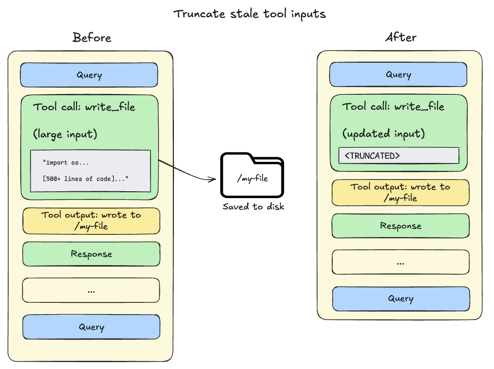
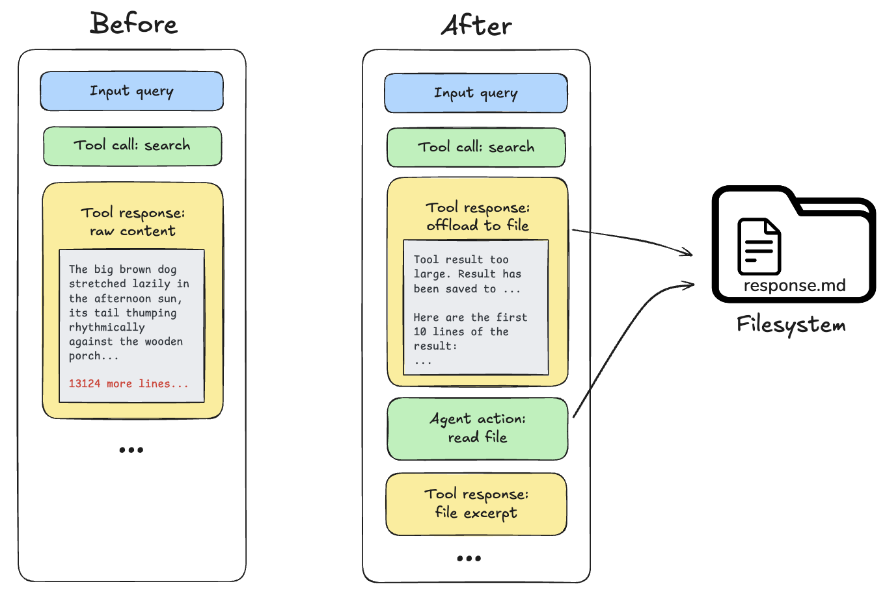
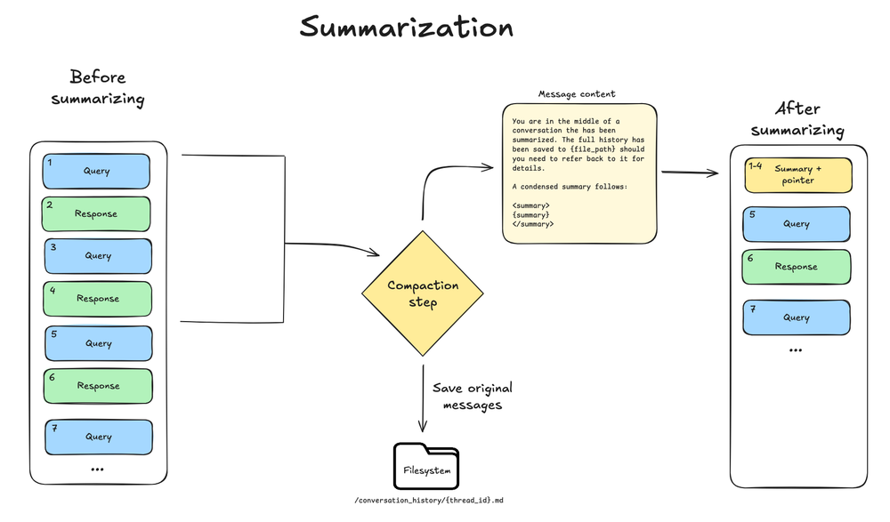

# Context engineering in Deep Agents

> Control what context your deep agent has access to and how it is managed across long-running tasks

Context engineering is providing the right information and tools in the right format so your deep agent can accomplish tasks reliably.

Deep agents have access to several kinds of context.
Some sources are provided to the agent at startup; others become available during runtime, such as user input.
Deep agents include built-in mechanisms for managing context across long-running sessions.

This page provides an overview of the different kinds of context your deep agent has access to and manages.

> [!TIP]
>
> New to context engineering? See the [conceptual overview](https://docs.langchain.com/oss/python/concepts/context.md) for the different types of context and when to use them.

## Types of context

| Context Type | What You Control | Scope |
| - | - | - |
| **[Input context](#input-context)** | What goes into the agent's prompt at startup (system prompt, memory, skills) | Static, applied each run |
| **[Runtime context](#runtime-context)** | Static configuration passed at invoke time (user metadata, API keys, connections) | Per run, propagates to subagents |
| **[Context compression](#context-compression)** | Built-in offloading and summarization to keep context within window limits | Automatic, when limits approached |
| **[Context isolation](#context-isolation-with-subagents)** | Use subagents to quarantine heavy work, returning only results to the main agent | Per subagent, when delegated |
| **[Long-term memory](#long-term-memory)** | Persistent storage across threads using the virtual filesystem | Persistent across conversations |

## Input context

Input context is information provided to your deep agent at startup that becomes part of its system prompt. The final prompt consists of several sources:

> [card] [System prompt](#system-prompt)
>
> Custom instructions you provide plus built-in agent guidance.

> [card] [Memory](#memory)
>
> Persistent `AGENTS.md` files always loaded when configured.

> [card] [Skills](#skills)
>
> On-demand capabilities loaded when relevant (progressive disclosure).

> [card] [Tool prompts](#tool-prompts)
>
> Instructions for using built-in tools or custom tools.

### System prompt

Your custom system prompt is prepended to the built-in system prompt, which includes guidance for filesystem tools and subagents. Use it to define the agent's role, behavior, and knowledge:

```python Google theme={"theme":{"light":"catppuccin-latte","dark":"catppuccin-mocha"}}
from deepagents import create_deep_agent

agent = create_deep_agent(
    model="google_genai:gemini-3.6-flash",
    system_prompt=(
        "You are a research assistant specializing in scientific literature. "
        "Always cite sources. Use subagents for parallel research on different topics."
    ),
)
```

```python OpenAI theme={"theme":{"light":"catppuccin-latte","dark":"catppuccin-mocha"}}
from deepagents import create_deep_agent

agent = create_deep_agent(
    model="openai:gpt-5.5",
    system_prompt=(
        "You are a research assistant specializing in scientific literature. "
        "Always cite sources. Use subagents for parallel research on different topics."
    ),
)
```

```python Anthropic theme={"theme":{"light":"catppuccin-latte","dark":"catppuccin-mocha"}}
from deepagents import create_deep_agent

agent = create_deep_agent(
    model="anthropic:claude-sonnet-5",
    system_prompt=(
        "You are a research assistant specializing in scientific literature. "
        "Always cite sources. Use subagents for parallel research on different topics."
    ),
)
```

```python OpenRouter theme={"theme":{"light":"catppuccin-latte","dark":"catppuccin-mocha"}}
from deepagents import create_deep_agent

agent = create_deep_agent(
    model="openrouter:z-ai/glm-5.2",
    system_prompt=(
        "You are a research assistant specializing in scientific literature. "
        "Always cite sources. Use subagents for parallel research on different topics."
    ),
)
```

```python Fireworks theme={"theme":{"light":"catppuccin-latte","dark":"catppuccin-mocha"}}
from deepagents import create_deep_agent

agent = create_deep_agent(
    model="fireworks:accounts/fireworks/models/glm-5p2",
    system_prompt=(
        "You are a research assistant specializing in scientific literature. "
        "Always cite sources. Use subagents for parallel research on different topics."
    ),
)
```

```python Baseten theme={"theme":{"light":"catppuccin-latte","dark":"catppuccin-mocha"}}
from deepagents import create_deep_agent

agent = create_deep_agent(
    model="baseten:zai-org/GLM-5.2",
    system_prompt=(
        "You are a research assistant specializing in scientific literature. "
        "Always cite sources. Use subagents for parallel research on different topics."
    ),
)
```

```python Ollama theme={"theme":{"light":"catppuccin-latte","dark":"catppuccin-mocha"}}
from deepagents import create_deep_agent

agent = create_deep_agent(
    model="ollama:north-mini-code-1.0",
    system_prompt=(
        "You are a research assistant specializing in scientific literature. "
        "Always cite sources. Use subagents for parallel research on different topics."
    ),
)
```

The `system_prompt` parameter is static which means it does not change per invocation.
For some use cases you may want a dynamic prompt: for example, to tell the model "You have admin access" vs "You have read-only access," or to inject user preferences like "User prefers concise responses" from [long-term memory](#long-term-memory).
If your prompt depends on context or `runtime.store`, use `@dynamic_prompt` to build context-aware instructions. Your middleware can read `request.runtime.context` and `request.runtime.store`.
See [Customization](../Get%20started/Customize%20Deep%20Agents.md#middleware) for the [Deep Agents stack](../Get%20started/Customize%20Deep%20Agents.md#deep-agents-stack) and for adding [custom middleware](https://docs.langchain.com/oss/python/langchain/middleware.md). See the [LangChain context engineering](https://docs.langchain.com/oss/python/langchain/context-engineering.md#system-prompt) guide for examples.

You do **not** need middleware when tools alone use context or `runtime.store`; tools receive the [ToolRuntime](https://reference.langchain.com/python/langchain/tools/#langchain.tools.ToolRuntime) object (including `runtime.context` and `runtime.store`) directly. Add middleware only when tools should be packaged with an update to the system prompt.

> [!TIP]
>
> To adjust the assembled system prompt for a specific provider or model, use a [harness profile](Profiles.md#harness-profiles): `base_system_prompt` replaces the base prompt outright, and `system_prompt_suffix` appends to it.

### Memory

Memory files ([`AGENTS.md`](https://agents.md/)) provide persistent context that is **always loaded** into the system prompt. Use memory for project conventions, user preferences, and critical guidelines that should apply to every conversation:

```python Google theme={"theme":{"light":"catppuccin-latte","dark":"catppuccin-mocha"}}
agent = create_deep_agent(
    model="google_genai:gemini-3.6-flash",
    memory=["/project/AGENTS.md", "~/.deepagents/preferences.md"],
)
```

```python OpenAI theme={"theme":{"light":"catppuccin-latte","dark":"catppuccin-mocha"}}
agent = create_deep_agent(
    model="openai:gpt-5.5",
    memory=["/project/AGENTS.md", "~/.deepagents/preferences.md"],
)
```

```python Anthropic theme={"theme":{"light":"catppuccin-latte","dark":"catppuccin-mocha"}}
agent = create_deep_agent(
    model="anthropic:claude-sonnet-5",
    memory=["/project/AGENTS.md", "~/.deepagents/preferences.md"],
)
```

```python OpenRouter theme={"theme":{"light":"catppuccin-latte","dark":"catppuccin-mocha"}}
agent = create_deep_agent(
    model="openrouter:z-ai/glm-5.2",
    memory=["/project/AGENTS.md", "~/.deepagents/preferences.md"],
)
```

```python Fireworks theme={"theme":{"light":"catppuccin-latte","dark":"catppuccin-mocha"}}
agent = create_deep_agent(
    model="fireworks:accounts/fireworks/models/glm-5p2",
    memory=["/project/AGENTS.md", "~/.deepagents/preferences.md"],
)
```

```python Baseten theme={"theme":{"light":"catppuccin-latte","dark":"catppuccin-mocha"}}
agent = create_deep_agent(
    model="baseten:zai-org/GLM-5.2",
    memory=["/project/AGENTS.md", "~/.deepagents/preferences.md"],
)
```

```python Ollama theme={"theme":{"light":"catppuccin-latte","dark":"catppuccin-mocha"}}
agent = create_deep_agent(
    model="ollama:north-mini-code-1.0",
    memory=["/project/AGENTS.md", "~/.deepagents/preferences.md"],
)
```

Unlike skills, memory is always injected—there is no progressive disclosure. Keep memory minimal to avoid context overload; use [skills](Skills.md) for detailed workflows and domain-specific content. See [Memory](../Get%20started/Customize%20Deep%20Agents.md#memory) for configuration details.

To generate a repository wiki that coding agents discover through `AGENTS.md`, see [OpenWiki](OpenWiki.md).

### Skills

Skills provide **on-demand** capabilities. The agent reads frontmatter from each `SKILL.md` at startup, then loads full skill content only when it determines the skill is relevant. This reduces token usage while still providing specialized workflows:

```python Google theme={"theme":{"light":"catppuccin-latte","dark":"catppuccin-mocha"}}
agent = create_deep_agent(
    model="google_genai:gemini-3.6-flash",
    skills=["/skills/"],
)
```

```python OpenAI theme={"theme":{"light":"catppuccin-latte","dark":"catppuccin-mocha"}}
agent = create_deep_agent(
    model="openai:gpt-5.5",
    skills=["/skills/"],
)
```

```python Anthropic theme={"theme":{"light":"catppuccin-latte","dark":"catppuccin-mocha"}}
agent = create_deep_agent(
    model="anthropic:claude-sonnet-5",
    skills=["/skills/"],
)
```

```python OpenRouter theme={"theme":{"light":"catppuccin-latte","dark":"catppuccin-mocha"}}
agent = create_deep_agent(
    model="openrouter:z-ai/glm-5.2",
    skills=["/skills/"],
)
```

```python Fireworks theme={"theme":{"light":"catppuccin-latte","dark":"catppuccin-mocha"}}
agent = create_deep_agent(
    model="fireworks:accounts/fireworks/models/glm-5p2",
    skills=["/skills/"],
)
```

```python Baseten theme={"theme":{"light":"catppuccin-latte","dark":"catppuccin-mocha"}}
agent = create_deep_agent(
    model="baseten:zai-org/GLM-5.2",
    skills=["/skills/"],
)
```

```python Ollama theme={"theme":{"light":"catppuccin-latte","dark":"catppuccin-mocha"}}
agent = create_deep_agent(
    model="ollama:north-mini-code-1.0",
    skills=["/skills/"],
)
```

Keep each skill focused on a single workflow or domain; broad or overlapping skills dilute relevance and bloat context when loaded. Within a skill, keep the main content concise and move detailed reference material to separate files that are referenced in the skill file. Put always-relevant conventions in [memory](#memory). See [Skills](Skills.md) for authoring and configuration.

### Tool prompts

[Tool](https://docs.langchain.com/oss/python/langchain/tools.md) prompts are instructions that shape how the model uses tools. All tools expose metadata the model sees in its prompt—typically a schema and a description. Tools you pass via the `tools` parameter surface that tool metadata (schema and descriptions) to the model. A deep agent's built-in tools are packaged in the [Deep Agents stack](../Get%20started/Customize%20Deep%20Agents.md#deep-agents-stack) and typically also update the system prompt with more guidance for those tools.

**Built-in tools**: Middleware that adds harness capabilities (filesystem, subagents, and optional planning) automatically appends tool-specific instructions to the system prompt, creating tool prompts that explain how to use those tools effectively. See [Customization](../Get%20started/Customize%20Deep%20Agents.md#middleware) for the full list:

* Filesystem prompt: Documentation for `ls`, `read_file`, `write_file`, `edit_file`, `delete`, `glob`, `grep` (and `execute` when using a sandbox backend)

* Subagent prompt: Guidance for delegating work with the `task` tool

* Human-in-the-loop prompt: Usage for pausing at specified tool calls (when `interrupt_on` is set)

* Local context prompt: Current directory and project info (Deep Agents Code only)

**Tools you provide**: Tools passed via the `tools` parameter get their descriptions (from the tool schema) sent to the model. You can also add [custom middleware](https://docs.langchain.com/oss/python/langchain/middleware.md) that adds tools and appends its own system prompt instructions.

For tools you provide, make sure to provide a clear name, description, and argument descriptions. These guide the model's reasoning about when and how to use the tool. Include *when* to use the tool in the description and describe what each argument does.

```python theme={"theme":{"light":"catppuccin-latte","dark":"catppuccin-mocha"}}
from langchain.tools import tool


@tool(parse_docstring=True)
def search_orders(
    user_id: str,
    status: str,
    limit: int = 10,
) -> str:
    """Search for user orders by status.

    Use this when the user asks about order history or wants to check
    order status. Always filter by the provided status.

    Args:
        user_id: Unique identifier for the user
        status: Order status: 'pending', 'shipped', or 'delivered'
        limit: Maximum number of results to return
    """
    # Implementation here
    return f"orders for {user_id} with status {status} (limit {limit})"
```

> [!TIP]
>
> To override a built-in or user-supplied tool's description for a specific provider or model, use a [harness profile](Profiles.md#harness-profiles)'s `tool_description_overrides` keyed by tool name.
>
> Unused built-in tools still send their full schemas on every turn. Use `excluded_tools` to remove tools the agent should never call (for example `write_file` or `execute` on a read-only agent). That shrinks baseline prompt size for the whole run. It is configuration, not the automatic offloading or summarization in [Context compression](#context-compression).
>
> See [Harness profiles](Profiles.md#harness-profiles) and [Running without the default filesystem tools](../Deep%20Agents%20overview.md#virtual-filesystem-access).
>
> If a tool is related to a skill, you can keep the tool's schema out of the prompt until a skill needs it. For more information, see [Add tools to skills](Skills.md#add-tools-to-skills).

See [Overview](../Deep%20Agents%20overview.md#execution-environment) for built-in capabilities and [Customization](../Get%20started/Customize%20Deep%20Agents.md#tools) for passing tools directly.

### Complete system prompt

The deep agent's system message—the assembled system prompt the model receives at the start of a run—consists of the following parts:

1. Custom `system_prompt` (if provided)
2. [Base agent prompt](https://github.com/langchain-ai/deepagents/blob/e18e9dcd0e6edc72c0a4a5b76ae752c4bc539752/libs/deepagents/deepagents/graph.py#L37)
3. Memory prompt: `AGENTS.md` + memory usage guidelines (only when `memory` provided)
4. Skills prompt: Skills locations + list of skills with frontmatter information + usage (only when skills provided)
5. Virtual filesystem prompt (filesystem + execute tool docs if applicable)
6. Subagent prompt: Task tool usage
7. User-provided middleware prompts (if custom middleware is provided)
8. Human-in-the-loop prompt (when `interrupt_on` is set)

## Runtime context

Runtime context is per-run configuration you pass when you invoke the agent. It is not automatically included in the model prompt; the model only sees it if a tool, middleware, or other logic reads it and adds it to messages or the system prompt. Use runtime context for user metadata (IDs, preferences, roles), API keys, database connections, feature flags, or other values your tools and harness need.

Define the shape of that data with `context_schema`: use a `dataclasses.dataclass` or `typing.TypedDict` class. Pass values with the **`context`** argument to `invoke` / `ainvoke`. See [Runtime](https://docs.langchain.com/oss/python/langchain/runtime.md) and [LangGraph runtime context](https://docs.langchain.com/oss/python/langgraph/graph-api.md#runtime-context) for full detail.

Inside tools, read context from the injected [ToolRuntime](https://reference.langchain.com/python/langchain/tools/#langchain.tools.ToolRuntime):

```python Google theme={"theme":{"light":"catppuccin-latte","dark":"catppuccin-mocha"}}
from dataclasses import dataclass

from deepagents import create_deep_agent
from langchain.tools import ToolRuntime, tool


@dataclass
class Context:
    user_id: str
    api_key: str


@tool
def fetch_user_data(query: str, runtime: ToolRuntime[Context]) -> str:
    """Fetch data for the current user."""
    user_id = runtime.context.user_id
    return f"Data for user {user_id}: {query}"


agent = create_deep_agent(
    model="google_genai:gemini-3.6-flash",
    tools=[fetch_user_data],
    context_schema=Context,
)

result = agent.invoke(
    {"messages": [{"role": "user", "content": "Get my recent activity"}]},
    context=Context(user_id="user-123", api_key="sk-..."),
)
```

```python OpenAI theme={"theme":{"light":"catppuccin-latte","dark":"catppuccin-mocha"}}
from dataclasses import dataclass

from deepagents import create_deep_agent
from langchain.tools import ToolRuntime, tool


@dataclass
class Context:
    user_id: str
    api_key: str


@tool
def fetch_user_data(query: str, runtime: ToolRuntime[Context]) -> str:
    """Fetch data for the current user."""
    user_id = runtime.context.user_id
    return f"Data for user {user_id}: {query}"


agent = create_deep_agent(
    model="openai:gpt-5.5",
    tools=[fetch_user_data],
    context_schema=Context,
)

result = agent.invoke(
    {"messages": [{"role": "user", "content": "Get my recent activity"}]},
    context=Context(user_id="user-123", api_key="sk-..."),
)
```

```python Anthropic theme={"theme":{"light":"catppuccin-latte","dark":"catppuccin-mocha"}}
from dataclasses import dataclass

from deepagents import create_deep_agent
from langchain.tools import ToolRuntime, tool


@dataclass
class Context:
    user_id: str
    api_key: str


@tool
def fetch_user_data(query: str, runtime: ToolRuntime[Context]) -> str:
    """Fetch data for the current user."""
    user_id = runtime.context.user_id
    return f"Data for user {user_id}: {query}"


agent = create_deep_agent(
    model="anthropic:claude-sonnet-5",
    tools=[fetch_user_data],
    context_schema=Context,
)

result = agent.invoke(
    {"messages": [{"role": "user", "content": "Get my recent activity"}]},
    context=Context(user_id="user-123", api_key="sk-..."),
)
```

```python OpenRouter theme={"theme":{"light":"catppuccin-latte","dark":"catppuccin-mocha"}}
from dataclasses import dataclass

from deepagents import create_deep_agent
from langchain.tools import ToolRuntime, tool


@dataclass
class Context:
    user_id: str
    api_key: str


@tool
def fetch_user_data(query: str, runtime: ToolRuntime[Context]) -> str:
    """Fetch data for the current user."""
    user_id = runtime.context.user_id
    return f"Data for user {user_id}: {query}"


agent = create_deep_agent(
    model="openrouter:z-ai/glm-5.2",
    tools=[fetch_user_data],
    context_schema=Context,
)

result = agent.invoke(
    {"messages": [{"role": "user", "content": "Get my recent activity"}]},
    context=Context(user_id="user-123", api_key="sk-..."),
)
```

```python Fireworks theme={"theme":{"light":"catppuccin-latte","dark":"catppuccin-mocha"}}
from dataclasses import dataclass

from deepagents import create_deep_agent
from langchain.tools import ToolRuntime, tool


@dataclass
class Context:
    user_id: str
    api_key: str


@tool
def fetch_user_data(query: str, runtime: ToolRuntime[Context]) -> str:
    """Fetch data for the current user."""
    user_id = runtime.context.user_id
    return f"Data for user {user_id}: {query}"


agent = create_deep_agent(
    model="fireworks:accounts/fireworks/models/glm-5p2",
    tools=[fetch_user_data],
    context_schema=Context,
)

result = agent.invoke(
    {"messages": [{"role": "user", "content": "Get my recent activity"}]},
    context=Context(user_id="user-123", api_key="sk-..."),
)
```

```python Baseten theme={"theme":{"light":"catppuccin-latte","dark":"catppuccin-mocha"}}
from dataclasses import dataclass

from deepagents import create_deep_agent
from langchain.tools import ToolRuntime, tool


@dataclass
class Context:
    user_id: str
    api_key: str


@tool
def fetch_user_data(query: str, runtime: ToolRuntime[Context]) -> str:
    """Fetch data for the current user."""
    user_id = runtime.context.user_id
    return f"Data for user {user_id}: {query}"


agent = create_deep_agent(
    model="baseten:zai-org/GLM-5.2",
    tools=[fetch_user_data],
    context_schema=Context,
)

result = agent.invoke(
    {"messages": [{"role": "user", "content": "Get my recent activity"}]},
    context=Context(user_id="user-123", api_key="sk-..."),
)
```

```python Ollama theme={"theme":{"light":"catppuccin-latte","dark":"catppuccin-mocha"}}
from dataclasses import dataclass

from deepagents import create_deep_agent
from langchain.tools import ToolRuntime, tool


@dataclass
class Context:
    user_id: str
    api_key: str


@tool
def fetch_user_data(query: str, runtime: ToolRuntime[Context]) -> str:
    """Fetch data for the current user."""
    user_id = runtime.context.user_id
    return f"Data for user {user_id}: {query}"


agent = create_deep_agent(
    model="ollama:north-mini-code-1.0",
    tools=[fetch_user_data],
    context_schema=Context,
)

result = agent.invoke(
    {"messages": [{"role": "user", "content": "Get my recent activity"}]},
    context=Context(user_id="user-123", api_key="sk-..."),
)
```

Runtime context **propagates to all subagents**. When a subagent runs, it receives the same runtime context as the parent. See [Subagents](../Delegation/Subagents.md#context-management) for per-subagent context (namespaced keys).

## Custom state schema

> [!NOTE]
>
> Custom state schemas require `deepagents>=0.6.6`.

Use a custom state schema when your agent or middleware needs to track data that must persist across the full agent lifecycle and survive checkpointing. Custom state lets you:

* **Track state across the full run**: Maintain counters, flags, or accumulated values that survive across model calls and tool calls
* **Share data between tools and middleware**: A tool can write a value into state, and middleware hooks can read it, or vice versa
* **Implement cross-cutting concerns**: Add functionality like rate limiting, usage tracking, or audit logging without modifying core agent logic
* **Pass initial values at invoke time**: Seed state fields at the start of each run, then let the agent update them during execution

Use `state_schema` when data must be part of the agent's mutable graph state, checkpointed with the thread, or available through `runtime.state`. For immutable per-run inputs such as user IDs, credentials, or feature flags, prefer [runtime context](#runtime-context).

Custom state schemas must subclass [DeepAgentState](https://reference.langchain.com/python/deepagents/graph/DeepAgentState). This preserves the built-in `DeltaChannel` reducer on `messages`, which keeps checkpoint growth linear as conversations get longer.

```python Google theme={"theme":{"light":"catppuccin-latte","dark":"catppuccin-mocha"}}
from deepagents import DeepAgentState, create_deep_agent
from langchain.tools import ToolRuntime, tool


class ResearchState(DeepAgentState):
    page_url: str
    file_urls: list[str]


@tool
def cite_page(runtime: ToolRuntime) -> str:
    """Return the current page URL."""
    return runtime.state["page_url"]


agent = create_deep_agent(
    model="google_genai:gemini-3.6-flash",
    tools=[cite_page],
    state_schema=ResearchState,
)

result = agent.invoke(
    {
        "messages": [{"role": "user", "content": "Cite the current page"}],
        "page_url": "https://example.com/report",
        "file_urls": [],
    },
)
```

```python OpenAI theme={"theme":{"light":"catppuccin-latte","dark":"catppuccin-mocha"}}
from deepagents import DeepAgentState, create_deep_agent
from langchain.tools import ToolRuntime, tool


class ResearchState(DeepAgentState):
    page_url: str
    file_urls: list[str]


@tool
def cite_page(runtime: ToolRuntime) -> str:
    """Return the current page URL."""
    return runtime.state["page_url"]


agent = create_deep_agent(
    model="openai:gpt-5.5",
    tools=[cite_page],
    state_schema=ResearchState,
)

result = agent.invoke(
    {
        "messages": [{"role": "user", "content": "Cite the current page"}],
        "page_url": "https://example.com/report",
        "file_urls": [],
    },
)
```

```python Anthropic theme={"theme":{"light":"catppuccin-latte","dark":"catppuccin-mocha"}}
from deepagents import DeepAgentState, create_deep_agent
from langchain.tools import ToolRuntime, tool


class ResearchState(DeepAgentState):
    page_url: str
    file_urls: list[str]


@tool
def cite_page(runtime: ToolRuntime) -> str:
    """Return the current page URL."""
    return runtime.state["page_url"]


agent = create_deep_agent(
    model="anthropic:claude-sonnet-5",
    tools=[cite_page],
    state_schema=ResearchState,
)

result = agent.invoke(
    {
        "messages": [{"role": "user", "content": "Cite the current page"}],
        "page_url": "https://example.com/report",
        "file_urls": [],
    },
)
```

```python OpenRouter theme={"theme":{"light":"catppuccin-latte","dark":"catppuccin-mocha"}}
from deepagents import DeepAgentState, create_deep_agent
from langchain.tools import ToolRuntime, tool


class ResearchState(DeepAgentState):
    page_url: str
    file_urls: list[str]


@tool
def cite_page(runtime: ToolRuntime) -> str:
    """Return the current page URL."""
    return runtime.state["page_url"]


agent = create_deep_agent(
    model="openrouter:z-ai/glm-5.2",
    tools=[cite_page],
    state_schema=ResearchState,
)

result = agent.invoke(
    {
        "messages": [{"role": "user", "content": "Cite the current page"}],
        "page_url": "https://example.com/report",
        "file_urls": [],
    },
)
```

```python Fireworks theme={"theme":{"light":"catppuccin-latte","dark":"catppuccin-mocha"}}
from deepagents import DeepAgentState, create_deep_agent
from langchain.tools import ToolRuntime, tool


class ResearchState(DeepAgentState):
    page_url: str
    file_urls: list[str]


@tool
def cite_page(runtime: ToolRuntime) -> str:
    """Return the current page URL."""
    return runtime.state["page_url"]


agent = create_deep_agent(
    model="fireworks:accounts/fireworks/models/glm-5p2",
    tools=[cite_page],
    state_schema=ResearchState,
)

result = agent.invoke(
    {
        "messages": [{"role": "user", "content": "Cite the current page"}],
        "page_url": "https://example.com/report",
        "file_urls": [],
    },
)
```

```python Baseten theme={"theme":{"light":"catppuccin-latte","dark":"catppuccin-mocha"}}
from deepagents import DeepAgentState, create_deep_agent
from langchain.tools import ToolRuntime, tool


class ResearchState(DeepAgentState):
    page_url: str
    file_urls: list[str]


@tool
def cite_page(runtime: ToolRuntime) -> str:
    """Return the current page URL."""
    return runtime.state["page_url"]


agent = create_deep_agent(
    model="baseten:zai-org/GLM-5.2",
    tools=[cite_page],
    state_schema=ResearchState,
)

result = agent.invoke(
    {
        "messages": [{"role": "user", "content": "Cite the current page"}],
        "page_url": "https://example.com/report",
        "file_urls": [],
    },
)
```

```python Ollama theme={"theme":{"light":"catppuccin-latte","dark":"catppuccin-mocha"}}
from deepagents import DeepAgentState, create_deep_agent
from langchain.tools import ToolRuntime, tool


class ResearchState(DeepAgentState):
    page_url: str
    file_urls: list[str]


@tool
def cite_page(runtime: ToolRuntime) -> str:
    """Return the current page URL."""
    return runtime.state["page_url"]


agent = create_deep_agent(
    model="ollama:north-mini-code-1.0",
    tools=[cite_page],
    state_schema=ResearchState,
)

result = agent.invoke(
    {
        "messages": [{"role": "user", "content": "Cite the current page"}],
        "page_url": "https://example.com/report",
        "file_urls": [],
    },
)
```

The schema is merged with state schemas contributed by middleware. Declarative [SubAgent](https://reference.langchain.com/python/deepagents/middleware/subagents/SubAgent) specs passed to `subagents=` inherit the parent `state_schema` when Deep Agents compiles them for the `task` tool. [CompiledSubAgent](https://reference.langchain.com/python/deepagents/middleware/subagents/CompiledSubAgent) runnables and remote [AsyncSubAgent](https://reference.langchain.com/python/deepagents/middleware/async_subagents/AsyncSubAgent) specs do not inherit it because their graphs are already compiled or hosted separately. Compile those graphs with a compatible schema if they need the same state fields.

## Context compression

Every `create_deep_agent` call includes built-in context compression. You do not need to add middleware for offloading or summarization to work.

Long-running tasks produce large tool outputs and long conversation history.
Context compression reduces the size of information in an agent's working memory while preserving details relevant to the task.
The following techniques are the built-in mechanisms to ensure the context passed to LLMs stays within its context window limit:

> [card] [Offloading](#offloading)
>
> Large tool inputs and results are stored in the filesystem and replaced with references.

> [card] [Summarization](#summarization)
>
> Old messages are compressed into an LLM-generated summary when limits are approached.

To shrink the tool schemas sent on every turn before compression ever runs, exclude unused built-in tools via a [harness profile](Profiles.md#harness-profiles) (`excluded_tools`). See [Tool prompts](#tool-prompts).

### Offloading

Deep Agents use the [built-in filesystem tools](../Deep%20Agents%20overview.md#virtual-filesystem-access) to automatically offload content and to search and retrieve that offloaded content as needed.
Content offloading happens when tool call inputs or results exceed a token threshold (default 20,000):

1. **Tool call inputs exceed 20,000 tokens**: File write and edit operations leave behind tool calls containing the complete file content in the agent's conversation history.
   Since this content is already persisted to the filesystem, it's often redundant.
   As the session context crosses 85% of the model's available window, deep agents truncate older tool calls, replacing them with a pointer to the file on disk and reducing the size of the active context.

   

2. **Tool call results exceed 20,000 tokens**: When this occurs, the deep agent offloads the response to the configured backend and substitutes it with a file path reference and a preview of the first 10 lines. Agents can then re-read or search the content as needed.

   

> [!NOTE]
>
> Built-in context compression does not resize images, lower image resolution, or generate visual embeddings. For multimodal inputs, tool outputs, and how compression interacts with media, see [Multimodal](../Execution%20environment/Multimodal%20inputs%20and%20outputs.md).

### Summarization

Every `create_deep_agent` call includes [`SummarizationMiddleware`](https://reference.langchain.com/python/langchain/agents/middleware/summarization/SummarizationMiddleware) in the [bare stack](../Get%20started/Customize%20Deep%20Agents.md#bare-stack). When the context size crosses the model's context window limit (for example 85% of `max_input_tokens`), and there is no more context eligible for offloading, the deep agent summarizes the message history automatically.

This process has two components:

* **In-context summary**: An LLM generates a structured summary of the conversation including session intent, artifacts created, and next steps—which replaces the full conversation history in the agent's working memory.
* **Filesystem preservation**: A text rendering of the original conversation messages is written to the filesystem as a canonical record.

This dual approach ensures the agent maintains awareness of its goals and progress (via the summary) while preserving the ability to recover text details when needed (via filesystem search).

Summarization changes the messages sent to the model, not the persisted `state["messages"]` history. Preserving that history supports replay and evaluation.

For context management in custom middleware, transform the outgoing model request rather than deleting or reordering persisted messages. Reserve history edits for intentional application behavior, not routine context compression. Editing source messages does not regenerate an existing summary.



**Configuration:**

* Triggers at 85% of the model's `max_input_tokens` from its [model profile](https://docs.langchain.com/oss/python/langchain/models.md#model-profiles)
* Keeps 10% of tokens as recent context
* Falls back to 170,000-token trigger / 6 messages kept if model profile is unavailable
* If any model call raises a standard [ContextOverflowError](https://reference.langchain.com/python/langchain-core/exceptions/ContextOverflowError), the deep agent immediately falls back to summarization and retry with summary + recent preserved messages
* Older messages are summarized by the model

To summarize with a different (often cheaper) model or a custom callable, pass `summarizer=` when you [override SummarizationMiddleware](../Get%20started/Customize%20Deep%20Agents.md#override-a-default-middleware-instance). The primary `model` still supplies the profile and token counting. Requires `deepagents>=0.7.26`.

> [!TIP]
>
> [Streaming tokens](../Execution%20environment/Streaming.md#llm-tokens) from the agent will generally include tokens generated by the summarization step. You can filter out these tokens using their associated metadata:
>
> ```python theme={"theme":{"light":"catppuccin-latte","dark":"catppuccin-mocha"}}
> for token, metadata in agent.stream(
>     {"messages": [...]},
>     stream_mode="messages",
> ):
>     if metadata.get("lc_source") == "summarization":  # [!code highlight]
>         continue
>     else:
>         ...
> ```

##### On-demand compaction tool

By default, automatic summarization runs when context thresholds are reached.
Separately, you can give the agent a `compact_conversation` [tool](https://docs.langchain.com/oss/python/langchain/tools.md) so it can trigger compaction on demand, for example between tasks, instead of waiting for the 85% threshold.

Enable the tool by passing [`create_summarization_tool_middleware`](https://reference.langchain.com/python/deepagents/middleware/summarization/create_summarization_tool_middleware) using the `middleware` argument on `create_deep_agent`. Custom middleware is inserted into the [Deep Agents stack](../Get%20started/Customize%20Deep%20Agents.md#deep-agents-stack) after [`PatchToolCallsMiddleware`](https://reference.langchain.com/python/deepagents/middleware/patch_tool_calls/PatchToolCallsMiddleware):

```python Google theme={"theme":{"light":"catppuccin-latte","dark":"catppuccin-mocha"}}
from deepagents import create_deep_agent
from deepagents.backends import StateBackend
from deepagents.middleware.summarization import create_summarization_tool_middleware

backend = StateBackend  # if using default backend

model = "google_genai:gemini-3.6-flash"
agent = create_deep_agent(
    model=model,
    middleware=[  # [!code highlight]
        create_summarization_tool_middleware(model, backend),  # [!code highlight]
    ],  # [!code highlight]
)
```

```python OpenAI theme={"theme":{"light":"catppuccin-latte","dark":"catppuccin-mocha"}}
from deepagents import create_deep_agent
from deepagents.backends import StateBackend
from deepagents.middleware.summarization import create_summarization_tool_middleware

backend = StateBackend  # if using default backend

model = "openai:gpt-5.5"
agent = create_deep_agent(
    model=model,
    middleware=[  # [!code highlight]
        create_summarization_tool_middleware(model, backend),  # [!code highlight]
    ],  # [!code highlight]
)
```

```python Anthropic theme={"theme":{"light":"catppuccin-latte","dark":"catppuccin-mocha"}}
from deepagents import create_deep_agent
from deepagents.backends import StateBackend
from deepagents.middleware.summarization import create_summarization_tool_middleware

backend = StateBackend  # if using default backend

model = "anthropic:claude-sonnet-5"
agent = create_deep_agent(
    model=model,
    middleware=[  # [!code highlight]
        create_summarization_tool_middleware(model, backend),  # [!code highlight]
    ],  # [!code highlight]
)
```

```python OpenRouter theme={"theme":{"light":"catppuccin-latte","dark":"catppuccin-mocha"}}
from deepagents import create_deep_agent
from deepagents.backends import StateBackend
from deepagents.middleware.summarization import create_summarization_tool_middleware

backend = StateBackend  # if using default backend

model = "openrouter:z-ai/glm-5.2"
agent = create_deep_agent(
    model=model,
    middleware=[  # [!code highlight]
        create_summarization_tool_middleware(model, backend),  # [!code highlight]
    ],  # [!code highlight]
)
```

```python Fireworks theme={"theme":{"light":"catppuccin-latte","dark":"catppuccin-mocha"}}
from deepagents import create_deep_agent
from deepagents.backends import StateBackend
from deepagents.middleware.summarization import create_summarization_tool_middleware

backend = StateBackend  # if using default backend

model = "fireworks:accounts/fireworks/models/glm-5p2"
agent = create_deep_agent(
    model=model,
    middleware=[  # [!code highlight]
        create_summarization_tool_middleware(model, backend),  # [!code highlight]
    ],  # [!code highlight]
)
```

```python Baseten theme={"theme":{"light":"catppuccin-latte","dark":"catppuccin-mocha"}}
from deepagents import create_deep_agent
from deepagents.backends import StateBackend
from deepagents.middleware.summarization import create_summarization_tool_middleware

backend = StateBackend  # if using default backend

model = "baseten:zai-org/GLM-5.2"
agent = create_deep_agent(
    model=model,
    middleware=[  # [!code highlight]
        create_summarization_tool_middleware(model, backend),  # [!code highlight]
    ],  # [!code highlight]
)
```

```python Ollama theme={"theme":{"light":"catppuccin-latte","dark":"catppuccin-mocha"}}
from deepagents import create_deep_agent
from deepagents.backends import StateBackend
from deepagents.middleware.summarization import create_summarization_tool_middleware

backend = StateBackend  # if using default backend

model = "ollama:north-mini-code-1.0"
agent = create_deep_agent(
    model=model,
    middleware=[  # [!code highlight]
        create_summarization_tool_middleware(model, backend),  # [!code highlight]
    ],  # [!code highlight]
)
```

Adding the compaction tool does not disable automatic summarization at 85% of the model's context limit. Both share the same summarization engine and state.

See [`SummarizationToolMiddleware`](https://reference.langchain.com/python/deepagents/middleware/summarization/SummarizationToolMiddleware) and [`create_summarization_tool_middleware`](https://reference.langchain.com/python/deepagents/middleware/summarization/create_summarization_tool_middleware) in the API reference for details.

## Context isolation with subagents

Subagents solve the **context bloat problem**. When the main agent uses tools with large outputs (web search, file reads, database queries), the context window fills quickly. Subagents isolate this work—the main agent receives only the final result, not the dozens of tool calls that produced it. You can also configure each subagent separately from the main agent (for example, model, tools, system prompt, and skills).

**How it works:**

* Main agent has a `task` tool to delegate work
* Subagent runs with its own fresh context
* Subagent executes autonomously until completion
* Subagent returns a single final report to the main agent
* Main agent's context stays clean

**Best practices:**

1. **Delegate complex tasks**: Use subagents for multi-step work that would clutter the main agent's context.

2. **Keep subagent responses concise**: Instruct subagents to return summaries, not raw data:

   ```python theme={"theme":{"light":"catppuccin-latte","dark":"catppuccin-mocha"}}
   research_subagent = {
       "name": "researcher",
       "description": "Conducts research on a topic",
       "system_prompt": """You are a research assistant.
       IMPORTANT: Return only the essential summary (under 500 words).
       Do NOT include raw search results or detailed tool outputs.""",
       "tools": [web_search],
   }
   ```

3. **Use the filesystem for large data**: Subagents can write results to files; the main agent reads what it needs.

See [Subagents](../Delegation/Subagents.md) for configuration and [context management](../Delegation/Subagents.md#context-management) for runtime context propagation and per-subagent namespacing.

## Long-term memory

When using the default filesystem, your deep agent stores its working memory files in agent state, which only persists within a single thread.
Long-term memory enables your deep agent to persist information across different threads and conversations.
Deep agents can use long-term memory for storing user preferences, accumulated knowledge, research progress, or any information that should persist beyond a single session.

To use long-term memory, you must use a `CompositeBackend` that routes specific paths (typically `/memories/`) to a LangGraph Store, which provides durable cross-thread persistence.
The `CompositeBackend` is a hybrid storage system where some files persist indefinitely while others remain scoped to a single thread.

```python Google theme={"theme":{"light":"catppuccin-latte","dark":"catppuccin-mocha"}}
from deepagents import create_deep_agent
from deepagents.backends import CompositeBackend, StateBackend, StoreBackend
from langgraph.store.memory import InMemoryStore

store = InMemoryStore()

agent = create_deep_agent(
    model="google_genai:gemini-3.6-flash",
    store=store,
    backend=CompositeBackend(
        default=StateBackend(),
        routes={
            "/memories/": StoreBackend(namespace=lambda _rt: ("memories",)),
        },
    ),
    system_prompt="""When users tell you their preferences, save them to
    /memories/user_preferences.txt so you remember them in future conversations.""",
)
```

```python OpenAI theme={"theme":{"light":"catppuccin-latte","dark":"catppuccin-mocha"}}
from deepagents import create_deep_agent
from deepagents.backends import CompositeBackend, StateBackend, StoreBackend
from langgraph.store.memory import InMemoryStore

store = InMemoryStore()

agent = create_deep_agent(
    model="openai:gpt-5.5",
    store=store,
    backend=CompositeBackend(
        default=StateBackend(),
        routes={
            "/memories/": StoreBackend(namespace=lambda _rt: ("memories",)),
        },
    ),
    system_prompt="""When users tell you their preferences, save them to
    /memories/user_preferences.txt so you remember them in future conversations.""",
)
```

```python Anthropic theme={"theme":{"light":"catppuccin-latte","dark":"catppuccin-mocha"}}
from deepagents import create_deep_agent
from deepagents.backends import CompositeBackend, StateBackend, StoreBackend
from langgraph.store.memory import InMemoryStore

store = InMemoryStore()

agent = create_deep_agent(
    model="anthropic:claude-sonnet-5",
    store=store,
    backend=CompositeBackend(
        default=StateBackend(),
        routes={
            "/memories/": StoreBackend(namespace=lambda _rt: ("memories",)),
        },
    ),
    system_prompt="""When users tell you their preferences, save them to
    /memories/user_preferences.txt so you remember them in future conversations.""",
)
```

```python OpenRouter theme={"theme":{"light":"catppuccin-latte","dark":"catppuccin-mocha"}}
from deepagents import create_deep_agent
from deepagents.backends import CompositeBackend, StateBackend, StoreBackend
from langgraph.store.memory import InMemoryStore

store = InMemoryStore()

agent = create_deep_agent(
    model="openrouter:z-ai/glm-5.2",
    store=store,
    backend=CompositeBackend(
        default=StateBackend(),
        routes={
            "/memories/": StoreBackend(namespace=lambda _rt: ("memories",)),
        },
    ),
    system_prompt="""When users tell you their preferences, save them to
    /memories/user_preferences.txt so you remember them in future conversations.""",
)
```

```python Fireworks theme={"theme":{"light":"catppuccin-latte","dark":"catppuccin-mocha"}}
from deepagents import create_deep_agent
from deepagents.backends import CompositeBackend, StateBackend, StoreBackend
from langgraph.store.memory import InMemoryStore

store = InMemoryStore()

agent = create_deep_agent(
    model="fireworks:accounts/fireworks/models/glm-5p2",
    store=store,
    backend=CompositeBackend(
        default=StateBackend(),
        routes={
            "/memories/": StoreBackend(namespace=lambda _rt: ("memories",)),
        },
    ),
    system_prompt="""When users tell you their preferences, save them to
    /memories/user_preferences.txt so you remember them in future conversations.""",
)
```

```python Baseten theme={"theme":{"light":"catppuccin-latte","dark":"catppuccin-mocha"}}
from deepagents import create_deep_agent
from deepagents.backends import CompositeBackend, StateBackend, StoreBackend
from langgraph.store.memory import InMemoryStore

store = InMemoryStore()

agent = create_deep_agent(
    model="baseten:zai-org/GLM-5.2",
    store=store,
    backend=CompositeBackend(
        default=StateBackend(),
        routes={
            "/memories/": StoreBackend(namespace=lambda _rt: ("memories",)),
        },
    ),
    system_prompt="""When users tell you their preferences, save them to
    /memories/user_preferences.txt so you remember them in future conversations.""",
)
```

```python Ollama theme={"theme":{"light":"catppuccin-latte","dark":"catppuccin-mocha"}}
from deepagents import create_deep_agent
from deepagents.backends import CompositeBackend, StateBackend, StoreBackend
from langgraph.store.memory import InMemoryStore

store = InMemoryStore()

agent = create_deep_agent(
    model="ollama:north-mini-code-1.0",
    store=store,
    backend=CompositeBackend(
        default=StateBackend(),
        routes={
            "/memories/": StoreBackend(namespace=lambda _rt: ("memories",)),
        },
    ),
    system_prompt="""When users tell you their preferences, save them to
    /memories/user_preferences.txt so you remember them in future conversations.""",
)
```

You do not need to pre-populate `/memories/` with files.
You provide the backend config, store, and system prompt instructions that tell the agent *what* to save and *where*.
For example, you may prompt the agent to store preferences in `/memories/preferences.txt`.
The path starts empty and the agent creates files on demand using its filesystem tools (`write_file`, `edit_file`) when users share information worth remembering.

To pre-seed memories, use the [Store API](https://docs.langchain.com/langsmith/custom-store.md) when deploying on LangSmith.
See [Long-term memory](Memory.md) for setup and use cases.

## Best practices

1. **Start with the right input context**: Keep memory minimal for always-relevant conventions; use focused skills for task-specific capabilities.
2. **Leverage subagents for heavy work**: Delegate multi-step, output-heavy tasks to keep the main agent's context clean.
3. **Adjust subagent outputs in configuration**: If you notice when debugging that subagents generate long output, you can add guidance to the subagent's `system_prompt` to create summaries and synthesized findings.
4. **Use the filesystem**: Persist large outputs to files (for example subagent writes or [automatic offloading](#offloading)) so the active context stays small; the model can pull in fragments with `read_file` and `grep` when it needs details.
5. **Document long-term memory structure**: Tell the agent what lives in `/memories/` and how to use it.
6. **Pass runtime context for tools**: Use `context` for user metadata, API keys, and other static configuration that tools need.

## Related resources

* [Harness](../Deep%20Agents%20overview.md): Context management overview, offloading,
  summarization
* [Multimodal](../Execution%20environment/Multimodal%20inputs%20and%20outputs.md): images, audio, video, and multimodal tool outputs
* [Subagents](../Delegation/Subagents.md): Context isolation, runtime context propagation
* [Long-term memory](Memory.md): Cross-thread persistence
* * [OpenWiki](OpenWiki.md): Repository wikis that coding agents find through `AGENTS.md`
* [Skills](Skills.md): Progressive disclosure and skill authoring
* [Backends](../Execution%20environment/Backends.md): Filesystem backends and CompositeBackend
* [Context conceptual overview](https://docs.langchain.com/oss/python/concepts/context.md): Context types and lifecycle

***

[Connect these docs](https://docs.langchain.com/use-these-docs.md) to your agent of choice via MCP for real-time answers.

[Edit this page on GitHub](https://github.com/langchain-ai/docs/edit/main/src/oss/deepagents/context-engineering.mdx) or [file an issue](https://github.com/langchain-ai/docs/issues/new/choose).
