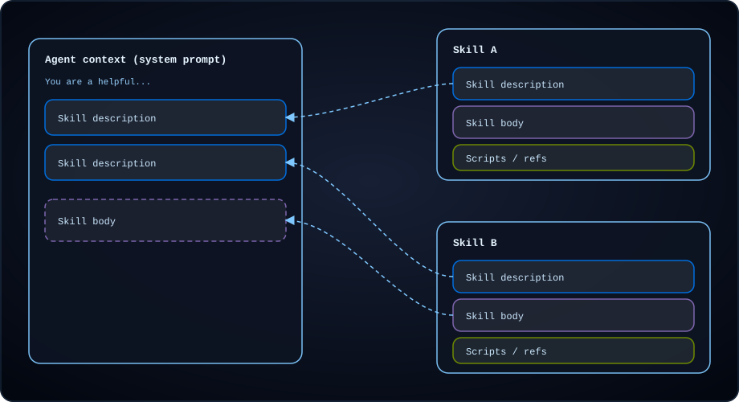
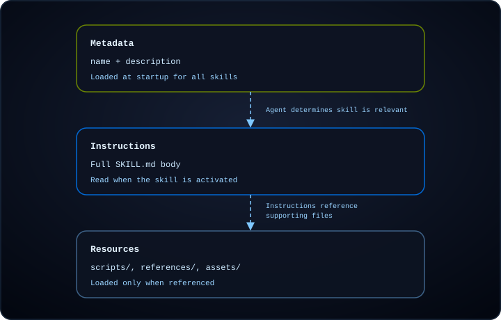

# Skills

> Learn how to extend your deep agent's capabilities with skills

Skills package domain expertise, such as workflows, best practices, scripts, reference docs, and templates, into reusable directories. The agent gets a summary of the contents on startup and discovers and reads the contained files only when relevant.

Skills help you avoid context bloat by loading only summaries at startup and reading full instructions when a task requires them. You can share skills across agents and projects, and compose multiple skills in a single agent so each one covers a distinct capability.

> [!TIP]
>
> For ready-to-use skills that improve your agent's performance on LangChain ecosystem tasks, see the [LangChain Skills](https://github.com/langchain-ai/langchain-skills) repository.

## Usage

**1. Create a top-level skills directory**

Create a directory to hold all skills for your project, such as `skills/` under your backend root.

**2. Create a subdirectory inside your skills directory for your skill**

Each skill is a directory containing a `SKILL.md` file: a markdown file with YAML [frontmatter](#frontmatter-fields) (`name` and `description`) followed by instructions the agent follows when the skill is activated. A skill directory can also optionally include supporting files such as scripts, reference docs, and templates.

**skills**

**langgraph-docs**

**SKILL.md**

**scripts**

**fetch\_docs.py**

**references**

**api-patterns.md**

**style-guide.md**

**assets**

**report-template.md**

**schema.json**

Deep agent skills follow the [Agent Skills specification](https://agentskills.io/specification).

**3. Add a `SKILL.md` file with YAML frontmatter and instructions.**

The `SKILL.md` starts with YAML [frontmatter](#frontmatter-fields) followed by markdown instructions:

```md theme={"theme":{"light":"catppuccin-latte","dark":"catppuccin-mocha"}}
---
name: langgraph-docs
description: Use this skill for requests related to LangGraph in order to fetch relevant documentation to provide accurate, up-to-date guidance.
---

# langgraph-docs

## Overview

This skill explains how to access LangGraph documentation to help answer questions and guide implementation.

## Instructions

### 1. Fetch the documentation index

Use the fetch_url tool to read the following URL:
https://docs.langchain.com/llms.txt

This provides a structured list of all available documentation with descriptions.

### 2. Select relevant documentation

Based on the question, identify 2-4 most relevant documentation URLs from the index. Prioritize:

- Specific how-to guides for implementation questions
- Core concept pages for understanding questions
- Tutorials for end-to-end examples
- Reference docs for API details

### 3. Fetch and synthesize

Use the fetch_url tool to read the selected documentation URLs, then answer the user's question. Give a direct answer first, include the minimum necessary context, and link to the source pages rather than quoting long passages.
```

> [!NOTE]
>
> Reference any [supporting resources](#add-supporting-resources) in your `SKILL.md` with a description of what each file contains and when to use it. The agent discovers these files through the references in the skill instructions.

**4. Pass the skills path when creating your agent**

Pass the path to your top-level skills directory in the `skills` argument when creating your agent:

```python theme={"theme":{"light":"catppuccin-latte","dark":"catppuccin-mocha"}}
from deepagents import create_deep_agent
from deepagents.backends.filesystem import FilesystemBackend

backend = FilesystemBackend(root_dir="./my-project")

agent = create_deep_agent(
    model="anthropic:claude-sonnet-4-6",
    backend=backend,
    skills=["./my-project/skills/"],
)
```

This example uses `FilesystemBackend` to load skills from disk. For other storage options, including loading skills from remote sources, see [Backends and remote skill loading](#backends-and-remote-skill-loading).

Point each source path at a directory that contains skill directories. A path that points directly at a skill directory with `SKILL.md` is not loaded.

**skills** `list[str]`

List of skill source paths.

Paths must be specified using forward slashes and are relative to the backend's root.

* If omitted, no skills are loaded.
* When using `StateBackend` (default), provide skill files with `invoke(files={...})`. Use `create_file_data()` from `deepagents.backends.utils` to format file contents; raw strings are not supported.
* With `FilesystemBackend` and `StoreBackend`, create the backend, call `backend.upload_files()` to add skill files, then pass the backend to `create_deep_agent`. For `FilesystemBackend`, use `virtual_mode=True` to sandbox paths under `root_dir`. Skills already on disk under `root_dir` load without uploading.

Later sources override earlier ones for skills with the same name (last one wins).

> [!NOTE]
>
> When multiple skill sources contain a skill with the same name, the skill from the source listed later in the `skills` array takes precedence (last one wins). This lets you layer skills from different origins, such as base skills overridden by project-specific versions.

**5. Invoke the agent**

Send a task to the agent with `invoke()`. At startup, the agent loads each skill's [`name`](#frontmatter-fields) and [`description`](#frontmatter-fields) from [frontmatter](#frontmatter-fields) into the system prompt. When your task matches a skill's description, the agent reads that skill's `SKILL.md` and follows its instructions.

```python theme={"theme":{"light":"catppuccin-latte","dark":"catppuccin-mocha"}}
result = agent.invoke(
    {"messages": [{"role": "user", "content": "What is LangGraph?"}]},
    config={"configurable": {"thread_id": "1"}},
)
```

## How skills work

As agents take on more complex tasks, the context they need grows with them. Loading all instructions into the system prompt wastes tokens on information irrelevant to the current task, and providing the same guidance manually across sessions does not scale.

> [!NOTE]
>
> Skills use **progressive disclosure**: the agent loads skill information in layers instead of all at once. At startup, it sees only each skill's name and description. When a skill is invoked, it reads the full `SKILL.md` instructions. Supporting files load afterward, only when the instructions call for them.

Skills load in three levels. Each level adds more detail only when the task needs it:

| Level | What loads | When |
| - | - | - |
| **1. Metadata** | [`name`](#frontmatter-fields) and [`description`](#frontmatter-fields) from `SKILL.md` [frontmatter](#frontmatter-fields) | Agent startup, for every configured skill |
| **2. Instructions** | Full `SKILL.md` body | When the skill is invoked |
| **3. Resources** | [Supporting files](#add-supporting-resources) under `scripts/`, `references/`, and `assets/` | As needed after invocation, when the instructions reference them |

The following diagram shows what appears in agent context at a given moment. At startup, level 1 metadata for every skill is in the system prompt. When a skill is invoked, level 2 instructions join the context. Level 3 files stay on the backend until the agent reads them after invocation.



As the agent works through a task, it loads skill information in layers:



In Deep Agents, [`SkillsMiddleware`](https://reference.langchain.com/python/deepagents/middleware/skills/SkillsMiddleware) (part of the [Deep Agents stack](../Get%20started/Customize%20Deep%20Agents.md#deep-agents-stack) when you pass `skills`) handles the first two levels, with the third level being handled by the LLM:

1. **Discovery** (level 1): At agent start, the middleware scans the configured skill paths, parses each `SKILL.md` [frontmatter](#frontmatter-fields), and injects the [`name`](#frontmatter-fields) and [`description`](#frontmatter-fields) fields into the system prompt.
2. **Read** (level 2): When the agent invokes a skill, it reads the full `SKILL.md` content via `read_file`.
3. **Execute** (level 3): After invocation, the agent follows the skill's instructions and reads supporting files (scripts, references, assets) only as the instructions require.

To give the agent a skill's instructions without waiting for it to choose the skill, [pin the skill](#pin-skills).

## When to use skills

If you find yourself giving similar instructions to an agent, especially if they are detailed and contain multiple steps, consider codifying the instructions for the agent. That way, in future when you want to accomplish a similar task, the agent will already know what to do.

> [!TIP]
>
> You can also ask your agent to write a skill for a task you worked on with the agent.

Skills are especially helpful for codifying:

* **Step-by-step workflows**: Workflows that span multiple steps, similar to recipes.
* **Domain-specific knowledge**: Instruct the agent on how to use tools for the workflow. For example, include information on where to pull information from, including other reference information or scripts that the skill may have access to.
* **Instructions with executable code**: Bundle procedures with scripts or modules the agent can run, so it follows tested logic instead of regenerating it from instructions each time. See [Execute code with skills](#execute-code-with-skills).
* **Guidelines**: Provide the agent with supporting instructions about guardrails to adhere to. For example, following a specific format or style guide, or specifying to always run tests as part of the workflow.

## Write effective skills

The [Agent Skills specification](https://agentskills.io/specification) includes guidance on structuring skills for reliable discovery and activation. The following recommendations build on that foundation with practical patterns for Deep Agents.

**Keep [frontmatter](#frontmatter-fields) concise** and the `SKILL.md` body under 5,000 tokens. Every skill's frontmatter is added to the system prompt at [discovery](#how-skills-work), while the full body is only read when activated. Keeping both layers small means you can load many skills without crowding the context window.

**Write specific descriptions.** During [discovery](#how-skills-work), the [`description`](#frontmatter-fields) field is the only information the agent sees for each skill. A good description tells the agent both what the skill does and when to activate it, with specific keywords the agent can match against:

```yaml theme={"theme":{"light":"catppuccin-latte","dark":"catppuccin-mocha"}}
# Good: specific about what and when
description: >-
  Extract text and tables from PDF files, fill PDF forms, and merge
  multiple PDFs. Use when working with PDF documents or when the user
  mentions PDFs, forms, or document extraction.

# Poor: too vague for reliable matching
description: Helps with PDFs.
```

When you have multiple skills in related domains, differentiate their descriptions clearly. Overlapping descriptions cause the agent to activate the wrong skill or hesitate between options. If two skills serve similar purposes, consolidate them into one.

**Keep instructions focused.** The Agent Skills specification recommends keeping your `SKILL.md` under 500 lines. When instructions grow longer, move detailed reference material into [supporting resource files](#add-supporting-resources) and reference them from the main `SKILL.md`:

**skills**

**data-pipeline**

**SKILL.md**

**references**

**schema-reference.md**

**error-codes.md**

The agent loads reference files only when the instructions call for them, keeping each layer of progressive disclosure appropriately sized. Keep file references one level deep from `SKILL.md` and avoid deeply nested reference chains, which force the agent through multiple reads to reach the information it needs.

**Structure instructions for the agent.** Write your `SKILL.md` body as clear instructions the agent can follow:

* **Step-by-step procedures** for multi-step workflows
* **Decision criteria** for choosing between approaches
* **Examples of expected inputs and outputs** so the agent knows what success looks like
* **Edge cases** the agent should handle or flag to the user

**Manage skill count.** Fewer well-scoped skills outperform many overlapping ones. As the number of skills with similar descriptions grows, the agent's ability to select the right one degrades. If you find yourself with many related skills, consider:

* Consolidating related capabilities into a single skill with sections for each sub-task
* Using reference files to keep the main `SKILL.md` concise while covering multiple sub-tasks

> [!TIP]
>
> Use the [`skills-ref` validation tool](https://github.com/agentskills/agentskills/tree/main/skills-ref) to check that your `SKILL.md` [frontmatter](#frontmatter-fields) follows the Agent Skills specification naming and format conventions.

## Add supporting resources

Beyond `SKILL.md`, a skill directory can include any additional files or directories. The [Agent Skills specification](https://agentskills.io/specification) defines three optional directories for common resource types. Deep Agents does not load these files at discovery or activation. The agent reads or executes them only when your `SKILL.md` instructions say to.

### `scripts/`

The `scripts/` directory holds executable code the agent can run, such as API clients, data transforms, or validation checks. Scripts should:

* Be self-contained or clearly document dependencies
* Include helpful error messages
* Handle edge cases gracefully

Supported languages depend on your agent setup. Common options include Python, Bash, and JavaScript or TypeScript. To execute scripts rather than only read them, see [Execute code with skills](#execute-code-with-skills). Use [sandbox scripts](#sandbox-scripts) when the agent needs a shell.

### `references/`

The `references/` directory holds supplementary documentation the agent reads on demand. Use it for material that is too detailed for `SKILL.md` but still task-specific, such as:

* `REFERENCE.md` for detailed technical reference
* `FORMS.md` for form templates or structured data formats
* Domain-specific guides (`finance.md`, `legal.md`, and similar)

Keep individual reference files focused. The agent loads them only when needed, so smaller files use less context.

### `assets/`

The `assets/` directory holds static resources the agent uses but does not need to read as instructions, such as:

* Document or configuration templates
* Images (diagrams, examples)
* Data files (lookup tables, schemas)

Describe in `SKILL.md` when the agent should open or copy each asset.

### Reference files from `SKILL.md`

When you reference supporting files, use paths relative to the skill root:

```md theme={"theme":{"light":"catppuccin-latte","dark":"catppuccin-mocha"}}
For API details, see the [reference guide](references/api-patterns.md).

To extract tables from a PDF, run:
scripts/extract.py
```

For each file you reference, state what it contains and when the agent should use it. Keep references one level deep from `SKILL.md`. Avoid deeply nested reference chains that force the agent through multiple reads to reach the information it needs.

## Add tools to skills

A skill can bring its own tools. The agent sees them only after it reads the skill, so their schemas stay out of the prompt until a task needs them.

Skill tools are a Deep Agents feature, not part of the [Agent Skills specification](https://agentskills.io/specification). Deep Agents reads the tool names from the spec's free-form `metadata` field. They are unrelated to the spec's `allowed-tools` field, which pre-approves tools rather than adding them.

> [!NOTE]
>
> Skill tools require `deepagents>=0.7.22`.

List the tools under `metadata.include_tools` in the skill's frontmatter, separated by spaces. A YAML list does not match any tool.

```yaml theme={"theme":{"light":"catppuccin-latte","dark":"catppuccin-mocha"}}
name: linear
description: Triage and file Linear issues. Use when the user reports a bug or asks about the Linear backlog.
metadata:
  include_tools: list_issues create_issue
```

Passing `skills` to `create_deep_agent` creates a `SkillsMiddleware` for you. To add tools, create the middleware yourself and pass it in `middleware` instead. Give it your skill paths as `sources`, and your tools as `tools` on the middleware rather than on the agent:

```python theme={"theme":{"light":"catppuccin-latte","dark":"catppuccin-mocha"}}
from deepagents import create_deep_agent
from deepagents.backends.filesystem import FilesystemBackend
from deepagents.middleware import SkillsMiddleware
from langchain.tools import tool


@tool
def list_issues(team: str) -> str:
    """List open issues for a Linear team."""
    return f"{team}-101: Login page times out"


@tool
def create_issue(team: str, title: str) -> str:
    """Create a Linear issue and return its ID."""
    return f"{team}-102: {title}"


backend = FilesystemBackend(root_dir="./my-project", virtual_mode=True)

agent = create_deep_agent(
    model="anthropic:claude-sonnet-4-6",
    backend=backend,
    middleware=[
        SkillsMiddleware(
            backend=backend,
            sources=["/skills/"],
            tools=[list_issues, create_issue],
        ),
    ],
)
```

Skill tools follow these rules:

* Skill tools are gated. Until the agent reads the skill's `SKILL.md`, a call to one fails as an unknown tool, even if the model guesses its name and arguments.
* When [summarization](Context%20engineering%20in%20Deep%20Agents.md#summarization) drops that read from the conversation, the tool is unavailable until the agent reads the skill again.
* [Pinning a skill](#pin-skills) makes its tools available the same way reading its `SKILL.md` does. They stay available until summarization drops the pinned skill's message.

> [!NOTE]
>
> On models that accept new tools mid-conversation, Deep Agents adds a skill tool after the read, which keeps the prompt cache valid. On other models, it adds the tool to the request's `tools`, which invalidates the cache. See the [Anthropic](https://docs.langchain.com/oss/python/integrations/chat/anthropic#change-tools-mid-conversation) and [OpenAI](https://docs.langchain.com/oss/python/integrations/chat/openai#add-tools-mid-conversation) integration pages.

### Resolve tools at runtime

The names in `include_tools` do not have to match a tool's own name. A generated tool name such as `mcp_linear_list_issues_ab12` is hard to write by hand, and may not stay the same.

To map the names a skill lists to tools, pass a resolver function as the middleware's `tools`. The resolver receives each `include_tools` name and the graph's `Runtime`, and returns the tools for that name.

The skill lists readable names:

```yaml theme={"theme":{"light":"catppuccin-latte","dark":"catppuccin-mocha"}}
metadata:
  include_tools: list_issues create_issue
```

The resolver maps each one to its real tool:

```python theme={"theme":{"light":"catppuccin-latte","dark":"catppuccin-mocha"}}
from deepagents import create_deep_agent
from deepagents.middleware import SkillsMiddleware
from langchain.tools import BaseTool
from langgraph.runtime import Runtime

# Real names like "mcp_linear_list_issues_ab12"
tools_by_name = {"list_issues": list_issues, "create_issue": create_issue}


def resolve_skill_tools(name: str, runtime: Runtime) -> list[BaseTool]:
    return [tools_by_name[name]] if name in tools_by_name else []


agent = create_deep_agent(
    model="anthropic:claude-sonnet-4-6",
    backend=backend,
    middleware=[
        SkillsMiddleware(
            backend=backend,
            sources=["/skills/"],
            tools=resolve_skill_tools,
        ),
    ],
)
```

One name can also stand for many tools, such as every tool from the Linear MCP server. List one name in the skill:

```yaml theme={"theme":{"light":"catppuccin-latte","dark":"catppuccin-mocha"}}
metadata:
  include_tools: linear
```

Then return all of the server's tools from the resolver:

```python theme={"theme":{"light":"catppuccin-latte","dark":"catppuccin-mocha"}}
# Every tool from the Linear MCP server
tools_by_integration = {"linear": linear_tools}


def resolve_skill_tools(name: str, runtime: Runtime) -> list[BaseTool]:
    return tools_by_integration.get(name, [])
```

The resolver also receives the graph's `Runtime`, so it can return different tools for each run based on [runtime context](Context%20engineering%20in%20Deep%20Agents.md#runtime-context). For example, look up tools by user:

```python theme={"theme":{"light":"catppuccin-latte","dark":"catppuccin-mocha"}}
from dataclasses import dataclass

from deepagents import create_deep_agent
from deepagents.middleware import SkillsMiddleware
from langchain.tools import BaseTool
from langgraph.runtime import Runtime


@dataclass
class Context:
    user_id: str


def resolve_skill_tools(name: str, runtime: Runtime[Context]) -> list[BaseTool]:
    if name != "linear":
        return []
    return linear_tools_for_user(runtime.context.user_id)


agent = create_deep_agent(
    model="anthropic:claude-sonnet-4-6",
    backend=backend,
    context_schema=Context,
    middleware=[
        SkillsMiddleware(
            backend=backend,
            sources=["/skills/"],
            tools=resolve_skill_tools,
        ),
    ],
)

result = agent.invoke(
    {"messages": [{"role": "user", "content": "File a bug: checkout button does nothing."}]},
    context=Context(user_id="user-123"),
)
```

When you write a resolver:

* Keep it fast. It runs on every model call after the agent reads the skill, and again before each skill tool call.
* The resolver can be async. If it is, run the agent through its async methods, such as `ainvoke`.

### Keep a tool searchable

Skill tools, the ones you pass to `SkillsMiddleware`, are reachable only through their skill. With [`ProviderToolSearchMiddleware`](https://reference.langchain.com/python/langchain/agents/middleware/provider_tool_search/ProviderToolSearchMiddleware), the model finds [deferred tools](../Middleware/Prebuilt%20middleware.md#provider-tool-search), marked with `extras={"defer_loading": True}`, by searching for them. To make a tool reachable either way, through search or by reading a skill, pass it to the agent's `tools` and defer it. Reading the skill then reveals it without a search:

```python theme={"theme":{"light":"catppuccin-latte","dark":"catppuccin-mocha"}}
from deepagents import create_deep_agent
from deepagents.middleware import SkillsMiddleware
from langchain.agents.middleware import ProviderToolSearchMiddleware
from langchain.tools import tool


@tool(extras={"defer_loading": True})
def create_issue(team: str, title: str) -> str:
    """Create a Linear issue and return its ID."""
    return f"{team}-102: {title}"


agent = create_deep_agent(
    model="anthropic:claude-sonnet-4-6",
    backend=backend,
    tools=[create_issue],
    middleware=[
        ProviderToolSearchMiddleware(),
        SkillsMiddleware(backend=backend, sources=["/skills/"]),
    ],
)
```

Unlike a skill tool, a deferred tool is not gated. The model can find and call it through search before the agent reads the skill.

How the agent reaches a tool depends on where you pass it:

| Pass the tool to | Before the agent reads the skill | After the agent reads the skill |
| - | - | - |
| `SkillsMiddleware(tools=...)` | Hidden, and calls fail | Visible |
| The agent's `tools`, deferred | Available through provider tool search | Visible without a search |
| The agent's `tools` | Visible, so `include_tools` has no effect | Visible |

When a skill lists a tool the agent already has, including built-in tools such as `edit_file`, Deep Agents uses the agent's tool, not one with the same name in `SkillsMiddleware`.

## Backends and remote skill loading

Deep Agents supports different backends depending on how you want to store and manage skill files:

* `StateBackend`: Stores files in LangGraph agent state for the current thread.
* `StoreBackend`: Stores files in a LangGraph store for durable, cross-thread storage.
* `FilesystemBackend`: Reads and writes skill files from disk under a configurable `root_dir`.

> [tab] StateBackend
>
> ```python Google theme={"theme":{"light":"catppuccin-latte","dark":"catppuccin-mocha"}}
> from urllib.request import urlopen
> from deepagents import create_deep_agent
> from deepagents.backends import StateBackend
> from deepagents.backends.utils import create_file_data
> from langgraph.checkpoint.memory import MemorySaver
>
> checkpointer = MemorySaver()
> backend = StateBackend()
>
> skill_url = "https://raw.githubusercontent.com/langchain-ai/deepagents/refs/heads/main/libs/code/examples/skills/langgraph-docs/SKILL.md"
> with urlopen(skill_url) as response:
>     skill_content = response.read().decode('utf-8')
>
> skills_files = {
>     "/skills/langgraph-docs/SKILL.md": create_file_data(skill_content),
> }
>
> agent = create_deep_agent(
>     model="google_genai:gemini-3.6-flash",
>     backend=backend,
>     skills=["/skills/"],
>     checkpointer=checkpointer,
> )
>
> result = agent.invoke(
>     {
>         "messages": [{"role": "user", "content": "What is langgraph?"}],
>         # Seed the default StateBackend's in-state filesystem (virtual paths must start with "/").
>         "files": skills_files,
>     },
>     config={"configurable": {"thread_id": "12345"}},
> )
> ```
>
> ```python OpenAI theme={"theme":{"light":"catppuccin-latte","dark":"catppuccin-mocha"}}
> from urllib.request import urlopen
> from deepagents import create_deep_agent
> from deepagents.backends import StateBackend
> from deepagents.backends.utils import create_file_data
> from langgraph.checkpoint.memory import MemorySaver
>
> checkpointer = MemorySaver()
> backend = StateBackend()
>
> skill_url = "https://raw.githubusercontent.com/langchain-ai/deepagents/refs/heads/main/libs/code/examples/skills/langgraph-docs/SKILL.md"
> with urlopen(skill_url) as response:
>     skill_content = response.read().decode('utf-8')
>
> skills_files = {
>     "/skills/langgraph-docs/SKILL.md": create_file_data(skill_content),
> }
>
> agent = create_deep_agent(
>     model="openai:gpt-5.5",
>     backend=backend,
>     skills=["/skills/"],
>     checkpointer=checkpointer,
> )
>
> result = agent.invoke(
>     {
>         "messages": [{"role": "user", "content": "What is langgraph?"}],
>         # Seed the default StateBackend's in-state filesystem (virtual paths must start with "/").
>         "files": skills_files,
>     },
>     config={"configurable": {"thread_id": "12345"}},
> )
> ```
>
> ```python Anthropic theme={"theme":{"light":"catppuccin-latte","dark":"catppuccin-mocha"}}
> from urllib.request import urlopen
> from deepagents import create_deep_agent
> from deepagents.backends import StateBackend
> from deepagents.backends.utils import create_file_data
> from langgraph.checkpoint.memory import MemorySaver
>
> checkpointer = MemorySaver()
> backend = StateBackend()
>
> skill_url = "https://raw.githubusercontent.com/langchain-ai/deepagents/refs/heads/main/libs/code/examples/skills/langgraph-docs/SKILL.md"
> with urlopen(skill_url) as response:
>     skill_content = response.read().decode('utf-8')
>
> skills_files = {
>     "/skills/langgraph-docs/SKILL.md": create_file_data(skill_content),
> }
>
> agent = create_deep_agent(
>     model="anthropic:claude-sonnet-5",
>     backend=backend,
>     skills=["/skills/"],
>     checkpointer=checkpointer,
> )
>
> result = agent.invoke(
>     {
>         "messages": [{"role": "user", "content": "What is langgraph?"}],
>         # Seed the default StateBackend's in-state filesystem (virtual paths must start with "/").
>         "files": skills_files,
>     },
>     config={"configurable": {"thread_id": "12345"}},
> )
> ```
>
> ```python OpenRouter theme={"theme":{"light":"catppuccin-latte","dark":"catppuccin-mocha"}}
> from urllib.request import urlopen
> from deepagents import create_deep_agent
> from deepagents.backends import StateBackend
> from deepagents.backends.utils import create_file_data
> from langgraph.checkpoint.memory import MemorySaver
>
> checkpointer = MemorySaver()
> backend = StateBackend()
>
> skill_url = "https://raw.githubusercontent.com/langchain-ai/deepagents/refs/heads/main/libs/code/examples/skills/langgraph-docs/SKILL.md"
> with urlopen(skill_url) as response:
>     skill_content = response.read().decode('utf-8')
>
> skills_files = {
>     "/skills/langgraph-docs/SKILL.md": create_file_data(skill_content),
> }
>
> agent = create_deep_agent(
>     model="openrouter:z-ai/glm-5.2",
>     backend=backend,
>     skills=["/skills/"],
>     checkpointer=checkpointer,
> )
>
> result = agent.invoke(
>     {
>         "messages": [{"role": "user", "content": "What is langgraph?"}],
>         # Seed the default StateBackend's in-state filesystem (virtual paths must start with "/").
>         "files": skills_files,
>     },
>     config={"configurable": {"thread_id": "12345"}},
> )
> ```
>
> ```python Fireworks theme={"theme":{"light":"catppuccin-latte","dark":"catppuccin-mocha"}}
> from urllib.request import urlopen
> from deepagents import create_deep_agent
> from deepagents.backends import StateBackend
> from deepagents.backends.utils import create_file_data
> from langgraph.checkpoint.memory import MemorySaver
>
> checkpointer = MemorySaver()
> backend = StateBackend()
>
> skill_url = "https://raw.githubusercontent.com/langchain-ai/deepagents/refs/heads/main/libs/code/examples/skills/langgraph-docs/SKILL.md"
> with urlopen(skill_url) as response:
>     skill_content = response.read().decode('utf-8')
>
> skills_files = {
>     "/skills/langgraph-docs/SKILL.md": create_file_data(skill_content),
> }
>
> agent = create_deep_agent(
>     model="fireworks:accounts/fireworks/models/glm-5p2",
>     backend=backend,
>     skills=["/skills/"],
>     checkpointer=checkpointer,
> )
>
> result = agent.invoke(
>     {
>         "messages": [{"role": "user", "content": "What is langgraph?"}],
>         # Seed the default StateBackend's in-state filesystem (virtual paths must start with "/").
>         "files": skills_files,
>     },
>     config={"configurable": {"thread_id": "12345"}},
> )
> ```
>
> ```python Baseten theme={"theme":{"light":"catppuccin-latte","dark":"catppuccin-mocha"}}
> from urllib.request import urlopen
> from deepagents import create_deep_agent
> from deepagents.backends import StateBackend
> from deepagents.backends.utils import create_file_data
> from langgraph.checkpoint.memory import MemorySaver
>
> checkpointer = MemorySaver()
> backend = StateBackend()
>
> skill_url = "https://raw.githubusercontent.com/langchain-ai/deepagents/refs/heads/main/libs/code/examples/skills/langgraph-docs/SKILL.md"
> with urlopen(skill_url) as response:
>     skill_content = response.read().decode('utf-8')
>
> skills_files = {
>     "/skills/langgraph-docs/SKILL.md": create_file_data(skill_content),
> }
>
> agent = create_deep_agent(
>     model="baseten:zai-org/GLM-5.2",
>     backend=backend,
>     skills=["/skills/"],
>     checkpointer=checkpointer,
> )
>
> result = agent.invoke(
>     {
>         "messages": [{"role": "user", "content": "What is langgraph?"}],
>         # Seed the default StateBackend's in-state filesystem (virtual paths must start with "/").
>         "files": skills_files,
>     },
>     config={"configurable": {"thread_id": "12345"}},
> )
> ```
>
> ```python Ollama theme={"theme":{"light":"catppuccin-latte","dark":"catppuccin-mocha"}}
> from urllib.request import urlopen
> from deepagents import create_deep_agent
> from deepagents.backends import StateBackend
> from deepagents.backends.utils import create_file_data
> from langgraph.checkpoint.memory import MemorySaver
>
> checkpointer = MemorySaver()
> backend = StateBackend()
>
> skill_url = "https://raw.githubusercontent.com/langchain-ai/deepagents/refs/heads/main/libs/code/examples/skills/langgraph-docs/SKILL.md"
> with urlopen(skill_url) as response:
>     skill_content = response.read().decode('utf-8')
>
> skills_files = {
>     "/skills/langgraph-docs/SKILL.md": create_file_data(skill_content),
> }
>
> agent = create_deep_agent(
>     model="ollama:north-mini-code-1.0",
>     backend=backend,
>     skills=["/skills/"],
>     checkpointer=checkpointer,
> )
>
> result = agent.invoke(
>     {
>         "messages": [{"role": "user", "content": "What is langgraph?"}],
>         # Seed the default StateBackend's in-state filesystem (virtual paths must start with "/").
>         "files": skills_files,
>     },
>     config={"configurable": {"thread_id": "12345"}},
> )
> ```

> [tab] StoreBackend
>
> ```python theme={"theme":{"light":"catppuccin-latte","dark":"catppuccin-mocha"}}
> from urllib.request import urlopen
> from deepagents import create_deep_agent
> from deepagents.backends import StoreBackend
> from langgraph.store.memory import InMemoryStore
>
> store = InMemoryStore()
> backend = StoreBackend(
>     namespace=lambda _rt: ("filesystem",),
>     store=store,
> )
>
> skill_url = "https://raw.githubusercontent.com/langchain-ai/deepagents/refs/heads/main/libs/code/examples/skills/langgraph-docs/SKILL.md"
> with urlopen(skill_url) as response:
>     skill_content = response.read().decode('utf-8')
>
> backend.upload_files(
>     [("/skills/langgraph-docs/SKILL.md", skill_content.encode("utf-8"))]
> )
>
> agent = create_deep_agent(
>     model="google_genai:gemini-3.6-flash",
>     backend=backend,
>     store=store,
>     skills=["/skills/"],
> )
>
> result = agent.invoke(
>     {"messages": [{"role": "user", "content": "What is langgraph?"}]},
>     config={"configurable": {"thread_id": "12345"}},
> )
> ```

> [tab] FilesystemBackend
>
> ```python theme={"theme":{"light":"catppuccin-latte","dark":"catppuccin-mocha"}}
> from urllib.request import urlopen
> from deepagents import create_deep_agent
> from deepagents.backends.filesystem import FilesystemBackend
> from langgraph.checkpoint.memory import MemorySaver
>
> # Checkpointer is REQUIRED for human-in-the-loop
> checkpointer = MemorySaver()
>
> skill_url = "https://raw.githubusercontent.com/langchain-ai/deepagents/refs/heads/main/libs/code/examples/skills/langgraph-docs/SKILL.md"
> with urlopen(skill_url) as response:
>     skill_content = response.read().decode('utf-8')
>
> backend = FilesystemBackend(root_dir="/Users/user/{project}", virtual_mode=True)
> backend.upload_files(
>     [("/skills/langgraph-docs/SKILL.md", skill_content.encode("utf-8"))]
> )
>
> agent = create_deep_agent(
>     model="google_genai:gemini-3.6-flash",
>     backend=backend,
>     skills=["/skills/"],
>     interrupt_on={
>         "write_file": True,
>         "read_file": False,
>         "edit_file": True,
>     },
>     checkpointer=checkpointer,  # Required for filesystem operations!
> )
>
> result = agent.invoke(
>     {"messages": [{"role": "user", "content": "What is langgraph?"}]},
>     config={"configurable": {"thread_id": "12345"}},
> )
> ```

## Skill availability

Not every run needs every skill. Control which skills the agent can see by choosing the paths passed to `skills`, by resolving those paths against context-specific storage, or by combining multiple skill sources. The context can come from a request handler, auth claims, a graph factory, deployment configuration, or any other application logic.

### Select skills by context

Choose the `skills` array before creating the agent. Use this when skills live in a common location and your application decides which paths apply to the current role, tenant, user, or request type:

```python theme={"theme":{"light":"catppuccin-latte","dark":"catppuccin-mocha"}}
from deepagents import create_deep_agent

SKILLS_BY_ROLE = {
    "engineering": ["/skills/engineering/"],
    "data": ["/skills/data/"],
    "support": ["/skills/support/"],
}


def create_agent_for_user(user_role: str):
    return create_deep_agent(
        model="anthropic:claude-sonnet-4-6",
        skills=SKILLS_BY_ROLE.get(user_role, []),
    )
```

This pattern keeps one maintained copy of each skill and varies only the paths passed to each agent. In deployments, a graph factory is a natural place to parse user information and construct the agent with the right skill paths.

> [!NOTE]
>
> The SDK only loads the sources you pass in `skills`. It does not automatically scan directories such as `~/.deepagents/...` or `~/.agents/...`.
>
> For Deep Agents Code storage conventions, see [App data](https://docs.langchain.com/oss/deepagents/code/configuration#data-locations).
>
> > [accordion] Emulate Deep Agents Code source order in the SDK
> >
> > To match Deep Agents Code layering in SDK code, pass all desired sources explicitly in lowest-to-highest precedence order:
> >
> > ```text theme={"theme":{"light":"catppuccin-latte","dark":"catppuccin-mocha"}}
> > [
> > "<user-home>/.deepagents/{agent}/skills/",
> > "<user-home>/.agents/skills/",
> > "<project-root>/.deepagents/skills/",
> > "<project-root>/.agents/skills/",
> > ]
> > ```
> >
> > Then pass that ordered list as `skills` when creating your agent.

### Isolate skill libraries

Use isolated libraries when the same skill path should resolve to different files for different users, roles, tenants, workspaces, or environments. For example, every agent can receive `skills=["/skills/"]`, while the backend resolves `/skills/` against storage scoped to the current identity or deployment context.

The following example uses [StoreBackend](https://reference.langchain.com/python/deepagents/backends/store/StoreBackend), but the same pattern applies to any backend that can resolve files based on runtime context:

```python theme={"theme":{"light":"catppuccin-latte","dark":"catppuccin-mocha"}}
from deepagents import create_deep_agent
from deepagents.backends import CompositeBackend, StateBackend, StoreBackend

agent = create_deep_agent(
    model="anthropic:claude-sonnet-4-6",
    skills=["/skills/"],
    backend=CompositeBackend(
        default=StateBackend(),
        routes={
            "/skills/": StoreBackend(
                namespace=lambda rt: (
                    rt.server_info.assistant_id,
                    rt.server_info.user.identity,
                ),
            ),
        },
    ),
)
```

This keeps the agent configuration stable while the backend enforces which library the agent can access. The scope does not need to be user-specific. It can be any boundary your application uses, including role, tenant, workspace, organization, environment, or request type.

To populate a shared library, seed the store from your application code or an admin workflow:

* Namespace by org ID for workspace-wide skills. Pair this with [read-only skills](#read-only-skills) when agents should use the library but not modify it.
* Namespace by user ID when each user needs an independent library, as in the example above.

Seed the store with keys like `/company-policies/SKILL.md` and values that include `content` and `encoding` fields. The `/skills/` route prefix is stripped before records are read from the store.

You can also combine shared and personal libraries: route `/skills/approved/` to an organization-scoped `StoreBackend`, route `/skills/editable/` to a user-scoped backend, and pass both paths in `skills`. See [Writable skills](#writable-skills).

### Compose multiple sources

Pass multiple skill paths when the agent should see more than one library. For example, you can combine approved organization skills, team-specific workflows, and request-specific instructions:

```python theme={"theme":{"light":"catppuccin-latte","dark":"catppuccin-mocha"}}
from deepagents import create_deep_agent

agent = create_deep_agent(
    model="anthropic:claude-sonnet-4-6",
    skills=["/skills/org/", "/skills/team/", "/skills/request/"],
)
```

Each path can point to the same backend, a different backend route, or a backend scoped by runtime context. For a managed solution that handles skill access, sharing, and workspace-level visibility, see [Fleet skills](https://docs.langchain.com/langsmith/fleet/skills.md).

## Reload skills

Skills load once per thread and stay in agent state, so every later model call on that thread reuses the same list. Skills added, edited, or deleted since then never reach the model. This applies when a checkpointer is configured. Without one, state does not survive between runs, so every run loads skills again.

Reset the stored metadata to load every source again at the start of the next run.

> [!NOTE]
>
> Local runs often have no checkpointer, so skill edits take effect immediately and skills appear to reload on their own. [LangSmith Deployments](https://docs.langchain.com/langsmith/deployment.md) configure a persistent checkpointer automatically, so the same agent holds its skills for the life of a thread once deployed. See [Going to production](../Deployment/Going%20to%20production/index.md).

> [!NOTE]
>
> Reloading skills requires `deepagents>=0.7.16`.

Pass the reset as run input to reload and run in a single call:

```python theme={"theme":{"light":"catppuccin-latte","dark":"catppuccin-mocha"}}
config = {"configurable": {"thread_id": "1"}}

result = agent.invoke(
    {
        "messages": [{"role": "user", "content": "What is LangGraph?"}],
        "skills_metadata": None,
    },
    config=config,
)
```

Update state to reset a thread between runs:

```python theme={"theme":{"light":"catppuccin-latte","dark":"catppuccin-mocha"}}
agent.update_state(config, {"skills_metadata": None})
```

Use `None`, not an empty list. An empty list means the sources loaded and held no skills, so the agent sees no skills for the rest of the thread.

> [!NOTE]
>
> A reload that finds a different set of skills changes the system prompt and invalidates the prompt cache for that thread. A reload that finds the same skills produces the same prompt and costs nothing.

Middleware can reset the value as well, which lets your application decide when a thread is stale.

Loading happens at the start of each run, so a reset from a hook is served by the next run rather than partway through the current one. Reset from `after_agent` rather than `after_model`: a value stored mid-run leaves the prompt with no skills listed for the remaining model calls in that run.

```python theme={"theme":{"light":"catppuccin-latte","dark":"catppuccin-mocha"}}
from typing import Any

from deepagents.middleware import SkillsState
from langchain.agents.middleware import AgentMiddleware


class ReloadEditedSkills(AgentMiddleware[SkillsState]):
    """Reload skills on the next run when the agent edited one."""

    state_schema = SkillsState

    def after_agent(self, state: SkillsState, runtime) -> dict[str, Any] | None:
        if not agent_edited_skills(state):
            return None
        return {"skills_metadata": None}
```

## Pin skills

The agent reads a skill only when it decides the skill matches the task. When a user names a skill in your app, for example by typing `/langgraph-docs` or choosing it from a menu, pin the skill. Deep Agents then adds the skill's instructions to the conversation, so the agent does not have to choose it.

> [!NOTE]
>
> Pinning skills requires `deepagents>=0.7.23`.

Pass skill names in `pinned_skills` with the run input:

```python theme={"theme":{"light":"catppuccin-latte","dark":"catppuccin-mocha"}}
result = agent.invoke(
    {
        "messages": [{"role": "user", "content": "What is LangGraph?"}],
        "pinned_skills": ["langgraph-docs"],
    },
    config={"configurable": {"thread_id": "1"}},
)
```

Before the next model call, `SkillsMiddleware` reads each named skill's `SKILL.md` and appends it to the conversation as a `HumanMessage`. It adds one message per skill, in the order you name them. Each message holds the file without its frontmatter:

```text theme={"theme":{"light":"catppuccin-latte","dark":"catppuccin-mocha"}}
<skill name="langgraph-docs" path="/skills/langgraph-docs/SKILL.md">
# langgraph-docs

## Overview
...
</skill>
```

Each message also sets `additional_kwargs["lc_source"]` to `"pinned_skill"`, and puts the skill's `name`, `path`, and `description` in `additional_kwargs["skill"]`. A chat UI can use these fields to show a pinned skill as a label instead of its full text.

Pinned skills follow these rules:

* The message stays in the conversation as written. Editing `SKILL.md` later does not change it, and pinning the skill again appends the current text. Earlier messages never change, so the prompt cache stays valid.
* The middleware skips a name that matches no loaded skill, and a skill whose `SKILL.md` it cannot read. It logs each skip at debug level.
* When you pin a skill, its [skill tools](#add-tools-to-skills) become available to the agent, the same as when the agent reads its `SKILL.md`.

### Pin skills named in a message

Deep Agents does not look for skill names in messages. Your app chooses the syntax, finds the names, and passes them in `pinned_skills`. The following example pins each skill named as `/skill-name` anywhere in the message, and sends the text unchanged:

```python theme={"theme":{"light":"catppuccin-latte","dark":"catppuccin-mocha"}}
import re

SKILL_REFERENCE = re.compile(r"(?<!\S)/([a-z0-9-]+)")

message = "/langgraph-docs How do I add a checkpointer to my graph?"
pinned_skills = SKILL_REFERENCE.findall(message)  # ["langgraph-docs"]

result = agent.invoke(
    {
        "messages": [{"role": "user", "content": message}],
        "pinned_skills": pinned_skills,
    },
    config={"configurable": {"thread_id": "1"}},
)
```

The pattern matches a `/` followed by a skill name, at the start of the message or after a space. It does not check names against your skills, because the middleware skips unknown names. To support another syntax, such as `$skill-name`, change the pattern.

## Skills for subagents

When you use [subagents](../Delegation/Subagents.md), you can configure which skills each type has access to:

* **General-purpose subagent**: Automatically inherits skills from the main agent when you pass `skills` to `create_deep_agent`. No additional configuration is needed.
* **Custom subagents**: Do not inherit the main agent's skills. Add a `skills` parameter to each subagent definition with that subagent's skill source paths.

Skill state is fully isolated: the main agent's skills are not visible to subagents, and subagent skills are not visible to the main agent.

```python theme={"theme":{"light":"catppuccin-latte","dark":"catppuccin-mocha"}}
from deepagents import create_deep_agent

research_subagent = {
    "name": "researcher",
    "description": "Research assistant with specialized skills",
    "system_prompt": "You are a researcher.",
    "tools": [web_search],
    "skills": ["/skills/researcher/"],  # Subagent-specific skills
}

agent = create_deep_agent(
    model="google_genai:gemini-3.6-flash",
    skills=["/skills/main/"],  # Main agent and GP subagent get these
    subagents=[research_subagent],  # Researcher gets only its own skills
)
```

For more information on subagent configuration and skills inheritance, see [Subagents](../Delegation/Subagents.md).

## Skill permissions

Skill availability controls which skill files the agent can see. Skill permissions control whether the agent can read those files, write to them, or pause for human approval before writing. Use [filesystem permissions](../Execution%20environment/Permissions.md) for path-based read and write rules, and use [`interrupt_on`](../Steering/Human-in-the-loop.md) or permission rules with `mode="interrupt"` when writes need approval.

### Read-only skills

To let agents use a curated skill library without modifying it, route the skill path to the backend that contains the approved library and deny write operations under that path. The agent can discover and read skills; only your application code or an admin workflow updates the backend.

```python Google theme={"theme":{"light":"catppuccin-latte","dark":"catppuccin-mocha"}}
from deepagents import FilesystemPermission, create_deep_agent
from deepagents.backends import CompositeBackend, StateBackend, StoreBackend
from langgraph.store.memory import InMemoryStore

store = InMemoryStore()  # Good for local dev; omit for LangSmith Deployment

agent = create_deep_agent(
    model="google_genai:gemini-3.6-flash",
    backend=CompositeBackend(
        default=StateBackend(),
        routes={
            "/skills/": StoreBackend(
                namespace=lambda rt: ("curated-skills", rt.context.org_id),
            ),
        },
    ),
    skills=["/skills/"],
    permissions=[
        FilesystemPermission(
            operations=["write"],
            paths=["/skills/**"],
            mode="deny",
        ),
    ],
    store=store,
)
```

```python OpenAI theme={"theme":{"light":"catppuccin-latte","dark":"catppuccin-mocha"}}
from deepagents import FilesystemPermission, create_deep_agent
from deepagents.backends import CompositeBackend, StateBackend, StoreBackend
from langgraph.store.memory import InMemoryStore

store = InMemoryStore()  # Good for local dev; omit for LangSmith Deployment

agent = create_deep_agent(
    model="openai:gpt-5.5",
    backend=CompositeBackend(
        default=StateBackend(),
        routes={
            "/skills/": StoreBackend(
                namespace=lambda rt: ("curated-skills", rt.context.org_id),
            ),
        },
    ),
    skills=["/skills/"],
    permissions=[
        FilesystemPermission(
            operations=["write"],
            paths=["/skills/**"],
            mode="deny",
        ),
    ],
    store=store,
)
```

```python Anthropic theme={"theme":{"light":"catppuccin-latte","dark":"catppuccin-mocha"}}
from deepagents import FilesystemPermission, create_deep_agent
from deepagents.backends import CompositeBackend, StateBackend, StoreBackend
from langgraph.store.memory import InMemoryStore

store = InMemoryStore()  # Good for local dev; omit for LangSmith Deployment

agent = create_deep_agent(
    model="anthropic:claude-sonnet-5",
    backend=CompositeBackend(
        default=StateBackend(),
        routes={
            "/skills/": StoreBackend(
                namespace=lambda rt: ("curated-skills", rt.context.org_id),
            ),
        },
    ),
    skills=["/skills/"],
    permissions=[
        FilesystemPermission(
            operations=["write"],
            paths=["/skills/**"],
            mode="deny",
        ),
    ],
    store=store,
)
```

```python OpenRouter theme={"theme":{"light":"catppuccin-latte","dark":"catppuccin-mocha"}}
from deepagents import FilesystemPermission, create_deep_agent
from deepagents.backends import CompositeBackend, StateBackend, StoreBackend
from langgraph.store.memory import InMemoryStore

store = InMemoryStore()  # Good for local dev; omit for LangSmith Deployment

agent = create_deep_agent(
    model="openrouter:z-ai/glm-5.2",
    backend=CompositeBackend(
        default=StateBackend(),
        routes={
            "/skills/": StoreBackend(
                namespace=lambda rt: ("curated-skills", rt.context.org_id),
            ),
        },
    ),
    skills=["/skills/"],
    permissions=[
        FilesystemPermission(
            operations=["write"],
            paths=["/skills/**"],
            mode="deny",
        ),
    ],
    store=store,
)
```

```python Fireworks theme={"theme":{"light":"catppuccin-latte","dark":"catppuccin-mocha"}}
from deepagents import FilesystemPermission, create_deep_agent
from deepagents.backends import CompositeBackend, StateBackend, StoreBackend
from langgraph.store.memory import InMemoryStore

store = InMemoryStore()  # Good for local dev; omit for LangSmith Deployment

agent = create_deep_agent(
    model="fireworks:accounts/fireworks/models/glm-5p2",
    backend=CompositeBackend(
        default=StateBackend(),
        routes={
            "/skills/": StoreBackend(
                namespace=lambda rt: ("curated-skills", rt.context.org_id),
            ),
        },
    ),
    skills=["/skills/"],
    permissions=[
        FilesystemPermission(
            operations=["write"],
            paths=["/skills/**"],
            mode="deny",
        ),
    ],
    store=store,
)
```

```python Baseten theme={"theme":{"light":"catppuccin-latte","dark":"catppuccin-mocha"}}
from deepagents import FilesystemPermission, create_deep_agent
from deepagents.backends import CompositeBackend, StateBackend, StoreBackend
from langgraph.store.memory import InMemoryStore

store = InMemoryStore()  # Good for local dev; omit for LangSmith Deployment

agent = create_deep_agent(
    model="baseten:zai-org/GLM-5.2",
    backend=CompositeBackend(
        default=StateBackend(),
        routes={
            "/skills/": StoreBackend(
                namespace=lambda rt: ("curated-skills", rt.context.org_id),
            ),
        },
    ),
    skills=["/skills/"],
    permissions=[
        FilesystemPermission(
            operations=["write"],
            paths=["/skills/**"],
            mode="deny",
        ),
    ],
    store=store,
)
```

```python Ollama theme={"theme":{"light":"catppuccin-latte","dark":"catppuccin-mocha"}}
from deepagents import FilesystemPermission, create_deep_agent
from deepagents.backends import CompositeBackend, StateBackend, StoreBackend
from langgraph.store.memory import InMemoryStore

store = InMemoryStore()  # Good for local dev; omit for LangSmith Deployment

agent = create_deep_agent(
    model="ollama:north-mini-code-1.0",
    backend=CompositeBackend(
        default=StateBackend(),
        routes={
            "/skills/": StoreBackend(
                namespace=lambda rt: ("curated-skills", rt.context.org_id),
            ),
        },
    ),
    skills=["/skills/"],
    permissions=[
        FilesystemPermission(
            operations=["write"],
            paths=["/skills/**"],
            mode="deny",
        ),
    ],
    store=store,
)
```

Use this for enterprise knowledge bases, approved tool instructions, or centrally managed skill packs where the agent should use the content but should not rewrite the source of truth.

### Writable skills

By default, agents can write to skill files if the backend permits it and no permission rule blocks the path. To let agents create or refine some skills while protecting others:

1. Route writable paths to a backend that can persist agent edits.
2. Pass those paths in `skills`.
3. Add `deny` rules for any paths that should stay read-only. Place more specific rules before broader deny rules if paths overlap ([rule ordering](../Execution%20environment/Permissions.md#rule-ordering)).

```python theme={"theme":{"light":"catppuccin-latte","dark":"catppuccin-mocha"}}
from deepagents import FilesystemPermission, create_deep_agent
from deepagents.backends import CompositeBackend, StateBackend, StoreBackend
from langgraph.store.memory import InMemoryStore

store = InMemoryStore()  # Use for local dev; omit for LangSmith Deployment

agent = create_deep_agent(
    model="anthropic:claude-sonnet-4-6",
    backend=CompositeBackend(
        default=StateBackend(),
        routes={
            "/skills/approved/": StoreBackend(
                namespace=lambda rt: ("approved-skills", rt.context.org_id),
            ),
            "/skills/editable/": StoreBackend(
                namespace=lambda rt: (
                    "editable-skills",
                    rt.server_info.user.identity,
                ),
            ),
        },
    ),
    skills=["/skills/approved/", "/skills/editable/"],
    permissions=[
        FilesystemPermission(
            operations=["write"],
            paths=["/skills/approved/**"],
            mode="deny",
        ),
    ],
    store=store,
)
```

The agent uses `write_file` and `edit_file` to create or update `SKILL.md` and supporting files under writable paths. To capture general learnings outside the skills format, route a separate path such as `/memories/` to another writable backend. See [Backends](../Execution%20environment/Backends.md) for routing and store setup.

### Write approval

If agents may write to skill files but you want a human in the loop first, use either [`interrupt_on`](../Steering/Human-in-the-loop.md) or a permission rule with `mode="interrupt"`. Both pause before `write_file` or `edit_file` runs and use the same resume flow.

```python theme={"theme":{"light":"catppuccin-latte","dark":"catppuccin-mocha"}}
from deepagents import FilesystemPermission, create_deep_agent
from langgraph.checkpoint.memory import MemorySaver

agent = create_deep_agent(
    model="anthropic:claude-sonnet-4-6",
    skills=["/skills/editable/"],
    permissions=[
        FilesystemPermission(
            operations=["write"],
            paths=["/skills/**"],
            mode="interrupt",
        ),
    ],
    checkpointer=MemorySaver(),  # Required to pause and resume
)
```

Alternatively, configure `interrupt_on={"write_file": True, "edit_file": True}` to require approval for all filesystem writes, not only skills paths. See [Human-in-the-loop](../Steering/Human-in-the-loop.md) for handling and resuming interrupts.

> [!NOTE]
>
> Filesystem permission interrupts require `deepagents>=0.6.8`.

## Execute code with skills

Without code execution, skills are passive: the agent reads instructions and follows them using its available tools. Code execution turns skills into active capabilities. A skill can ship a tested script that calls an API, transforms data, validates output, or runs a pipeline — and the agent executes it deterministically rather than regenerating the logic from instructions each time. This is especially valuable for workflows that require exact behavior (data transformations, API integrations, compliance checks) or that depend on libraries the agent cannot use through tool calls alone.

Skills execute code through [sandbox scripts](#sandbox-scripts): the agent runs a bundled script when it needs to install dependencies, run tests, call CLIs, or work with an operating-system filesystem.

### Sandbox scripts

Skills can include scripts alongside the `SKILL.md` file. Reference scripts in your `SKILL.md` so the agent knows they exist and when to run them:

**skills**

**arxiv-search**

**SKILL.md**

**scripts**

**search.py**

```md theme={"theme":{"light":"catppuccin-latte","dark":"catppuccin-mocha"}}
---
name: arxiv-search
description: Search the arXiv preprint repository for research papers. Use when the user asks about academic papers, recent research, or scientific literature.
---

# arxiv-search

Search arXiv for papers matching the user's query.

## Instructions

1. Run `scripts/search.py` with the user's query as an argument.
2. Parse the results and present them with title, authors, abstract summary, and link.
3. If the user asks for more detail on a specific paper, fetch the full abstract.
```

The agent can *read* scripts from any backend, but to *execute* them, the agent needs access to a shell, which only [sandbox backends](../Execution%20environment/Sandboxes.md) provide.

[Sandbox backends](../Execution%20environment/Sandboxes.md) run in isolated containers. Skill files stored outside the sandbox are not available inside it, which means the agent cannot execute skill scripts or access skill resources unless they are transferred in first. Use [custom middleware](../Middleware/Custom%20middleware.md) to handle this transfer:

* **`before_agent`**: Read skill files from the backend and upload them into the sandbox so the agent can execute scripts from the start.
* **`after_agent`**: Download any updated or newly created skill files from the sandbox and write them back to the backend so changes persist across runs.

```python Google theme={"theme":{"light":"catppuccin-latte","dark":"catppuccin-mocha"}}
import asyncio
from pathlib import Path
from typing import Any

from deepagents import create_deep_agent
from deepagents.backends import CompositeBackend, StoreBackend
from deepagents.backends.langsmith import LangSmithSandbox
from deepagents.backends.utils import create_file_data
from langchain.agents.middleware import AgentMiddleware, AgentState

from langgraph.runtime import Runtime
from langgraph.store.memory import InMemoryStore
from langsmith.sandbox import SandboxClient

# Identical skill bundles for every user: one shared store namespace.
SKILLS_SHARED_NAMESPACE = ("skills", "builtin")


class SkillSandboxSyncMiddleware(AgentMiddleware[AgentState, Any, Any]):
    """Copy shared skill files from the store into the sandbox before each agent run."""

    def __init__(self, backend: CompositeBackend) -> None:
        super().__init__()
        self.backend = backend

    async def abefore_agent(self, state: AgentState, runtime: Runtime[Any]) -> None:
        store = runtime.store

        files: list[tuple[str, bytes]] = []
        for item in await store.asearch(SKILLS_SHARED_NAMESPACE):
            key = str(item.key)
            if ".." in key or any(c in key for c in ("*", "?")):
                msg = f"Invalid key: {key}"
                raise ValueError(msg)
            normalized = key if key.startswith("/") else f"/{key}"
            # CompositeBackend routes paths and batches uploads to the right backend.
            files.append((f"/skills{normalized}", item.value["content"].encode()))

        if files:
            await self.backend.aupload_files(files)


async def seed_skill_store(store: InMemoryStore) -> None:
    """Load canonical skill files from disk into the shared store namespace (run once at deploy).
    You can retrieve skills from any source (local filesystem, remote URL, etc.).
    """
    skills_dir = Path(__file__).resolve().parent / "skills"
    for file_path in sorted(p for p in skills_dir.rglob("*") if p.is_file()):
        rel = file_path.relative_to(skills_dir).as_posix()
        key = f"/{rel}"
        await store.aput(
            SKILLS_SHARED_NAMESPACE,
            key,
            create_file_data(file_path.read_text(encoding="utf-8")),
        )


async def main() -> None:
    store = InMemoryStore()
    await seed_skill_store(store)

    client = SandboxClient()
    ls_sandbox = client.create_sandbox()
    sandbox_backend = LangSmithSandbox(sandbox=ls_sandbox)

    backend = CompositeBackend(
        default=sandbox_backend,
        routes={
            "/skills/": StoreBackend(
                store=store,
                namespace=lambda _rt: SKILLS_SHARED_NAMESPACE,
            ),
        },
    )

    try:
        agent = create_deep_agent(
            model="google_genai:gemini-3.6-flash",
            backend=backend,
            skills=["/skills/"],
            store=store,
            middleware=[SkillSandboxSyncMiddleware(backend)],
        )

    finally:
        client.delete_sandbox(ls_sandbox.name)


if __name__ == "__main__":
    asyncio.run(main())
```

```python OpenAI theme={"theme":{"light":"catppuccin-latte","dark":"catppuccin-mocha"}}
import asyncio
from pathlib import Path
from typing import Any

from deepagents import create_deep_agent
from deepagents.backends import CompositeBackend, StoreBackend
from deepagents.backends.langsmith import LangSmithSandbox
from deepagents.backends.utils import create_file_data
from langchain.agents.middleware import AgentMiddleware, AgentState

from langgraph.runtime import Runtime
from langgraph.store.memory import InMemoryStore
from langsmith.sandbox import SandboxClient

# Identical skill bundles for every user: one shared store namespace.
SKILLS_SHARED_NAMESPACE = ("skills", "builtin")


class SkillSandboxSyncMiddleware(AgentMiddleware[AgentState, Any, Any]):
    """Copy shared skill files from the store into the sandbox before each agent run."""

    def __init__(self, backend: CompositeBackend) -> None:
        super().__init__()
        self.backend = backend

    async def abefore_agent(self, state: AgentState, runtime: Runtime[Any]) -> None:
        store = runtime.store

        files: list[tuple[str, bytes]] = []
        for item in await store.asearch(SKILLS_SHARED_NAMESPACE):
            key = str(item.key)
            if ".." in key or any(c in key for c in ("*", "?")):
                msg = f"Invalid key: {key}"
                raise ValueError(msg)
            normalized = key if key.startswith("/") else f"/{key}"
            # CompositeBackend routes paths and batches uploads to the right backend.
            files.append((f"/skills{normalized}", item.value["content"].encode()))

        if files:
            await self.backend.aupload_files(files)


async def seed_skill_store(store: InMemoryStore) -> None:
    """Load canonical skill files from disk into the shared store namespace (run once at deploy).
    You can retrieve skills from any source (local filesystem, remote URL, etc.).
    """
    skills_dir = Path(__file__).resolve().parent / "skills"
    for file_path in sorted(p for p in skills_dir.rglob("*") if p.is_file()):
        rel = file_path.relative_to(skills_dir).as_posix()
        key = f"/{rel}"
        await store.aput(
            SKILLS_SHARED_NAMESPACE,
            key,
            create_file_data(file_path.read_text(encoding="utf-8")),
        )


async def main() -> None:
    store = InMemoryStore()
    await seed_skill_store(store)

    client = SandboxClient()
    ls_sandbox = client.create_sandbox()
    sandbox_backend = LangSmithSandbox(sandbox=ls_sandbox)

    backend = CompositeBackend(
        default=sandbox_backend,
        routes={
            "/skills/": StoreBackend(
                store=store,
                namespace=lambda _rt: SKILLS_SHARED_NAMESPACE,
            ),
        },
    )

    try:
        agent = create_deep_agent(
            model="openai:gpt-5.5",
            backend=backend,
            skills=["/skills/"],
            store=store,
            middleware=[SkillSandboxSyncMiddleware(backend)],
        )

    finally:
        client.delete_sandbox(ls_sandbox.name)


if __name__ == "__main__":
    asyncio.run(main())
```

```python Anthropic theme={"theme":{"light":"catppuccin-latte","dark":"catppuccin-mocha"}}
import asyncio
from pathlib import Path
from typing import Any

from deepagents import create_deep_agent
from deepagents.backends import CompositeBackend, StoreBackend
from deepagents.backends.langsmith import LangSmithSandbox
from deepagents.backends.utils import create_file_data
from langchain.agents.middleware import AgentMiddleware, AgentState

from langgraph.runtime import Runtime
from langgraph.store.memory import InMemoryStore
from langsmith.sandbox import SandboxClient

# Identical skill bundles for every user: one shared store namespace.
SKILLS_SHARED_NAMESPACE = ("skills", "builtin")


class SkillSandboxSyncMiddleware(AgentMiddleware[AgentState, Any, Any]):
    """Copy shared skill files from the store into the sandbox before each agent run."""

    def __init__(self, backend: CompositeBackend) -> None:
        super().__init__()
        self.backend = backend

    async def abefore_agent(self, state: AgentState, runtime: Runtime[Any]) -> None:
        store = runtime.store

        files: list[tuple[str, bytes]] = []
        for item in await store.asearch(SKILLS_SHARED_NAMESPACE):
            key = str(item.key)
            if ".." in key or any(c in key for c in ("*", "?")):
                msg = f"Invalid key: {key}"
                raise ValueError(msg)
            normalized = key if key.startswith("/") else f"/{key}"
            # CompositeBackend routes paths and batches uploads to the right backend.
            files.append((f"/skills{normalized}", item.value["content"].encode()))

        if files:
            await self.backend.aupload_files(files)


async def seed_skill_store(store: InMemoryStore) -> None:
    """Load canonical skill files from disk into the shared store namespace (run once at deploy).
    You can retrieve skills from any source (local filesystem, remote URL, etc.).
    """
    skills_dir = Path(__file__).resolve().parent / "skills"
    for file_path in sorted(p for p in skills_dir.rglob("*") if p.is_file()):
        rel = file_path.relative_to(skills_dir).as_posix()
        key = f"/{rel}"
        await store.aput(
            SKILLS_SHARED_NAMESPACE,
            key,
            create_file_data(file_path.read_text(encoding="utf-8")),
        )


async def main() -> None:
    store = InMemoryStore()
    await seed_skill_store(store)

    client = SandboxClient()
    ls_sandbox = client.create_sandbox()
    sandbox_backend = LangSmithSandbox(sandbox=ls_sandbox)

    backend = CompositeBackend(
        default=sandbox_backend,
        routes={
            "/skills/": StoreBackend(
                store=store,
                namespace=lambda _rt: SKILLS_SHARED_NAMESPACE,
            ),
        },
    )

    try:
        agent = create_deep_agent(
            model="anthropic:claude-sonnet-5",
            backend=backend,
            skills=["/skills/"],
            store=store,
            middleware=[SkillSandboxSyncMiddleware(backend)],
        )

    finally:
        client.delete_sandbox(ls_sandbox.name)


if __name__ == "__main__":
    asyncio.run(main())
```

```python OpenRouter theme={"theme":{"light":"catppuccin-latte","dark":"catppuccin-mocha"}}
import asyncio
from pathlib import Path
from typing import Any

from deepagents import create_deep_agent
from deepagents.backends import CompositeBackend, StoreBackend
from deepagents.backends.langsmith import LangSmithSandbox
from deepagents.backends.utils import create_file_data
from langchain.agents.middleware import AgentMiddleware, AgentState

from langgraph.runtime import Runtime
from langgraph.store.memory import InMemoryStore
from langsmith.sandbox import SandboxClient

# Identical skill bundles for every user: one shared store namespace.
SKILLS_SHARED_NAMESPACE = ("skills", "builtin")


class SkillSandboxSyncMiddleware(AgentMiddleware[AgentState, Any, Any]):
    """Copy shared skill files from the store into the sandbox before each agent run."""

    def __init__(self, backend: CompositeBackend) -> None:
        super().__init__()
        self.backend = backend

    async def abefore_agent(self, state: AgentState, runtime: Runtime[Any]) -> None:
        store = runtime.store

        files: list[tuple[str, bytes]] = []
        for item in await store.asearch(SKILLS_SHARED_NAMESPACE):
            key = str(item.key)
            if ".." in key or any(c in key for c in ("*", "?")):
                msg = f"Invalid key: {key}"
                raise ValueError(msg)
            normalized = key if key.startswith("/") else f"/{key}"
            # CompositeBackend routes paths and batches uploads to the right backend.
            files.append((f"/skills{normalized}", item.value["content"].encode()))

        if files:
            await self.backend.aupload_files(files)


async def seed_skill_store(store: InMemoryStore) -> None:
    """Load canonical skill files from disk into the shared store namespace (run once at deploy).
    You can retrieve skills from any source (local filesystem, remote URL, etc.).
    """
    skills_dir = Path(__file__).resolve().parent / "skills"
    for file_path in sorted(p for p in skills_dir.rglob("*") if p.is_file()):
        rel = file_path.relative_to(skills_dir).as_posix()
        key = f"/{rel}"
        await store.aput(
            SKILLS_SHARED_NAMESPACE,
            key,
            create_file_data(file_path.read_text(encoding="utf-8")),
        )


async def main() -> None:
    store = InMemoryStore()
    await seed_skill_store(store)

    client = SandboxClient()
    ls_sandbox = client.create_sandbox()
    sandbox_backend = LangSmithSandbox(sandbox=ls_sandbox)

    backend = CompositeBackend(
        default=sandbox_backend,
        routes={
            "/skills/": StoreBackend(
                store=store,
                namespace=lambda _rt: SKILLS_SHARED_NAMESPACE,
            ),
        },
    )

    try:
        agent = create_deep_agent(
            model="openrouter:z-ai/glm-5.2",
            backend=backend,
            skills=["/skills/"],
            store=store,
            middleware=[SkillSandboxSyncMiddleware(backend)],
        )

    finally:
        client.delete_sandbox(ls_sandbox.name)


if __name__ == "__main__":
    asyncio.run(main())
```

```python Fireworks theme={"theme":{"light":"catppuccin-latte","dark":"catppuccin-mocha"}}
import asyncio
from pathlib import Path
from typing import Any

from deepagents import create_deep_agent
from deepagents.backends import CompositeBackend, StoreBackend
from deepagents.backends.langsmith import LangSmithSandbox
from deepagents.backends.utils import create_file_data
from langchain.agents.middleware import AgentMiddleware, AgentState

from langgraph.runtime import Runtime
from langgraph.store.memory import InMemoryStore
from langsmith.sandbox import SandboxClient

# Identical skill bundles for every user: one shared store namespace.
SKILLS_SHARED_NAMESPACE = ("skills", "builtin")


class SkillSandboxSyncMiddleware(AgentMiddleware[AgentState, Any, Any]):
    """Copy shared skill files from the store into the sandbox before each agent run."""

    def __init__(self, backend: CompositeBackend) -> None:
        super().__init__()
        self.backend = backend

    async def abefore_agent(self, state: AgentState, runtime: Runtime[Any]) -> None:
        store = runtime.store

        files: list[tuple[str, bytes]] = []
        for item in await store.asearch(SKILLS_SHARED_NAMESPACE):
            key = str(item.key)
            if ".." in key or any(c in key for c in ("*", "?")):
                msg = f"Invalid key: {key}"
                raise ValueError(msg)
            normalized = key if key.startswith("/") else f"/{key}"
            # CompositeBackend routes paths and batches uploads to the right backend.
            files.append((f"/skills{normalized}", item.value["content"].encode()))

        if files:
            await self.backend.aupload_files(files)


async def seed_skill_store(store: InMemoryStore) -> None:
    """Load canonical skill files from disk into the shared store namespace (run once at deploy).
    You can retrieve skills from any source (local filesystem, remote URL, etc.).
    """
    skills_dir = Path(__file__).resolve().parent / "skills"
    for file_path in sorted(p for p in skills_dir.rglob("*") if p.is_file()):
        rel = file_path.relative_to(skills_dir).as_posix()
        key = f"/{rel}"
        await store.aput(
            SKILLS_SHARED_NAMESPACE,
            key,
            create_file_data(file_path.read_text(encoding="utf-8")),
        )


async def main() -> None:
    store = InMemoryStore()
    await seed_skill_store(store)

    client = SandboxClient()
    ls_sandbox = client.create_sandbox()
    sandbox_backend = LangSmithSandbox(sandbox=ls_sandbox)

    backend = CompositeBackend(
        default=sandbox_backend,
        routes={
            "/skills/": StoreBackend(
                store=store,
                namespace=lambda _rt: SKILLS_SHARED_NAMESPACE,
            ),
        },
    )

    try:
        agent = create_deep_agent(
            model="fireworks:accounts/fireworks/models/glm-5p2",
            backend=backend,
            skills=["/skills/"],
            store=store,
            middleware=[SkillSandboxSyncMiddleware(backend)],
        )

    finally:
        client.delete_sandbox(ls_sandbox.name)


if __name__ == "__main__":
    asyncio.run(main())
```

```python Baseten theme={"theme":{"light":"catppuccin-latte","dark":"catppuccin-mocha"}}
import asyncio
from pathlib import Path
from typing import Any

from deepagents import create_deep_agent
from deepagents.backends import CompositeBackend, StoreBackend
from deepagents.backends.langsmith import LangSmithSandbox
from deepagents.backends.utils import create_file_data
from langchain.agents.middleware import AgentMiddleware, AgentState

from langgraph.runtime import Runtime
from langgraph.store.memory import InMemoryStore
from langsmith.sandbox import SandboxClient

# Identical skill bundles for every user: one shared store namespace.
SKILLS_SHARED_NAMESPACE = ("skills", "builtin")


class SkillSandboxSyncMiddleware(AgentMiddleware[AgentState, Any, Any]):
    """Copy shared skill files from the store into the sandbox before each agent run."""

    def __init__(self, backend: CompositeBackend) -> None:
        super().__init__()
        self.backend = backend

    async def abefore_agent(self, state: AgentState, runtime: Runtime[Any]) -> None:
        store = runtime.store

        files: list[tuple[str, bytes]] = []
        for item in await store.asearch(SKILLS_SHARED_NAMESPACE):
            key = str(item.key)
            if ".." in key or any(c in key for c in ("*", "?")):
                msg = f"Invalid key: {key}"
                raise ValueError(msg)
            normalized = key if key.startswith("/") else f"/{key}"
            # CompositeBackend routes paths and batches uploads to the right backend.
            files.append((f"/skills{normalized}", item.value["content"].encode()))

        if files:
            await self.backend.aupload_files(files)


async def seed_skill_store(store: InMemoryStore) -> None:
    """Load canonical skill files from disk into the shared store namespace (run once at deploy).
    You can retrieve skills from any source (local filesystem, remote URL, etc.).
    """
    skills_dir = Path(__file__).resolve().parent / "skills"
    for file_path in sorted(p for p in skills_dir.rglob("*") if p.is_file()):
        rel = file_path.relative_to(skills_dir).as_posix()
        key = f"/{rel}"
        await store.aput(
            SKILLS_SHARED_NAMESPACE,
            key,
            create_file_data(file_path.read_text(encoding="utf-8")),
        )


async def main() -> None:
    store = InMemoryStore()
    await seed_skill_store(store)

    client = SandboxClient()
    ls_sandbox = client.create_sandbox()
    sandbox_backend = LangSmithSandbox(sandbox=ls_sandbox)

    backend = CompositeBackend(
        default=sandbox_backend,
        routes={
            "/skills/": StoreBackend(
                store=store,
                namespace=lambda _rt: SKILLS_SHARED_NAMESPACE,
            ),
        },
    )

    try:
        agent = create_deep_agent(
            model="baseten:zai-org/GLM-5.2",
            backend=backend,
            skills=["/skills/"],
            store=store,
            middleware=[SkillSandboxSyncMiddleware(backend)],
        )

    finally:
        client.delete_sandbox(ls_sandbox.name)


if __name__ == "__main__":
    asyncio.run(main())
```

```python Ollama theme={"theme":{"light":"catppuccin-latte","dark":"catppuccin-mocha"}}
import asyncio
from pathlib import Path
from typing import Any

from deepagents import create_deep_agent
from deepagents.backends import CompositeBackend, StoreBackend
from deepagents.backends.langsmith import LangSmithSandbox
from deepagents.backends.utils import create_file_data
from langchain.agents.middleware import AgentMiddleware, AgentState

from langgraph.runtime import Runtime
from langgraph.store.memory import InMemoryStore
from langsmith.sandbox import SandboxClient

# Identical skill bundles for every user: one shared store namespace.
SKILLS_SHARED_NAMESPACE = ("skills", "builtin")


class SkillSandboxSyncMiddleware(AgentMiddleware[AgentState, Any, Any]):
    """Copy shared skill files from the store into the sandbox before each agent run."""

    def __init__(self, backend: CompositeBackend) -> None:
        super().__init__()
        self.backend = backend

    async def abefore_agent(self, state: AgentState, runtime: Runtime[Any]) -> None:
        store = runtime.store

        files: list[tuple[str, bytes]] = []
        for item in await store.asearch(SKILLS_SHARED_NAMESPACE):
            key = str(item.key)
            if ".." in key or any(c in key for c in ("*", "?")):
                msg = f"Invalid key: {key}"
                raise ValueError(msg)
            normalized = key if key.startswith("/") else f"/{key}"
            # CompositeBackend routes paths and batches uploads to the right backend.
            files.append((f"/skills{normalized}", item.value["content"].encode()))

        if files:
            await self.backend.aupload_files(files)


async def seed_skill_store(store: InMemoryStore) -> None:
    """Load canonical skill files from disk into the shared store namespace (run once at deploy).
    You can retrieve skills from any source (local filesystem, remote URL, etc.).
    """
    skills_dir = Path(__file__).resolve().parent / "skills"
    for file_path in sorted(p for p in skills_dir.rglob("*") if p.is_file()):
        rel = file_path.relative_to(skills_dir).as_posix()
        key = f"/{rel}"
        await store.aput(
            SKILLS_SHARED_NAMESPACE,
            key,
            create_file_data(file_path.read_text(encoding="utf-8")),
        )


async def main() -> None:
    store = InMemoryStore()
    await seed_skill_store(store)

    client = SandboxClient()
    ls_sandbox = client.create_sandbox()
    sandbox_backend = LangSmithSandbox(sandbox=ls_sandbox)

    backend = CompositeBackend(
        default=sandbox_backend,
        routes={
            "/skills/": StoreBackend(
                store=store,
                namespace=lambda _rt: SKILLS_SHARED_NAMESPACE,
            ),
        },
    )

    try:
        agent = create_deep_agent(
            model="ollama:north-mini-code-1.0",
            backend=backend,
            skills=["/skills/"],
            store=store,
            middleware=[SkillSandboxSyncMiddleware(backend)],
        )

    finally:
        client.delete_sandbox(ls_sandbox.name)


if __name__ == "__main__":
    asyncio.run(main())
```

> [card] [View example trace](https://smith.langchain.com/public/0052c946-fa0d-437b-ab76-6be7f4f5e557/r)
>
> Open a public LangSmith run for this example.

For a complete example that seeds both skills and memories before execution and syncs both back afterward, see [syncing skills and memories with custom middleware](../Deployment/Going%20to%20production/index.md#example-syncing-skills-and-memories-with-custom-middleware).

## Troubleshooting

Use [LangSmith](https://smith.langchain.com?utm_source=docs\&utm_medium=cta\&utm_campaign=langsmith-signup\&utm_content=oss-deepagents-skills) traces to debug skill discovery, `read_file` calls on `SKILL.md`, and supporting resource access. Follow the [tracing quickstart](https://docs.langchain.com/langsmith/observability-quickstart.md) to get set up. We recommend you also set up [LangSmith Engine](https://docs.langchain.com/langsmith/engine.md), which monitors your traces, detects issues, and proposes fixes.

### Skill not activated

**Problem**: The agent handles the task without reading the skill's `SKILL.md`.

**Solutions**:

1. **Make the description more specific.** The agent selects skills from the [`description`](#frontmatter-fields) field alone at [discovery](#how-skills-work). Include what the skill does, when to use it, and keywords the agent can match:

   ```yaml theme={"theme":{"light":"catppuccin-latte","dark":"catppuccin-mocha"}}
   # Good
   description: >-
     Search the arXiv preprint repository for research papers. Use when the
     user asks about academic papers, recent research, or scientific literature.

   # Poor
   description: Helps with research.
   ```

2. **Reduce overlap between skills.** If multiple skills have similar descriptions, the agent may skip the right one or pick the wrong one. Differentiate descriptions or [consolidate related skills](#write-effective-skills).

3. **Confirm the skill is in the `skills` array.** Skills load only from paths you pass at agent creation or from subagent-specific `skills` parameters.

4. **Pin the skill.** When the user or your app already knows which skill applies, [pin it](#pin-skills). The agent then gets the skill's instructions without having to choose the skill.

### Skills missing at startup

**Problem**: The agent does not list a skill in its system prompt, or `read_file` on `SKILL.md` fails.

**Solutions**:

1. **Check the skill path.** Paths must use forward slashes and be relative to the backend root. With `FilesystemBackend`, the path is relative to `root_dir`. With `StateBackend`, pass skill files in `invoke(files={...})` using `create_file_data()`.

2. **Check the path level.** Each entry in `skills` is a source directory that contains skill directories. Passing the skill directories themselves discovers nothing and raises no error, because the source directory exists and only its subdirectories are searched for `SKILL.md`.

3. **Validate `SKILL.md` [frontmatter](#frontmatter-fields).** The [`name`](#frontmatter-fields) must match the parent directory name and follow the [Agent Skills specification](https://agentskills.io/specification). Use the [`skills-ref` validation tool](https://github.com/agentskills/agentskills/tree/main/skills-ref) to check formatting.

4. **Check file size.** Deep Agents skips `SKILL.md` files over 10 MB during discovery.

5. **Check layered sources.** When the same skill name appears in multiple sources, the [last source wins](#usage). An older or empty skill from a later path can override the one you expect.

### Skill changes not picked up

**Problem**: The agent keeps using an earlier version of a skill after you add, edit, or delete one.

**Solution**: Skills load once per thread, so a thread that has already run does not see the change. Reset the stored metadata. See [Reload skills](#reload-skills).

### Supporting files not found

**Problem**: The agent reads `SKILL.md` but cannot access scripts, references, or assets.

**Solutions**:

1. **Reference files from `SKILL.md`.** The agent does not auto-discover supporting files. State what each file contains and when to use it. Use [relative paths](#reference-files-from-skill-md) from the skill root.

2. **Keep paths within the skill directory.** File paths resolve against the backend. Confirm supporting files exist at the paths your instructions reference.

3. **Sync skills into sandboxes.** If you use [sandbox backends](../Execution%20environment/Sandboxes.md), skill files outside the container are not available until you copy them in. See [Sandbox scripts](#sandbox-scripts) and [syncing skills and memories with custom middleware](../Deployment/Going%20to%20production/index.md#example-syncing-skills-and-memories-with-custom-middleware).

### Skill tool not available

**Problem**: The agent cannot call a tool that a skill lists in `include_tools`.

**Solutions**:

1. **Check that the agent read the skill.** Skill tools appear only after the agent reads `SKILL.md`, and disappear when summarization drops that read. See [Add tools to skills](#add-tools-to-skills).

2. **Write `include_tools` as a string.** Separate names with spaces. A YAML list never matches a tool.

3. **Check the names.** Each name must match a tool passed to the agent or to `SkillsMiddleware`, or a name your resolver handles. Deep Agents logs unmatched names at `DEBUG` level only, so enable debug logging for the `deepagents` logger to see them.

### Scripts fail to run

**Problem**: The agent reads a script but cannot run it.

**Solution**: The agent can read scripts from any backend, but running them requires a [sandbox backend](../Execution%20environment/Sandboxes.md). See [Execute code with skills](#execute-code-with-skills).

### Subagent cannot access a skill

**Problem**: A custom subagent does not see skills that the main agent uses.

**Solution**: Custom subagents do not inherit the main agent's skills. Add a `skills` parameter to each [subagent definition](#skills-for-subagents) with that subagent's skill source paths. The general-purpose subagent inherits skills from `create_deep_agent` automatically.

## Reference

### Skills, memory, and tools

Skills, [memory](Memory.md) (`AGENTS.md` files), and tools all provide context or capabilities to the agent. The following table summarizes when to reach for each:

| | Skills | Memory | Tools |
| - | - | - | - |
| **Purpose** | On-demand capabilities discovered through progressive disclosure | Persistent context loaded at startup | Programmatic actions the agent can call |
| **Loading** | Read only when the agent determines relevance | Loaded at agent start | Available every turn |
| **Format** | `SKILL.md` in named directories | `AGENTS.md` files | Functions bound to the agent |
| **Layering** | User, then project (last wins) | User, then project (combined) | Defined at agent creation |
| **Use when** | Instructions are task-specific and potentially large | Context is always relevant (project conventions, preferences) | The agent needs a programmatic action, or does not have access to the file system |

These are guidelines, not hard boundaries. In practice, skills and memory sit on a spectrum. An agent can update its own skills as it works, capturing new procedures and refining instructions over time. In this way, skills can function as a form of progressive-disclosure memory: context the agent builds up and retrieves on demand rather than loading on every prompt.

### Frontmatter fields

The [Agent Skills specification](https://agentskills.io/specification) defines the following frontmatter fields:

| Field | Required | Description |
| - | - | - |
| `name` | Yes | Lowercase alphanumeric with hyphens, 1-64 characters. Must match the parent directory name. |
| `description` | Yes | What the skill does and when to use it. Max 1,024 characters. |
| `license` | No | License name or reference to a bundled license file. |
| `compatibility` | No | Environment requirements (system packages, network access). Max 500 characters. |
| `metadata` | No | Arbitrary key-value pairs for additional properties. |
| `allowed-tools` | No | Space-separated list of pre-approved tools the skill can use. Experimental. |

```md expandable theme={"theme":{"light":"catppuccin-latte","dark":"catppuccin-mocha"}}
---
name: langgraph-docs
description: Use this skill for requests related to LangGraph in order to fetch relevant documentation to provide accurate, up-to-date guidance.
license: MIT
compatibility: Requires internet access for fetching documentation URLs
metadata:
  author: langchain
  version: "1.0"
allowed-tools: fetch_url
---

# langgraph-docs

Instructions for the agent go here. See [Usage](#usage) for a complete example of skill instructions.
```

> [!WARNING]
>
> Refer to the full [Agent Skills specification](https://agentskills.io/specification) for detailed constraints and validation rules. In Deep Agents, `SKILL.md` files must be under 10 MB. Files exceeding this limit are skipped during skill loading.

For more example skills, see [Deep Agents example skills](https://github.com/langchain-ai/deepagents/tree/main/libs/code/examples/skills).

***

[Connect these docs](https://docs.langchain.com/use-these-docs.md) to your agent of choice via MCP for real-time answers.

[Edit this page on GitHub](https://github.com/langchain-ai/docs/edit/main/src/oss/deepagents/skills.mdx) or [file an issue](https://github.com/langchain-ai/docs/issues/new/choose).
