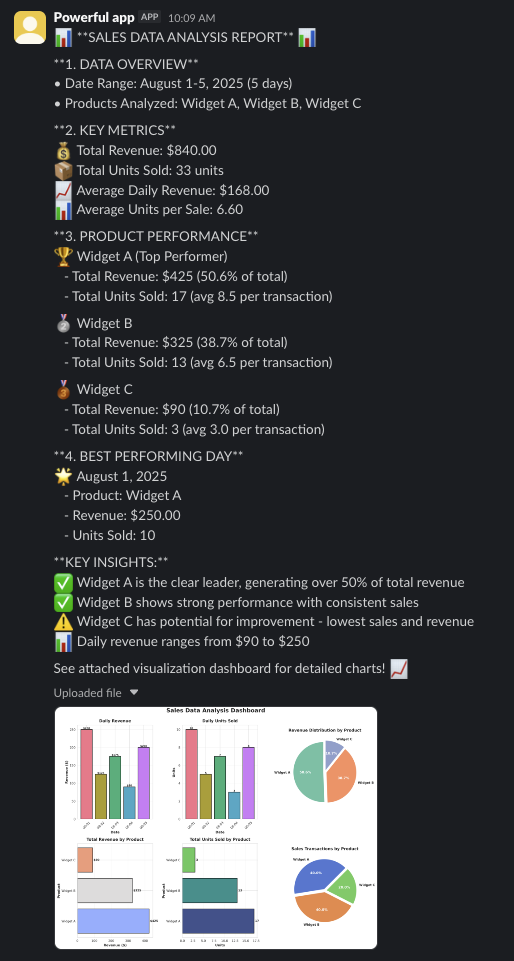

# Build a data analysis agent

> Build an agent that analyzes data files, generates visualizations, and shares results

## Overview

This guide demonstrates how to build a data analysis agent using a [deep agent](https://docs.langchain.com/oss/python/deepagents.md). Data analysis tasks typically require multi-step reasoning, code execution, and working with artifacts such as scripts, reports, and plots—capabilities that deep agents are designed to handle.

The agent you build will:

1. Accept a CSV file for analysis
2. Plan and track analysis steps with an opt-in todo list
3. Perform exploratory data analysis and generate visualizations
4. Share results to a Slack channel

> [!TIP]
>
> The Slack integration is optional. The agent can be modified to save artifacts locally or share results through other channels.

### Key concepts

This tutorial covers:

* [Backends](../../Execution%20environment/Backends.md) for sandboxed code execution
* Custom [tools](https://docs.langchain.com/oss/python/langchain/tools.md) for external integrations
* Opt-in [task planning](../../Deep%20Agents%20overview.md#task-planning) with [`TodoListMiddleware`](https://reference.langchain.com/python/langchain/agents/middleware/todo/TodoListMiddleware)

## Setup

### Installation

Install the core dependencies:

```bash pip theme={"theme":{"light":"catppuccin-latte","dark":"catppuccin-mocha"}}
pip install deepagents
```

### Optional dependencies

For this tutorial, we'll use:

* [Slack Python SDK](https://docs.slack.dev/tools/python-slack-sdk/) for sharing results ([token setup](https://docs.slack.dev/authentication/tokens/))
* A [LangSmith sandbox](https://docs.langchain.com/langsmith/sandboxes.md) for code execution

```bash pip theme={"theme":{"light":"catppuccin-latte","dark":"catppuccin-mocha"}}
pip install langsmith slack-sdk
```

> [!NOTE]
>
> These services are optional, though a sandboxed environment is highly recommended for any production use. You can alternatively use the local shell backend (with important [security considerations](../../Execution%20environment/Backends.md#localshellbackend-local-shell)) or download artifacts directly from the backend.

### LangSmith

Many of the applications you build with LangChain will contain multiple steps with multiple invocations of LLM calls. As these applications get more complex, it becomes crucial to be able to inspect what exactly is going on inside your chain or agent. The best way to do this is with [LangSmith](https://smith.langchain.com?utm_source=docs\&utm_medium=cta\&utm_campaign=langsmith-signup\&utm_content=oss-deepagents-data-analysis).

After you sign up at the link above, make sure to set your environment variables to start logging traces:

```shell theme={"theme":{"light":"catppuccin-latte","dark":"catppuccin-mocha"}}
export LANGSMITH_TRACING="true"
export LANGSMITH_API_KEY="..."
```

Or, set them in Python:

```python theme={"theme":{"light":"catppuccin-latte","dark":"catppuccin-mocha"}}
import getpass
import os

os.environ["LANGSMITH_TRACING"] = "true"
os.environ["LANGSMITH_API_KEY"] = getpass.getpass()
```

## Set up the backend

Deep Agents use [backends](../../Execution%20environment/Backends.md) to execute code in sandboxed environments.

The examples below use a [LangSmith sandbox](https://docs.langchain.com/langsmith/sandboxes.md). For other providers, see [available providers](../../Execution%20environment/Sandboxes.md#available-providers).

> [tab] LangSmith
>
> ```bash pip theme={"theme":{"light":"catppuccin-latte","dark":"catppuccin-mocha"}}
> pip install langsmith
> ```
>
> ```bash uv theme={"theme":{"light":"catppuccin-latte","dark":"catppuccin-mocha"}}
> uv add langsmith
> ```
>
> ```python theme={"theme":{"light":"catppuccin-latte","dark":"catppuccin-mocha"}}
> from deepagents.backends.langsmith import LangSmithSandbox
> from langsmith.sandbox import SandboxClient
>
> client = SandboxClient()
> ls_sandbox = client.create_sandbox()
> backend = LangSmithSandbox(sandbox=ls_sandbox)
> ```

> [tab] Local shell
>
> > [!WARNING]
> >
> > This backend provides unrestricted filesystem and shell access. Use only in controlled environments for development and testing. See the [security considerations](../../Execution%20environment/Backends.md#localshellbackend-local-shell) for more details.
>
> ```python theme={"theme":{"light":"catppuccin-latte","dark":"catppuccin-mocha"}}
> from deepagents.backends import LocalShellBackend
>
> backend = LocalShellBackend(
>     root_dir=".",
>     virtual_mode=True,
>     env={"PATH": "/usr/bin:/bin"},
> )
> ```

> [tab] AgentCore
>
> ```bash pip theme={"theme":{"light":"catppuccin-latte","dark":"catppuccin-mocha"}}
> pip install langchain-agentcore-codeinterpreter
> ```
>
> ```bash uv theme={"theme":{"light":"catppuccin-latte","dark":"catppuccin-mocha"}}
> uv add langchain-agentcore-codeinterpreter
> ```
>
> ```python theme={"theme":{"light":"catppuccin-latte","dark":"catppuccin-mocha"}}
> from bedrock_agentcore.tools.code_interpreter_client import CodeInterpreter
> from langchain_agentcore_codeinterpreter import AgentCoreSandbox
>
> interpreter = CodeInterpreter(region="us-west-2")
> interpreter.start()
> backend = AgentCoreSandbox(interpreter=interpreter)
> ```

> [tab] Daytona
>
> ```bash pip theme={"theme":{"light":"catppuccin-latte","dark":"catppuccin-mocha"}}
> pip install langchain-daytona
> ```
>
> ```bash uv theme={"theme":{"light":"catppuccin-latte","dark":"catppuccin-mocha"}}
> uv add langchain-daytona
> ```
>
> ```python theme={"theme":{"light":"catppuccin-latte","dark":"catppuccin-mocha"}}
> from daytona import Daytona
>
> from langchain_daytona import DaytonaSandbox
>
> sandbox = Daytona().create()
> backend = DaytonaSandbox(sandbox=sandbox)
> ```
>
> Verify the sandbox is ready:
>
> ```python theme={"theme":{"light":"catppuccin-latte","dark":"catppuccin-mocha"}}
> result = backend.execute("echo ready")
> print(result)
> # ExecuteResponse(output='ready', exit_code=0, ...)
> ```

> [tab] E2B
>
> ```bash pip theme={"theme":{"light":"catppuccin-latte","dark":"catppuccin-mocha"}}
> pip install langchain-e2b
> ```
>
> ```bash uv theme={"theme":{"light":"catppuccin-latte","dark":"catppuccin-mocha"}}
> uv add langchain-e2b
> ```
>
> ```python theme={"theme":{"light":"catppuccin-latte","dark":"catppuccin-mocha"}}
> from e2b import Sandbox
> from langchain_e2b import E2BSandbox
>
> e2b_sandbox = Sandbox.create()
> backend = E2BSandbox(sandbox=e2b_sandbox)
> ```

> [tab] Modal
>
> ```python theme={"theme":{"light":"catppuccin-latte","dark":"catppuccin-mocha"}}
> import modal
>
> from langchain_modal import ModalSandbox
>
> app = modal.App.lookup("your-app")
> modal_sandbox = modal.Sandbox.create(app=app)
> backend = ModalSandbox(sandbox=modal_sandbox)
> ```

> [tab] Runloop
>
> ```bash pip theme={"theme":{"light":"catppuccin-latte","dark":"catppuccin-mocha"}}
> pip install langchain-runloop
> ```
>
> ```bash uv theme={"theme":{"light":"catppuccin-latte","dark":"catppuccin-mocha"}}
> uv add langchain-runloop
> ```
>
> ```python theme={"theme":{"light":"catppuccin-latte","dark":"catppuccin-mocha"}}
> from runloop_api_client import RunloopSDK
>
> from langchain_runloop import RunloopSandbox
>
> api_key = "..."
> client = RunloopSDK(bearer_token=api_key)
>
> devbox = client.devbox.create()
> backend = RunloopSandbox(devbox=devbox)
> ```

### Upload sample data

Create and upload sample sales data to the backend:

```python theme={"theme":{"light":"catppuccin-latte","dark":"catppuccin-mocha"}}
import csv
import io

# Create sample sales data
data = [
    ["Date", "Product", "Units Sold", "Revenue"],
    ["2025-08-01", "Widget A", 10, 250],
    ["2025-08-02", "Widget B", 5, 125],
    ["2025-08-03", "Widget A", 7, 175],
    ["2025-08-04", "Widget C", 3, 90],
    ["2025-08-05", "Widget B", 8, 200],
]

# Convert to CSV bytes
text_buf = io.StringIO()
writer = csv.writer(text_buf)
writer.writerows(data)
csv_bytes = text_buf.getvalue().encode("utf-8")
text_buf.close()

# Upload to backend
backend.upload_files([("/root/data/sales_data.csv", csv_bytes)])
```

## Implement custom tools

Data analysis tasks might produce artifacts, like reports or plots.
The following simple [tool](https://docs.langchain.com/oss/python/langchain/tools.md) downloads them with `backend.download_files` and then uploads them using the Slack SDK.
We could also ask our agent to list the relevant file paths instead of uploading them, so interested parties can obtain them separately as needed.

```python theme={"theme":{"light":"catppuccin-latte","dark":"catppuccin-mocha"}}
import os

from langchain.tools import tool
from slack_sdk import WebClient

slack_token = os.environ["SLACK_USER_TOKEN"]
slack_client = WebClient(token=slack_token)
channel = "C0123456ABC"  # specify your own channel here


@tool(parse_docstring=True)
def slack_send_message(text: str, file_path: str | None = None) -> str:
    """Send message, optionally including attachments such as images.

    Args:
        text: (str) text content of the message
        file_path: (str) file path of attachment in the filesystem.
    """
    if not file_path:
        slack_client.chat_postMessage(channel=channel, text=text)
    else:
        fp = backend.download_files([file_path])
        slack_client.files_upload_v2(
            channel=channel,
            content=fp[0].content,
            initial_comment=text,
        )

    return "Message sent."
```

> [!NOTE]
>
> It is generally good practice to avoid adding credentials and other secrets to the sandbox. Here we manage the Slack token outside the sandbox in a tool.

## Enable task planning

[Task planning](../../Deep%20Agents%20overview.md#task-planning) is opt-in. Data analysis often involves long, multi-step work, so pass [`TodoListMiddleware`](https://reference.langchain.com/python/langchain/agents/middleware/todo/TodoListMiddleware) when you create the agent. That gives the agent a `write_todos` tool for tracking exploratory analysis, visualization, and sharing steps.

```python theme={"theme":{"light":"catppuccin-latte","dark":"catppuccin-mocha"}}
from langchain.agents.middleware import TodoListMiddleware
```

Include this middleware in the `create_deep_agent` call in the next section.

## Run the agent

Let's instantiate an agent:

```python theme={"theme":{"light":"catppuccin-latte","dark":"catppuccin-mocha"}}
from langchain_core.utils.uuid import uuid7

from deepagents import create_deep_agent
from langchain.agents.middleware import TodoListMiddleware
from langgraph.checkpoint.memory import InMemorySaver

checkpointer = InMemorySaver()

agent = create_deep_agent(
    model="google_genai:gemini-3.6-flash",
    tools=[slack_send_message],
    backend=backend,
    checkpointer=checkpointer,
    middleware=[TodoListMiddleware()],
)

thread_id = str(uuid7())
config = {"configurable": {"thread_id": thread_id}}
```

We include:

* A choice of [model](../../Get%20started/Customize%20Deep%20Agents.md#model)
* Our custom [tool](../../Get%20started/Customize%20Deep%20Agents.md#tools)
* The [backend](../../Execution%20environment/Backends.md)
* A [checkpointer](https://docs.langchain.com/oss/python/langchain/short-term-memory.md) to support multi-turn conversations
* [`TodoListMiddleware`](https://reference.langchain.com/python/langchain/agents/middleware/todo/TodoListMiddleware) for opt-in [task planning](../../Deep%20Agents%20overview.md#task-planning)

Let's now invoke our agent.

```python theme={"theme":{"light":"catppuccin-latte","dark":"catppuccin-mocha"}}
input_message = {
    "role": "user",
    "content": (
        "Analyze ./data/sales_data.csv in the current dir and generate a beautiful plot. "
        "When finished, send your analysis and the plot to Slack using the tool."
    ),
}
stream = agent.stream_events(
    {"messages": [input_message]},
    config,
    version="v3",
)
for snapshot in stream.values:
    snapshot["messages"][-1].pretty_print()
```

```Result expandable theme={"theme":{"light":"catppuccin-latte","dark":"catppuccin-mocha"}}
================================== Ai Message ==================================

[{'text': "I'll help you analyze the sales data and create a beautiful plot, then send the results to Slack. Let me start by exploring the data.", 'type': 'text'}, {'id': 'toolu_01LRot5h6WkhdpDQ1SG6EQGQ', 'input': {'file_path': './data/sales_data.csv'}, 'name': 'read_file', 'type': 'tool_use'}]
Tool Calls:
  read_file (toolu_01LRot5h6WkhdpDQ1SG6EQGQ)
 Call ID: toolu_01LRot5h6WkhdpDQ1SG6EQGQ
  Args:
    file_path: ./data/sales_data.csv
================================= Tool Message =================================
Name: read_file

Error: File '/data/sales_data.csv' not found
================================== Ai Message ==================================

[{'text': 'Let me check the current directory structure first:', 'type': 'text'}, {'id': 'toolu_018DSeF8Dx714Dh2M5vJ1JuK', 'input': {'command': 'pwd'}, 'name': 'execute', 'type': 'tool_use'}, {'id': 'toolu_01As782aRsVB3mJpKPKNwg9c', 'input': {'path': '/'}, 'name': 'ls', 'type': 'tool_use'}]
Tool Calls:
  execute (toolu_018DSeF8Dx714Dh2M5vJ1JuK)
 Call ID: toolu_018DSeF8Dx714Dh2M5vJ1JuK
  Args:
    command: pwd
  ls (toolu_01As782aRsVB3mJpKPKNwg9c)
 Call ID: toolu_01As782aRsVB3mJpKPKNwg9c
  Args:
    path: /
================================= Tool Message =================================
Name: execute

/root
[Command succeeded with exit code 0]
================================= Tool Message =================================
Name: ls

['/bin', '/boot', '/dev', '/etc', '/home', '/lib', '/lib64', '/media', '/mnt', '/opt', '/proc', '/root', '/run', '/sbin', '/srv', '/sys', '/tmp', '/usr', '/var', '/.dockerenv']
================================== Ai Message ==================================

[{'id': 'toolu_01Sv4ut1P2XFsjrzVmQbJLpr', 'input': {'path': '/root'}, 'name': 'ls', 'type': 'tool_use'}]
Tool Calls:
  ls (toolu_01Sv4ut1P2XFsjrzVmQbJLpr)
 Call ID: toolu_01Sv4ut1P2XFsjrzVmQbJLpr
  Args:
    path: /root
================================= Tool Message =================================
Name: ls

['/root/.bash_logout', '/root/.bashrc', '/root/.profile', '/root/data']
================================== Ai Message ==================================

[{'text': "Great! I can see there's a data directory. Let me check its contents:", 'type': 'text'}, {'id': 'toolu_01WN6V9RZjGGoDXzuWdEgB1z', 'input': {'path': '/root/data'}, 'name': 'ls', 'type': 'tool_use'}]
Tool Calls:
  ls (toolu_01WN6V9RZjGGoDXzuWdEgB1z)
 Call ID: toolu_01WN6V9RZjGGoDXzuWdEgB1z
  Args:
    path: /root/data
================================= Tool Message =================================
Name: ls

['/root/data/sales_data.csv']
================================== Ai Message ==================================

[{'text': 'Perfect! Now let me read the sales data:', 'type': 'text'}, {'id': 'toolu_01RFmneg7mua1G5csH3rH2Zq', 'input': {'file_path': '/root/data/sales_data.csv'}, 'name': 'read_file', 'type': 'tool_use'}]
Tool Calls:
  read_file (toolu_01RFmneg7mua1G5csH3rH2Zq)
 Call ID: toolu_01RFmneg7mua1G5csH3rH2Zq
  Args:
    file_path: /root/data/sales_data.csv
================================= Tool Message =================================
Name: read_file

     1	Date,Product,Units Sold,Revenue
     2	2025-08-01,Widget A,10,250
     3	2025-08-02,Widget B,5,125
     4	2025-08-03,Widget A,7,175
     5	2025-08-04,Widget C,3,90
     6	2025-08-05,Widget B,8,200
================================== Ai Message ==================================

[{'text': "Excellent! I can see the sales data. Now I'll create a Python script to analyze the data and generate a beautiful plot. Let me create a comprehensive analysis with visualizations:", 'type': 'text'}, {'id': 'toolu_01JcBjEXgPpCPuaGxn9ALwMg', 'input': {'file_path': '/root/analyze_sales.py', 'content': 'import pandas as pd\nimport matplotlib.pyplot as plt\nimport seaborn as sns\nfrom datetime import datetime\n\n# Set style for beautiful plots\nsns.set_style("whitegrid")\nplt.rcParams[\'figure.figsize\'] = (14, 10)\nplt.rcParams[\'font.size\'] = 11\n\n# Read the data\ndf = pd.read_csv(\'/root/data/sales_data.csv\')\ndf[\'Date\'] = pd.to_datetime(df[\'Date\'])\n\n# Analysis\nprint("=" * 60)\nprint("SALES DATA ANALYSIS REPORT")\nprint("=" * 60)\nprint("\\n1. DATA OVERVIEW")\nprint("-" * 60)\nprint(f"Date Range: {df[\'Date\'].min().strftime(\'%Y-%m-%d\')} to {df[\'Date\'].max().strftime(\'%Y-%m-%d\')}")\nprint(f"Total Records: {len(df)}")\nprint(f"Products: {\', \'.join(df[\'Product\'].unique())}")\n\nprint("\\n2. SUMMARY STATISTICS")\nprint("-" * 60)\nprint(f"Total Revenue: ${df[\'Revenue\'].sum():,.2f}")\nprint(f"Total Units Sold: {df[\'Units Sold\'].sum()}")\nprint(f"Average Daily Revenue: ${df[\'Revenue\'].mean():.2f}")\nprint(f"Average Units per Sale: {df[\'Units Sold\'].mean():.2f}")\n\nprint("\\n3. PRODUCT PERFORMANCE")\nprint("-" * 60)\nproduct_stats = df.groupby(\'Product\').agg({\n    \'Revenue\': [\'sum\', \'mean\'],\n    \'Units Sold\': [\'sum\', \'mean\']\n}).round(2)\nprint(product_stats)\n\nprint("\\n4. BEST PERFORMING DAY")\nprint("-" * 60)\nbest_day = df.loc[df[\'Revenue\'].idxmax()]\nprint(f"Date: {best_day[\'Date\'].strftime(\'%Y-%m-%d\')}")\nprint(f"Product: {best_day[\'Product\']}")\nprint(f"Revenue: ${best_day[\'Revenue\']:.2f}")\nprint(f"Units Sold: {best_day[\'Units Sold\']}")\n\n# Create visualizations\nfig = plt.figure(figsize=(16, 12))\nfig.suptitle(\'Sales Data Analysis Dashboard\', fontsize=20, fontweight=\'bold\', y=0.995)\n\n# 1. Revenue by Date\nax1 = plt.subplot(2, 3, 1)\ncolors = sns.color_palette("husl", len(df))\nbars = ax1.bar(df[\'Date\'].dt.strftime(\'%m-%d\'), df[\'Revenue\'], color=colors, edgecolor=\'black\', linewidth=1.5)\nax1.set_title(\'Daily Revenue\', fontsize=14, fontweight=\'bold\', pad=10)\nax1.set_xlabel(\'Date\', fontsize=12, fontweight=\'bold\')\nax1.set_ylabel(\'Revenue ($)\', fontsize=12, fontweight=\'bold\')\nax1.grid(axis=\'y\', alpha=0.3)\nfor bar in bars:\n    height = bar.get_height()\n    ax1.text(bar.get_x() + bar.get_width()/2., height,\n            f\'${int(height)}\',\n            ha=\'center\', va=\'bottom\', fontsize=9, fontweight=\'bold\')\nplt.setp(ax1.xaxis.get_majorticklabels(), rotation=45)\n\n# 2. Units Sold by Date\nax2 = plt.subplot(2, 3, 2)\nbars = ax2.bar(df[\'Date\'].dt.strftime(\'%m-%d\'), df[\'Units Sold\'], color=colors, edgecolor=\'black\', linewidth=1.5)\nax2.set_title(\'Daily Units Sold\', fontsize=14, fontweight=\'bold\', pad=10)\nax2.set_xlabel(\'Date\', fontsize=12, fontweight=\'bold\')\nax2.set_ylabel(\'Units\', fontsize=12, fontweight=\'bold\')\nax2.grid(axis=\'y\', alpha=0.3)\nfor bar in bars:\n    height = bar.get_height()\n    ax2.text(bar.get_x() + bar.get_width()/2., height,\n            f\'{int(height)}\',\n            ha=\'center\', va=\'bottom\', fontsize=9, fontweight=\'bold\')\nplt.setp(ax2.xaxis.get_majorticklabels(), rotation=45)\n\n# 3. Revenue by Product (Pie Chart)\nax3 = plt.subplot(2, 3, 3)\nproduct_revenue = df.groupby(\'Product\')[\'Revenue\'].sum()\ncolors_pie = sns.color_palette("Set2", len(product_revenue))\nwedges, texts, autotexts = ax3.pie(product_revenue, labels=product_revenue.index, autopct=\'%1.1f%%\',\n                                     colors=colors_pie, startangle=90, textprops={\'fontsize\': 11, \'fontweight\': \'bold\'},\n                                     explode=[0.05] * len(product_revenue))\nax3.set_title(\'Revenue Distribution by Product\', fontsize=14, fontweight=\'bold\', pad=10)\nfor autotext in autotexts:\n    autotext.set_color(\'white\')\n    autotext.set_fontsize(12)\n\n# 4. Total Revenue by Product (Bar Chart)\nax4 = plt.subplot(2, 3, 4)\nproduct_revenue_sorted = product_revenue.sort_values(ascending=False)\ncolors_product = sns.color_palette("coolwarm", len(product_revenue_sorted))\nbars = ax4.barh(product_revenue_sorted.index, product_revenue_sorted.values, color=colors_product, edgecolor=\'black\', linewidth=1.5)\nax4.set_title(\'Total Revenue by Product\', fontsize=14, fontweight=\'bold\', pad=10)\nax4.set_xlabel(\'Revenue ($)\', fontsize=12, fontweight=\'bold\')\nax4.set_ylabel(\'Product\', fontsize=12, fontweight=\'bold\')\nax4.grid(axis=\'x\', alpha=0.3)\nfor i, (product, revenue) in enumerate(product_revenue_sorted.items()):\n    ax4.text(revenue, i, f\' ${int(revenue)}\', va=\'center\', fontsize=10, fontweight=\'bold\')\n\n# 5. Total Units Sold by Product\nax5 = plt.subplot(2, 3, 5)\nproduct_units = df.groupby(\'Product\')[\'Units Sold\'].sum().sort_values(ascending=False)\ncolors_units = sns.color_palette("viridis", len(product_units))\nbars = ax5.barh(product_units.index, product_units.values, color=colors_units, edgecolor=\'black\', linewidth=1.5)\nax5.set_title(\'Total Units Sold by Product\', fontsize=14, fontweight=\'bold\', pad=10)\nax5.set_xlabel(\'Units\', fontsize=12, fontweight=\'bold\')\nax5.set_ylabel(\'Product\', fontsize=12, fontweight=\'bold\')\nax5.grid(axis=\'x\', alpha=0.3)\nfor i, (product, units) in enumerate(product_units.items()):\n    ax5.text(units, i, f\' {int(units)}\', va=\'center\', fontsize=10, fontweight=\'bold\')\n\n# 6. Product Distribution\nax6 = plt.subplot(2, 3, 6)\nproduct_counts = df[\'Product\'].value_counts()\ncolors_count = sns.color_palette("muted", len(product_counts))\nwedges, texts, autotexts = ax6.pie(product_counts, labels=product_counts.index, autopct=\'%1.1f%%\',\n                                     colors=colors_count, startangle=45, textprops={\'fontsize\': 11, \'fontweight\': \'bold\'},\n                                     explode=[0.05] * len(product_counts))\nax6.set_title(\'Sales Transactions by Product\', fontsize=14, fontweight=\'bold\', pad=10)\nfor autotext in autotexts:\n    autotext.set_color(\'white\')\n    autotext.set_fontsize(12)\n\nplt.tight_layout()\nplt.savefig(\'/root/sales_analysis_plot.png\', dpi=300, bbox_inches=\'tight\', facecolor=\'white\')\nprint("\\n" + "=" * 60)\nprint("Plot saved as: sales_analysis_plot.png")\nprint("=" * 60)\n'}, 'name': 'write_file', 'type': 'tool_use'}]
Tool Calls:
  write_file (toolu_01JcBjEXgPpCPuaGxn9ALwMg)
 Call ID: toolu_01JcBjEXgPpCPuaGxn9ALwMg
  Args:
    file_path: /root/analyze_sales.py
    content: import pandas as pd
import matplotlib.pyplot as plt
import seaborn as sns
from datetime import datetime

# Set style for beautiful plots
sns.set_style("whitegrid")
plt.rcParams['figure.figsize'] = (14, 10)
plt.rcParams['font.size'] = 11

# Read the data
df = pd.read_csv('/root/data/sales_data.csv')
df['Date'] = pd.to_datetime(df['Date'])

# Analysis
print("=" * 60)
print("SALES DATA ANALYSIS REPORT")
print("=" * 60)
print("\n1. DATA OVERVIEW")
print("-" * 60)
print(f"Date Range: {df['Date'].min().strftime('%Y-%m-%d')} to {df['Date'].max().strftime('%Y-%m-%d')}")
print(f"Total Records: {len(df)}")
print(f"Products: {', '.join(df['Product'].unique())}")

print("\n2. SUMMARY STATISTICS")
print("-" * 60)
print(f"Total Revenue: ${df['Revenue'].sum():,.2f}")
print(f"Total Units Sold: {df['Units Sold'].sum()}")
print(f"Average Daily Revenue: ${df['Revenue'].mean():.2f}")
print(f"Average Units per Sale: {df['Units Sold'].mean():.2f}")

print("\n3. PRODUCT PERFORMANCE")
print("-" * 60)
product_stats = df.groupby('Product').agg({
    'Revenue': ['sum', 'mean'],
    'Units Sold': ['sum', 'mean']
}).round(2)
print(product_stats)

print("\n4. BEST PERFORMING DAY")
print("-" * 60)
best_day = df.loc[df['Revenue'].idxmax()]
print(f"Date: {best_day['Date'].strftime('%Y-%m-%d')}")
print(f"Product: {best_day['Product']}")
print(f"Revenue: ${best_day['Revenue']:.2f}")
print(f"Units Sold: {best_day['Units Sold']}")

# Create visualizations
fig = plt.figure(figsize=(16, 12))
fig.suptitle('Sales Data Analysis Dashboard', fontsize=20, fontweight='bold', y=0.995)

# 1. Revenue by Date
ax1 = plt.subplot(2, 3, 1)
colors = sns.color_palette("husl", len(df))
bars = ax1.bar(df['Date'].dt.strftime('%m-%d'), df['Revenue'], color=colors, edgecolor='black', linewidth=1.5)
ax1.set_title('Daily Revenue', fontsize=14, fontweight='bold', pad=10)
ax1.set_xlabel('Date', fontsize=12, fontweight='bold')
ax1.set_ylabel('Revenue ($)', fontsize=12, fontweight='bold')
ax1.grid(axis='y', alpha=0.3)
for bar in bars:
    height = bar.get_height()
    ax1.text(bar.get_x() + bar.get_width()/2., height,
            f'${int(height)}',
            ha='center', va='bottom', fontsize=9, fontweight='bold')
plt.setp(ax1.xaxis.get_majorticklabels(), rotation=45)

# 2. Units Sold by Date
ax2 = plt.subplot(2, 3, 2)
bars = ax2.bar(df['Date'].dt.strftime('%m-%d'), df['Units Sold'], color=colors, edgecolor='black', linewidth=1.5)
ax2.set_title('Daily Units Sold', fontsize=14, fontweight='bold', pad=10)
ax2.set_xlabel('Date', fontsize=12, fontweight='bold')
ax2.set_ylabel('Units', fontsize=12, fontweight='bold')
ax2.grid(axis='y', alpha=0.3)
for bar in bars:
    height = bar.get_height()
    ax2.text(bar.get_x() + bar.get_width()/2., height,
            f'{int(height)}',
            ha='center', va='bottom', fontsize=9, fontweight='bold')
plt.setp(ax2.xaxis.get_majorticklabels(), rotation=45)

# 3. Revenue by Product (Pie Chart)
ax3 = plt.subplot(2, 3, 3)
product_revenue = df.groupby('Product')['Revenue'].sum()
colors_pie = sns.color_palette("Set2", len(product_revenue))
wedges, texts, autotexts = ax3.pie(product_revenue, labels=product_revenue.index, autopct='%1.1f%%',
                                     colors=colors_pie, startangle=90, textprops={'fontsize': 11, 'fontweight': 'bold'},
                                     explode=[0.05] * len(product_revenue))
ax3.set_title('Revenue Distribution by Product', fontsize=14, fontweight='bold', pad=10)
for autotext in autotexts:
    autotext.set_color('white')
    autotext.set_fontsize(12)

# 4. Total Revenue by Product (Bar Chart)
ax4 = plt.subplot(2, 3, 4)
product_revenue_sorted = product_revenue.sort_values(ascending=False)
colors_product = sns.color_palette("coolwarm", len(product_revenue_sorted))
bars = ax4.barh(product_revenue_sorted.index, product_revenue_sorted.values, color=colors_product, edgecolor='black', linewidth=1.5)
ax4.set_title('Total Revenue by Product', fontsize=14, fontweight='bold', pad=10)
ax4.set_xlabel('Revenue ($)', fontsize=12, fontweight='bold')
ax4.set_ylabel('Product', fontsize=12, fontweight='bold')
ax4.grid(axis='x', alpha=0.3)
for i, (product, revenue) in enumerate(product_revenue_sorted.items()):
    ax4.text(revenue, i, f' ${int(revenue)}', va='center', fontsize=10, fontweight='bold')

# 5. Total Units Sold by Product
ax5 = plt.subplot(2, 3, 5)
product_units = df.groupby('Product')['Units Sold'].sum().sort_values(ascending=False)
colors_units = sns.color_palette("viridis", len(product_units))
bars = ax5.barh(product_units.index, product_units.values, color=colors_units, edgecolor='black', linewidth=1.5)
ax5.set_title('Total Units Sold by Product', fontsize=14, fontweight='bold', pad=10)
ax5.set_xlabel('Units', fontsize=12, fontweight='bold')
ax5.set_ylabel('Product', fontsize=12, fontweight='bold')
ax5.grid(axis='x', alpha=0.3)
for i, (product, units) in enumerate(product_units.items()):
    ax5.text(units, i, f' {int(units)}', va='center', fontsize=10, fontweight='bold')

# 6. Product Distribution
ax6 = plt.subplot(2, 3, 6)
product_counts = df['Product'].value_counts()
colors_count = sns.color_palette("muted", len(product_counts))
wedges, texts, autotexts = ax6.pie(product_counts, labels=product_counts.index, autopct='%1.1f%%',
                                     colors=colors_count, startangle=45, textprops={'fontsize': 11, 'fontweight': 'bold'},
                                     explode=[0.05] * len(product_counts))
ax6.set_title('Sales Transactions by Product', fontsize=14, fontweight='bold', pad=10)
for autotext in autotexts:
    autotext.set_color('white')
    autotext.set_fontsize(12)

plt.tight_layout()
plt.savefig('/root/sales_analysis_plot.png', dpi=300, bbox_inches='tight', facecolor='white')
print("\n" + "=" * 60)
print("Plot saved as: sales_analysis_plot.png")
print("=" * 60)
================================= Tool Message =================================
Name: write_file

Updated file /root/analyze_sales.py
================================== Ai Message ==================================

[{'text': 'Now let me run the analysis script:', 'type': 'text'}, {'id': 'toolu_015xkZr21TuzCTEKGzSqgnbp', 'input': {'command': 'cd /root && python analyze_sales.py'}, 'name': 'execute', 'type': 'tool_use'}]
Tool Calls:
  execute (toolu_015xkZr21TuzCTEKGzSqgnbp)
 Call ID: toolu_015xkZr21TuzCTEKGzSqgnbp
  Args:
    command: cd /root && python analyze_sales.py
================================= Tool Message =================================
Name: execute

============================================================
SALES DATA ANALYSIS REPORT
============================================================

1. DATA OVERVIEW
------------------------------------------------------------
Date Range: 2025-08-01 to 2025-08-05
Total Records: 5
Products: Widget A, Widget B, Widget C

2. SUMMARY STATISTICS
------------------------------------------------------------
Total Revenue: $840.00
Total Units Sold: 33
Average Daily Revenue: $168.00
Average Units per Sale: 6.60

3. PRODUCT PERFORMANCE
------------------------------------------------------------
         Revenue        Units Sold
             sum   mean        sum mean
Product
Widget A     425  212.5         17  8.5
Widget B     325  162.5         13  6.5
Widget C      90   90.0          3  3.0

4. BEST PERFORMING DAY
------------------------------------------------------------
Date: 2025-08-01
Product: Widget A
Revenue: $250.00
Units Sold: 10

============================================================
Plot saved as: sales_analysis_plot.png
============================================================
[Command succeeded with exit code 0]
================================== Ai Message ==================================

[{'text': 'Perfect! The analysis is complete and the plot has been generated. Now let me send both the analysis and the plot to Slack:', 'type': 'text'}, {'id': 'toolu_01Qust5a8DECKPZuU9pBBvkz', 'input': {'text': '📊 **SALES DATA ANALYSIS REPORT** 📊\n\n**1. DATA OVERVIEW**\n• Date Range: August 1-5, 2025 (5 days)\n• Products Analyzed: Widget A, Widget B, Widget C\n\n**2. KEY METRICS**\n💰 Total Revenue: $840.00\n📦 Total Units Sold: 33 units\n📈 Average Daily Revenue: $168.00\n📊 Average Units per Sale: 6.60\n\n**3. PRODUCT PERFORMANCE**\n🏆 Widget A (Top Performer)\n   - Total Revenue: $425 (50.6% of total)\n   - Total Units Sold: 17 (avg 8.5 per transaction)\n\n🥈 Widget B\n   - Total Revenue: $325 (38.7% of total)\n   - Total Units Sold: 13 (avg 6.5 per transaction)\n\n🥉 Widget C\n   - Total Revenue: $90 (10.7% of total)\n   - Total Units Sold: 3 (avg 3.0 per transaction)\n\n**4. BEST PERFORMING DAY**\n🌟 August 1, 2025\n   - Product: Widget A\n   - Revenue: $250.00\n   - Units Sold: 10\n\n**KEY INSIGHTS:**\n✅ Widget A is the clear leader, generating over 50% of total revenue\n✅ Widget B shows strong performance with consistent sales\n⚠️ Widget C has potential for improvement - lowest sales and revenue\n📊 Daily revenue ranges from $90 to $250\n\nSee attached visualization dashboard for detailed charts! 📈', 'file_path': '/root/sales_analysis_plot.png'}, 'name': 'slack_send_message', 'type': 'tool_use'}]
Tool Calls:
  slack_send_message (toolu_01Qust5a8DECKPZuU9pBBvkz)
 Call ID: toolu_01Qust5a8DECKPZuU9pBBvkz
  Args:
    text: 📊 **SALES DATA ANALYSIS REPORT** 📊

**1. DATA OVERVIEW**
• Date Range: August 1-5, 2025 (5 days)
• Products Analyzed: Widget A, Widget B, Widget C

**2. KEY METRICS**
💰 Total Revenue: $840.00
📦 Total Units Sold: 33 units
📈 Average Daily Revenue: $168.00
📊 Average Units per Sale: 6.60

**3. PRODUCT PERFORMANCE**
🏆 Widget A (Top Performer)
   - Total Revenue: $425 (50.6% of total)
   - Total Units Sold: 17 (avg 8.5 per transaction)

🥈 Widget B
   - Total Revenue: $325 (38.7% of total)
   - Total Units Sold: 13 (avg 6.5 per transaction)

🥉 Widget C
   - Total Revenue: $90 (10.7% of total)
   - Total Units Sold: 3 (avg 3.0 per transaction)

**4. BEST PERFORMING DAY**
🌟 August 1, 2025
   - Product: Widget A
   - Revenue: $250.00
   - Units Sold: 10

**KEY INSIGHTS:**
✅ Widget A is the clear leader, generating over 50% of total revenue
✅ Widget B shows strong performance with consistent sales
⚠️ Widget C has potential for improvement - lowest sales and revenue
📊 Daily revenue ranges from $90 to $250

See attached visualization dashboard for detailed charts! 📈
    file_path: /root/sales_analysis_plot.png
================================= Tool Message =================================
Name: slack_send_message

Message sent.
================================== Ai Message ==================================

Excellent! I've successfully completed the analysis and sent everything to Slack. Here's what I did:

## Summary

**Analysis Completed:**
- Analyzed the sales data from August 1-5, 2025
- Processed data for 3 products (Widget A, B, and C)
- Generated comprehensive statistics and insights

**Key Findings:**
1. **Total Revenue:** $840 across 5 days
2. **Best Product:** Widget A ($425 revenue, 50.6% of total)
3. **Best Day:** August 1st with $250 in revenue
4. **Total Units Sold:** 33 units

**Visualization Created:**
A beautiful 6-panel dashboard featuring:
- Daily revenue trends
- Daily units sold
- Revenue distribution by product (pie chart)
- Total revenue by product (horizontal bar chart)
- Total units sold by product (horizontal bar chart)
- Sales transactions distribution (pie chart)

**Delivered to Slack:**
✅ Comprehensive analysis report with key metrics and insights
✅ High-resolution visualization dashboard (saved as PNG)

The analysis reveals that Widget A is the top performer, while Widget C shows room for improvement. All results have been sent to your Slack workspace!
```

View the full [LangSmith trace](https://smith.langchain.com/public/ac2443a8-16ad-4e00-8f02-afde6a737534/r) for this execution.

## Results

The agent successfully analyzes the data and shares a comprehensive report with visualizations to Slack:



Agent-generated analysis report and visualization dashboard delivered to Slack

> [!TIP]
>
> You can download artifacts directly from the backend without using external tools:
>
> ```python theme={"theme":{"light":"catppuccin-latte","dark":"catppuccin-mocha"}}
> backend.download_files(list_of_filepaths)
> ```

> [!NOTE]
>
> See [provider guides](../../Execution%20environment/Sandboxes.md#available-providers) for how to clean up the sandbox once finished.

## Next steps

Now that you've built a data analysis agent, explore these resources to extend its capabilities:

* [Managed Deep Agents](../../Deployment/Managed%20Deep%20Agents.md): Build deep agents with managed deployment infrastructure
* [Backends](../../Execution%20environment/Backends.md): Learn about the Deep Agents backend system
* [Sandboxes](../../Execution%20environment/Sandboxes.md): Review backends for sandboxed code execution, including security considerations and advanced configurations
* [Customization](../../Get%20started/Customize%20Deep%20Agents.md): Discover how to customize your agent with different models, tools, prompts, and optional [task planning](../../Deep%20Agents%20overview.md#task-planning)
* [Code](https://docs.langchain.com/oss/deepagents/code/overview.md): Try Deep Agents Code as a terminal coding agent to assist with data analysis and other agentic tasks locally
* [Skills](../../Context%20management/Skills.md): Equip your agent with reusable skills for common workflows
* [Human-in-the-loop](../../Steering/Human-in-the-loop.md): Add interactive approval steps for critical operations in your data analysis workflow

***

[Connect these docs](https://docs.langchain.com/use-these-docs.md) to your agent of choice via MCP for real-time answers.

[Edit this page on GitHub](https://github.com/langchain-ai/docs/edit/main/src/oss/deepagents/data-analysis.mdx) or [file an issue](https://github.com/langchain-ai/docs/issues/new/choose).
