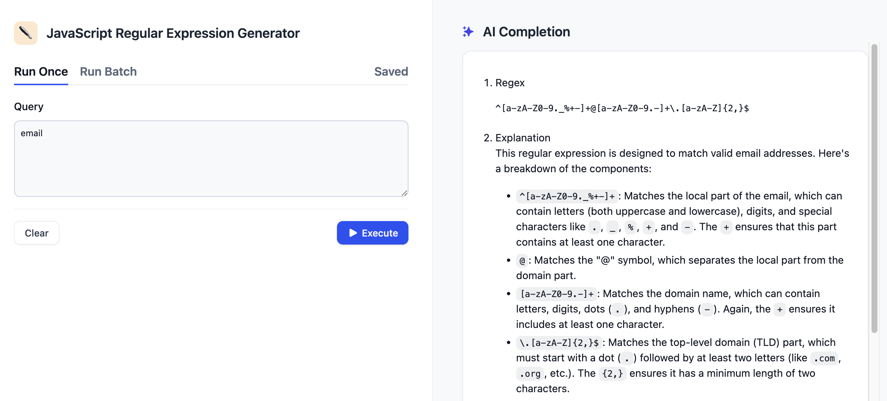
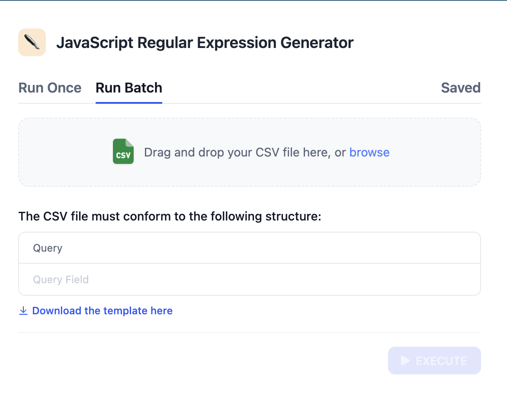
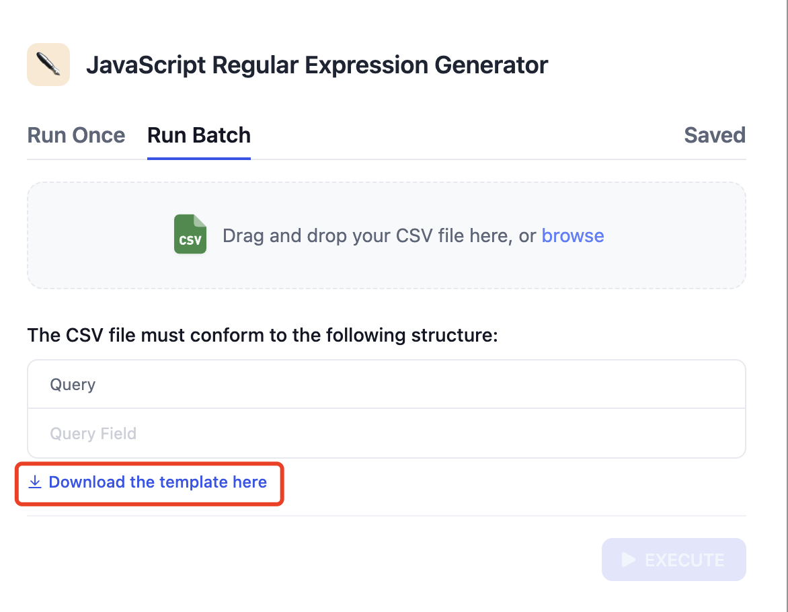
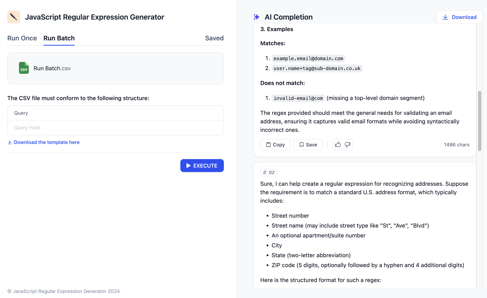
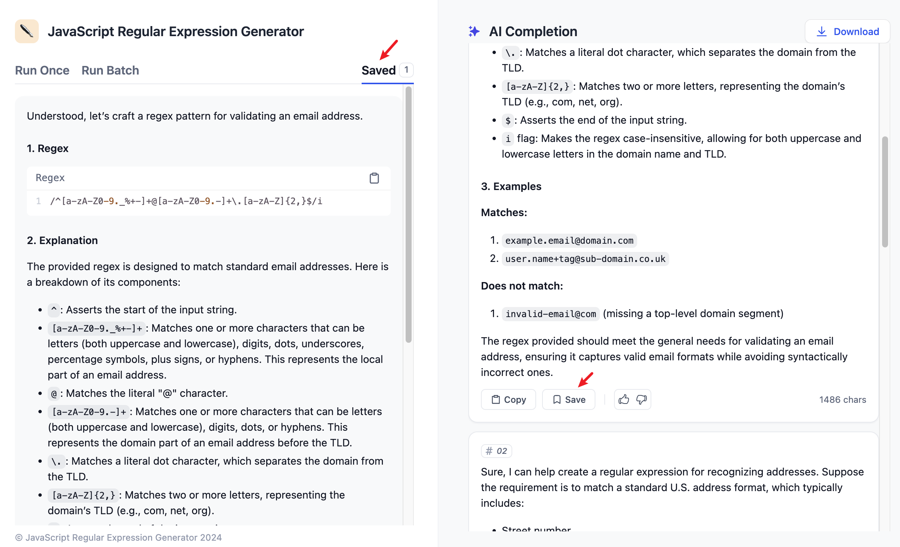
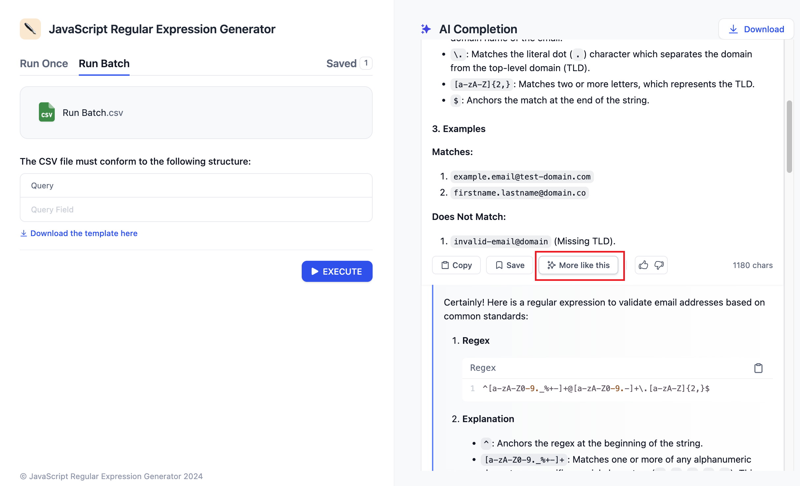

# Workflow Web 应用

> 通过批处理、结果管理和流畅的使用体验，将工作流转变为强大的 Web 应用

> 本文档由 AI 自动翻译。如有任何不准确之处，请参考 [英文原版](https://docs.dify.ai/en/cloud/use-dify/publish/webapp/workflow-webapp.md)。

Workflow Web 应用将你的 Dify 工作流转换为生产就绪的应用，可以处理从单次运行到大规模批处理操作的各种任务。用户可以获得清晰的输入界面、实时处理反馈和全面的结果管理功能。

## Workflow 应用如何工作

当你发布工作流时，Dify 会自动创建一个网页界面，该界面：

* **收集输入参数**：通过基于工作流起始变量的表单
* **处理请求**：使用你完整的工作流逻辑
* **处理结果**：具有内置的保存、复制和管理功能
* **自动扩展**：从单次运行扩展到批处理数百个项目

> [!NOTE]
>
> 与维护对话上下文的聊天应用不同，Workflow 应用设计用于产生特定输出的离散任务。

> [card] 单次执行
>
> 一次运行一个工作流，获得即时结果和反馈

> [card] 批处理
>
> 通过 CSV 上传/下载同时处理数百个输入

> [card] 结果管理
>
> 使用内置存储保存、整理和导出输出

> [card] 更多类似的
>
> 自动生成成功输出的变体

## 单次执行

Workflow 应用的默认模式处理带有实时处理的单个请求：

**用户体验**：

1. **填写输入表单**：用户根据你工作流的起始变量提供参数
2. **点击运行**：工作流执行，并显示实时进度指示
3. **查看结果**：输出显示，可立即访问复制、保存和反馈选项
4. **采取操作**：用户可以保存重要结果、提供反馈或生成类似输出

每个结果都包含内置操作：

* **复制**：一键复制到剪贴板，方便分享
* **保存**：将结果存储在应用的已保存项目中，供以后访问
* **反馈**：点赞/点踩评级，帮助改进你的工作流
* **更多类似的**：基于当前结果生成变体（如果启用）

## 批处理

当你需要对多个输入运行相同的工作流时，批处理可以同时处理数百次执行：

> [!TIP]
>
> 非常适合为多个主题生成内容、处理客户数据或分析大型数据集等任务。

### 设置批量运行

**1. 切换到批处理模式**

点击 **批量运行** 标签以访问批处理功能。

**2. 获取 CSV 模板**

下载模板文件以查看工作流输入变量所需的列结构。

**3. 准备你的数据**

在模板中填入你的输入数据。每一行都会成为一次工作流执行。

**4. 上传并运行**

上传你完成的 CSV 文件并开始批处理。

### 批处理优势

* **并行执行**：多个工作流运行同时进行
* **进度跟踪**：完成状态的实时更新
* **批量导出**：完成后将所有结果下载为 CSV 文件
* **错误处理**：失败的项目会清楚地标记错误详情

> [!WARNING]
>
> CSV 文件必须使用 Unicode 编码以防止导入失败。从 Excel 或类似工具保存时，请明确选择「Unicode (UTF-8)」编码。

## 结果管理

Workflow 应用包含全面的结果管理功能，帮助用户整理和重复使用输出：

### 保存结果

**保存工作原理**：

* 用户在想要保留的结果上点击 **保存**
* 保存的项目出现在专用的 **已保存** 标签中
* 每个保存的结果包含原始输入和完整输出
* 用户可以整理保存的结果并随时访问

> [!NOTE]
>
> 保存的结果在用户会话间持久保存，使 Workflow 应用对构建个人输出库非常有用。

### 生成变体

当你在工作流设置中启用 **更多类似的** 时，用户可以生成成功结果的变体：

**工作原理**：

1. 用户得到他们喜欢的结果
2. 他们点击 **更多类似的** 来生成类似的输出
3. 工作流再次运行，带有轻微变化以产生不同但相关的结果
4. 用户可以迭代直到找到完美的输出

> [!TIP]
>
> **更多类似的** 对于内容生成等创意工作流特别有效，用户可借此探索同一主题的不同方法。
