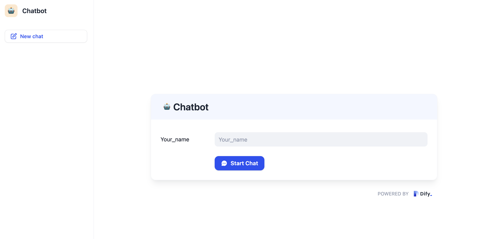
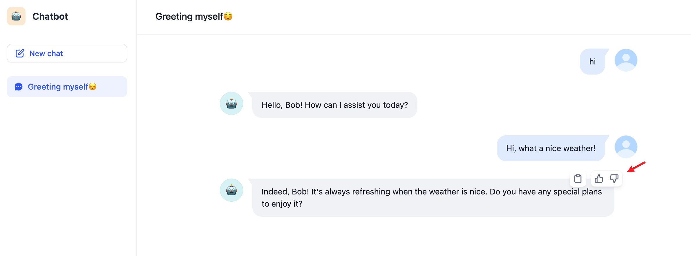
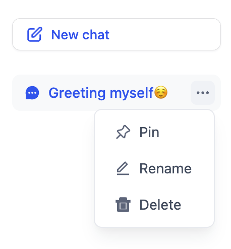
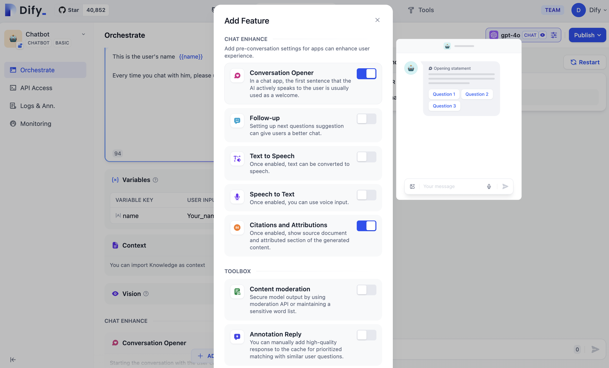
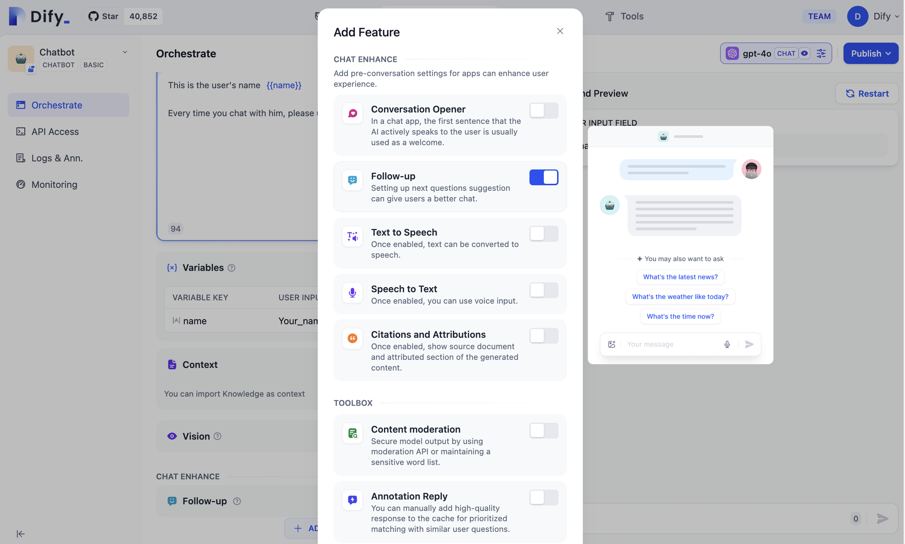
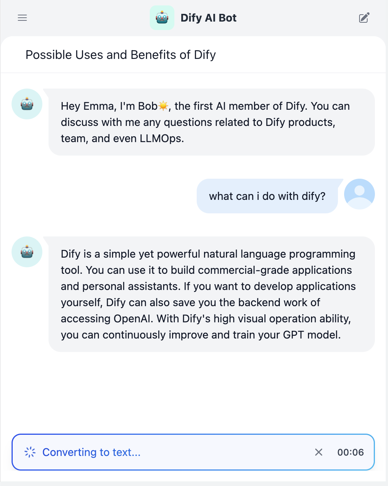

# 聊天 Web App

> 将 Chatflow 转变为具备持久化历史记录和交互功能的完整对话界面

> 本文档由 AI 自动翻译。如有任何不准确之处，请参考 [英文原版](https://docs.dify.ai/en/cloud/use-dify/publish/webapp/chatflow-webapp.md)。

聊天 Web App 将你的 Chatflow 转变为完整的对话体验。用户可获得持续的聊天会话、智能交互以及你配置的所有功能，无需安装任何软件。

## 聊天 Web App 的工作原理

当你发布 Chatflow 时，它会自动变成 Web 应用。系统会创建一个响应式界面，具备以下特点：

* **在用户会话间保持对话上下文**
* **继承 Chatflow 配置的所有编排设置**
* **适应从移动设备到桌面的任何屏幕尺寸**
* **处理用户身份验证**（如果你启用了访问控制）

> [!TIP]
>
> 与一次性文本生成器不同，聊天 Web App 保持对话记忆，让用户可以基于之前的交流继续构建对话。

## 交互功能

你的 Web 应用会根据 Chatflow 设置自动包含以下功能：

> [card] 对话前表单
>
> 在聊天开始前收集上下文信息，比在对话中途询问更好

> [card] AI 对话开场白
>
> 通过有用的开场消息消除空白页面问题

> [card] 智能后续问题
>
> 系统在每次回应后生成 3 个与上下文相关的后续问题

> [card] 语音输入
>
> 语音转文字让用户可以说话而不必打字

> [card] 来源引用
>
> 参考资料显示信息的准确来源

> [card] 回应反馈
>
> 用户可以对回应进行评价以帮助改进你的应用

## 对话前设置

当你的 Chatflow 使用变量时，用户在开始聊天前需要完成一个表单。这种做法将上下文收集前置，而不是中断对话流程。

用户体验流程如下：

**1. 用户访问你的应用**

他们会看到一个简洁的表单，要求提供必要的上下文信息。

**2. 完成表单后解锁聊天**

只有在填写完必填字段后，"开始对话"按钮才会激活。

**3. AI 获得完整上下文**

对话开始时就具备所有需要的背景信息。

> [!WARNING]
>
> 每个表单字段都会增加摩擦。只询问能够显著改善回应的信息。

## 对话体验

一旦开始聊天，用户会获得专为自然交互设计的界面：

每个 AI 回应都包含这些操作：

* **复制按钮** - 一键复制，便于分享或记录笔记
* **反馈按钮** - 点赞/点踩评级，帮助持续改进你的应用
* **后续建议** - AI 生成 3 个与上下文相关的后续问题

## 会话管理

用户可以像现代消息应用一样管理多个对话线程：

**对话控制功能**：

* **新建** - 开始新的对话而不丢失之前对话的上下文
* **置顶重要对话** - 将重要对话保持在列表顶部，便于访问
* **删除已完成对话** - 清理不再相关的对话

> [!NOTE]
>
> 每个对话线程都维护自己的记忆和上下文。用户可以在不同主题或项目间无缝切换。

## 对话开场白

启用对话开场白来消除令人生畏的空白聊天屏幕：

当用户开始新对话时，AI 会主动介绍自己并解释其功能。这立即向用户展示他们可以完成什么任务，并提高参与度。

> [!TIP]
>
> 对话开场白在专业应用中特别有效，因为用户可能不知道所有可用功能。

## 后续问题

系统在每次 AI 回应后自动生成与上下文相关的后续问题：

这些建议具有以下特点：

* **与当前对话主题相关**
* **基于 AI 的回应动态生成**
* **可点击的快捷方式**，帮助用户深入探索或转向相关主题

## 语音输入

语音转文字将你的聊天 Web App 转变为语音优先的体验：

**工作原理**：

1. 当你在 Chatflow 中启用语音转文字时，会出现麦克风按钮
2. 用户点击开始录制他们的问题
3. 语音在说话时实时转换为文本
4. 他们可以在发送前编辑文本或立即发送

> [!WARNING]
>
> 用户必须在浏览器中授予麦克风权限。当他们首次尝试使用语音输入时，应用会提示此权限。

## 引用与归属

开启此功能后，若 AI 在回答问题时引用了知识库内容，具体的引用来源将展示在回复内容下方。

引用与归属通过提供信息来源的透明度来建立用户信任。用户可以点击验证详情或进一步探索源材料。
