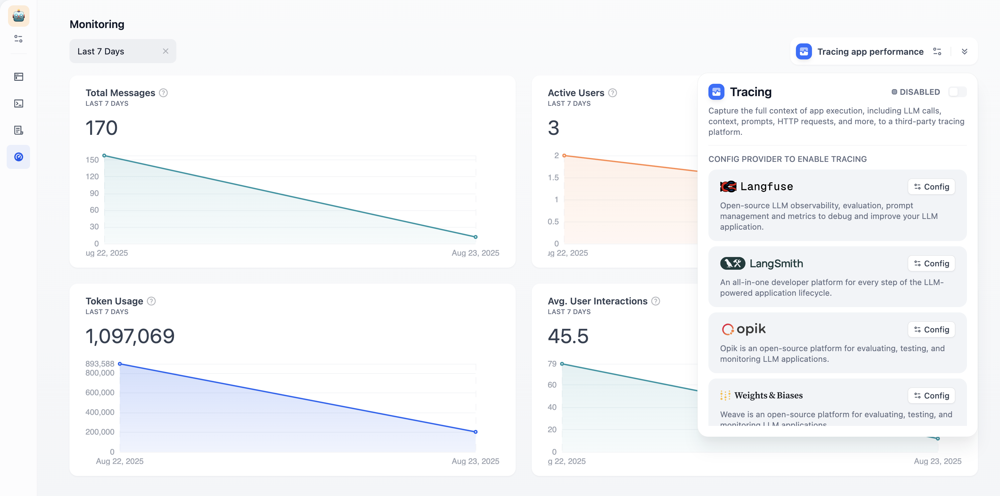

# 仪表盘

> 通过 Dify 内置的分析仪表盘监控性能、成本和用户参与度

> 本文档由 AI 自动翻译。如有任何不准确之处，请参考 [英文原版](https://docs.dify.ai/en/cloud/use-dify/monitor/analysis.md)。

该仪表盘随时间跟踪四个指标，以展示你的应用的表现：

**Total Messages**：对话量\
**Active Users**：有意义互动的用户（多于一次的交互）\
**Average User Interactions**：每次会话的参与深度\
**Token Usage**：资源消耗和成本

使用时间选择器查看不同时间段的趋势。点击 **"Tracing app performance"** 以连接外部可观察性平台，如 [Langfuse](%E9%9B%86%E6%88%90/%E9%9B%86%E6%88%90%20Langfuse.md) 或 [LangSmith](%E9%9B%86%E6%88%90/%E9%9B%86%E6%88%90%20LangSmith.md)，以获得更深入的分析。

[Agent](../%E7%BC%96%E6%8E%92/Agent/Agent.md) 也有同样的追踪设置，在它的 **监控** 区域中打开。这些设置只作用于 Agent 自己的运行，比如它的对话、Web 应用和 API 调用。Agent 在 Workflow 应用中运行时，以该应用的追踪设置为准。

追踪设置里的 **Agent 数据采集** 用来决定追踪数据包含哪些内容，适用于 Agent 应用和含 [新 Agent 节点](../%E7%BC%96%E6%8E%92/Workflow%20%E4%B8%8E%20Chatflow/%E8%8A%82%E7%82%B9/Agent.md#new-agent) 的工作流：

* **采集 Agent 内部过程**：Agent 的模型调用和工具调用。不想把这些步骤发给追踪供应商时，可关闭它，追踪中的 Agent 随之只显示为一个步骤。
* **采集内容**：追踪中每个步骤（不只是 Agent）的输入和输出。开启后，提示词、用户消息和回复都会发送到追踪供应商。

其他工作流（包括只含经典 Agent 节点的工作流）中，这两个开关都不起作用。
