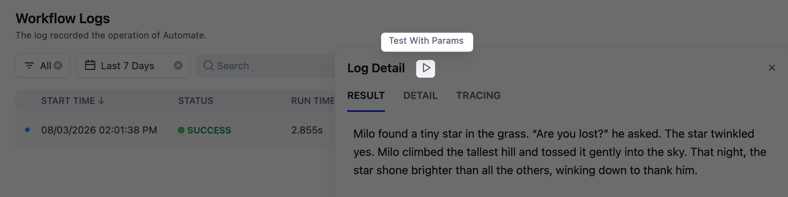

# 日志

> 浏览与查看应用的对话和运行日志，了解日志保留规则，并管理已归档的工作流日志

> 本文档由 AI 自动翻译。如有任何不准确之处，请参考 [英文原版](https://docs.dify.ai/en/cloud/use-dify/monitor/logs.md)。

在任意应用的 **日志** 页面中，可看到应用的真实使用情况：用户提交了什么、应用如何响应、收到了哪些反馈。

聊天类应用（聊天助手、Chatflow、Agent）和文本生成应用记录对话；Workflow 应用记录运行。

## 记录内容

日志涵盖所有渠道的真实使用：Web 应用、API，以及从 **主页** 的 **WEB APPS** 列表打开的应用。Workflow 应用中由 [触发器](../%E7%BC%96%E6%8E%92/Workflow%20%E4%B8%8E%20Chatflow/%E8%A7%A6%E5%8F%91%E5%99%A8/%E8%A7%A6%E5%8F%91%E5%99%A8.md) 启动的运行也会被记录。

> [!NOTE]
>
> 其他应用通过工具节点调用工作流工具时，这次运行记录在调用方应用中，而不是工具所在的应用。

终端用户的反馈（点赞/点踩和评论）与对应消息一同保存。

Chatflow 和 Workflow 应用在编辑器中的测试（**预览** 和 **测试运行**）不会出现在日志中；其他应用类型的测试对话会被记录，显示为对应团队成员的账户。

## 浏览日志

每一行是一次对话或一次运行。多数列一目了然，少数几列需要说明：

* **标题**：由对话的第一条消息自动生成。
* **用户或账户**：Web 应用和 API 的使用显示会话 ID，Dify 内的使用显示团队成员账户。
* **用户反馈** 统计终端用户的点赞/点踩，**管理员反馈** 统计团队成员的点赞/点踩，均按整个对话汇总。
* **触发方式**（Workflow 应用）：显示每次运行的来源：
  * **网页应用**：已发布的 Web 应用，或通过 API 调用
  * **Webhook**：Webhook 触发器收到请求
  * **定时任务**：定时触发器到达设定时间
  * **集成**：已连接集成发来的事件

要查找某次对话，可搜索消息中的文字或终端用户的会话 ID。要查找某次工作流运行，可搜索运行的输入或输出，或直接粘贴运行 ID。

## 查看对话

点击某一行可打开完整的消息记录。将鼠标悬停在回答上，你可以：

* 查看该条消息的 token 消耗与耗时。
* 打开背后的日志：原始提示词、Agent 应用的工具调用过程，或 Chatflow 消息的逐节点追踪。
* 评价回答，作为团队反馈；点踩时可附评论说明问题。团队评价计入 **管理员反馈** 列，与终端用户反馈分开统计。
* 添加标注，为该问题配上改进后的回复。标注如何生效，详见 [标注系统](%E6%A0%87%E6%B3%A8%E7%B3%BB%E7%BB%9F.md)。

要把某条日志分享给同事，复制浏览器地址栏中的链接即可。

## 查看运行

对于 Workflow 应用，点击某次运行可查看其结果、带状态和 token 总量的输入输出，以及逐节点的执行追踪，便于定位运行失败或变慢的环节。

> [!NOTE]
>
> 由工具节点调用的工作流工具，在追踪中只显示为该工具节点。要查看工具内部的节点，点击该节点上的 **追踪**。

要复现问题，点击 **按此参数测试**：工作流会在编辑器中以该次运行的输入重新运行。

## 日志保留

> [!WARNING]
>
> 日志包含完整的用户对话，可能涉及敏感信息。确保你的应用符合当地数据隐私法规：发布隐私政策，并在需要时获得用户同意。
>
> 删除对话或清理过期日志时，其中上传的文件不会被一并删除。

Sandbox 计划的各类日志均保留 30 天，更早的记录会被永久删除，之后升级也无法找回。

Professional 和 Team 套餐的保留规则取决于日志类型：

* **对话日志**（聊天助手、Chatflow、Agent 和文本生成应用）：在订阅有效期内持续保留。
* **工作流运行日志**（Workflow 应用）：近期运行保留在 **日志** 页面；超过约 3 个月的运行会转入按月归档，可下载为 CSV 文件。详见 [管理归档日志](%E6%97%A5%E5%BF%97.md#管理归档日志-professional-team)。

## 管理归档日志 Professional Team

工作流运行日志超过约 3 个月后，每月会以工作空间为单位打包归档一次。工作空间所有者和管理员可在 **设置** > **归档日志** 中找到这些归档。

### 下载

1. 点击目标月份的 **准备下载**。准备在后台进行，你可离开页面稍后再回来。
2. 按钮变为 **下载** 后，点击即可保存文件。已准备好的下载在 24 小时内有效。

每次下载是一个 ZIP 文件，其中的 CSV 文件涵盖工作空间当月的全部工作流运行：

| 文件 | 内容 |
| :- | :- |
| `workflow_runs.csv` | 每次运行一行：状态、输入、输出、耗时与 token 用量 |
| `workflow_app_logs.csv` | 将每次运行与所属应用及发起运行的终端用户或账户关联 |
| `workflow_node_executions.csv` | 每次运行中各节点的执行记录 |
| `workflow_node_execution_offload.csv` | 单独存储的超大节点输入与输出 |
| `workflow_pauses.csv`、`workflow_pause_reasons.csv` | 等待人工介入的运行产生的暂停记录 |
| `workflow_trigger_logs.csv` | 启动运行的触发器调用记录 |

> [!TIP]
>
> 如需提取单个应用的历史记录，可按 `app_id` 列筛选，运行与应用日志 CSV 中均有此列。应用 ID 是 **Studio** 中该应用 URL 里的一长串标识符。

### 删除

只有工作空间所有者才能删除某个月的归档。
