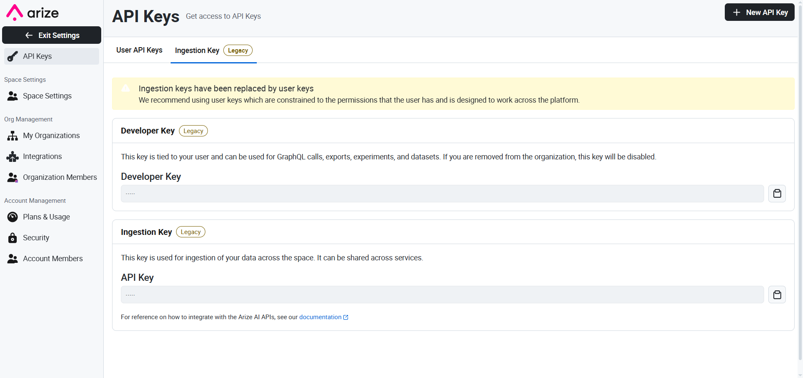
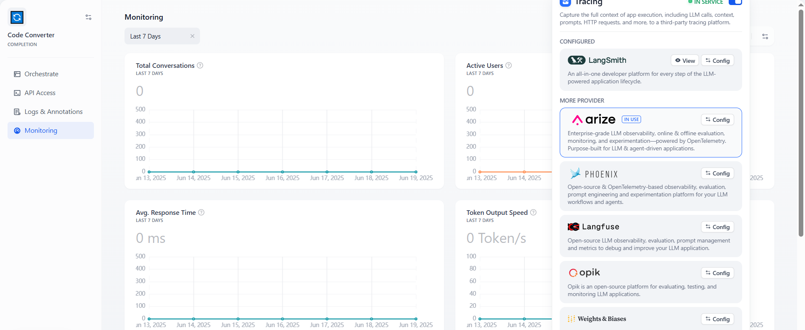
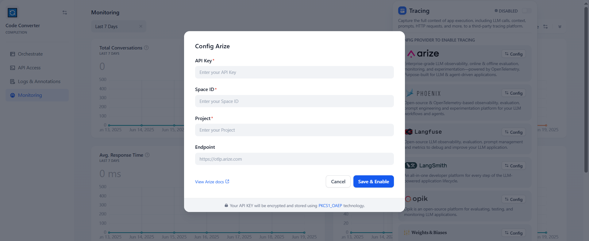
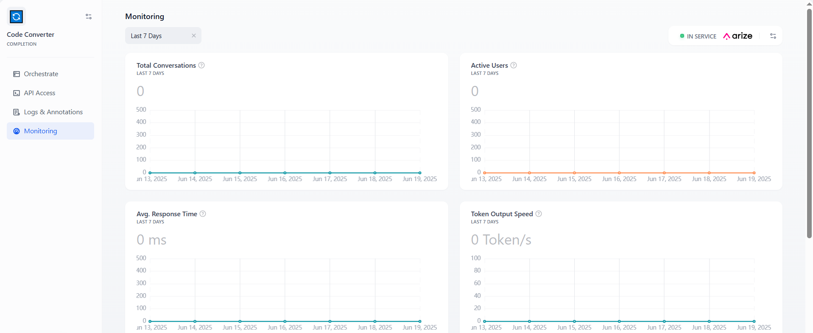

# 集成 Arize

> 本文档由 AI 自动翻译。如有任何不准确之处，请参考 [英文原版](https://docs.dify.ai/en/cloud/use-dify/monitor/integrations/integrate-arize.md)。

### Arize 简介

[Arize AX](https://arize.com/products/ax/) 是 [Arize AI](https://arize.com/?utm_source=dify-docs\&utm_medium=partner\&utm_campaign=partner-docs\&utm_content=integrate-arize) 推出的全功能平台，为 LLM 和 Agent 驱动的应用提供可观测性、在线与离线评估、监控和实验能力。它面向生产环境团队、AI 原生公司和企业，支持托管云与企业自部署两种部署方式。

如需用于实验或单容器自部署的开源方案，可改用 [Phoenix 集成](%E9%9B%86%E6%88%90%20Phoenix.md)。

追踪数据接入后，可参考 Arize 的 [Agent 评估指南](https://arize.com/guides/ai-agent-handbook/agent-evaluation/) 和 [LLM 评估指南](https://arize.com/resources/llm-evaluation/)，了解如何用追踪数据调试故障、评估 Agent 行为、监控模型质量。

### 配置 Arize

本章节将指引你注册 Arize 并将其集成至 Dify 平台内。

#### 1. 注册/登录 [Arize](https://app.arize.com/auth/join)

### 2. 获取 Arize API 密钥

从右上角的用户菜单中获取 Arize API 密钥。点击 **API Key**，然后点击 API Key 进行复制：

### 3. 集成 Arize 与 Dify

在 Dify 应用中配置 Arize。打开需要监控的应用，在侧边菜单中打开 **监控**，并在页面上选择 **追踪应用性能**。

点击配置后，将在 Arize 中创建的 **API Key**, **Space ID** 和 **项目名称**粘贴到配置中并保存。

成功保存后，你可以在当前页面查看监控状态。

## 监控数据列表

### **Workflow/Chatflow 追踪信息**

**用于追踪 Workflow 和 Chatflow**

| 工作流 | Arize 追踪 |
| - | - |
| workflow\_app\_log\_id/workflow\_run\_id | id |
| user\_session\_id | - 放置在元数据中 |
| `workflow_{id}` | name |
| start\_time | start\_time |
| end\_time | end\_time |
| inputs | inputs |
| outputs | outputs |
| Model token consumption | usage\_metadata |
| metadata | metadata |
| error | error |
| \[workflow] | tags |
| conversation\_id/none for workflow | conversation\_id in metadata |

**工作流追踪信息**

* workflow\_id - 工作流唯一标识符
* conversation\_id - 对话 ID
* workflow\_run\_id - 当前运行的 ID
* tenant\_id - 租户 ID
* elapsed\_time - 当前运行所用时间
* status - 运行状态
* version - 工作流版本
* total\_tokens - 当前运行使用的总令牌数
* file\_list - 处理的文件列表
* triggered\_from - 触发当前运行的来源
* workflow\_run\_inputs - 当前运行的输入数据
* workflow\_run\_outputs - 当前运行的输出数据
* error - 当前运行期间遇到的错误
* query - 运行期间使用的查询
* workflow\_app\_log\_id - Workflow 应用日志 ID
* message\_id - 关联的消息 ID
* start\_time - 运行开始时间
* end\_time - 运行结束时间
* workflow node executions - 工作流节点执行信息
* 元数据
  * workflow\_id - 工作流唯一标识符
  * conversation\_id - 对话 ID
  * workflow\_run\_id - 当前运行的 ID
  * tenant\_id - 租户 ID
  * elapsed\_time - 当前运行所用时间
  * status - 运行状态
  * version - 工作流版本
  * total\_tokens - 当前运行使用的总令牌数
  * file\_list - 处理的文件列表
  * triggered\_from - 触发当前运行的来源

#### **消息追踪信息**

**用于追踪 LLM 相关对话**

| 聊天 | Arize LLM |
| - | - |
| message\_id | id |
| user\_session\_id | - 放置在元数据中 |
| "llm" | name |
| start\_time | start\_time |
| end\_time | end\_time |
| inputs | inputs |
| outputs | outputs |
| Model token consumption | usage\_metadata |
| metadata | metadata |
| \["message", conversation\_mode] | tags |
| conversation\_id | conversation\_id in metadata |

**消息追踪信息**

* message\_id - 消息 ID
* message\_data - 消息数据
* user\_session\_id - 用户会话 ID
* conversation\_model - 对话模式
* message\_tokens - 消息中的令牌数
* answer\_tokens - 答案中的令牌数
* total\_tokens - 消息和答案中的总令牌数
* error - 错误信息
* inputs - 输入数据
* outputs - 输出数据
* file\_list - 处理的文件列表
* start\_time - 开始时间
* end\_time - 结束时间
* message\_file\_data - 与消息关联的文件数据
* conversation\_mode - 对话模式
* 元数据
  * conversation\_id - 对话 ID
  * ls\_provider - 模型供应商
  * ls\_model\_name - 模型 ID
  * status - 消息状态
  * from\_end\_user\_id - 发送用户的 ID
  * from\_account\_id - 发送账户的 ID
  * agent\_based - 消息是否基于代理
  * workflow\_run\_id - 工作流运行 ID
  * from\_source - 消息来源

#### **审核追踪信息**

**用于追踪对话审核**

| 审核 | Arize Tool |
| - | - |
| user\_id | - 放置在元数据中 |
| "moderation" | name |
| start\_time | start\_time |
| end\_time | end\_time |
| inputs | inputs |
| outputs | outputs |
| metadata | metadata |
| \["moderation"] | tags |

**审核追踪信息**

* message\_id - 消息 ID
* user\_id - 用户 ID
* workflow\_app\_log\_id - Workflow 应用日志 ID
* inputs - 审核输入数据
* message\_data - 消息数据
* flagged - 内容是否被标记需要注意
* action - 采取的具体行动
* preset\_response - 预设响应
* start\_time - 审核开始时间
* end\_time - 审核结束时间
* 元数据
  * message\_id - 消息 ID
  * action - 采取的具体行动
  * preset\_response - 预设响应

#### **建议问题追踪信息**

**用于追踪建议问题**

| 建议问题 | Arize LLM |
| - | - |
| user\_id | - 放置在元数据中 |
| "suggested\_question" | name |
| start\_time | start\_time |
| end\_time | end\_time |
| inputs | inputs |
| outputs | outputs |
| metadata | metadata |
| \["suggested\_question"] | tags |

**消息追踪信息**

* message\_id - 消息 ID
* message\_data - 消息数据
* inputs - 输入内容
* outputs - 输出内容
* start\_time - 开始时间
* end\_time - 结束时间
* total\_tokens - 令牌数量
* status - 消息状态
* error - 错误信息
* from\_account\_id - 发送账户的 ID
* agent\_based - 是否基于代理
* from\_source - 消息来源
* model\_provider - 模型供应商
* model\_id - 模型 ID
* suggested\_question - 建议问题
* level - 状态级别
* status\_message - 状态消息
* 元数据
  * message\_id - 消息 ID
  * ls\_provider - 模型供应商
  * ls\_model\_name - 模型 ID
  * status - 消息状态
  * from\_end\_user\_id - 发送用户的 ID
  * from\_account\_id - 发送账户的 ID
  * workflow\_run\_id - 工作流运行 ID
  * from\_source - 消息来源

#### **数据集检索追踪信息**

**用于追踪知识库检索**

| 数据集检索 | Arize Retriever |
| - | - |
| user\_id | - 放置在元数据中 |
| "dataset\_retrieval" | name |
| start\_time | start\_time |
| end\_time | end\_time |
| inputs | inputs |
| outputs | outputs |
| metadata | metadata |
| \["dataset\_retrieval"] | tags |
| message\_id | parent\_run\_id |

**数据集检索追踪信息**

* message\_id - 消息 ID
* inputs - 输入内容
* documents - 文档数据
* start\_time - 开始时间
* end\_time - 结束时间
* message\_data - 消息数据
* 元数据
  * message\_id - 消息 ID
  * ls\_provider - 模型供应商
  * ls\_model\_name - 模型 ID
  * status - 消息状态
  * from\_end\_user\_id - 发送用户的 ID
  * from\_account\_id - 发送账户的 ID
  * agent\_based - 是否基于代理
  * workflow\_run\_id - 工作流运行 ID
  * from\_source - 消息来源

#### **工具追踪信息**

**用于追踪工具调用**

| 工具 | Arize Tool |
| - | - |
| user\_id | - 放置在元数据中 |
| tool\_name | name |
| start\_time | start\_time |
| end\_time | end\_time |
| inputs | inputs |
| outputs | outputs |
| metadata | metadata |
| \["tool", tool\_name] | tags |

#### **工具追踪信息**

* message\_id - 消息 ID
* tool\_name - 工具名称
* start\_time - 开始时间
* end\_time - 结束时间
* tool\_inputs - 工具输入
* tool\_outputs - 工具输出
* message\_data - 消息数据
* error - 错误信息（如果有）
* inputs - 消息的输入
* outputs - 消息的输出
* tool\_config - 工具配置
* time\_cost - 时间消耗
* tool\_parameters - 工具参数
* file\_url - 关联文件的 URL
* 元数据
  * message\_id - 消息 ID
  * tool\_name - 工具名称
  * tool\_inputs - 工具输入
  * tool\_outputs - 工具输出
  * tool\_config - 工具配置
  * time\_cost - 时间消耗
  * error - 错误信息（如果有）
  * tool\_parameters - 工具参数
  * message\_file\_id - 消息文件 ID
  * created\_by\_role - 创建者角色
  * created\_user\_id - 创建者用户 ID

#### **生成名称追踪信息**

**用于追踪对话标题生成**

| 生成名称 | Arize Tool |
| - | - |
| user\_id | - 放置在元数据中 |
| "generate\_conversation\_name" | name |
| start\_time | start\_time |
| end\_time | end\_time |
| inputs | inputs |
| outputs | outputs |
| metadata | metadata |
| \["generate\_name"] | tags |

**生成名称追踪信息**

* conversation\_id - 对话 ID
* inputs - 输入数据
* outputs - 生成的对话名称
* start\_time - 开始时间
* end\_time - 结束时间
* tenant\_id - 租户 ID
* 元数据
  * conversation\_id - 对话 ID
  * tenant\_id - 租户 ID
