# 集成 LangSmith

> 本文档由 AI 自动翻译。如有任何不准确之处，请参考 [英文原版](https://docs.dify.ai/en/cloud/use-dify/monitor/integrations/integrate-langsmith.md)。

### LangSmith 简介

LangSmith 是一个用于构建生产级 LLM 应用的平台，它用于开发、协作、测试、部署和监控 LLM 应用。

LangSmith [官网介绍](https://www.langchain.com/langsmith)

### 配置 LangSmith

本章节将指引你注册 LangSmith 并将其集成至 Dify 平台内。

#### 1. 注册/登录 [LangSmith](https://www.langchain.com/langsmith)

#### 2. 创建项目

在 LangSmith 内创建项目，登录后在主页点击 **New Project** 创建一个自己的项目，**项目**将用于与 Dify 内的**应用**关联进行数据监测。

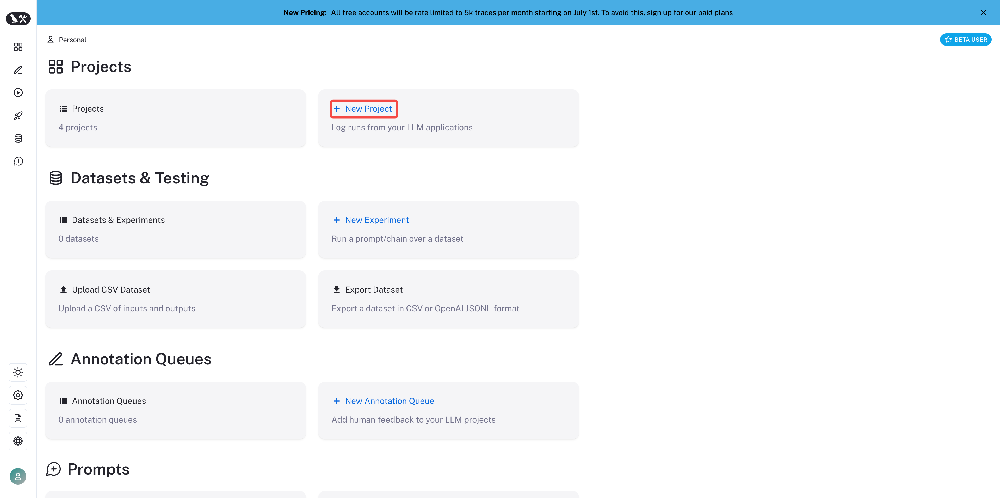

在 LangSmith 内创建项目

创建完成之后在 Projects 内可以查看该项目。

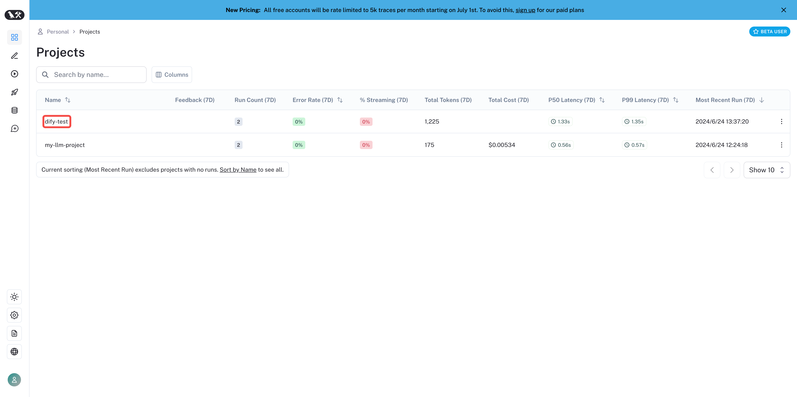

在 LangSmith 内查看已创建项目

#### 3. 创建项目凭据

创建项目凭据，在左侧边栏内找到项目设置 **Settings**。

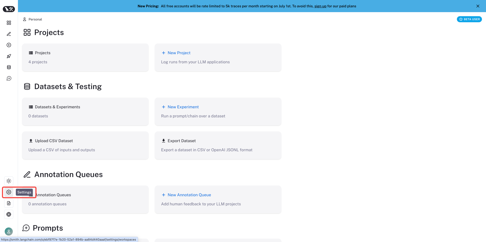

项目设置

点击 **Create API Key**，创建一个项目凭据。

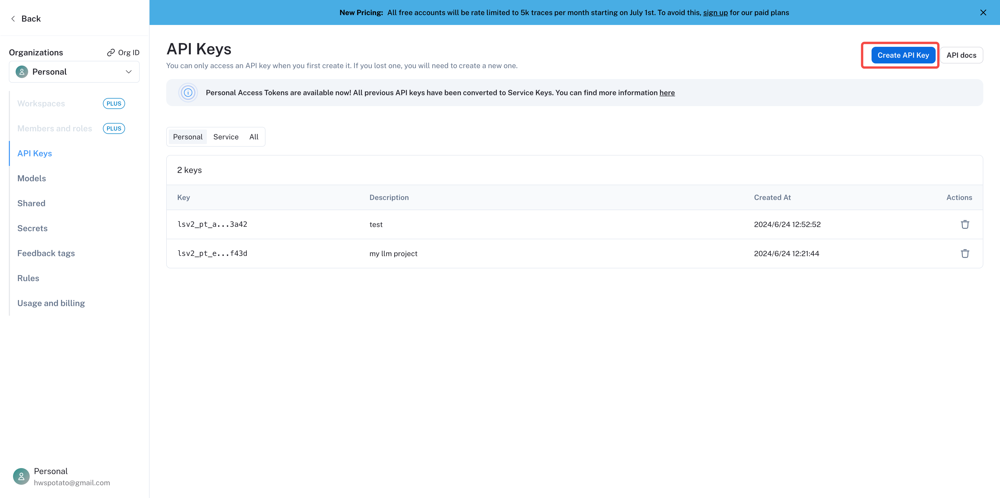

创建一个项目 API Key

选择 **Personal Access Token** ，用于后续的 API 身份校验。

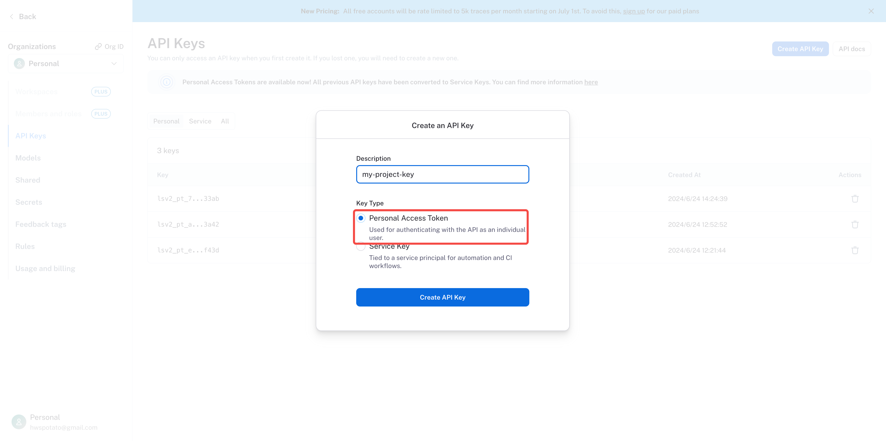

创建一个 API Key

将创建的 API key 复制保存。

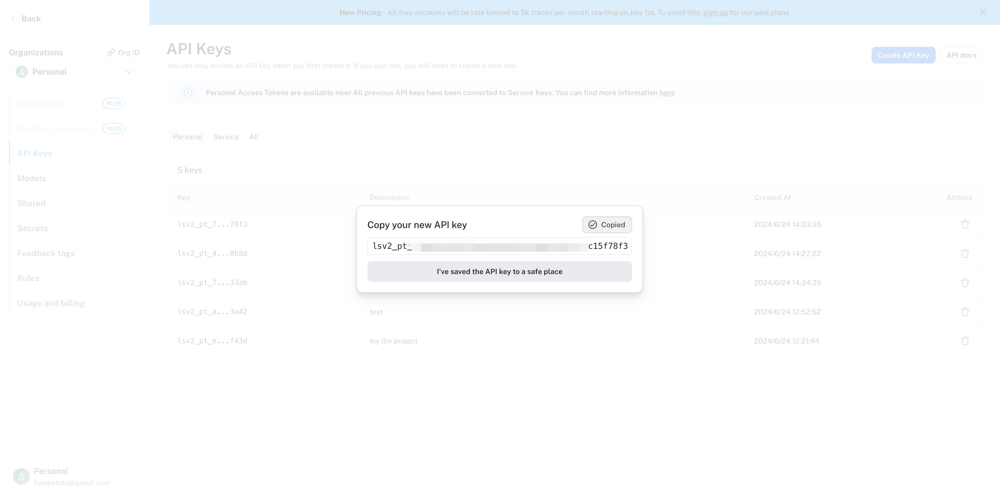

复制 API Key

#### 4. 将 LangSmith 集成至 Dify 平台

在 Dify 应用内配置 LangSmith。打开需要监测的应用，在左侧边菜单内打开 **监测**，点击页面内的 **配置。**

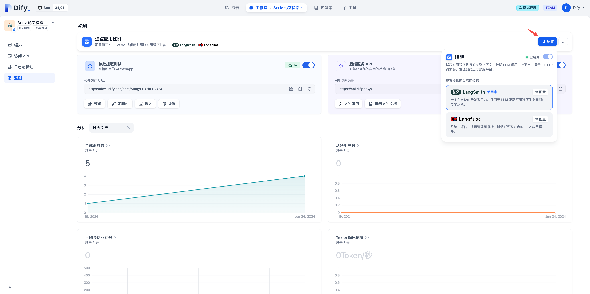

配置 LangSmith

点击配置后，将在 LangSmith 内创建的 **API Key** 和 **项目名**粘贴到配置内并保存。

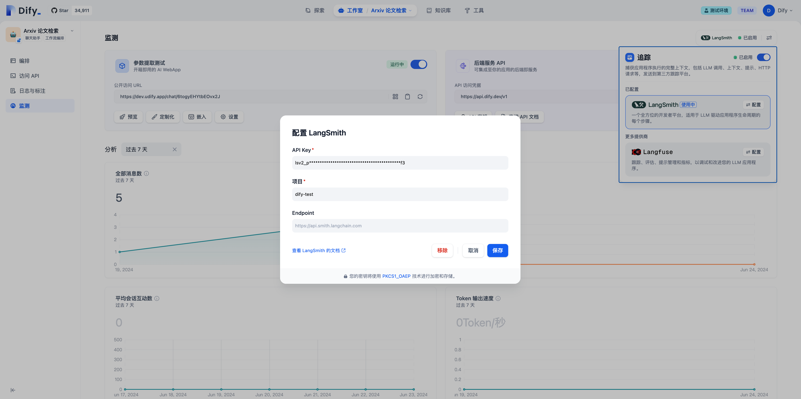

配置 LangSmith

配置项目名需要与 LangSmith 内设置的项目一致，若项目名不一致，数据同步时 LangSmith 会自动创建一个新的项目。

成功保存后可以在当前页面查看监测状态。

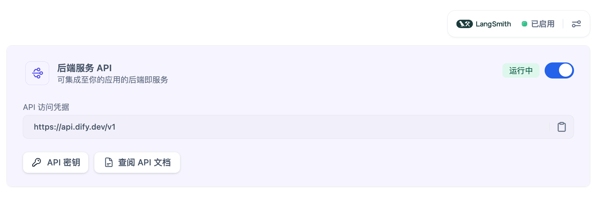

查看配置状态

### 在 LangSmith 内查看监测数据

配置完成后，Dify 内应用的调试或生产数据可以在 LangSmith 查看监测数据。

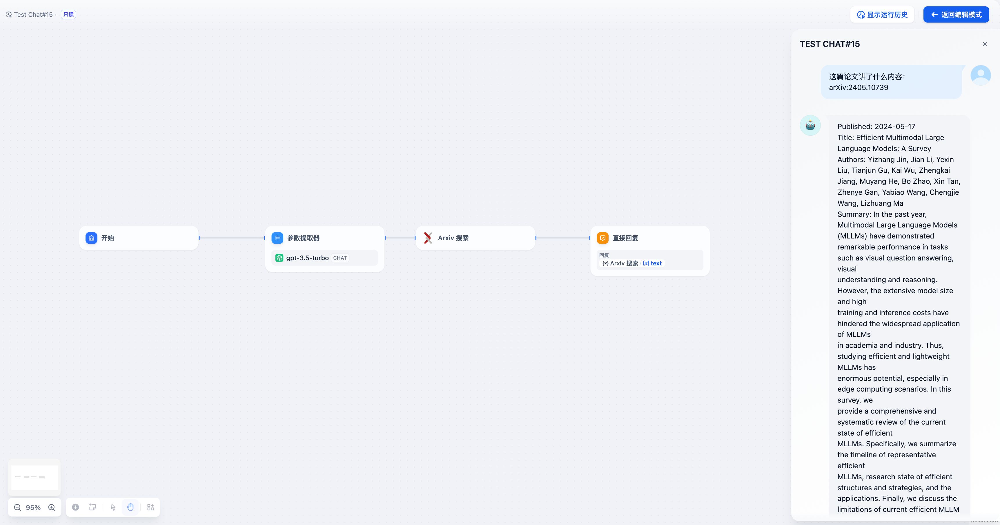

在 Dify 内调试应用

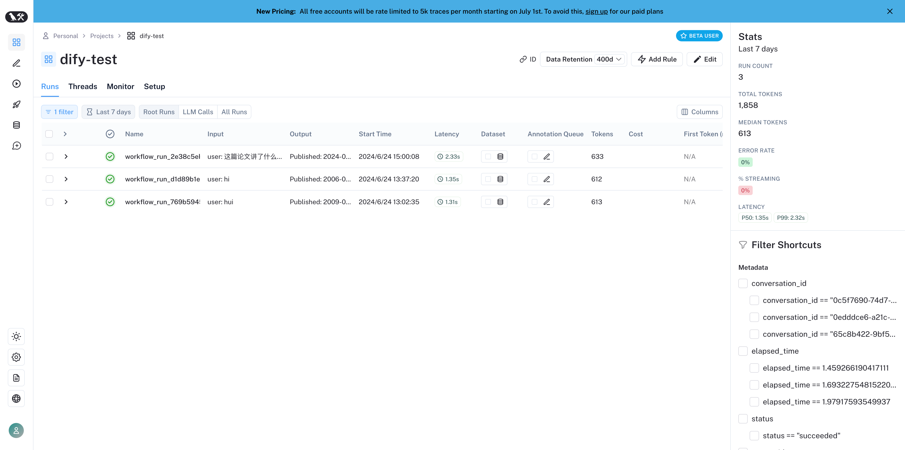

在 LangSmith 内查看应用数据

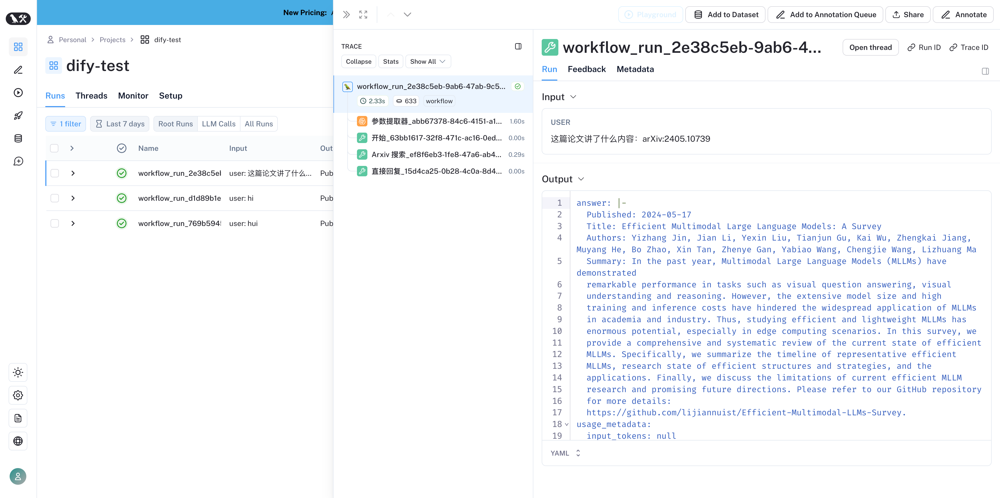

在 LangSmith 内查看应用数据

### 监测数据清单

#### Workflow /Chatflow Trace 信息

**用于追踪 workflow 以及 chatflow**

| Workflow | LangSmith Chain |
| - | - |
| workflow\_app\_log\_id/workflow\_run\_id | id |
| user\_session\_id | -放入 metadata |
| workflow\_\{id} | name |
| start\_time | start\_time |
| end\_time | end\_time |
| inputs | inputs |
| outputs | outputs |
| 模型 token 消耗相关 | usage\_metadata |
| metadata | extra |
| error | error |
| \[workflow] | tags |
| "conversation\_id/workflow 时无" | metadata 中的 conversation\_id |
| conversion\_id | parent\_run\_id |

**Workflow Trace Info**

* workflow\_id - Workflow 的唯一标识
* conversation\_id - 对话 ID
* workflow\_run\_id - 此次运行的 ID
* tenant\_id - 租户 ID
* elapsed\_time - 此次运行耗时
* status - 运行状态
* version - Workflow 版本
* total\_tokens - 此次运行使用的 token 总数
* file\_list - 处理的文件列表
* triggered\_from - 触发此次运行的来源
* workflow\_run\_inputs - 此次运行的输入数据
* workflow\_run\_outputs - 此次运行的输出数据
* error - 此次运行中发生的错误
* query - 运行时使用的查询
* workflow\_app\_log\_id - Workflow 应用日志 ID
* message\_id - 关联的消息 ID
* start\_time - 运行开始时间
* end\_time - 运行结束时间
* workflow node executions - workflow 节点运行信息
* Metadata
  * workflow\_id - Workflow 的唯一标识
  * conversation\_id - 对话 ID
  * workflow\_run\_id - 此次运行的 ID
  * tenant\_id - 租户 ID
  * elapsed\_time - 此次运行耗时
  * status - 运行状态
  * version - Workflow 版本
  * total\_tokens - 此次运行使用的 token 总数
  * file\_list - 处理的文件列表
  * triggered\_from - 触发来源

#### Message Trace 信息

**用于追踪 llm 对话相关**

| Chat | LangSmith LLM |
| - | - |
| message\_id | id |
| user\_session\_id | -放入 metadata |
| "message\_\{id}" | name |
| start\_time | start\_time |
| end\_time | end\_time |
| inputs | inputs |
| outputs | outputs |
| 模型 token 消耗相关 | usage\_metadata |
| metadata | extra |
| error | error |
| \["message", conversation\_mode] | tags |
| conversation\_id | metadata 中的 conversation\_id |
| conversion\_id | parent\_run\_id |

**Message Trace Info**

* message\_id - 消息 ID
* message\_data - 消息数据
* user\_session\_id - 用户的 session\_id
* conversation\_model - 对话模式
* message\_tokens - 消息中的令牌数
* answer\_tokens - 回答中的令牌数
* total\_tokens - 消息和回答中的总令牌数
* error - 错误信息
* inputs - 输入数据
* outputs - 输出数据
* file\_list - 处理的文件列表
* start\_time - 开始时间
* end\_time - 结束时间
* message\_file\_data - 消息关联的文件数据
* conversation\_mode - 对话模式
* Metadata
  * conversation\_id - 消息所属对话的 ID
  * ls\_provider - 模型提供者
  * ls\_model\_name - 模型 ID
  * status - 消息状态
  * from\_end\_user\_id - 发送用户的 ID
  * from\_account\_id - 发送账户的 ID
  * agent\_based - 是否基于代理
  * workflow\_run\_id - 工作流运行 ID
  * from\_source - 消息来源
  * message\_id - 消息 ID

#### Moderation Trace 信息

**用于追踪对话审查**

| Moderation | LangSmith Tool |
| - | - |
| user\_id | -放入 metadata |
| “moderation" | name |
| start\_time | start\_time |
| end\_time | end\_time |
| inputs | inputs |
| outputs | outputs |
| metadata | extra |
| \[moderation] | tags |
| message\_id | parent\_run\_id |

**Message Trace Info**

* message\_id - 消息 ID
* user\_id: 用户 id
* workflow\_app\_log\_id workflow\_app\_log\_id
* inputs - 审查的输入数据
* message\_data - 消息数据
* flagged - 是否被标记为需要注意的内容
* action - 执行的具体行动
* preset\_response - 预设响应
* start\_time - 审查开始时间
* end\_time - 审查结束时间
* Metadata
  * message\_id - 消息 ID
  * action - 执行的具体行动
  * preset\_response - 预设响应

#### Suggested Question Trace 信息

**用于追踪建议问题**

| Suggested Question | LangSmith LLM |
| - | - |
| user\_id | -放入 metadata |
| suggested\_question | name |
| start\_time | start\_time |
| end\_time | end\_time |
| inputs | inputs |
| outputs | outputs |
| metadata | extra |
| \[suggested\_question] | tags |
| message\_id | parent\_run\_id |

**Message Trace Info**

* message\_id - 消息 ID
* message\_data - 消息数据
* inputs - 输入的内容
* outputs - 输出的内容
* start\_time - 开始时间
* end\_time - 结束时间
* total\_tokens - 令牌数量
* status - 消息状态
* error - 错误信息
* from\_account\_id - 发送账户的 ID
* agent\_based - 是否基于代理
* from\_source - 消息来源
* model\_provider - 模型提供者
* model\_id - 模型 ID
* suggested\_question - 建议的问题
* level - 状态级别
* status\_message - 状态信息
* Metadata
  * message\_id - 消息 ID
  * ls\_provider - 模型提供者
  * ls\_model\_name - 模型 ID
  * status - 消息状态
  * from\_end\_user\_id - 发送用户的 ID
  * from\_account\_id - 发送账户的 ID
  * workflow\_run\_id - 工作流运行 ID
  * from\_source - 消息来源

#### Dataset Retrieval Trace 信息

**用于追踪知识库检索**

| Dataset Retrieval | LangSmith Retriever |
| - | - |
| user\_id | -放入 metadata |
| dataset\_retrieval | name |
| start\_time | start\_time |
| end\_time | end\_time |
| inputs | inputs |
| outputs | outputs |
| metadata | extra |
| \[dataset\_retrieval] | tags |
| message\_id | parent\_run\_id |

**Dataset Retrieval Trace Info**

* message\_id - 消息 ID
* inputs - 输入内容
* documents - 文档数据
* start\_time - 开始时间
* end\_time - 结束时间
* message\_data - 消息数据
* Metadata
  * message\_id 消息 ID
  * ls\_provider 模型提供者
  * ls\_model\_name 模型 ID
  * status 消息状态
  * from\_end\_user\_id 发送用户的 ID
  * from\_account\_id 发送账户的 ID
  * agent\_based 是否基于代理
  * workflow\_run\_id 工作流运行 ID
  * from\_source 消息来源

#### Tool Trace 信息

**用于追踪工具调用**

| Tool | LangSmith Tool |
| - | - |
| user\_id | -放入 metadata |
| tool\_name | name |
| start\_time | start\_time |
| end\_time | end\_time |
| inputs | inputs |
| outputs | outputs |
| metadata | extra |
| \["tool", tool\_name] | tags |
| message\_id | parent\_run\_id |

**Tool Trace Info**

* message\_id 消息 ID
* tool\_name 工具名称
* start\_time 开始时间
* end\_time 结束时间
* tool\_inputs 工具输入
* tool\_outputs 工具输出
* message\_data 消息数据
* error 错误信息，如果存在
* inputs 消息的输入内容
* outputs 消息的回答内容
* tool\_config 工具配置
* time\_cost 时间成本
* tool\_parameters 工具参数
* file\_url 关联文件的 URL
* Metadata
  * message\_id 消息 ID
  * tool\_name 工具名称
  * tool\_inputs 工具输入
  * tool\_outputs 工具输出
  * tool\_config 工具配置
  * time\_cost 时间成本
  * error 错误信息
  * tool\_parameters 工具参数
  * message\_file\_id 消息文件 ID
  * created\_by\_role 创建者角色
  * created\_user\_id 创建者用户 ID

#### Generate Name Trace 信息

**用于追踪会话标题生成**

| Generate Name | LangSmith Tool |
| - | - |
| user\_id | -放入 metadata |
| generate\_name | name |
| start\_time | start\_time |
| end\_time | end\_time |
| inputs | inputs |
| outputs | outputs |
| metadata | extra |
| \[generate\_name] | tags |

**Generate Name Trace Info**

* conversation\_id 对话 ID
* inputs 输入数据
* outputs 生成的会话名称
* start\_time 开始时间
* end\_time 结束时间
* tenant\_id 租户 ID
* Metadata
  * conversation\_id 对话 ID
  * tenant\_id 租户 ID
