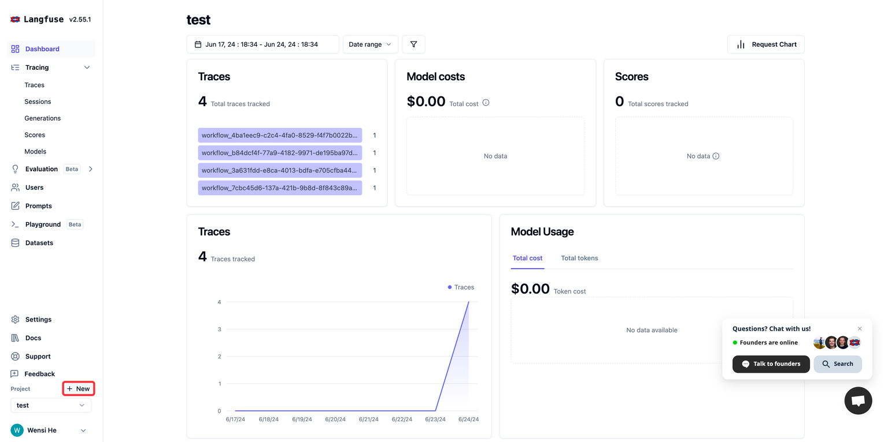
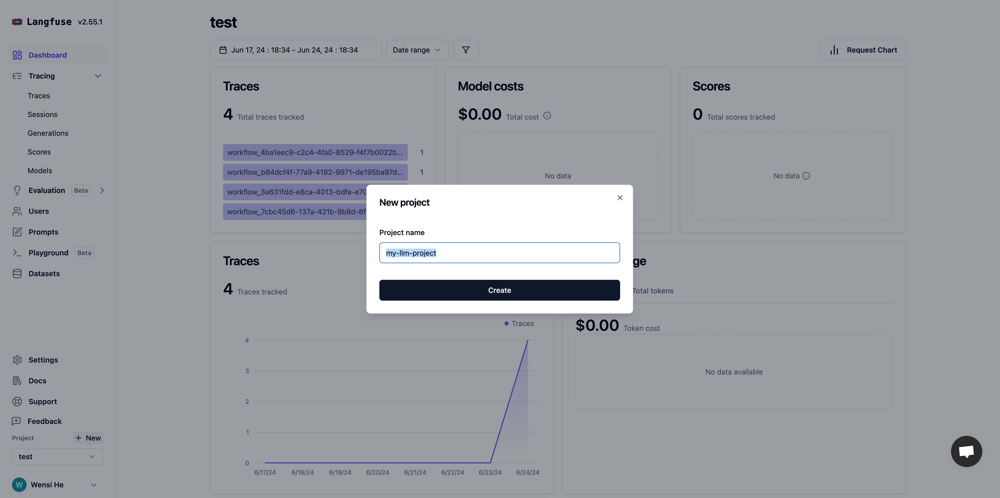
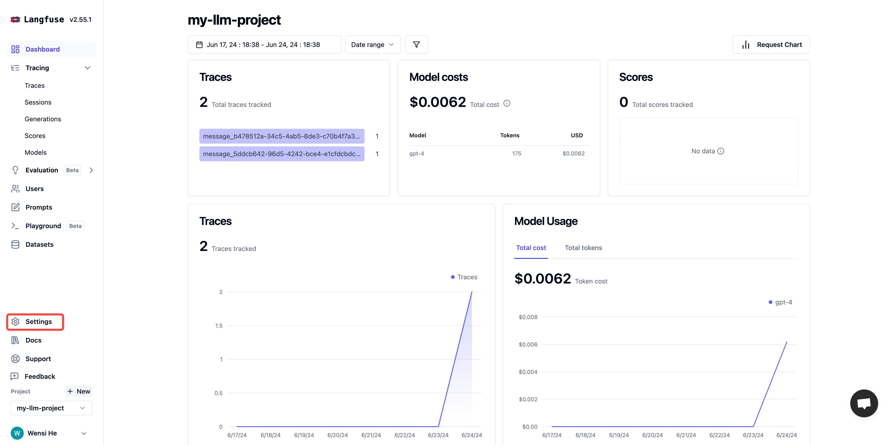
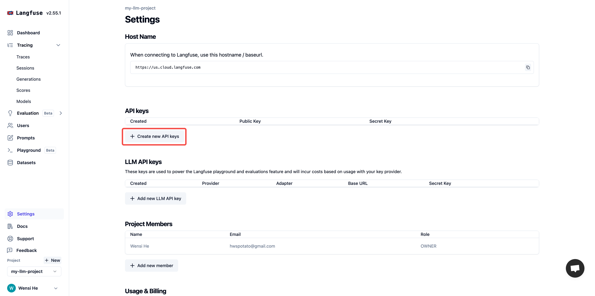
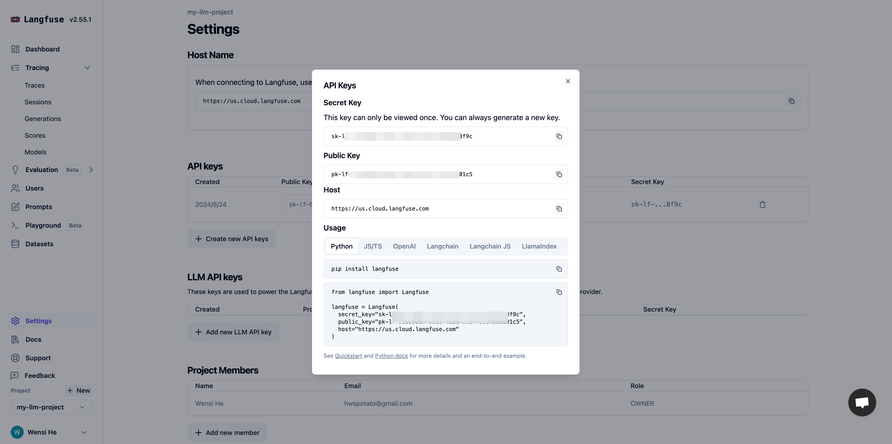
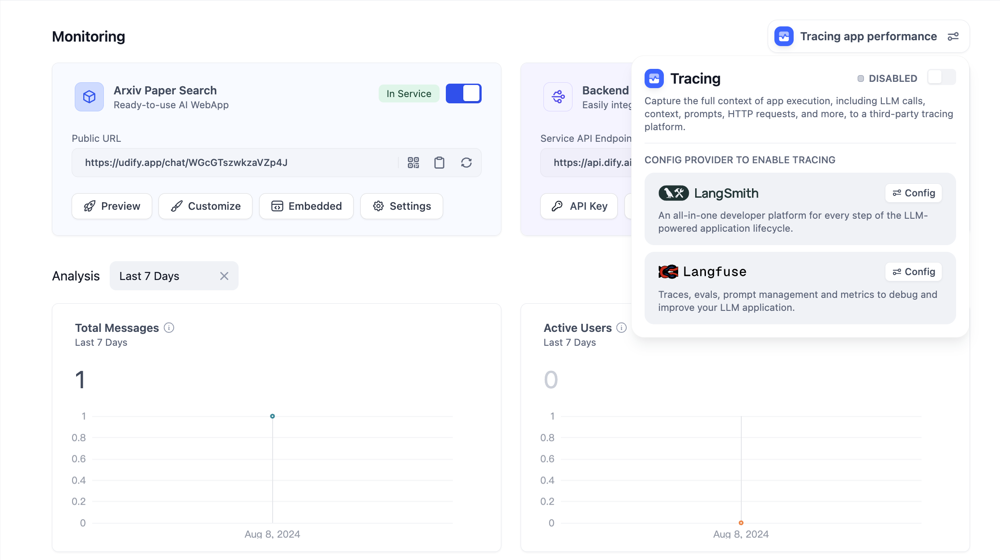
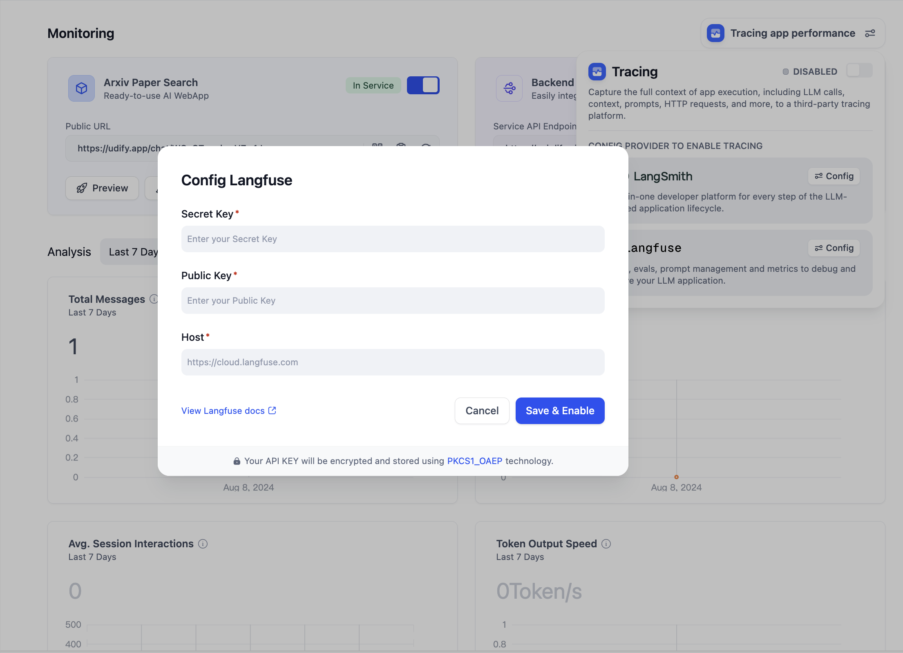
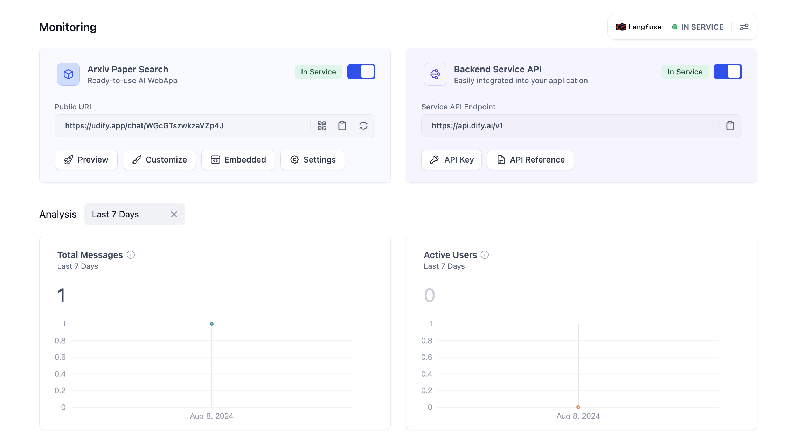
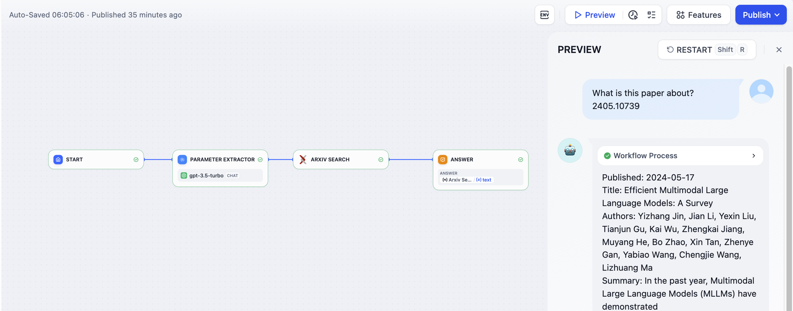
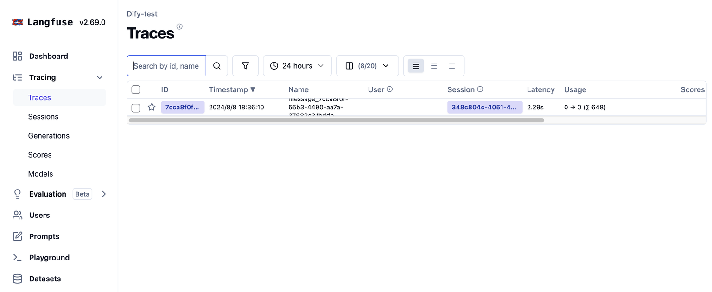

# 集成 Langfuse

> 本文档由 AI 自动翻译。如有任何不准确之处，请参考 [英文原版](https://docs.dify.ai/en/cloud/use-dify/monitor/integrations/integrate-langfuse.md)。

### 什么是 Langfuse

Langfuse 是一个开源的大型语言模型工程平台，帮助团队协作调试、分析和迭代他们的应用。

> [!NOTE]
>
> 介绍 Langfuse: [https://langfuse.com/](https://langfuse.com/)

### 如何配置 Langfuse

1. 在[官方网站](https://langfuse.com/)注册并登录 Langfuse
2. 在 Langfuse 中创建一个项目。登录后，点击主页上的 **New** 来创建你自己的项目。该 **项目**将用于与 Dify 中的 **应用**关联，以进行数据监控。

编辑项目名称。

3. 创建项目 API 凭据。在项目的左侧栏中，点击 **Settings** 打开设置。

在设置中，点击 **Create API Keys** 来创建项目 API 凭据。

复制并保存 **Secret Key**、**Public Key** 和 **Host**。

4. 在 Dify 中配置 Langfuse。打开你需要监控的应用，在侧边菜单中打开 **Monitoring**，并在页面上选择 **Tracing app performance**。

点击配置后，将在 Langfuse 中创建的 **Secret Key, Public Key, Host** 粘贴到配置中并保存。

成功保存后，你可以在当前页面查看状态。如果显示为已启动，则正在被监控。

### 在 Langfuse 中查看监控数据

配置完成后，可以在 Langfuse 中查看 Dify 应用的调试或生产数据。

### 监控数据列表

#### 跟踪 Workflow 和 Chatflow 的信息

**跟踪 Workflow 和 Chatflow**

<table>
  <thead>
    <tr>
      <th>Workflow</th>
      <th>LangFuse Trace</th>
    </tr>
  </thead>

  <tbody>
    <tr>
      <td>workflow\_app\_log\_id/workflow\_run\_id</td>
      <td>id</td>
    </tr>

    <tr>
      <td>user\_session\_id</td>
      <td>user\_id</td>
    </tr>

    <tr>
      <td>
        workflow\_\{id}
      </td>

      <td>name</td>
    </tr>

    <tr>
      <td>start\_time</td>
      <td>start\_time</td>
    </tr>

    <tr>
      <td>end\_time</td>
      <td>end\_time</td>
    </tr>

    <tr>
      <td>inputs</td>
      <td>input</td>
    </tr>

    <tr>
      <td>outputs</td>
      <td>output</td>
    </tr>

    <tr>
      <td>Model token consumption</td>
      <td>usage</td>
    </tr>

    <tr>
      <td>metadata</td>
      <td>metadata</td>
    </tr>

    <tr>
      <td>error</td>
      <td>level</td>
    </tr>

    <tr>
      <td>error</td>
      <td>status\_message</td>
    </tr>

    <tr>
      <td>\[workflow]</td>
      <td>tags</td>
    </tr>

    <tr>
      <td>\["message", conversation\_mode]</td>
      <td>session\_id</td>
    </tr>

    <tr>
      <td>conversion\_id</td>
      <td>parent\_observation\_id</td>
    </tr>
  </tbody>
</table>

**工作流跟踪信息**

* workflow\_id - 工作流的唯一 ID
* conversation\_id - 对话 ID
* workflow\_run\_id - 此运行时的工作流 ID
* tenant\_id - 租户 ID
* elapsed\_time - 此运行时的经过时间
* status - 运行时状态
* version - 工作流版本
* total\_tokens - 此运行时使用的总标记数
* file\_list - 处理文件的列表
* triggered\_from - 触发此运行时的来源
* workflow\_run\_inputs - 此工作流的输入
* workflow\_run\_outputs - 此工作流的输出
* error - 错误信息
* query - 运行时使用的查询
* workflow\_app\_log\_id - Workflow 应用日志 ID
* message\_id - 相关消息 ID
* start\_time - 此运行时的开始时间
* end\_time - 此运行时的结束时间
* workflow node executions - 工作流节点运行时信息
* 元数据
  * workflow\_id - 工作流的唯一 ID
  * conversation\_id - 对话 ID
  * workflow\_run\_id - 此运行时的工作流 ID
  * tenant\_id - 租户 ID
  * elapsed\_time - 此运行时的经过时间
  * status - 操作状态
  * version - 工作流版本
  * total\_tokens - 此运行时使用的总标记数
  * file\_list - 处理文件的列表
  * triggered\_from - 触发此运行时的来源

#### 消息跟踪信息

**用于跟踪大型语言模型对话**

<table>
  <thead>
    <tr>
      <th>Message</th>
      <th>LangFuse Generation/Trace</th>
    </tr>
  </thead>

  <tbody>
    <tr>
      <td>message\_id</td>
      <td>id</td>
    </tr>

    <tr>
      <td>user\_session\_id</td>
      <td>user\_id</td>
    </tr>

    <tr>
      <td>
        message\_\{id}
      </td>

      <td>name</td>
    </tr>

    <tr>
      <td>start\_time</td>
      <td>start\_time</td>
    </tr>

    <tr>
      <td>end\_time</td>
      <td>end\_time</td>
    </tr>

    <tr>
      <td>inputs</td>
      <td>input</td>
    </tr>

    <tr>
      <td>outputs</td>
      <td>output</td>
    </tr>

    <tr>
      <td>Model token consumption</td>
      <td>usage</td>
    </tr>

    <tr>
      <td>metadata</td>
      <td>metadata</td>
    </tr>

    <tr>
      <td>error</td>
      <td>level</td>
    </tr>

    <tr>
      <td>error</td>
      <td>status\_message</td>
    </tr>

    <tr>
      <td>\["message", conversation\_mode]</td>
      <td>tags</td>
    </tr>

    <tr>
      <td>conversation\_id</td>
      <td>session\_id</td>
    </tr>

    <tr>
      <td>conversion\_id</td>
      <td>parent\_observation\_id</td>
    </tr>
  </tbody>
</table>

**消息跟踪信息**

* message\_id - 消息 ID
* message\_data - 消息数据
* user\_session\_id - 用户会话 ID
* conversation\_model - 对话模型
* message\_tokens - 消息标记数
* answer\_tokens - 回答标记数
* total\_tokens - 消息和回答的总标记数
* error - 错误信息
* inputs - 输入数据
* outputs - 输出数据
* file\_list - 处理文件的列表
* start\_time - 开始时间
* end\_time - 结束时间
* message\_file\_data - 相关文件数据的消息
* conversation\_mode - 对话模式
* 元数据
  * conversation\_id - 对话 ID
  * ls\_provider - 模型供应商
  * ls\_model\_name - 模型 ID
  * status - 消息状态
  * from\_end\_user\_id - 发送用户的 ID
  * from\_account\_id - 发送账户的 ID
  * agent\_based - 是否基于 Agent
  * workflow\_run\_id - 此运行时的工作流 ID
  * from\_source - 消息来源
  * message\_id - 消息 ID

#### 审核跟踪信息

**用于跟踪对话审核**

<table>
  <thead>
    <tr>
      <th>Moderation</th>
      <th>LangFuse Generation/Trace</th>
    </tr>
  </thead>

  <tbody>
    <tr>
      <td>user\_id</td>
      <td>user\_id</td>
    </tr>

    <tr>
      <td>moderation</td>
      <td>name</td>
    </tr>

    <tr>
      <td>start\_time</td>
      <td>start\_time</td>
    </tr>

    <tr>
      <td>end\_time</td>
      <td>end\_time</td>
    </tr>

    <tr>
      <td>inputs</td>
      <td>input</td>
    </tr>

    <tr>
      <td>outputs</td>
      <td>output</td>
    </tr>

    <tr>
      <td>metadata</td>
      <td>metadata</td>
    </tr>

    <tr>
      <td>\[moderation]</td>
      <td>tags</td>
    </tr>

    <tr>
      <td>message\_id</td>
      <td>parent\_observation\_id</td>
    </tr>
  </tbody>
</table>

**消息跟踪信息**

* message\_id - 消息 ID
* user\_id - 用户 ID
* workflow\_app\_log\_id - Workflow 应用日志 ID
* inputs - 审核输入数据
* message\_data - 消息数据
* flagged - 是否标记为关注
* action - 实施的具体动作
* preset\_response - 预设响应
* start\_time - 审核开始时间
* end\_time - 审核结束时间
* 元数据
  * message\_id - 消息 ID
  * action - 实施的具体动作
  * preset\_response - 预设响应

#### 建议问题跟踪信息

**用于跟踪建议问题**

<table>
  <thead>
    <tr>
      <th>Suggested Question</th>
      <th>LangFuse Generation/Trace</th>
    </tr>
  </thead>

  <tbody>
    <tr>
      <td>user\_id</td>
      <td>user\_id</td>
    </tr>

    <tr>
      <td>suggested\_question</td>
      <td>name</td>
    </tr>

    <tr>
      <td>start\_time</td>
      <td>start\_time</td>
    </tr>

    <tr>
      <td>end\_time</td>
      <td>end\_time</td>
    </tr>

    <tr>
      <td>inputs</td>
      <td>input</td>
    </tr>

    <tr>
      <td>outputs</td>
      <td>output</td>
    </tr>

    <tr>
      <td>metadata</td>
      <td>metadata</td>
    </tr>

    <tr>
      <td>\[suggested\_question]</td>
      <td>tags</td>
    </tr>

    <tr>
      <td>message\_id</td>
      <td>parent\_observation\_id</td>
    </tr>
  </tbody>
</table>

**消息跟踪信息**

* message\_id - 消息 ID
* message\_data - 消息数据
* inputs - 输入数据
* outputs - 输出数据
* start\_time - 开始时间
* end\_time - 结束时间
* total\_tokens - 总标记数
* status - 消息状态
* error - 错误信息
* from\_account\_id - 发送账户 ID
* agent\_based - 是否基于 Agent
* from\_source - 消息来源
* model\_provider - 模型供应商
* model\_id - 模型 ID
* suggested\_question - 建议问题
* level - 状态级别
* status\_message - 消息状态
* 元数据
  * message\_id - 消息 ID
  * ls\_provider - 模型供应商
  * ls\_model\_name - 模型 ID
  * status - 消息状态
  * from\_end\_user\_id - 发送用户的 ID
  * from\_account\_id - 发送账户 ID
  * workflow\_run\_id - 此运行时的工作流 ID
  * from\_source - 消息来源

#### 数据集检索跟踪信息

**用于跟踪知识库检索**

<table>
  <thead>
    <tr>
      <th>Dataset Retrieval</th>
      <th>LangFuse Generation/Trace</th>
    </tr>
  </thead>

  <tbody>
    <tr>
      <td>user\_id</td>
      <td>user\_id</td>
    </tr>

    <tr>
      <td>dataset\_retrieval</td>
      <td>name</td>
    </tr>

    <tr>
      <td>start\_time</td>
      <td>start\_time</td>
    </tr>

    <tr>
      <td>end\_time</td>
      <td>end\_time</td>
    </tr>

    <tr>
      <td>inputs</td>
      <td>input</td>
    </tr>

    <tr>
      <td>outputs</td>
      <td>output</td>
    </tr>

    <tr>
      <td>metadata</td>
      <td>metadata</td>
    </tr>

    <tr>
      <td>\[dataset\_retrieval]</td>
      <td>tags</td>
    </tr>

    <tr>
      <td>message\_id</td>
      <td>parent\_observation\_id</td>
    </tr>
  </tbody>
</table>

**数据集检索跟踪信息**

* message\_id - 消息 ID
* inputs - 输入消息
* documents - 文档数据
* start\_time - 开始时间
* end\_time - 结束时间
* message\_data - 消息数据
* 元数据
  * message\_id - 消息 ID
  * ls\_provider - 模型供应商
  * ls\_model\_name - 模型 ID
  * status - 模型状态
  * from\_end\_user\_id - 发送用户的 ID
  * from\_account\_id - 发送账户的 ID
  * agent\_based - 是否基于 Agent
  * workflow\_run\_id - 此运行时的工作流 ID
  * from\_source - 消息来源

#### 工具跟踪信息

**用于跟踪工具调用**

<table>
  <thead>
    <tr>
      <th>Tool</th>
      <th>LangFuse Generation/Trace</th>
    </tr>
  </thead>

  <tbody>
    <tr>
      <td>user\_id</td>
      <td>user\_id</td>
    </tr>

    <tr>
      <td>tool\_name</td>
      <td>name</td>
    </tr>

    <tr>
      <td>start\_time</td>
      <td>start\_time</td>
    </tr>

    <tr>
      <td>end\_time</td>
      <td>end\_time</td>
    </tr>

    <tr>
      <td>inputs</td>
      <td>input</td>
    </tr>

    <tr>
      <td>outputs</td>
      <td>output</td>
    </tr>

    <tr>
      <td>metadata</td>
      <td>metadata</td>
    </tr>

    <tr>
      <td>\["tool", tool\_name]</td>
      <td>tags</td>
    </tr>

    <tr>
      <td>message\_id</td>
      <td>parent\_observation\_id</td>
    </tr>
  </tbody>
</table>

**工具跟踪信息**

* message\_id - 消息 ID
* tool\_name - 工具名称
* start\_time - 开始时间
* end\_time - 结束时间
* tool\_inputs - 工具输入
* tool\_outputs - 工具输出
* message\_data - 消息数据
* error - 错误信息（如果存在）
* inputs - 消息输入
* outputs - 消息输出
* tool\_config - 工具配置
* time\_cost - 时间消耗
* tool\_parameters - 工具参数
* file\_url - 相关文件的 URL
* 元数据
  * message\_id - 消息 ID
  * tool\_name - 工具名称
  * tool\_inputs - 工具输入
  * tool\_outputs - 工具输出
  * tool\_config - 工具配置
  * time\_cost - 时间消耗
  * error - 错误信息
  * tool\_parameters - 工具参数
  * message\_file\_id - 消息文件 ID
  * created\_by\_role - 创建者角色
  * created\_user\_id - 创建者用户 ID

#### 生成名称跟踪

**用于跟踪对话标题生成**

<table>
  <thead>
    <tr>
      <th>Generate Name</th>
      <th>LangFuse Generation/Trace</th>
    </tr>
  </thead>

  <tbody>
    <tr>
      <td>user\_id</td>
      <td>user\_id</td>
    </tr>

    <tr>
      <td>generate\_name</td>
      <td>name</td>
    </tr>

    <tr>
      <td>start\_time</td>
      <td>start\_time</td>
    </tr>

    <tr>
      <td>end\_time</td>
      <td>end\_time</td>
    </tr>

    <tr>
      <td>inputs</td>
      <td>input</td>
    </tr>

    <tr>
      <td>outputs</td>
      <td>output</td>
    </tr>

    <tr>
      <td>metadata</td>
      <td>metadata</td>
    </tr>

    <tr>
      <td>\[generate\_name]</td>
      <td>tags</td>
    </tr>
  </tbody>
</table>

**生成名称跟踪信息**

* conversation\_id - 对话 ID
* inputs - 输入数据
* outputs - 生成的会话名称
* start\_time - 开始时间
* end\_time - 结束时间
* tenant\_id - 租户 ID
* 元数据
  * conversation\_id - 对话 ID
  * tenant\_id - 租户 ID

### Langfuse 提示词管理

[Langfuse 提示词管理插件](https://github.com/gao-ai-com/dify-plugin-langfuse)（社区维护）让你可以在 Dify 应用中使用 [Langfuse 中管理和版本化的提示词](https://langfuse.com/docs/prompt-management/get-started)，增强你的大型语言模型应用开发工作流。主要功能包括：

* **获取提示词**：获取在 Langfuse 中管理的特定提示词。
* **搜索提示词**：使用各种过滤器在 Langfuse 中搜索提示词。
* **更新提示词**：在 Langfuse 中创建提示词的新版本，并设置标签/标签。

此集成简化了管理和版本化提示词的过程，有助于更高效的开发和迭代周期。你可以在[这里](https://github.com/gao-ai-com/dify-plugin-langfuse)找到插件和安装说明。
