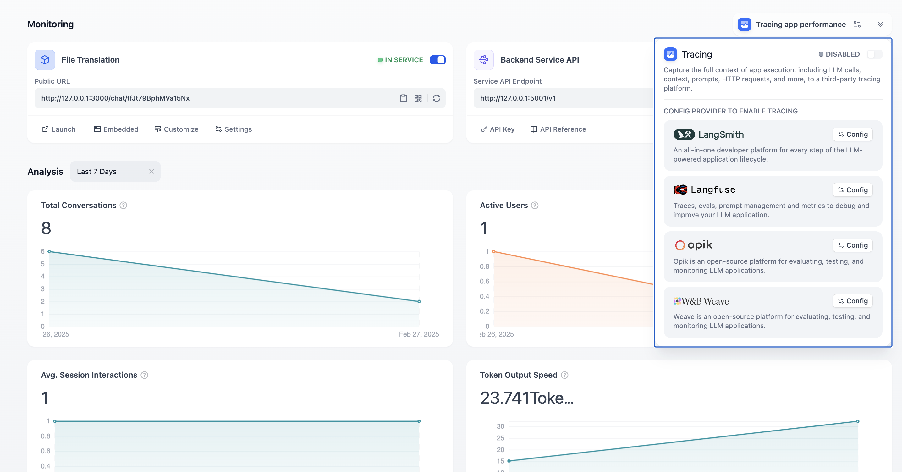
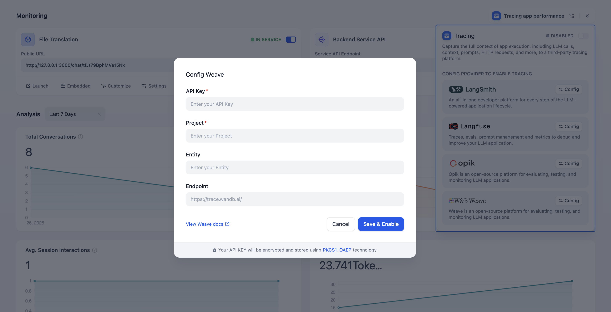
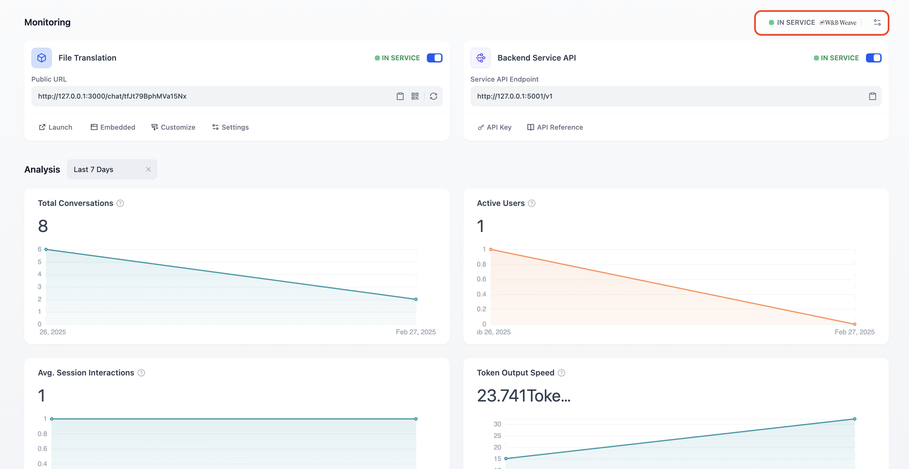
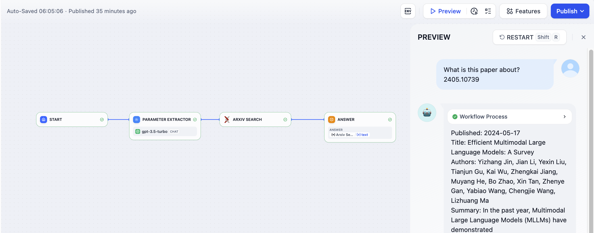
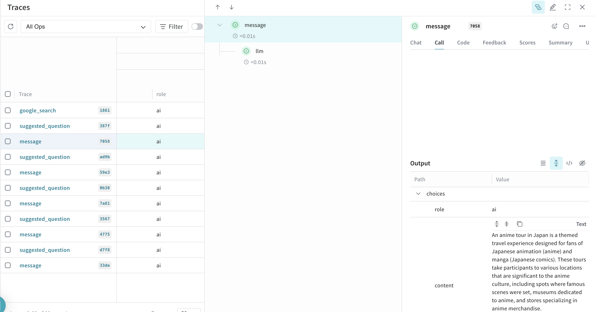

# 集成 W&B Weave

> 通过 W&B Weave 实现 Dify 应用的 LLM 可观测性，将追踪数据发送至 W&B Weave

> 本文档由 AI 自动翻译。如有任何不准确之处，请参考 [英文原版](https://docs.dify.ai/en/cloud/use-dify/monitor/integrations/integrate-weave.md)。

### 什么是 W\&B Weave

Weights & Biases (W\&B) Weave 是一个用于跟踪、实验、评估、部署和改进基于 LLM 的应用的框架。Weave 专为灵活性和可扩展性而设计，支持 LLM 应用开发工作流的每个阶段。

> [!NOTE]
>
> 更多详情，请参考 [Weave](https://docs.wandb.ai/weave)。

### 如何配置 Weave

#### 1. 注册/登录

前往 [W\&B Weave](https://wandb.ai/signup) 注册/登录。创建一个 Weights & Biases (W\&B) 账户，并在[此处](https://wandb.ai/authorize)复制 API 密钥。

#### 2. 将 W\&B Weave 与 Dify 集成

在 Dify 应用中配置 Weave。打开需要监控的应用，在侧边菜单中打开 **监控**，在页面上选择 **跟踪应用性能**。

点击配置后，粘贴 **API 密钥** 和**项目名称**，指定 **W\&B 实体**（可选，默认为你的用户名）到配置中并保存。

成功保存后，你可以在当前页面查看监控状态。

### 在 Weave 中查看监控数据

配置完成后，Dify 内应用的调试或生产数据可以在 Weave 中进行监控。

当你切换到 Weave 时，可以在仪表板中查看 Dify 应用的详细操作日志。

通过 Weave 获取的详细 LLM 操作日志将帮助你优化 Dify 应用的性能。

### 监控数据列表

#### **Workflow/Chatflow 追踪信息**

**用于追踪 Workflow 和 Chatflow**

| 工作流 | Weave 追踪 |
| - | - |
| workflow\_app\_log\_id/workflow\_run\_id | id |
| user\_session\_id | 放置在元数据中 |
| workflow\_\{id} | name |
| start\_time | start\_time |
| end\_time | end\_time |
| inputs | inputs |
| outputs | outputs |
| 模型令牌消耗 | usage\_metadata |
| metadata | extra |
| error | error |
| workflow | tags |
| "conversation\_id/none for workflow" | 元数据中的 conversation\_id |
| conversion\_id | parent\_run\_id |

**工作流追踪信息**

* workflow\_id - 工作流的唯一标识符
* conversation\_id - 对话 ID
* workflow\_run\_id - 当前运行的 ID
* tenant\_id - 租户 ID
* elapsed\_time - 当前运行所花费的时间
* status - 运行状态
* version - 工作流版本
* total\_tokens - 当前运行中使用的总令牌数
* file\_list - 处理的文件列表
* triggered\_from - 触发当前运行的来源
* workflow\_run\_inputs - 当前运行的输入数据
* workflow\_run\_outputs - 当前运行的输出数据
* error - 当前运行期间遇到的错误
* query - 运行期间使用的查询
* workflow\_app\_log\_id - Workflow 应用日志 ID
* message\_id - 关联的消息 ID
* start\_time - 运行的开始时间
* end\_time - 运行的结束时间
* workflow node executions - 工作流节点执行的信息
* 元数据
  * workflow\_id - 工作流的唯一标识符
  * conversation\_id - 对话 ID
  * workflow\_run\_id - 当前运行的 ID
  * tenant\_id - 租户 ID
  * elapsed\_time - 当前运行所花费的时间
  * status - 运行状态
  * version - 工作流版本
  * total\_tokens - 当前运行中使用的总令牌数
  * file\_list - 处理的文件列表
  * triggered\_from - 触发当前运行的来源

#### **消息追踪信息**

**用于追踪与 LLM 相关的对话**

| 聊天 | Weave 追踪 |
| - | - |
| message\_id | id |
| user\_session\_id | 放置在元数据中 |
| "message\_\{id}" | name |
| start\_time | start\_time |
| end\_time | end\_time |
| inputs | inputs |
| outputs | outputs |
| 模型令牌消耗 | usage\_metadata |
| metadata | extra |
| error | error |
| "message", conversation\_mode | tags |
| conversation\_id | 元数据中的 conversation\_id |
| conversion\_id | parent\_run\_id |

**消息追踪信息**

* message\_id - 消息 ID
* message\_data - 消息数据
* user\_session\_id - 用户会话 ID
* conversation\_model - 对话模式
* message\_tokens - 消息中的令牌数
* answer\_tokens - 回答中的令牌数
* total\_tokens - 消息和回答中的总令牌数
* error - 错误信息
* inputs - 输入数据
* outputs - 输出数据
* file\_list - 处理的文件列表
* start\_time - 开始时间
* end\_time - 结束时间
* message\_file\_data - 与消息关联的文件数据
* conversation\_mode - 对话模式
* 元数据
  * conversation\_id - 对话 ID
  * ls\_provider - 模型供应商
  * ls\_model\_name - 模型 ID
  * status - 消息状态
  * from\_end\_user\_id - 发送用户的 ID
  * from\_account\_id - 发送账户的 ID
  * agent\_based - 消息是否基于代理
  * workflow\_run\_id - 工作流运行 ID
  * from\_source - 消息来源

#### **审核追踪信息**

**用于追踪对话审核**

| 审核 | Weave 追踪 |
| - | - |
| user\_id | 放置在元数据中 |
| "moderation" | name |
| start\_time | start\_time |
| end\_time | end\_time |
| inputs | inputs |
| outputs | outputs |
| metadata | extra |
| \[moderation] | tags |
| message\_id | parent\_run\_id |

**审核追踪信息**

* message\_id - 消息 ID
* user\_id: 用户 ID
* workflow\_app\_log\_id - Workflow 应用日志 ID
* inputs - 审核输入数据
* message\_data - 消息数据
* flagged - 内容是否被标记为需要注意
* action - 采取的特定操作
* preset\_response - 预设响应
* start\_time - 审核开始时间
* end\_time - 审核结束时间
* 元数据
  * message\_id - 消息 ID
  * action - 采取的特定操作
  * preset\_response - 预设响应

#### **建议问题追踪信息**

**用于追踪建议的问题**

| 建议问题 | Weave 追踪 |
| - | - |
| user\_id | 放置在元数据中 |
| suggested\_question | name |
| start\_time | start\_time |
| end\_time | end\_time |
| inputs | inputs |
| outputs | outputs |
| metadata | extra |
| suggested\_question | tags |
| message\_id | parent\_run\_id |

**消息追踪信息**

* message\_id - 消息 ID
* message\_data - 消息数据
* inputs - 输入内容
* outputs - 输出内容
* start\_time - 开始时间
* end\_time - 结束时间
* total\_tokens - 令牌数
* status - 消息状态
* error - 错误信息
* from\_account\_id - 发送账户的 ID
* agent\_based - 消息是否基于代理
* from\_source - 消息来源
* model\_provider - 模型供应商
* model\_id - 模型 ID
* suggested\_question - 建议的问题
* level - 状态级别
* status\_message - 状态消息
* 元数据
  * message\_id - 消息 ID
  * ls\_provider - 模型供应商
  * ls\_model\_name - 模型 ID
  * status - 消息状态
  * from\_end\_user\_id - 发送用户的 ID
  * from\_account\_id - 发送账户的 ID
  * workflow\_run\_id - 工作流运行 ID
  * from\_source - 消息来源

#### **数据集检索追踪信息**

**用于追踪知识库检索**

| 数据集检索 | Weave 追踪 |
| - | - |
| user\_id | 放置在元数据中 |
| dataset\_retrieval | name |
| start\_time | start\_time |
| end\_time | end\_time |
| inputs | inputs |
| outputs | outputs |
| metadata | extra |
| dataset\_retrieval | tags |
| message\_id | parent\_run\_id |

**数据集检索追踪信息**

* message\_id - 消息 ID
* inputs - 输入内容
* documents - 文档数据
* start\_time - 开始时间
* end\_time - 结束时间
* message\_data - 消息数据
* 元数据
  * message\_id - 消息 ID
  * ls\_provider - 模型供应商
  * ls\_model\_name - 模型 ID
  * status - 消息状态
  * from\_end\_user\_id - 发送用户的 ID
  * from\_account\_id - 发送账户的 ID
  * agent\_based - 消息是否基于代理
  * workflow\_run\_id - 工作流运行 ID
  * from\_source - 消息来源

#### **工具追踪信息**

**用于追踪工具调用**

| 工具 | Weave 追踪 |
| - | - |
| user\_id | 放置在元数据中 |
| tool\_name | name |
| start\_time | start\_time |
| end\_time | end\_time |
| inputs | inputs |
| outputs | outputs |
| metadata | extra |
| \["tool", tool\_name] | tags |
| message\_id | parent\_run\_id |

#### **工具追踪信息**

* message\_id - 消息 ID
* tool\_name - 工具名称
* start\_time - 开始时间
* end\_time - 结束时间
* tool\_inputs - 工具输入
* tool\_outputs - 工具输出
* message\_data - 消息数据
* error - 错误信息（如果有）
* inputs - 消息的输入
* outputs - 消息的输出
* tool\_config - 工具配置
* time\_cost - 时间成本
* tool\_parameters - 工具参数
* file\_url - 关联文件的 URL
* 元数据
  * message\_id - 消息 ID
  * tool\_name - 工具名称
  * tool\_inputs - 工具输入
  * tool\_outputs - 工具输出
  * tool\_config - 工具配置
  * time\_cost - 时间成本
  * error - 错误信息（如果有）
  * tool\_parameters - 工具参数
  * message\_file\_id - 消息文件 ID
  * created\_by\_role - 创建者的角色
  * created\_user\_id - 创建者的用户 ID

**生成名称追踪信息**

**用于追踪对话标题生成**

| 生成名称 | Weave 追踪 |
| - | - |
| user\_id | 放置在元数据中 |
| generate\_name | name |
| start\_time | start\_time |
| end\_time | end\_time |
| inputs | inputs |
| outputs | outputs |
| metadata | extra |
| generate\_name | tags |

**生成名称追踪信息**

* conversation\_id - 对话 ID
* inputs - 输入数据
* outputs - 生成的对话名称
* start\_time - 开始时间
* end\_time - 结束时间
* tenant\_id - 租户 ID
* 元数据
  * conversation\_id - 对话 ID
  * tenant\_id - 租户 ID
