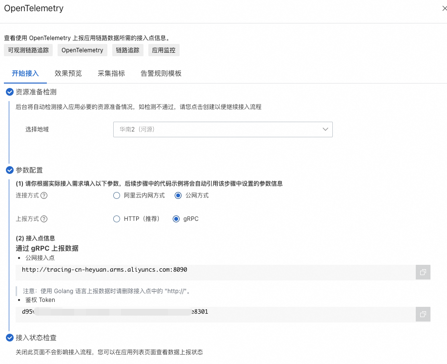
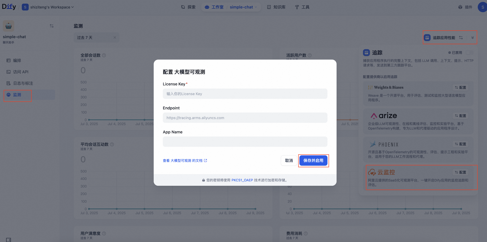
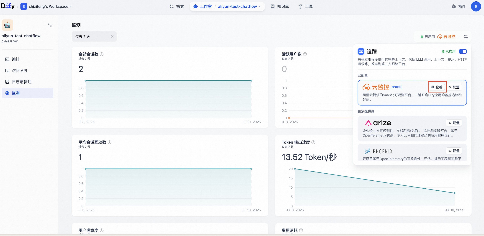

# 集成阿里云云监控

> 本文档由 AI 自动翻译。如有任何不准确之处，请参考 [英文原版](https://docs.dify.ai/en/cloud/use-dify/monitor/integrations/integrate-aliyun.md)。

## 什么是阿里云云监控

阿里云提供的全托管免运维可观测平台，一键开启 Dify 应用的监控追踪和评估。

> [!NOTE]
>
> 阿里云云监控原生支持 Python/Golang/Java 应用通过 [LoongSuite](https://github.com/alibaba/loongsuite-python-agent)
> 探针 & 开源 OpenTelemetry 探针接入，在一键开启 Dify 大模型应用监控外，还支持通过无侵入探针对 Dify 组件及其上下游依赖的全链路可观测。
> 更多详情，请参考 [阿里云官方文档](https://help.aliyun.com/zh/cms/cloudmonitor-2-0/user-guide/model-application)。

## 如何配置云监控

### 1. 获取阿里云 Endpoint 和 License Key

1. 登录 [ARMS 控制台](https://arms.console.aliyun.com/)，在左侧导航栏单击 **接入中心**。

2. 在 **服务端应用** 区域单击 **OpenTelemetry** 卡片。

3. 在弹出的 **OpenTelemetry** 面板中选择数据上报方式为 **gRPC**，并依据实际部署情况选择连接方式和地域。

   

4. 保存 **公网接入点（Endpoint）** 和 **鉴权 Token（License Key）**。

> **说明**
> Endpoint 不带端口号，例如 `http://tracing-cn-heyuan.arms.aliyuncs.com`。

### 2. 将云监控与 Dify 集成

1. 登录 **Dify 控制台**，并进入需要监控的 Dify 应用。

2. 在左侧导航栏单击 **监测**。

3. 单击 **追踪应用性能**，然后在 **云监控** 区域单击 **配置**。

   

4. 在弹出的对话框中输入步骤 1 获取的 **License Key** 和 **Endpoint**，并自定义 **App Name**（ARMS 控制台显示的应用名称），然后单击 **保存并启用**。

## 在云监控中查看监控数据

配置完成后，Dify 内应用的调试或生产数据可以在 **云监控** 中进行监控。

### 方式一：从 Dify 应用跳转 ARMS 控制台

在 Dify 控制台选择已开启应用追踪的应用，进入 **追踪配置**，在 **云监控** 区域单击 **查看**。

### 方式二：直接在 ARMS 控制台查看

在 ARMS 控制台的 **LLM 应用监控 > 应用列表** 页面进入对应的 Dify 应用。

## 接入更多数据

云监控提供了多语言无侵入探针，支持接入 Dify 集群的各个组件，实现全链路追踪。

| Dify 组件 | 探针 | 详情 |
| - | - | - |
| Nginx | OpenTelemetry 探针 | [使用 OpenTelemetry 对 Nginx 进行链路追踪](https://help.aliyun.com/zh/opentelemetry/user-guide/use-opentelemetry-to-perform-tracing-analysis-on-nginx) |
| Api | LoongSuite-Python 探针 | [loongsuite-python-agent](https://github.com/alibaba/loongsuite-python-agent/blob/main/README.md) |
| Sandbox | LoongSuite-Go 探针 | [loongsuite-go-agent](https://github.com/alibaba/loongsuite-go-agent/blob/main/README.md) |
| Worker | OpenTelemetry 探针 | [通过 OpenTelemetry 上报 Python 应用数据](https://help.aliyun.com/zh/opentelemetry/user-guide/use-managed-service-for-opentelemetry-to-submit-the-trace-data-of-python-applications) |
| Plugin-Daemon | LoongSuite-Go 探针 | [loongsuite-go-agent](https://github.com/alibaba/loongsuite-go-agent/blob/main/README.md) |

## 监测数据清单

云监控支持采集 Dify 的 Workflow/Chatflow/Chat/Agent 应用，采集数据包括工作流和工作流节点的执行明细，涵盖模型调用、工具调用、知识检索和各类流程节点的执行明细数据以及会话和用户信息等元数据

### Workflow/Chatflow Trace 信息

**Workflow Trace Info**

* workflow\_id - Workflow 的唯一标识
* conversation\_id - 对话 ID
* workflow\_run\_id - 此次运行的 ID
* tenant\_id - 租户 ID
* elapsed\_time - 此次运行耗时
* status - 运行状态
* version - Workflow 版本
* total\_tokens - 此次运行使用的 token 总数
* file\_list - 处理的文件列表
* triggered\_from - 触发此次运行的来源
* workflow\_run\_inputs - 此次运行的输入数据
* workflow\_run\_outputs - 此次运行的输出数据
* error - 此次运行中发生的错误
* query - 运行时使用的查询
* workflow\_app\_log\_id - Workflow 应用日志 ID
* message\_id - 关联的消息 ID
* start\_time - 运行开始时间
* end\_time - 运行结束时间
* workflow node executions - workflow 节点运行信息
* Metadata
  * workflow\_id - Workflow 的唯一标识
  * conversation\_id - 对话 ID
  * workflow\_run\_id - 此次运行的 ID
  * tenant\_id - 租户 ID
  * elapsed\_time - 此次运行耗时
  * status - 运行状态
  * version - Workflow 版本
  * total\_tokens - 此次运行使用的 token 总数
  * file\_list - 处理的文件列表
  * triggered\_from - 触发来源

### Message Trace 信息

**Message Trace Info**

* message\_id - 消息 ID
* message\_data - 消息数据
* user\_session\_id - 用户的 session\_id
* conversation\_model - 对话模式
* message\_tokens - 消息中的令牌数
* answer\_tokens - 回答中的令牌数
* total\_tokens - 消息和回答中的总令牌数
* error - 错误信息
* inputs - 输入数据
* outputs - 输出数据
* file\_list - 处理的文件列表
* start\_time - 开始时间
* end\_time - 结束时间
* message\_file\_data - 消息关联的文件数据
* conversation\_mode - 对话模式
* Metadata
  * conversation\_id - 消息所属对话的 ID
  * ls\_provider - 模型提供者
  * ls\_model\_name - 模型 ID
  * status - 消息状态
  * from\_end\_user\_id - 发送用户的 ID
  * from\_account\_id - 发送账户的 ID
  * agent\_based - 是否基于代理
  * workflow\_run\_id - 工作流运行 ID
  * from\_source - 消息来源
  * message\_id - 消息 ID

### Dataset Retrieval Trace 信息

**Dataset Retrieval Trace Info**

* message\_id - 消息 ID
* inputs - 输入内容
* documents - 文档数据
* start\_time - 开始时间
* end\_time - 结束时间
* message\_data - 消息数据
* Metadata
  * message\_id 消息 ID
  * ls\_provider 模型提供者
  * ls\_model\_name 模型 ID
  * status 消息状态
  * from\_end\_user\_id 发送用户的 ID
  * from\_account\_id 发送账户的 ID
  * agent\_based 是否基于代理
  * workflow\_run\_id 工作流运行 ID
  * from\_source 消息来源

### Tool Trace 信息

**Tool Trace Info**

* message\_id 消息 ID
* tool\_name 工具名称
* start\_time 开始时间
* end\_time 结束时间
* tool\_inputs 工具输入
* tool\_outputs 工具输出
* message\_data 消息数据
* error 错误信息，如果存在
* inputs 消息的输入内容
* outputs 消息的回答内容
* tool\_config 工具配置
* time\_cost 时间成本
* tool\_parameters 工具参数
* file\_url 关联文件的 URL
* Metadata
  * message\_id 消息 ID
  * tool\_name 工具名称
  * tool\_inputs 工具输入
  * tool\_outputs 工具输出
  * tool\_config 工具配置
  * time\_cost 时间成本
  * error 错误信息
  * tool\_parameters 工具参数
  * message\_file\_id 消息文件 ID
  * created\_by\_role 创建者角色
  * created\_user\_id 创建者用户 ID
