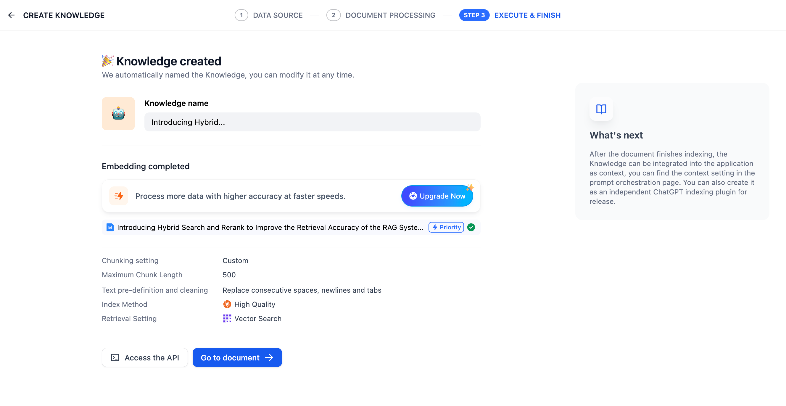

# 创建即用型知识库

> 本文档由 AI 自动翻译。如有任何不准确之处，请参考 [英文原版](https://docs.dify.ai/en/cloud/use-dify/knowledge/create-knowledge/introduction.md)。

创建即用型知识库的步骤如下：

1. 点击 **知识库** > **创建** > **创建即用型知识库**。然后，[上传本地文件](../%E5%AF%BC%E5%85%A5%E6%95%B0%E6%8D%AE/%E4%B8%8A%E4%BC%A0%E6%9C%AC%E5%9C%B0%E6%96%87%E4%BB%B6.md)、[从 Notion 导入数据](../%E5%AF%BC%E5%85%A5%E6%95%B0%E6%8D%AE/%E4%BB%8E%20Notion%20%E5%AF%BC%E5%85%A5%E6%95%B0%E6%8D%AE.md)、[从网页导入数据](../%E5%AF%BC%E5%85%A5%E6%95%B0%E6%8D%AE/%E4%BB%8E%E7%BD%91%E9%A1%B5%E5%AF%BC%E5%85%A5%E6%95%B0%E6%8D%AE.md)，或创建一个空的知识库。

2. [指定分段设置](%E6%8C%87%E5%AE%9A%E5%88%86%E6%AE%B5%E8%AE%BE%E7%BD%AE.md)。该阶段是内容的预处理与数据结构化过程，长文本将会被划分为多个内容分段。你可以在此环节预览文本的分段效果。

3. [指定索引方式和检索设置](%E6%8C%87%E5%AE%9A%E7%B4%A2%E5%BC%95%E6%96%B9%E5%BC%8F%E4%B8%8E%E6%A3%80%E7%B4%A2%E8%AE%BE%E7%BD%AE.md)。知识库在接收到用户查询问题后，按照预设的检索方式在已有的文档内查找相关内容，提取出高度相关的信息片段供语言模型生成高质量答案。

4. 等待数据处理完成，完成知识库的创建。

