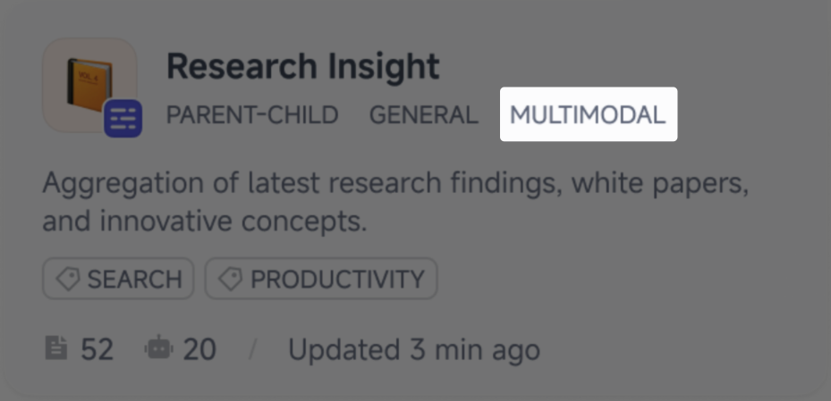
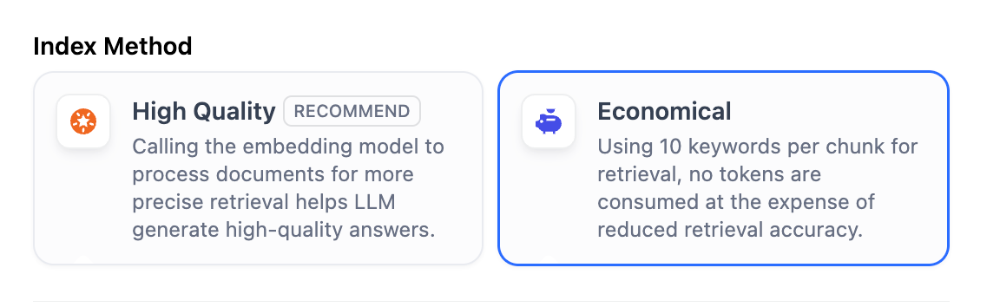
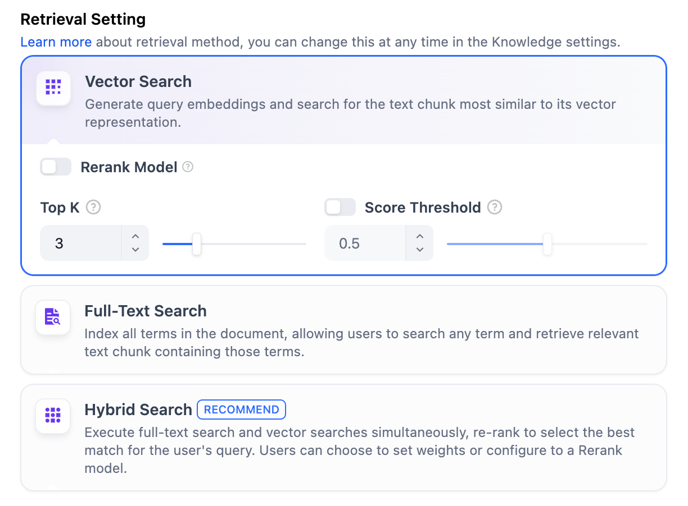
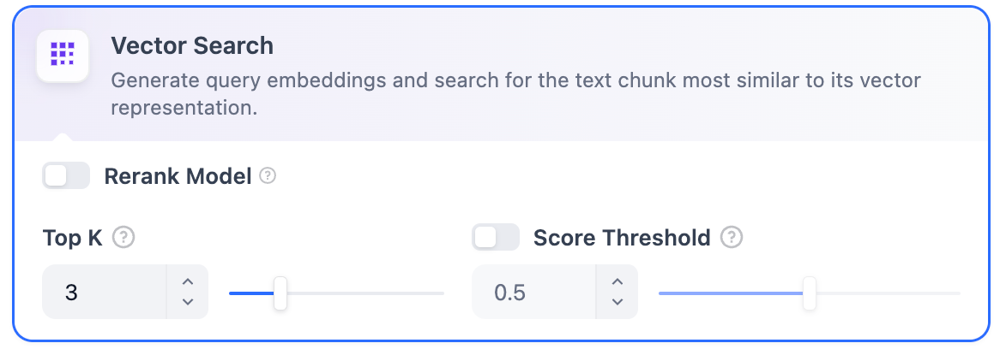
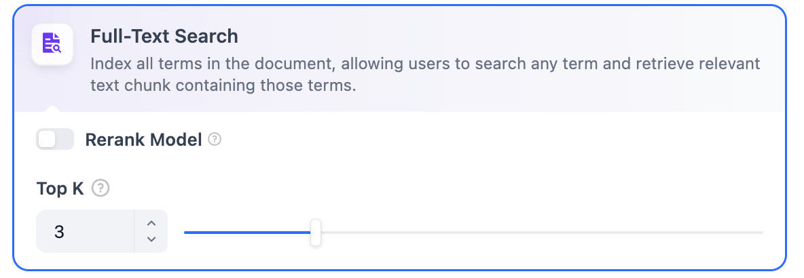
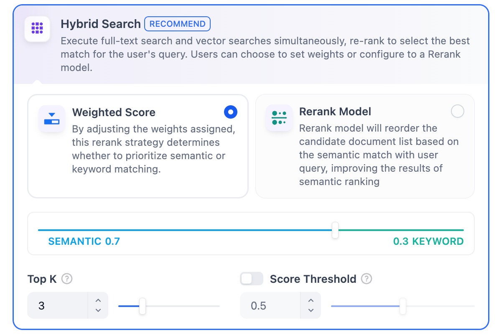
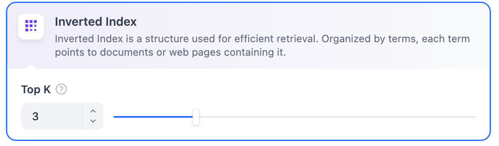

# 指定索引方式与检索设置

> 本文档由 AI 自动翻译。如有任何不准确之处，请参考 [英文原版](https://docs.dify.ai/en/cloud/use-dify/knowledge/create-knowledge/setting-indexing-methods.md)。

选定内容的分段模式后，接下来设定对于结构化内容的 **索引方式**。

## 选择索引方式

正如搜索引擎通过高效的索引算法匹配与用户问题最相关的网页内容，索引方式是否合理将直接影响 LLM 对知识库内容的检索效率以及回答的准确性。

提供 **高质量** 与 **经济** 两种索引方式，其中分别提供不同的检索设置选项。

> [tab] 高质量
>
> > [!NOTE]
> >
> > 一旦以高质量型索引方式创建知识库，后续无法切换为经济型索引。
>
> 高质量索引方式使用嵌入模型将内容分段转化为数字向量，这一过程称为嵌入或向量化。
>
> 这些向量可理解为多维空间中的坐标点。两个点越接近，它们的语义越相似。这使得系统能够基于语义相似度（而不仅仅是关键词匹配）找到相关信息。
>
> 这些向量会计入工作空间的知识库存储空间。哪些内容占用存储空间、达到上限后会怎样，详见 [知识库存储与文档配额](../../%E7%9F%A5%E8%AF%86%E5%BA%93%E5%AD%98%E5%82%A8%E4%B8%8E%E6%96%87%E6%A1%A3%E9%85%8D%E9%A2%9D.md)。
>
> > [!TIP]
> >
> > 若要启用跨模态检索（即基于语义相关性同时检索文本和图片），需选择多模态嵌入模型（带有 **Vision** 图标）。从文档中提取的图片将被嵌入并索引以供检索。
> >
> > 使用此类嵌入模型的知识库，其卡片上标有 **Multimodal**。
> >
> > 
>
> 高质量索引方式支持三种检索策略：向量检索、全文检索或混合检索。详见 [指定检索设置](%E6%8C%87%E5%AE%9A%E7%B4%A2%E5%BC%95%E6%96%B9%E5%BC%8F%E4%B8%8E%E6%A3%80%E7%B4%A2%E8%AE%BE%E7%BD%AE.md#指定检索设置)。

> [tab] 经济
>
> 在经济模式下，每个区块内使用 10 个关键词进行检索，降低了准确度但无需消耗 Token。对于检索到的区块，仅提供倒排索引方式选择最相关的区块。
>
> 如果经济型索引方式的效果不符合预期，可以在知识库设置页中升级为高质量索引方式。
>
> 

## 指定检索设置

知识库在接收到用户查询问题后，按照预设的检索方式在已有的文档内查找相关内容，提取出高度相关的信息片段。这些片段为 LLM 提供必要的上下文，最终影响其回答的准确性和可信度。

常见的检索方式包括：

1. 基于向量相似度的语义检索，将文本块和查询转化为向量，通过相似度评分进行匹配。
2. 使用倒排索引的关键词匹配（一种标准的搜索引擎技术）。

Dify 的知识库支持这两种检索方式。具体可用的检索选项取决于所选的索引方式。

> [tab] 高质量
>
> **高质量**
>
> 在 **高质量** 索引方式下，Dify 提供三种检索设置：**向量检索、全文检索和混合检索**。
>
> 
>
> **向量检索**
>
> **定义**：向量化用户输入的问题并生成查询向量，然后将其与知识库中对应的文本向量进行比较，找到最相邻的分段。
>
> 
>
> **向量检索设置**：
>
> **Rerank 模型**：默认关闭。开启后将使用第三方 Rerank 模型对向量检索返回的文本分段进行重新排序，以优化结果。这有助于 LLM 获取更精确的信息并提升输出质量。开启该选项前，需前往 **集成** > **模型供应商**，提前配置 Rerank 模型的 API 密钥。
>
> > [!NOTE]
> >
> > 若选择的嵌入模型为多模态，需同样选择多模态 Rerank 模型（带有 **Vision** 图标）。否则，检索到的图片将在重排序和检索结果中被排除。
>
> > 开启该功能后，将消耗 Rerank 模型的 Token。详情请参考对应模型的价格说明。
>
> **Top K**：用于确定检索与用户问题相似度最高的文本分段数量。系统同时会根据选用模型上下文窗口大小动态调整分段数量。默认值为 **3**，数值越高，预期被召回的文本分段数量越多。
>
> **Score 阈值**：用于设置文本分段被检索所需的最低相似度分数。只有超过该分数的分段才会被检索。默认值为 **0.5**。阈值越高，对相似度要求越高，因此被检索的分段数量越少。
>
> > TopK 和 Score 设置仅在 Rerank 阶段生效。因此，要应用这些设置中的任何一项，需要添加并启用 Rerank 模型。
>
> **全文检索**
>
> **定义**：索引文档中的所有词汇，允许用户查询任意词汇并返回包含这些词汇的文本片段。
>
> 
>
> **Rerank 模型**：默认关闭。开启后将使用第三方 Rerank 模型对全文检索返回的文本分段进行重新排序，以优化结果。这有助于 LLM 获取更精确的信息并提升输出质量。开启该选项前，需前往 **集成** > **模型供应商**，提前配置 Rerank 模型的 API 密钥。
>
> > [!NOTE]
> >
> > 若选择的嵌入模型为多模态，需同样选择多模态 Rerank 模型（带有 **Vision** 图标）。否则，检索到的图片将在重排序和检索结果中被排除。
>
> > 开启该功能后，将消耗 Rerank 模型的 Token。详情请参考对应模型的价格说明。
>
> **Top K**：用于确定检索与用户问题相似度最高的文本分段数量。系统同时会根据选用模型上下文窗口大小动态调整分段数量。默认值为 **3**，数值越高，预期被召回的文本分段数量越多。
>
> **Score 阈值**：用于设置文本分段被检索所需的最低相似度分数。只有超过该分数的分段才会被检索。默认值为 **0.5**。阈值越高，对相似度要求越高，因此被检索的分段数量越少。
>
> > TopK 和 Score 设置仅在 Rerank 阶段生效。因此，要应用这些设置中的任何一项，需要添加并启用 Rerank 模型。
>
> **混合检索**
>
> **定义**：同时执行全文检索和向量检索。它包含一个重排序步骤，根据用户的查询从两种搜索结果中选择最佳匹配结果。
>
> 
>
> 在此模式下，你可以指定 **"权重设置"** 而无需配置 Rerank 模型 API，或启用 **Rerank 模型** 进行检索。
>
> * **权重设置**
>
>   此功能允许用户为语义优先和关键词优先设置自定义权重。关键词检索指的是在知识库内进行全文检索，语义检索指的是在知识库内进行向量检索。
>
>   * **语义值设为 1**
>
>     仅启用语义检索模式。借助嵌入模型，即便知识库中没有出现查询中的确切词汇，也能通过计算向量距离的方式提高搜索的深度，返回相关内容。此外，当需要处理多语言内容时，语义检索能够捕捉不同语言之间的意义转换，提供更加准确的跨语言搜索结果。
>   * **关键词值设为 1**
>
>     仅启用关键词检索模式。通过用户输入的信息文本在知识库全文匹配，适用于用户知道确切的信息或术语的场景。该方法所消耗的计算资源较低，适合在大量文档的知识库内快速检索。
>   * **自定义关键词和语义权重**
>
>     除了仅启用语义检索或关键词检索外，还提供灵活的自定义权重设置。你可以不断调整两种方法的权重，找到符合业务场景的最佳权重比例。
>     **Rerank 模型**
>
>   默认关闭。开启后将使用第三方 Rerank 模型对混合检索返回的文本分段进行重新排序，以优化结果。这有助于 LLM 获取更精确的信息并提升输出质量。开启该选项前，需前往 **集成** > **模型供应商**，提前配置 Rerank 模型的 API 密钥。
>
>   > [!NOTE]
>   >
>   > 若选择的嵌入模型为多模态，需同样选择多模态 Rerank 模型（带有 **Vision** 图标）。否则，检索到的图片将在重排序和检索结果中被排除。
>
>   > 开启该功能后，将消耗 Rerank 模型的 Token。详情请参考对应模型的价格说明。
>
> **"权重设置"** 和 **"Rerank 模型"** 设置支持以下选项：
>
> **Top K**：用于确定检索与用户问题相似度最高的文本分段数量。系统同时会根据选用模型上下文窗口大小动态调整分段数量。默认值为 **3**，数值越高，预期被召回的文本分段数量越多。
>
> **Score 阈值**：用于设置文本分段被检索所需的最低相似度分数。只有超过该分数的分段才会被检索。默认值为 **0.5**。阈值越高，对相似度要求越高，因此被检索的分段数量越少。

> [tab] 经济
>
> **经济**
>
> 在 **经济索引** 模式下，仅提供倒排索引方式。倒排索引是一种用于快速检索文档中关键词的数据结构，常用于在线搜索引擎。倒排索引仅支持 **Top K** 设置。
>
> **Top K**：用于确定检索与用户问题相似度最高的文本分段数量。系统同时会根据选用模型上下文窗口大小动态调整分段数量。默认值为 **3**，数值越高，预期被召回的文本分段数量越多。
>
> 

### 参考

指定检索设置后，你可以参考以下文档查看在不同场景下关键词与内容块的匹配情况。

> [card] [测试知识检索](../%E6%B5%8B%E8%AF%95%E6%A3%80%E7%B4%A2.md)
>
> 了解如何测试和引用知识库检索
