# 在应用内集成知识库

> 本文档由 AI 自动翻译。如有任何不准确之处，请参考 [英文原版](https://docs.dify.ai/en/cloud/use-dify/knowledge/integrate-knowledge-within-application.md)。

可将已有的经典知识库关联到聊天助手、文本生成应用、旧版 Agent、Workflow 和 Chatflow 应用。

以聊天助手为例，使用流程如下：

1. 进入 **知识库**，创建 **即用型知识库** 并上传文件
2. 进入 **工作室**，创建应用并选择 **聊天助手**
3. 进入 **上下文设置** 点击 **添加** 选择已创建的知识库
4. 在 **上下文设置 -- 参数设置** 内配置 **召回策略**
5. 在 **元数据筛选** 板块中配置元数据的筛选条件，使用元数据功能筛选知识库内的文档
6. 在 **添加功能** 内打开 **引用和归属**
7. 在 **调试与预览** 内输入与知识库相关的用户问题进行调试
8. 调试完成之后 **保存并发布** 为一个 AI 知识库问答类应用

### 关联知识库并指定召回模式

如果当前应用的上下文涉及多个知识库，需要设置召回模式以使得检索的内容更加精确。进入 **上下文 -- 参数设置 -- 召回设置**。

#### 召回设置

检索器会在所有与应用关联的知识库中去检索与用户问题相关的文本内容，并将多路召回的相关文档结果合并，以下是召回策略的技术流程图：

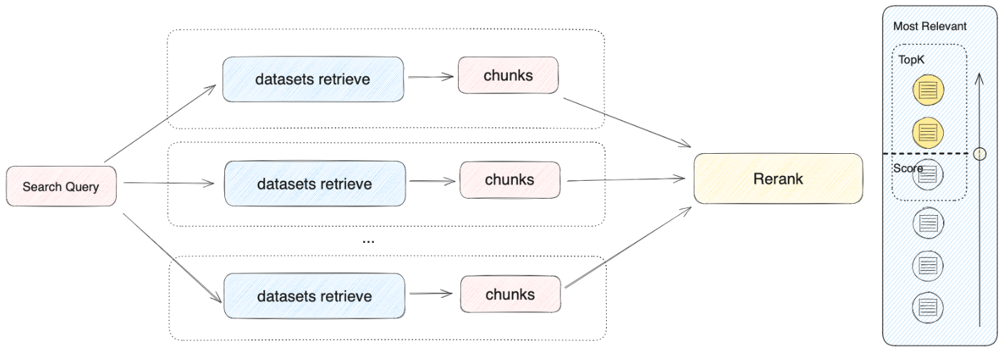

根据用户意图同时检索所有添加至 **「上下文」** 的知识库，在多个知识库内查询相关文本片段，选择所有和用户问题相匹配的内容，最后通过 Rerank 策略找到最适合的内容并回答用户。该方法的检索原理更为科学。

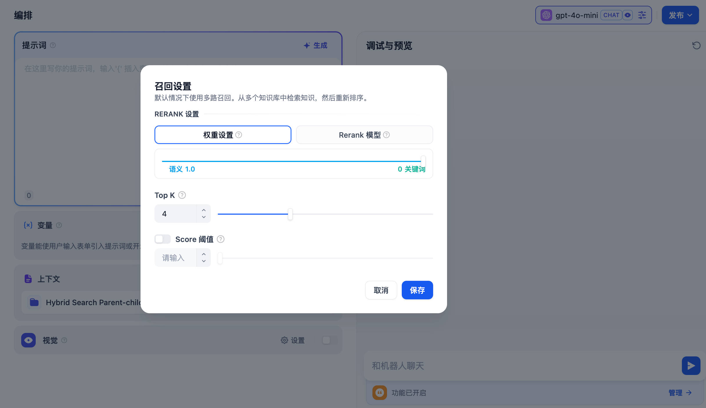

举例：A 应用的上下文关联了 K1、K2、K3 三个知识库，当用户输入问题后，将在三个知识库内检索并汇总多条内容。为确保能找到最匹配的内容，需要通过 Rerank 策略确定与用户问题最相关的内容，确保结果更加精准与可信。

在实际问答场景中，每个知识库的内容来源和检索方式可能都有所差异。针对检索返回的多条混合内容，Rerank 策略是一个更加科学的内容排序机制。它可以帮助确认候选内容列表与用户问题的匹配度，改进多个知识间排序的结果以找到最匹配的内容，提高回答质量和用户体验。

考虑到 Rerank 的使用成本和业务需求，多路召回模式提供了以下两种 Rerank 设置：

**权重设置**

该设置无需配置外部 Rerank 模型，重排序内容 **无需额外花费**。可以通过调整语义或关键词的权重比例条，选择最适合的内容匹配策略。

* **语义值为 1**

  仅启用语义检索模式。借助 Embedding 模型，即便知识库中没有出现查询中的确切词汇，也能通过计算向量距离的方式提高搜索的深度，返回正确内容。此外，当需要处理多语言内容时，语义检索能够捕捉不同语言之间的意义转换，提供更加准确的跨语言搜索结果。

  > 语义检索指的是比对用户问题与知识库内容中的向量距离。距离越近，匹配的概率越大。参考阅读：[《Dify：Embedding 技术与 Dify 数据集设计/规划》](https://mp.weixin.qq.com/s/vmY_CUmETo2IpEBf1nEGLQ)。
* **关键词值为 1**

  仅启用关键词检索模式。通过用户输入的信息文本在知识库全文匹配，适用于用户知道确切的信息或术语的场景。该方法所消耗的计算资源较低，适合在大量文档的知识库内快速检索。
* **自定义关键词和语义权重**

  除了仅启用语义检索或关键词检索模式，我们还提供了灵活的自定义权重设置。你可以通过不断调试二者的权重，找到符合业务场景的最佳权重比例。

**Rerank 模型**

Rerank 模型是一种外部评分系统，它会计算用户问题与给定的每个候选文档之间的相似度分数，从而改进语义排序的结果，并返回按相似度分数从高到低排序的文档列表。

虽然此方法会产生一定的额外花费，但是更加擅长处理知识库内容来源复杂的情况，例如混合了语义查询和关键词匹配的内容，或返回内容存在多语言的情况。

Dify 目前支持多个 Rerank 模型，进入「模型供应商」页填入 Rerank 模型（例如 Cohere、Jina AI 等模型）的 API Key。

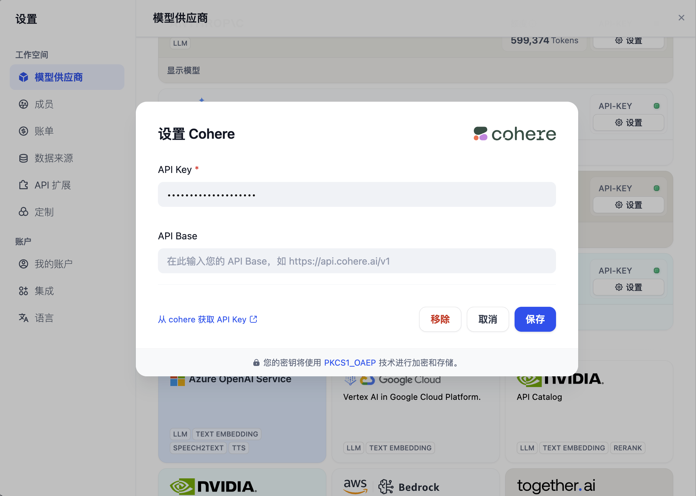

在模型供应商内配置 Rerank 模型

**可调参数**

* **Top K**

  用于筛选与用户问题相似度最高的文本片段。系统同时会根据选用模型上下文窗口大小，动态调整分段数量。数值越高，预期被召回的文本分段数量越多。
* **Score 阈值**

  用于设置文本片段筛选的相似度阈值。向量检索的相似度分数需要超过设置的分数后才会被召回，数值越高，预期被召回的文本数量越少。

### 使用元数据筛选知识

#### Chatflow/Workflow

在 **Chatflow/Workflow** 的 **知识检索** 节点中，你可以使用 **元数据筛选** 功能精确检索文档。该功能有助于你根据文档的元数据字段（如标签、类别或访问权限）优化检索结果。

##### 配置步骤

1. 选择筛选模式

   * **禁用模式**（默认）：禁用 **元数据筛选** 功能，不配置任何筛选条件。

   * **自动模式**：系统会根据传输给该 **知识检索** 节点的 **查询变量** 自动配置筛选条件，适用于简单的筛选需求。

   > 启用自动模式后，你依然需要在 **模型** 栏中选择合适的大模型以执行文档检索任务。

   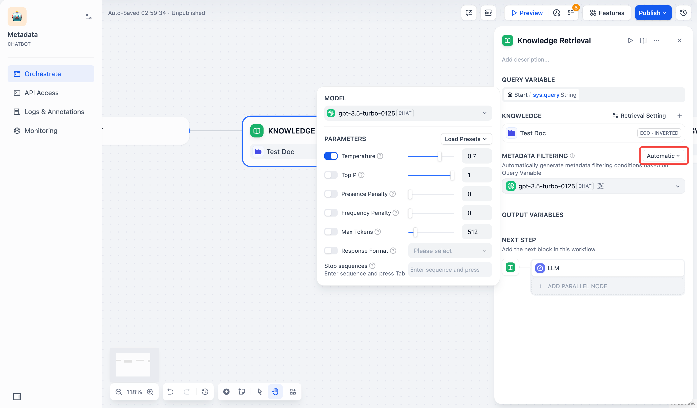

   * **手动模式**：用户可以手动配置筛选条件，自由设置筛选规则，适用于复杂的筛选需求。

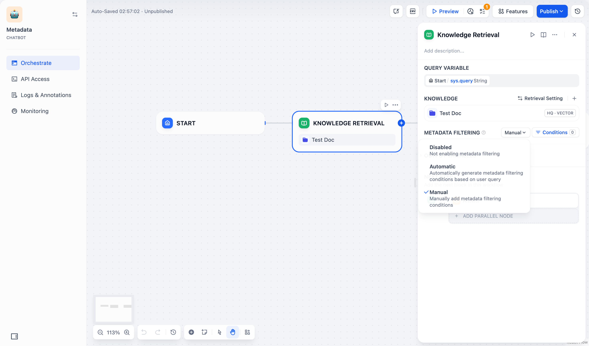

2. 如果你选择了 **手动模式**，请参照以下步骤配置筛选条件：

   1. 点击 **条件** 按钮，弹出配置框。

   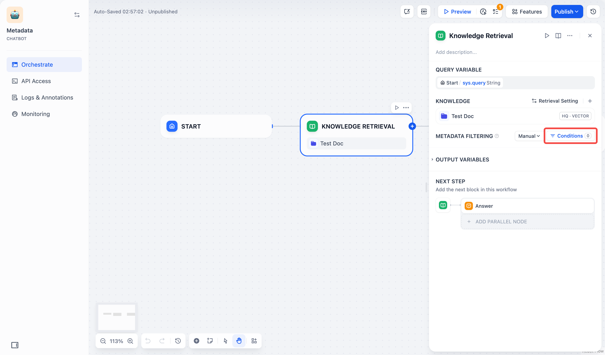

   2. 点击配置框中的 **+添加条件** 按钮：

      * 可以从下拉列表中选择一个已选中知识库内的元数据字段，添加到筛选条件列表中。

      > 如果你同时选择了多个知识库，下拉列表只会显示这些知识库共有的元数据字段。

      * 可以在 **搜索元数据** 搜索框中搜索你需要的字段，添加到筛选条件列表中。

   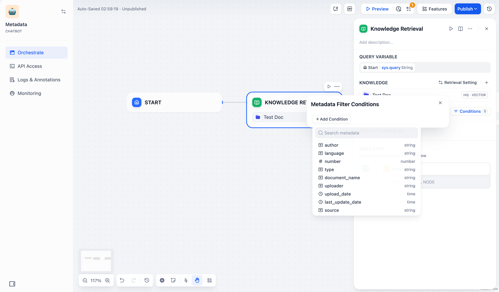

   3. 如果需要添加多条字段，可以重复点击 **+添加条件** 按钮。

   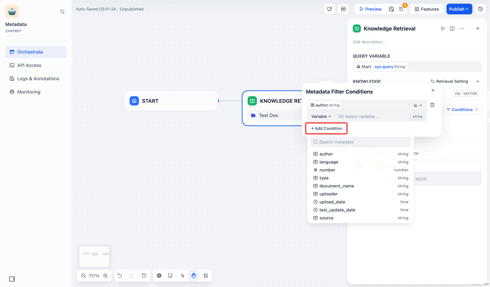

   4. 配置字段类型的筛选条件：

   | 字段类型 | 筛选条件 | 筛选条件说明与示例 |
   | - | - | - |
   | 字符串 | is | 字段的值必须与你输入的值完全匹配。例如，如果你设置筛选条件为 `is "Published"`，则只会返回标记为 "Published" 的文档。 |
   | | is not | 字段的值不能与你输入的值匹配。例如，如果你设置筛选条件为 `is not "Draft"`，则会返回所有未标记为 "Draft" 的文档。 |
   | | is empty | 字段的值为空。如果你配置了此条件，可以检索到未标记该字符串的文档。 |
   | | is not empty | 字段的值不为空。如果你配置了此条件，可以检索到标记了该字符串的文档。 |
   | | contains | 字段的值包含你输入的文本。例如，如果你设置筛选条件为 `contains "Report"`，则会返回所有包含"Report"的文档，如"Monthly Report" 或 "Annual Report"。 |
   | | not contains | 字段的值不包含你输入的文本。例如，如果你设置筛选条件为 `not contains "Draft"`，则会返回所有不包含 "Draft" 的文档。 |
   | | starts with | 字段的值以你输入的文本开头。例如，如果你设置筛选条件为 `starts with "Doc"`，则会返回所有以"Doc"开头的文档，如 "Doc1"、"Document"等。 |
   | | ends with | 字段的值以你输入的文本结尾。例如，如果你设置筛选条件为 `ends with "2024"`，则会返回所有以"2024"结尾的文档，如"Report 2024"、"Summary 2024"等。 |
   | 数字 | = | 字段的值必须等于你输入的数字。例如，`= 10` 会匹配所有数字标记为 10 的文档。 |
   | | ≠ | 字段的值不能等于你输入的数字。例如，`≠ 5` 会返回所有数字未标记为 5 的文档。 |
   | | > | 字段的值必须大于你输入的数字。例如，`100` 会返回所有数字标记为大于 100 的文档。 |
   | | \< | 字段的值必须小于你输入的数字。例如，`< 50` 会返回所有数字标记为小于 50 的文档。 |
   | | ≥ | 字段的值必须大于或等于你输入的数字。例如，`≥ 20` 会返回所有数字标记为大于或等于 20 的文档。 |
   | | ≤ | 字段的值必须小于或等于你输入的数字。例如，`≤ 200` 会返回所有数字标记为小于或等于 200 的文档。 |
   | | is empty | 字段未设置值。例如，`is empty` 会返回所有该字段未标记数字的文档。 |
   | | is not empty | 字段已设置值。例如，`is not empty` 会返回所有该字段已标记数字的文档。 |
   | 时间 | is | 字段的时间值必须与你选择的时间完全匹配。例如，`is "2024-01-01"` 只会返回标记为 2024 年 1 月 1 日的文档。 |
   | | before | 字段的时间值必须早于你选择的时间。例如，`before "2024-01-01"` 会返回所有标记为 2024 年 1 月 1 日之前的文档。 |
   | | after | 字段的时间值必须晚于你选择的时间。例如，`after "2024-01-01"` 会返回所有标记为 2024 年 1 月 1 日之后的文档。 |
   | | is empty | 字段的时间值为空。如果你配置了此条件，可以检索到未标记该时间信息的文档。 |
   | | is not empty | 字段的时间值不为空。如果你配置了此条件，可以检索到标记了该时间信息的文档。 |

   5. 选择并添加元数据筛选值：

   * **变量**：选择 **变量（Variable）**，并选择该 **Chatflow/Workflow** 中需要用于筛选文档的变量。

   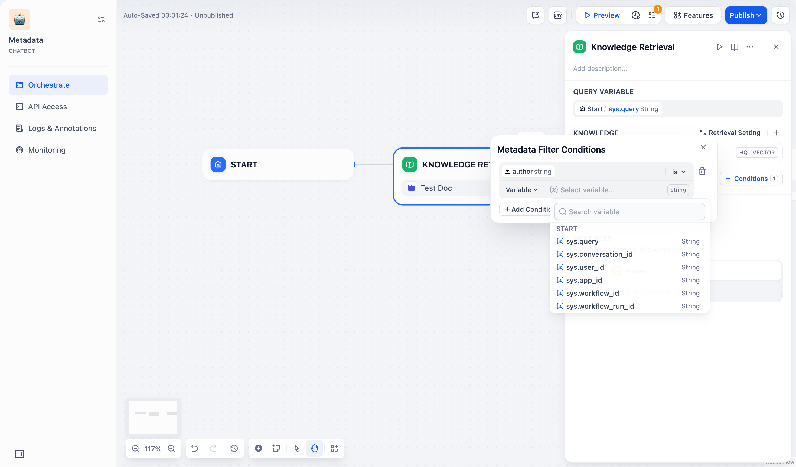

   * **常量**：选择 **常量（Constant）**，并手动输入你需要的常量值。

   > **时间** 字段类型仅支持使用常量筛选文档。如果你选用时间字段筛选文档，系统会弹出时间选择器，供你选择具体的时间节点。

   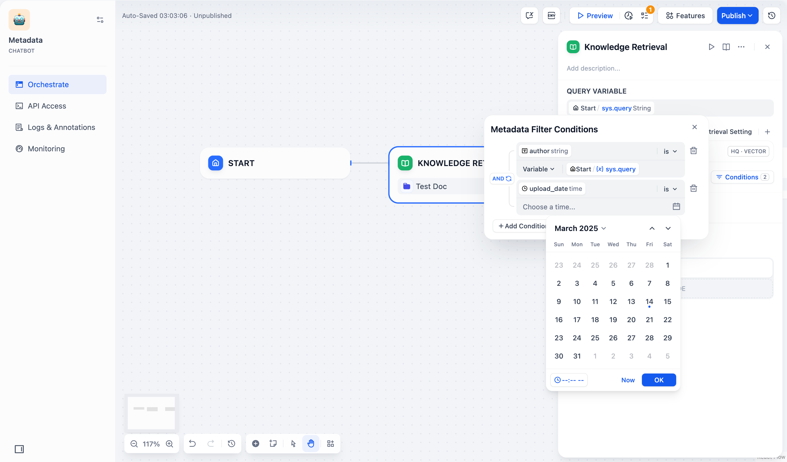

> [!WARNING]
>
> 当你输入常量筛选值时，该筛选值必须与该元数据字段值的文本完全一致，系统才能返回该文档。例如，当你设置筛选条件为 `starts with "App"` 或 `contains "App"` 时，系统会返回标记为“Apple”的文档，但不会返回标记为“apple”或“APPLE”的文档。

6. 配置筛选条件之间的逻辑关系 `AND` 或 `OR`。
   * `AND`：当一个文档满足所有筛选条件时，才能检索到该文档。
   * `OR`：只要一个文档满足其中任意一个筛选条件，就可以检索到该文档。

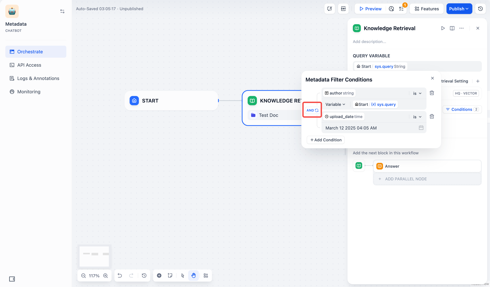

7. 关闭弹窗，系统将自动保存你的选择。

#### 聊天助手

在 **聊天助手** 中，**元数据筛选** 功能位于界面左下方的 **上下文** 板块下方，配置方法与 **Chatflow/Workflow** 中的操作一致。你可以按照相同的步骤配置元数据筛选条件。

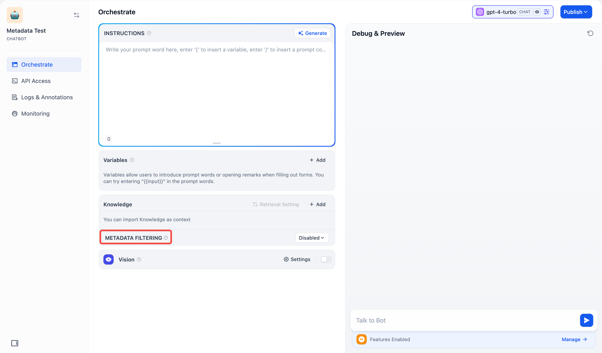

### 在知识库内查看已关联的应用

知识库将会在左侧信息栏中显示已关联的应用数量。将鼠标悬停至圆形信息图标时将显示所有已关联的 Apps 列表，点击右侧的跳转按钮即可快速查看对应的应用。

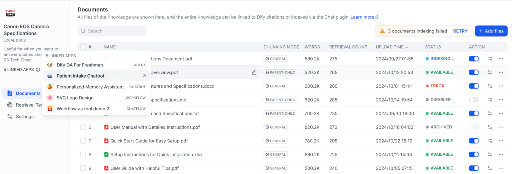

### 常见问题

1. **如何选择多路召回中的 Rerank 设置？**

如果用户知道确切的信息或术语，可以通过关键词检索精确发挥匹配结果，那么请将「权重设置」中的 **关键词设置为 1**。

如果知识库内并未出现确切词汇，或者存在跨语言查询的情况，那么推荐使用「权重设置」中的 **语义设置为 1**。

如果业务人员对于用户的实际提问场景比较熟悉，想要主动调整语义或关键词的比值，那么推荐自行调整「权重设置」里的比值。

如果知识库内容较为复杂，无法通过语义或关键词等简单条件进行匹配，同时要求较为精准的回答，愿意支付额外的费用，那么推荐使用 **Rerank 模型** 进行内容检索。

2. **为什么会出现找不到「权重设置」或要求必须配置 Rerank 模型等情况，应该如何处理？**

以下是知识库检索方式对文本召回的影响情况：

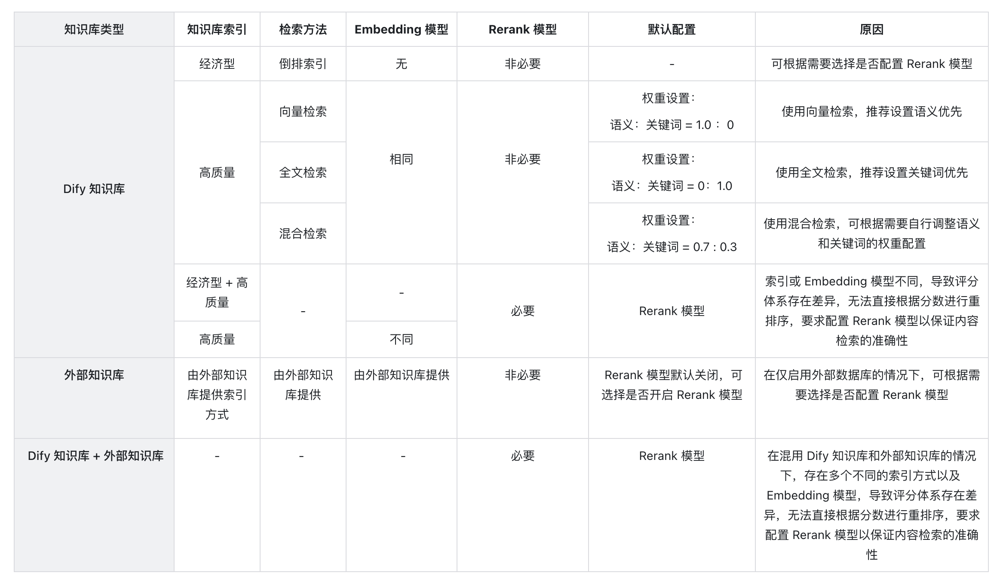

3. **引用多个知识库时，无法调整「权重设置」，提示错误应如何处理？**

出现此问题是因为上下文内所引用的多个知识库内所使用的嵌入模型（Embedding）不一致，为避免检索内容冲突而出现此提示。推荐设置在「模型供应商」内设置并启用 Rerank 模型，或者统一知识库的检索设置。

4. **为什么在多路召回模式下找不到「权重设置」选项，只能看到 Rerank 模型？**

请检查你的知识库是否使用了「经济」型索引模式。如果是，那么将其切换为「高质量」索引模式。
