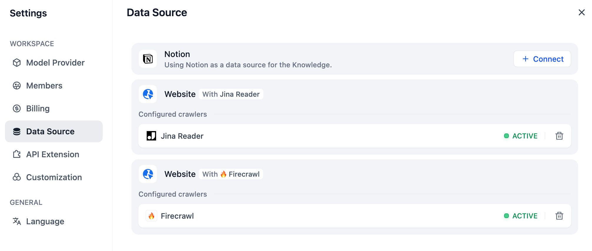
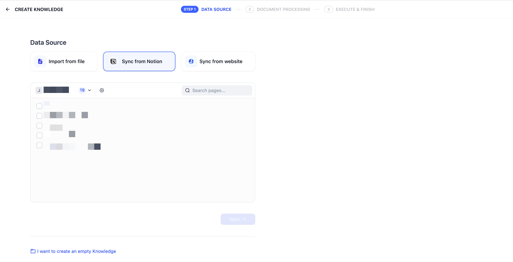
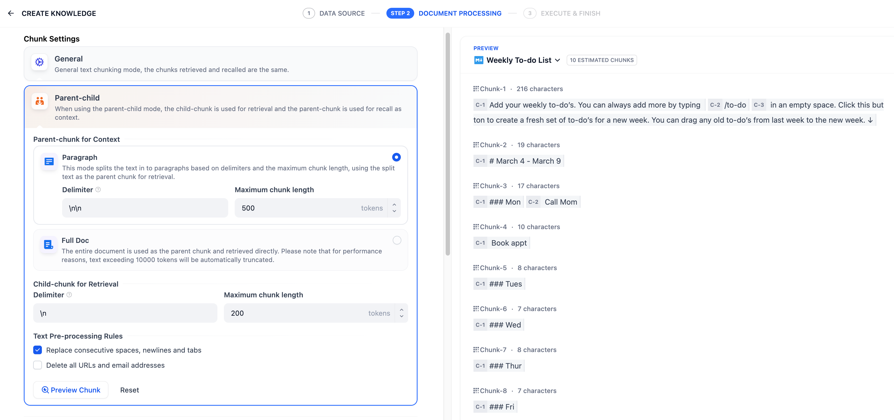
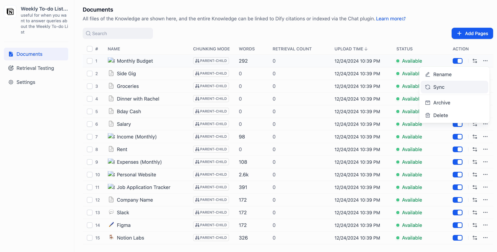

# 从 Notion 导入数据

> 本文档由 AI 自动翻译。如有任何不准确之处，请参考 [英文原版](https://docs.dify.ai/en/cloud/use-dify/knowledge/create-knowledge/import-text-data/sync-from-notion.md)。

Dify 知识库支持从 Notion 导入，并支持后续的数据自动同步。

> [!NOTE]
>
> Notion 通过 Dify 预置的集成连接。完成一次工作空间授权即可开始导入，无需自行配置 Notion 应用。

### 授权验证

1. 在创建知识库，选择数据源时，点击 **同步自 Notion 内容** 旁的 **去绑定**，根据提示完成授权验证。
2. 你也可以：进入 **设置 -- 数据来源 -- 添加数据源** 中点击 Notion 来源 **绑定** ，完成授权验证。

### 导入 Notion 数据

完成验证授权后，进入创建知识库页面，点击 **同步自 Notion 内容**，选择需要的授权页面进行导入。

### 进行分段和清洗

接下来，选择知识库的 **分段设置** 和 **索引方式**，**保存并处理**。等待 Dify 自动处理数据。Dify 不仅可以导入 Notion 的普通类型页面，同时也支持导入并汇总保存 database 类型下的页面属性。

> [!NOTE]
>
> 暂不支持导入图片和文件，表格类数据会被转换为文本展示。

### 同步 Notion 数据

如果你的 Notion 内容有更新，可以在知识库的 **文档列表页** 中点击对应内容页的 **同步** 按钮进行数据同步。同步文档涉及嵌入过程，因此将消耗嵌入模型的 Tokens。

