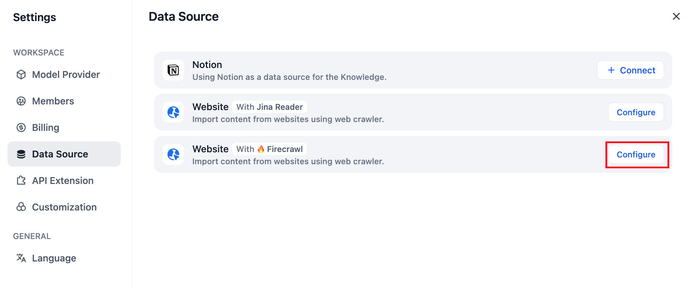
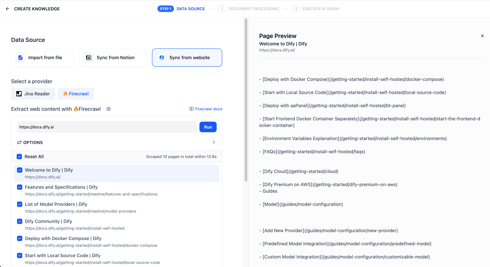
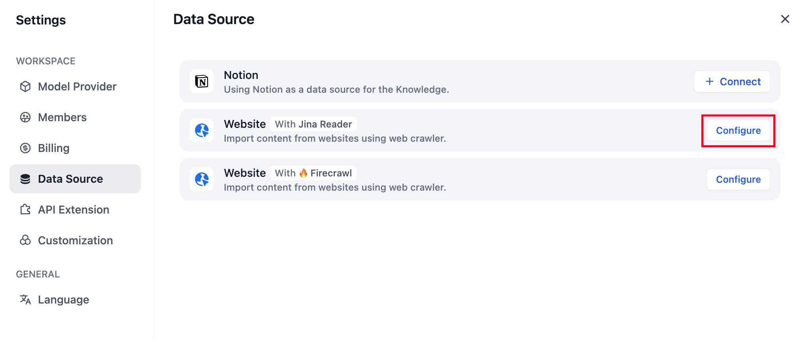
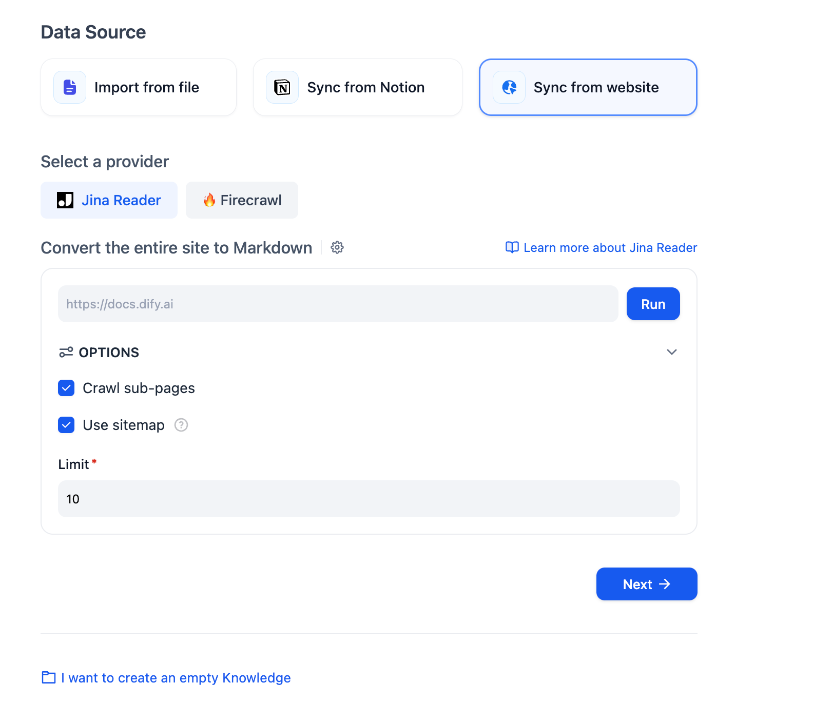
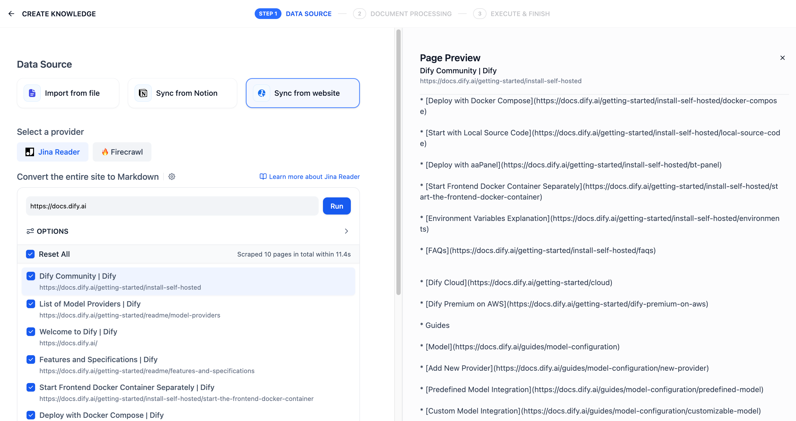
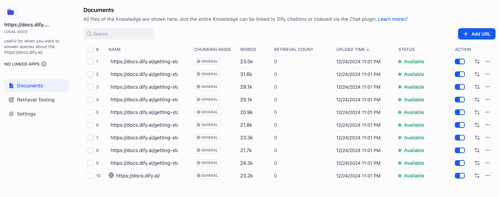

# 从网页导入数据

> 本文档由 AI 自动翻译。如有任何不准确之处，请参考 [英文原版](https://docs.dify.ai/en/cloud/use-dify/knowledge/create-knowledge/import-text-data/sync-from-website.md)。

知识库支持通过第三方工具如 [Jina Reader](https://jina.ai/reader), [Firecrawl ](https://www.firecrawl.dev/)抓取公开网页中的内容，解析为 Markdown 内容并导入至知识库。

> [!NOTE]
>
> Jina Reader 和 Firecrawl 均是开源的网页解析工具，能将网页将其转换为干净并且方便 LLM 识别的 Markdown 格式文本，同时提供了易于使用的 API 服务。

下文将分别介绍 Firecrawl 和 Jina Reader 的使用方法。

## Firecrawl

### 配置 Firecrawl 凭据

点击右上角头像，然后前往 **DataSource** 页面，点击 Firecrawl 右侧的 Configure 按钮。

登录 [Firecrawl 官网](https://www.firecrawl.dev/) 完成注册，获取 API Key 后按照页面提示填入并点击保存。

### 使用 Firecrawl 抓取网页内容

在知识库创建页选择 **Sync from website**，provider 选中 Firecrawl，填入需要抓取的目标 URL。

设置中的配置项包括：是否抓取子页面、抓取页面数量上限、页面抓取深度、排除页面、仅抓取页面、提取内容。完成配置后点击 **Run**，预览将要被抓取的目标页面链接。

导入网页解析的文本后存储至知识库的文档中，查看导入结果。点击 **Add URL** 可以继续导入新的网页。抓取完成后，网页中的内容将会被收录至知识库内。

***

## Jina Reader

### 配置 Jina Reader 凭据

点击右上角头像，然后前往 **DataSource** 页面，点击 Jina Reader 右侧的 Configure 按钮。

登录[ Jina Reader 官网](https://jina.ai/reader) 完成注册，获取 API Key 后并按照页面提示填入并保存。

### 使用 Jina Reader 抓取网页内容

在知识库创建页选择 **Sync from website**，provider 选中 Jina Reader，填写需要抓取的目标 URL。

设置中的配置项包括：是否抓取子页面、抓取页面数量上限、是否使用 sitemap 抓取。完成配置后点击 **Run** 按钮，预览将要被抓取的页面链接。

导入网页解析的文本后存储至知识库的文档中，查看导入结果。如需继续添加网页，轻点右侧 **Add URL** 按钮继续导入新的网页。

抓取完成后，网页中的内容将会被收录至知识库内。
