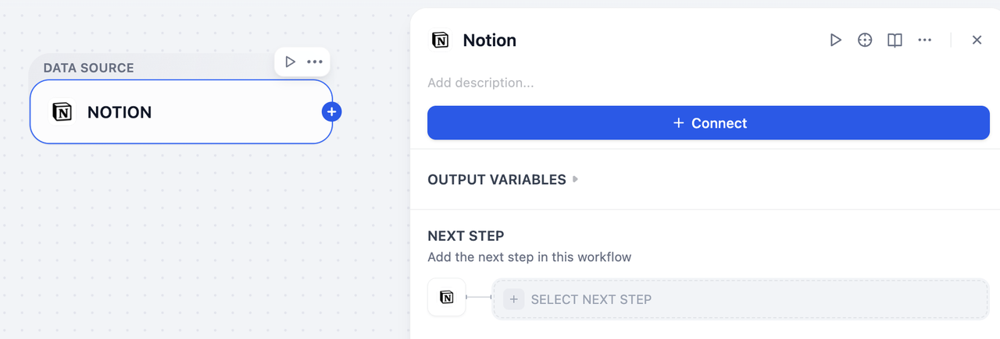
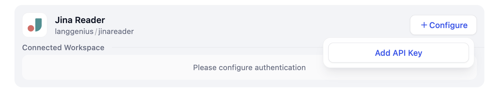
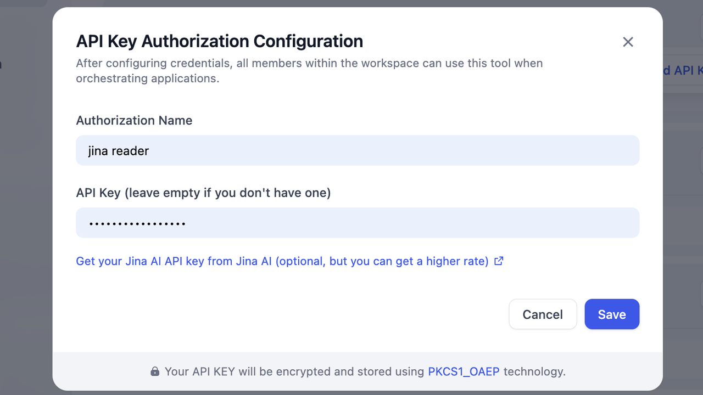
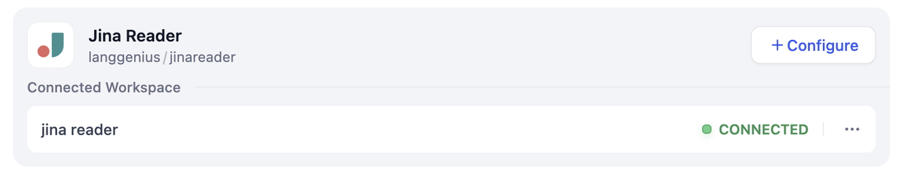
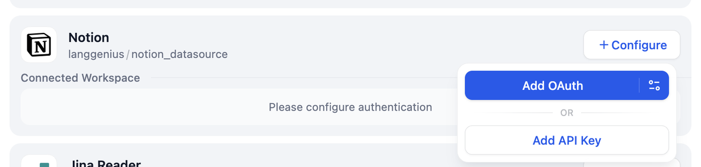
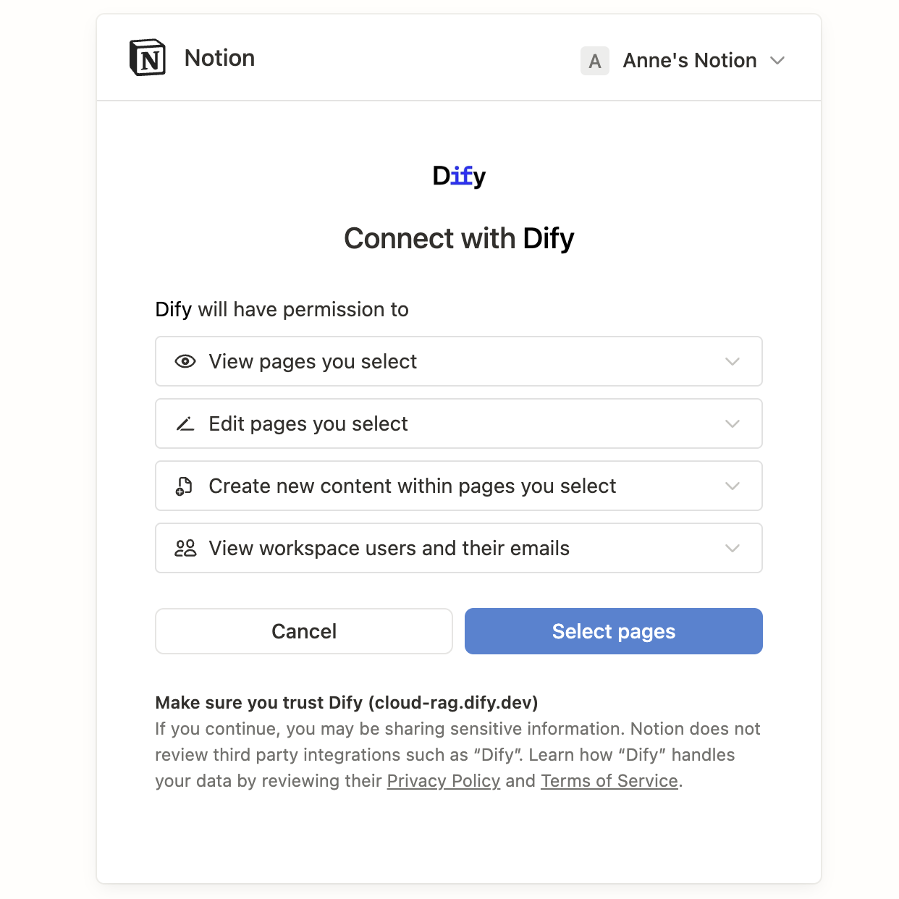
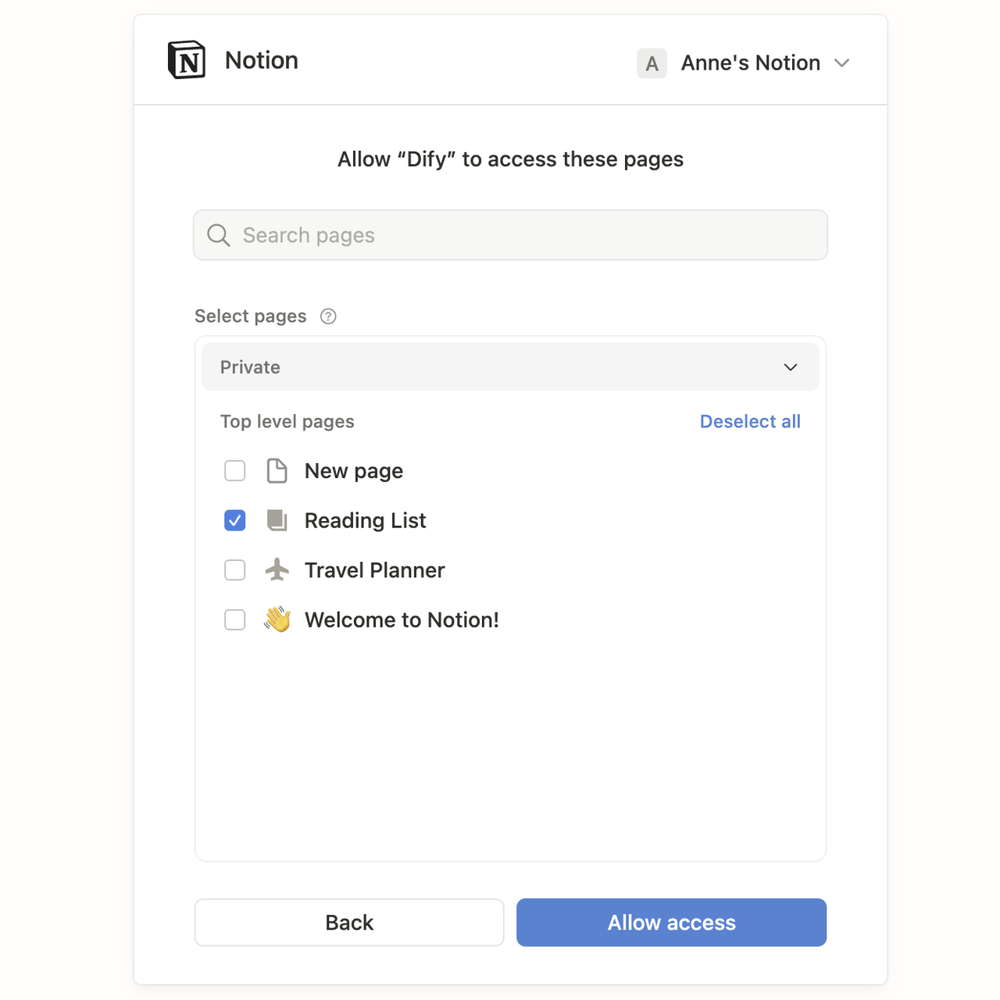
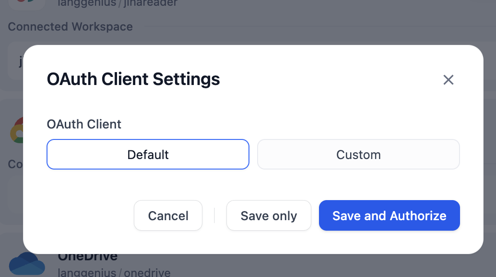
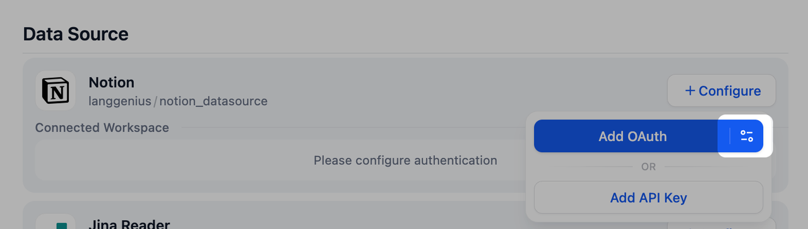
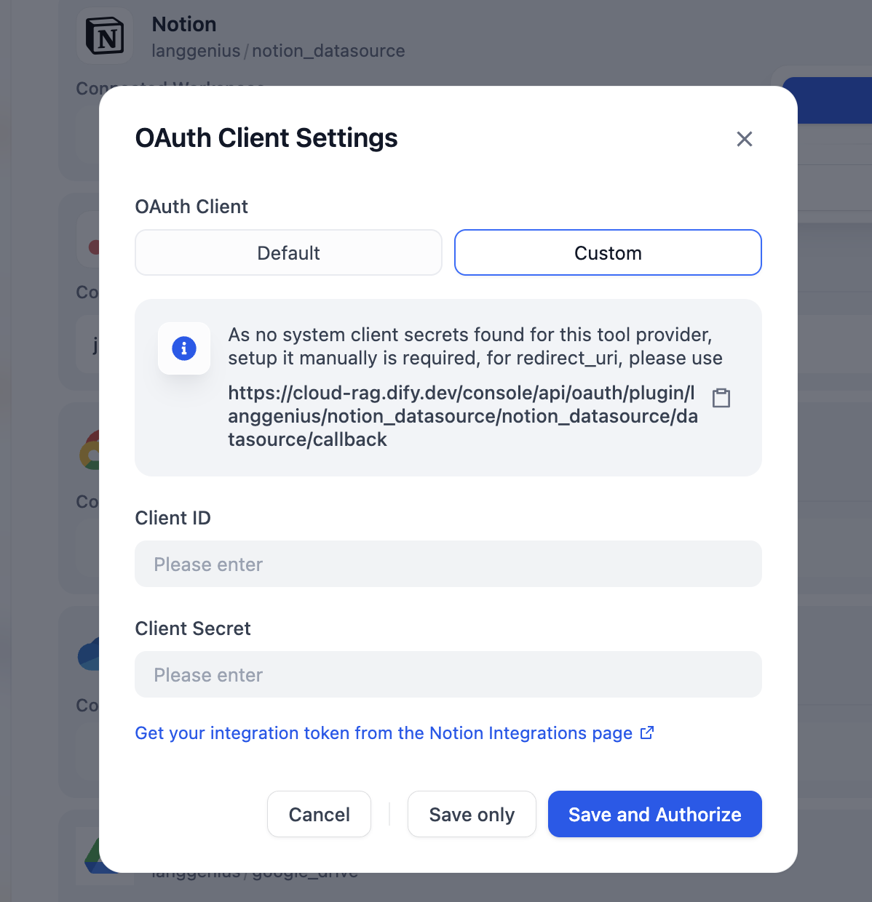

# 数据源授权

> 本文档由 AI 自动翻译。如有任何不准确之处，请参考 [英文原版](https://docs.dify.ai/en/cloud/use-dify/knowledge/knowledge-pipeline/authorize-data-source.md)。

Dify 支持多种外部数据源的连接，为了确保数据安全和访问控制，不同的数据源需要进行相应的授权配置。根据数据源的特性，Dify 提供两种主要的授权方式：**API Key** 和 **OAuth**，以确保你能够安全地访问和导入所需的数据。

## 数据源授权界面入口

在 Dify 中，你可以通过以下两种方式进入数据源授权配置界面：

### 方式一：通过知识流水线编排界面

进入知识流水线编排界面，添加需要的数据源。选中数据源节点，在右侧面板中，点击 **绑定**。

### 方式二：通过集成

前往 **集成** > **数据来源**，找到需要授权的数据源。在这里授权的数据源既可用于知识流水线，也可作为 [Agent 知识库的数据源](../../Agent%20%E7%9F%A5%E8%AF%86%E5%BA%93/%E5%88%9B%E5%BB%BA%20Agent%20%E7%9F%A5%E8%AF%86%E5%BA%93.md#connect-a-source)。

## 支持数据源及授权方式

| 数据源 | API Key | OAuth |
| - | - | - |
| Notion | ✅ | ✅ |
| Jina Reader | ✅ | |
| Firecrawl | ✅ | |
| Google Drive | | ✅ |
| Dropbox | ✅ | ✅ |
| OneDrive | | ✅ |

## 授权方式和流程

### API Key 授权

API Key 授权是一种基于密钥的身份验证方式，适用于企业级服务和开发者工具。用户需要在对应的服务提供商处生成 API Key，然后在 Dify 中进行配置。

#### 授权流程

1. 在数据源配置界面，选择对应的数据源，点击右侧的 **配置**，选择 **添加 API Key**。

   

2. 在弹出的配置面板中，填写对应信息。完成后，点击 **保存** 完成授权。

   

API 密钥会加密存储。配置完成后，即可在知识流水线中使用该数据源（如 Jina Reader），也可将其作为 Agent 知识库的数据源。

### OAuth 授权

OAuth 是一种开放标准的授权协议，允许用户在不暴露密码的情况下，授权第三方应用访问其在特定服务提供商上的资源。Dify 提供两种 OAuth 授权配置方式：默认配置和自定义配置。

#### 授权流程

1. 在数据源配置界面，选择对应的数据源，点击右侧的 **配置**，选择 **添加 OAuth**。

   

2. 在授权页面中查看并确认权限范围后，点击 **允许访问**。

   

   

#### OAuth 客户端设置

Dify 提供默认和自定义两种 OAuth 客户端配置方式。

> [tab] 默认
>
> 默认客户端使用 Dify 预先配置并维护的 OAuth 参数，无需任何额外设置，即可一键添加凭据。

> [tab] 自定义
>
> 自定义客户端允许你在第三方平台注册自己的 OAuth 应用并填入其参数。适用于没有默认客户端的数据源，或你有特定安全、合规要求的场景。
>
> **授权流程**
>
> 1. 在数据源配置界面，选择对应的数据源，点击右侧的 **配置**，选择 **添加 OAuth** 右侧的 **设置图标**，进入 OAuth 客户端设置。
>
>    
>
> 2. 点击 **自定义**，输入 **Client ID** 和 **Client Secret**。点击 **保存并授权** 完成 OAuth 授权流程。
>
>    
