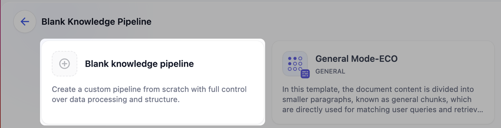
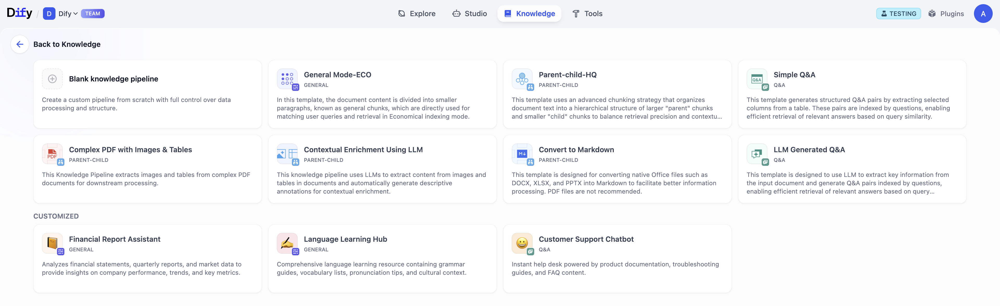
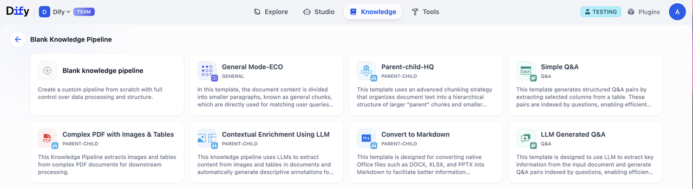
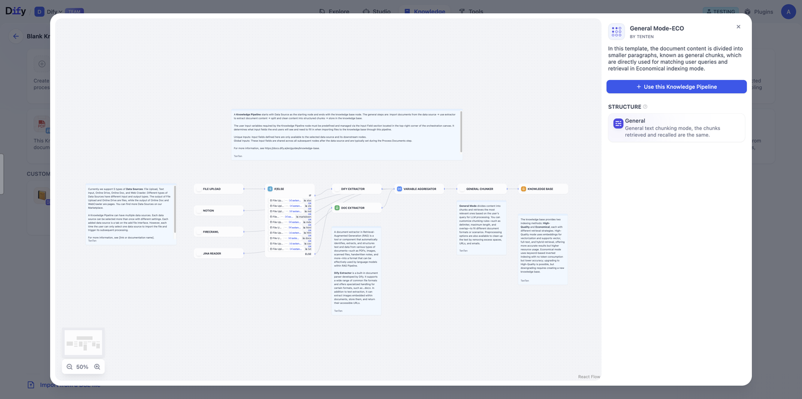
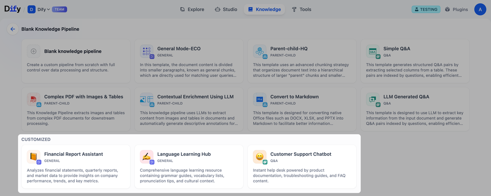
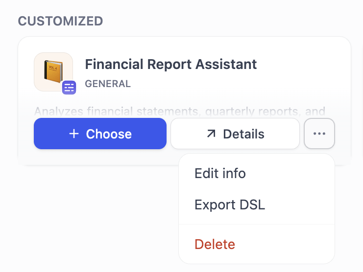
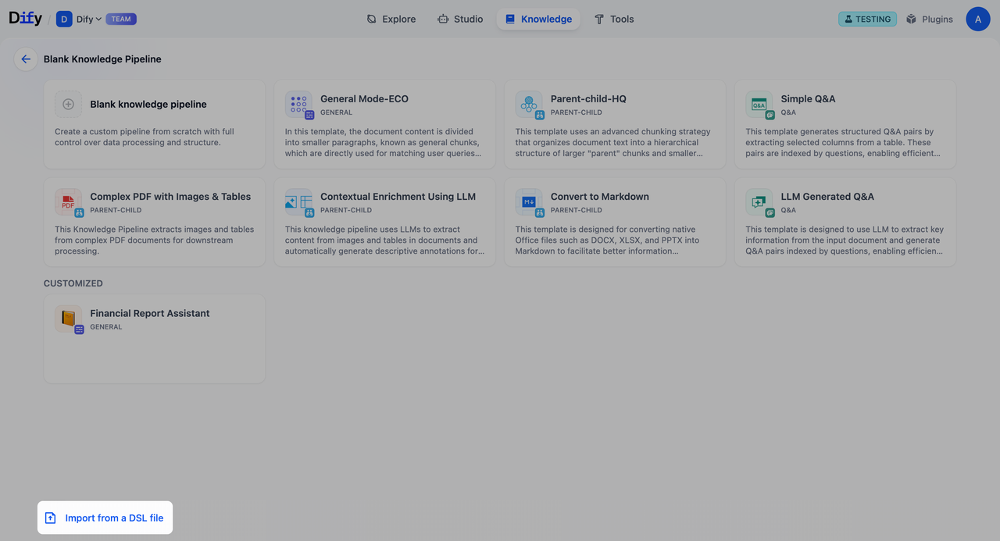

# 步骤一：创建知识流水线

> 本文档由 AI 自动翻译。如有任何不准确之处，请参考 [英文原版](https://docs.dify.ai/en/cloud/use-dify/knowledge/knowledge-pipeline/create-knowledge-pipeline.md)。

点击顶部的 **知识库**，然后点击 **创建** > **构建自定义知识库**，你可以通过以下 3 种方式来创建知识流水线。

### 方式一：从零开始构建

点击 **空白知识流水线** 即可从零开始构建自定义知识流水线。
如果你需要根据数据特点和业务需求自定义处理策略，建议选择从空白知识流水线开始。

### 方式二：通过模版创建

Dify 提供了两种模版方案： **内置流水线**（Built-in) 和**自定义** （Customized)。两种模版的卡片信息都包含了知识库名称、简介描述和标签（包含分段模式）。

#### 内置流水线（Built-in Pipeline)

内置流水线为预置的知识流水线模版，针对常见的文档数据结构进行优化，你可以根据不同的文档类型和使用场景选择适合的处理方式。点击 **选择** 即可开始使用。

**模版类型**

| 模版名称 | 分段结构 | 索引方式 | 检索设置 | 说明 |
| - | - | - | - | - |
| 通用模式（General Mode） | 通用模式 | 经济 | 倒排索引 | 将文档内容分割成较小的段落块（通用块），直接用于匹配用户查询和检索。 |
| 父子模式（Parent-child Structure) | 父子模式 | 高质量 | 混合检索 | 采用了高级分块策略，将文档文本分成较大的"父块"和较小的"子块"。其中，"父块"包含了"子块"。这样既保证了检索的精确性，又维持了上下文的完整性。 |
| 简单问答（Simple Q\&A) | 问答模式 | 高质量 | 向量搜索 | 将表格数据转化为一问一答的形式，通过问题匹配来快速找到对应的答案信息。适用于结构化表格数据。 |
| 复杂 PDF（含图片和表格）（Complex PDF with Images & Tables） | 父子模式 | 高质量 | 混合检索 - 加权评分 | 提取 PDF 文件内的图像和表格内容。 |
| LLM 上下文增强（Contextual Enriching Using LLM) | 父子模式 | 高质量 | 混合检索 - 加权评分 | 将文档内的图片和表格提取出来，使用大型语言模型自动生成描述性注释，实现上下文的智能增强。 |
| Markdown 转换（Convert to Markdown) | 父子模式 | 高质量 | 混合检索 - 加权评分 | 专为 DOCX、XLSX 和 PPTX 等 Office 原生文件格式设计，将其转换为 Markdown 格式以便更好地进行信息处理。⚠️ 注意：不推荐使用 PDF 文件。 |
| LLM 生成问答（LLM Generated Q\&A) | 问答模式 | 高质量 | 向量搜索 - 加权评分 | 使用大型语言模型自动生成结构化的问答对，通过问题匹配机制找到相关的答案信息。 |

点击模版卡片上的详情按钮，即可在弹窗中预览选中的流水线的编排结构、流水线简介和分段模式。点击使用此知识流水线模版进行编排。

#### 自定义（Customized）

自定义模版为用户创建和发布为知识流水线的方案，你可以选择使用该模版、导出 DSL，或点击详情进行快速预览。

点击模版卡片上的选择按钮，即可从该自定义模版开始创建知识库。你也可以在预览该流水线模版时，点击右侧的使用此知识流水线按钮开始创建。点击 ... 可以编辑流水线信息、导出知识流水线或者删除模版。

### 方式三：导入知识流水线

在完成知识流水线的编排后，你可以保存和导出知识流水线，并分享给其他人。知识库使用者可以导入知识流水线，快速复用已构建的知识流水线，并在此基础上针对不同情景或需求进行修改。与工作流 DSL 类似，知识流水线基于相同的 YAML 格式标准，用于定义知识库内的处理流程和配置。

知识流水线包含以下内容：

| 名称 | 包含 |
| - | - |
| 数据源 | 文件上传、网站、在线文档和在线网盘 |
| 数据处理流程 | 文档提取、内容分块和清洗策略 |
| 知识库储存配置 | 索引方式、检索设置和存储参数 |
| 节点连接 | 节点间的连接和处理顺序 |
| 用户输入表单 | 自定义的参数输入字段（如有配置） |
