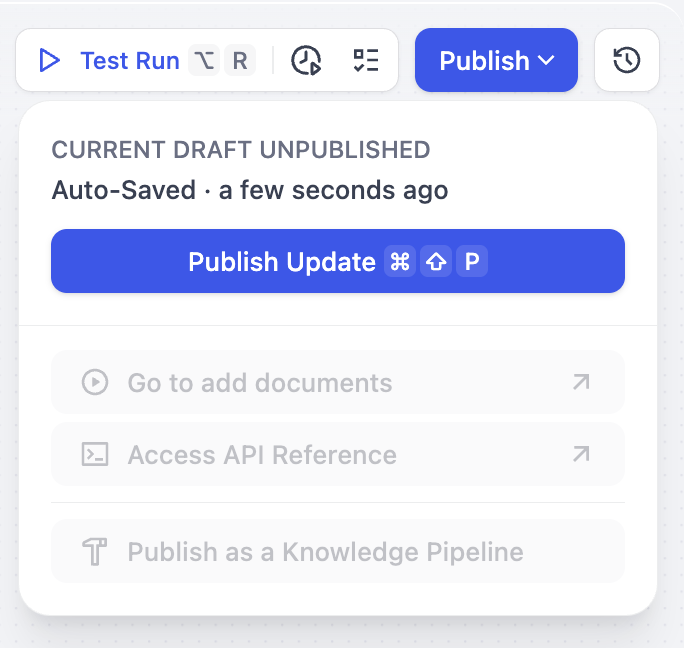
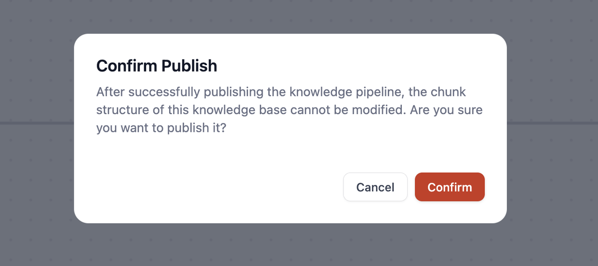
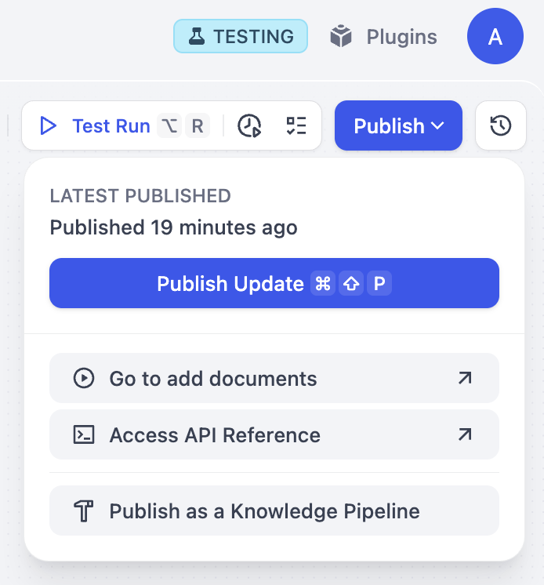

# 步骤三：发布知识流水线

> 本文档由 AI 自动翻译。如有任何不准确之处，请参考 [英文原版](https://docs.dify.ai/en/cloud/use-dify/knowledge/knowledge-pipeline/publish-knowledge-pipeline.md)。

完成知识流水线的编排和调试后，点击 **发布** 并在弹窗中点击 **确认**，即成功发布知识流水线。

> [!WARNING]
>
> **注意：知识流水线发布后，分段结构无法进行修改。**
> 由于分段结构会影响知识库的存储方式和检索召回策略，为确保数据一致性和用户体验，当前每个知识库仅支持 **一种分段结构**。

成功发布后，你可以进行如下操作：\
\

**添加文档（Go to add documents)**\
点击此选项可以跳转到知识库选择数据源界面，你可以直接上传文档。\
\

**访问 API（Access API Reference)**
前往 API 文档页面，你可以获取知识库的 API 调用方法和说明。\
\

**发布为流水线（Publish as a Knowledge Pipeline)**\
你可以点击发布为知识流水线将该流水线保存为可复用的模版，该模版将出现在自定义模版中。

> [!NOTE]
>
> **发布为知识流水线** 仅 Professional 和 Team 套餐可用。Sandbox 账户无法将流水线发布为可复用模板。[升级套餐](https://dify.ai/zh/pricing) 以解锁此功能。
