# 步骤二：编排知识流水线

> 本文档由 AI 自动翻译。如有任何不准确之处，请参考 [英文原版](https://docs.dify.ai/en/cloud/use-dify/knowledge/knowledge-pipeline/knowledge-pipeline-orchestration.md)。

想象一下你正在搭建一条生产流水线，每个站点执行特定任务，你将不同它们连接起来将每个零部件组装最终成品。知识流水线编排与此类似，你组合不同节点，将原始文档数据通过每个节点逐步转化为可搜索的知识库。在 Dify 里，你通过可视化的方式，拖放和连接不同节点，提取文档数据并分段，再配置索引方式和检索设置。

在这个章节，你将了解知识流水线的过程，理解不同节点的含义和配置，如何自定义构建数据处理流程，从而高效地管理和优化知识库。

### 界面状态

进入知识流水线编排界面时，你会看到：

* **标签页状态**：发布流水线后，**文档** 和 **召回测试** 标签页才可使用。
* **必要步骤**：你必须完成知识流水线的编排和发布后，才能上传文件

如果你选择了 **空白知识流水线**，你将看到仅包含知识库节点的画布。你可以跟随该节点旁的指引，逐步完成流水线创建。

如果选择 **特定的流水线模版**，编排界面将直接显示该流水线模版。

## 知识流水线处理流程

在开始之前，我们先拆解知识流水线的处理流程，你可以更好地理解数据是如何一步步转化为可用的知识库。

> [!TIP]
>
> **数据源配置 → 数据处理节点（提取器 + 分段器）→ 知识库节点（分段结构 + 检索设置） → 配置用户输入表单 → 测试发布**

1. **数据源配置**：来自各种数据源的原始内容（本地文件、Notion、网页等）
2. **数据处理节点配置**：处理和转换数据内容
   * 提取器 (Extractor) → 解析和结构化原始文档内容
   * 分段器 (Chunker) → 将结构化内容拆分为便于处理的分段
3. **知识库节点配置**：设置知识库的分段结构和检索设置
4. **用户输入表单配置**：定义流水线使用者需要输入的参数
5. **测试与发布**：验证并正式启用知识库

***

## 步骤一：数据源配置

在一个知识库里，你可以选择单一或多个数据源。目前，Dify 支持 4 种数据源：**文件上传、在线网盘、在线文档和网页爬虫**。

你也可以前往 [Dify Marketplace](https://marketplace.dify.ai)，获得更多数据源。

### 文件上传

用户可以直接选择本地文件进行上传，以下是配置选项和限制。

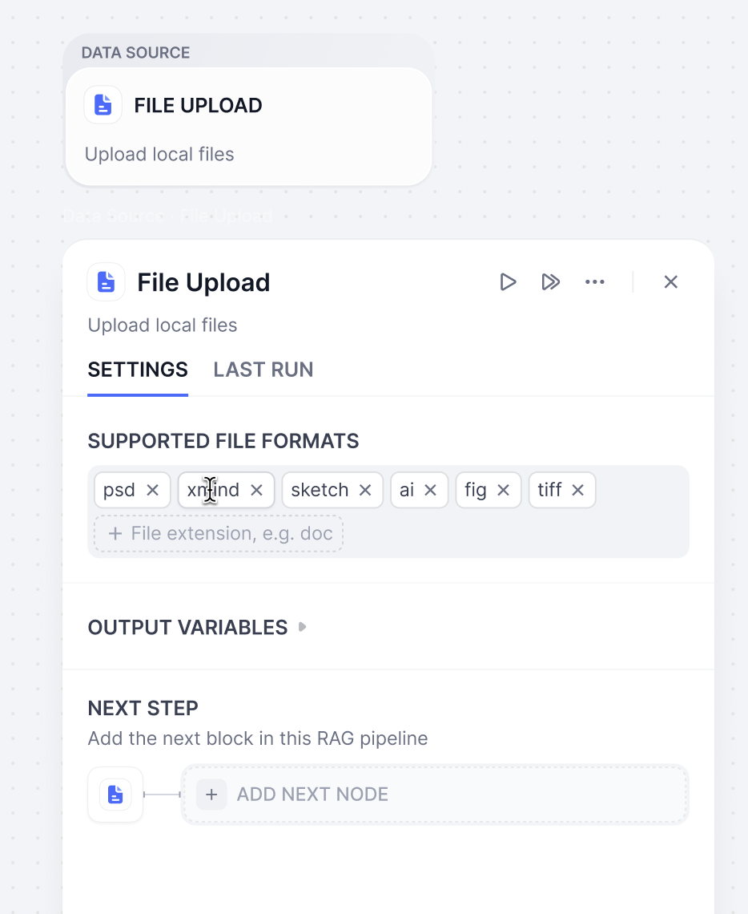

**配置选择**

| 配置项 | 说明 |
| - | - |
| 文件格式 | 支持 pdf, xlxs, docs 等，用户可自定义选择 |
| 上传方式 | 通过拖拽或选择文件或文件夹上传本地文件，支持批量上传 |

**限制**

| 限制项 | 说明 |
| - | - |
| 文件数量 | Sandbox 每次上传 1 个文件；Professional 和 Team 每次最多 50 个 |
| 文件大小 | 单个文件 15 MB；Professional 和 Team 为 50 MB |
| 储存限制 | 文档总数与知识库存储空间因套餐而异 |

**输出变量**

| 输出变量 | 变量格式 |
| - | - |
| `{x} Document` | 单个文档 |

***

### 在线文档

#### Notion

将知识库连接 Notion 工作空间，可直接导入 Notion 页面和数据库内容，支持后续的数据自动同步。

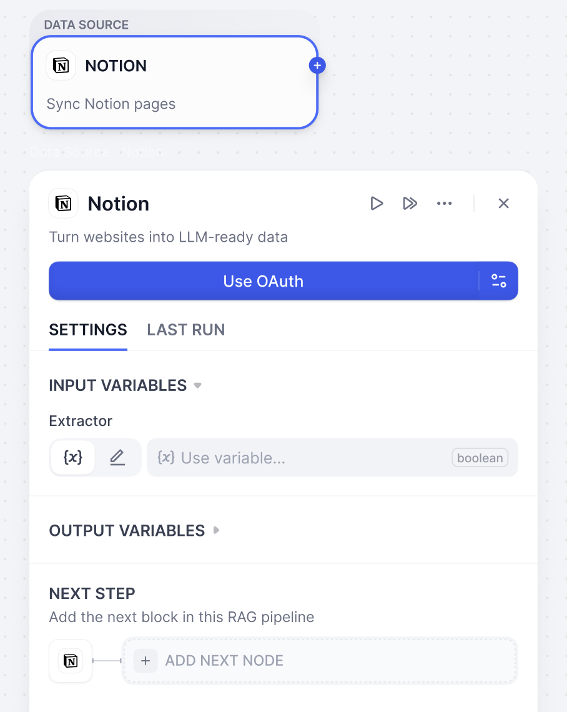

**配置选项说明**

| 配置项 | 选项 | 输出变量 | 说明 |
| - | - | - | - |
| Extractor | 开启 | `{x} Content` | 输出结构化处理的页面信息 |
| | 关闭 | `{x} Document` | 输出页面的原始文本信息 |

***

### 网页爬虫

将网页内容转化为大型语言模型容易识别的格式，知识库支持 Jina Reader 和 Firecrawl，提供灵活的网页解析能力。

#### Jina Reader

开源网页解析工具，提供简洁易用的 API 服务，适合快速抓取和处理网页内容。

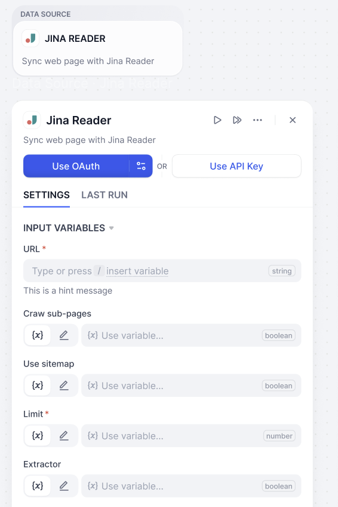

**参数配置和说明**

| 参数 | 类型 | 说明 |
| - | - | - |
| URL | 必填 | 目标网页地址 |
| 爬取子页面 (Crawl sub-page) | 可选 | 是否抓取链接页面 |
| 使用站点地图 (Use sitemap) | 可选 | 利用网站地图进行爬取 |
| 爬取页数限制 (Limit) | 必填 | 设置最大抓取页面数量 |
| 启用内容提取器 (Enable Extractor) | 可选 | 选择数据提取方式 |

#### Firecrawl

开源网页解析工具，提供更精细的爬取控制选项和 API 服务，支持复杂网站结构的深度爬取，适合需要批量处理和精确控制的场景。

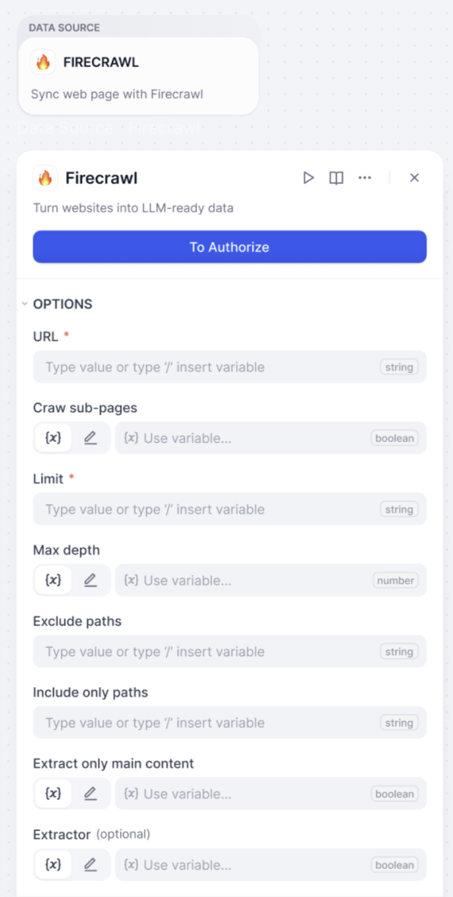

**参数配置和说明**

| 参数 | 类型 | 说明 |
| - | - | - |
| URL | 必填 | 目标网页地址 |
| 爬取页数限制 (Limit) | 必填 | 设置最大抓取页面数量 |
| 爬取子页面 (Crawl sub-page) | 可选 | 是否抓取链接页面 |
| 最大爬取深度 (Max depth) | 可选 | 控制爬取层级深度 |
| 排除路径 (Exclude paths) | 可选 | 设置不爬取的页面路径 |
| 仅包含路径 (Include only paths) | 可选 | 限制只爬取指定路径 |
| 启用内容提取器 (Extractor) | 可选 | 选择数据处理方式 |
| 只提取主要内容 | 可选 | 过滤页面辅助信息 |

***

### 在线网盘

连接你的在线云储存服务（例如 Google Drive、Dropbox、OneDrive），Dify 将自动检索云储存中的文件，你可以勾选并导入相应文档进行下一步处理，无需手动下载文件再进行上传。

> [!TIP]
>
> 关于第三方数据源授权，请前往 [数据源授权](%E6%95%B0%E6%8D%AE%E6%BA%90%E6%8E%88%E6%9D%83.md)。

***

## 步骤二：配置数据处理节点

该阶段是内容的预处理与数据结构化过程，这一部分将会把数据源进行提取、分段并转换为适合知识库存储和检索的格式。你可以将这一步想象成备餐过程：处理原材料、进行清理、切分成小块，并整理好一切，以便在有人需要时能迅速"烹制"出这道"菜肴"。

> [!TIP]
>
> 如需开发自定义数据处理插件，以提取可用于多模态向量化与检索的多模态数据，阅读 [构建在知识流水线中处理多模态数据的工具插件](../../../../%E5%BC%80%E5%8F%91%E8%80%85%E8%B5%84%E6%BA%90/%E6%8F%92%E4%BB%B6%E5%BC%80%E5%8F%91/%E5%BC%80%E5%8F%91%E6%8C%87%E5%8D%97%E4%B8%8E%E7%A4%BA%E4%BE%8B/%E5%AE%8C%E6%95%B4%E7%A4%BA%E4%BE%8B/%E5%A4%9A%E6%A8%A1%E6%80%81%E5%B7%A5%E5%85%B7.md)。

### 文档处理

由于知识库无法直接理解 PDF、Word 等各种文档格式，提取器负责将这些文档"解读"成系统可以处理的文本内容。它支持多种常见文件格式，确保你的文档内容能够被正确提取和处理，并转换为大型语言模型可以有效使用的格式。你可以选择 Dify 文档提取器来处理文件，也可以根据你的需求从 Dify Marketplace 中选择更多工具。Marketplace 提供了如 Dify Extractor、Unstructured 等第三方工具。

> [accordion] 对于文档中的图片
>
> 通过合适的文档处理工具，可将文档中的图片提取为对应分段的附件。被提取的图片可独立管理，并在检索时与分段一同返回。
>
> 被提取图片的 URL 会保留在分段文本中，但你可以安全地删除这些 URL 以保持文本整洁，这不会影响已提取的图片。
>
> 每个分段最多支持 10 个图片附件，超出的图片不会被提取。
>
> 若使用的工具未提取到图片，Dify 会自动提取通过以下 Markdown 语法引用、URL 可访问且小于 2 MB 的 JPG、JPEG、PNG 和 GIF 图片：
>
> * ``
> * ``
>
> 若在索引设置中选择多模态嵌入模型（带有 **Vision** 图标），则提取出的图片也将被向量化并参与检索。

#### 文档提取器 (Doc Extractor)

文档提取器节点可以理解为一个信息处理中心，通过识别并读取输入变量中的文件，提取信息后转化为下一个节点可使用的格式。

> [!TIP]
>
> 关于文档提取器的详细功能和配置方法，请参考 [文档提取器](../../../%E7%BC%96%E6%8E%92/Workflow%20%E4%B8%8E%20Chatflow/%E8%8A%82%E7%82%B9/%E6%96%87%E6%A1%A3%E6%8F%90%E5%8F%96%E5%99%A8.md)。

#### Dify 提取器 (Dify Extractor)

Dify Extractor 是 Dify 开发的一款内置文档解析器。它支持多种常见文件格式，并针对 Doc 文件进行了专门优化。它能够从文档中提取图片，进行存储并返回图片的 URL。

#### Unstructured

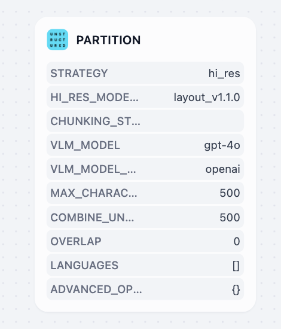

[Unstructured](https://marketplace.dify.ai/plugin/langgenius/unstructured) 将文档转换为结构化的机器可读格式，具有高度可定制的处理策略。它提供多种提取策略（auto、hi\_res、fast、OCR-only）和分段方法（by\_title、by\_page、by\_similarity）来处理各种文档类型，提供详细的元素级元数据，包括坐标、置信度分数和布局信息。推荐用于企业文档工作流、混合文件类型处理以及需要精确控制文档处理参数的场景。

> [!TIP]
>
> 你可前往 [Dify Marketplace](https://marketplace.dify.ai) 探索更多工具。

***

### 分段器 (Chunker)

和人类有限的注意力相似，大语言模型无法同时处理过多的信息。提取文档内容后，分段器会将其拆分为更小、更易于处理的分段。

不同类型的文档需要不同的分段策略，比如产品手册可能需要按照产品特性进行分段，而论文则需要根据逻辑结构进行分段。Dify 提供 3 种分段器，适用于不同的文档类型和使用场景。

#### 分段器类型概述

| 类型 | 特点 | 使用场景 |
| - | - | - |
| 通用文本分块 | 固定大小分段，支持自定义分隔符 | 结构简单的基础文档 |
| 父子文本分块 | 双层分段结构，平衡匹配精准度和上下文 | 需要较多上下文信息的复杂文档结构 |
| QA 分块 | 处理表格中的问答组合 | CSV 和 Excel 的结构化问答数据 |

#### 通用文本预处理规则

通用文本分块和父子文本分块包含以下文本清理选项：

| 处理选项 | 说明 |
| - | - |
| 替换连续的空格、换行符和制表符 | 将文档中的连续空格、换行符和制表符替换为单个空格 |
| 删除所有 URL 和电子邮件地址 | 自动识别并移除文本中的网址链接和邮箱地址 |

#### 通用文本分块 (General Chunker)

适用于结构相对简单的文档的基础分段。可按下面的配置设置分段规则和文本预处理规则。

**输入输出变量**

| 类型 | 变量 | 说明 |
| - | - | - |
| 输入变量 | `{x} Content` | 完整的文档内容，通用文本分块会将其拆分为分段 |
| 输出变量 | `{x} Array[Chunk]` | 分段数组 |

**分段设置 (Chunk Settings)**

| 配置项 | 说明 |
| - | - |
| 分隔符 (Delimiter) | 输入用作分隔符的字符，例如 `###`。分段器会在文本中每个与分隔符完全匹配的位置分段。 |
| 最大块的长度 (Maximum Chunk Length) | 设置每个分段的最大字符数。超出长度的文本会拆成更小的分段。 |
| 块的重叠长度 (Chunk Overlap Length) | 设置相邻分段之间可重叠的字符数，帮助保留上下文。 |

#### 父子文本分块 (Parent-child Chunker)

父子文本分块使用两层分段：检索时既能精确匹配查询，又能给模型提供足够的上下文。

**父子检索的工作机制**

* **子分段**：用于匹配用户查询的短文本，通常为单个句子。
* **父分段**：包含匹配子分段的更大文本块，会传给大语言模型（LLM）作为上下文。

**输入输出变量**

| 类型 | 变量 | 说明 |
| - | - | - |
| 输入变量 | `{x} Content` | 完整的文档内容，父子文本分块会将其拆分为父分段和子分段 |
| 输出变量 | `{x} Array[ParentChunk]` | 父分段数组 |

**分段设置 (Chunk Settings)**

| 配置项 | 说明 |
| - | - |
| 父块分隔符 (Parent Delimiter) | 设置父分段的分隔符 |
| 最大父块长度 (Maximum Parent Chunk Length) | 控制父分段的最大字符数 |
| 子分块分隔符 (Child Delimiter) | 设置子分段的分隔符 |
| 子分块最大长度 (Maximum Child Chunk Length) | 控制子分段的最大字符数 |
| 父块模式 (Parent Mode) | 选择 `paragraph` 将文本拆分为段落，或选择 `full_doc` 将整个文档作为父分段并直接检索 |

#### QA 分块 (QA Chunk)

QA 分块在一个节点中完成提取和分段，适用于 CSV 和 Excel 文件中的结构化问答数据，比如常见问题（FAQ）列表、排班表等问答对清晰的表格。

**输入输出变量**

| 类型 | 变量 | 说明 |
| - | - | - |
| 输入变量 | `{x} Document` | 单个文档 |
| 输出变量 | `{x} Array[QAChunk]` | 问答分段数组 |

**变量配置**

| 名称 | 说明 |
| - | - |
| 问题所在的列 | 表格中存放问题的列 |
| 答案所在的列 | 表格中存放答案的列 |

***

## 步骤三：配置知识库节点

在完成数据处理后，我们将进入知识流水线的最后一个环节 — 知识库节点。你可以根据实际需求，在这个节点选择不同的索引方法和检索策略，以获得最适合的检索效果和成本控制。

知识库节点配置分为以下部分：输入变量、分段结构、索引方式以及检索设置。

### 分段结构 (Chunk Structure)

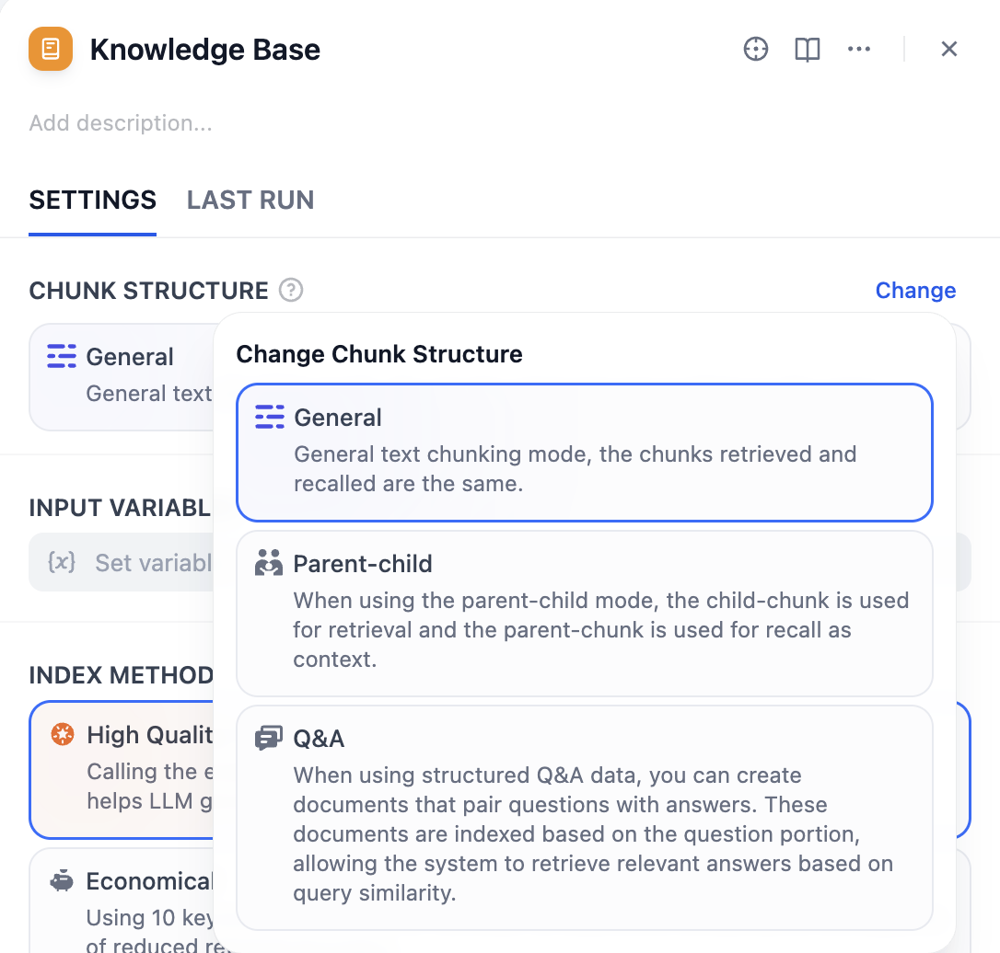

分段结构决定了知识库如何组织和索引你的文档内容。你可以根据文档类型、使用场景和成本考虑来选择最适合的结构模式。

知识库支持三种分段模式：**通用模式、父子模式和问答模式**。如果你是首次创建知识库，建议选择父子模式。

> [!WARNING]
>
> **重要提醒**：分段结构一旦保存发布后无法修改，请根据实际需求进行选择。

#### 通用模式

适用于大多数标准文档处理场景。通用模式提供灵活的索引选项，你可以根据对质量和成本的不同要求选择合适的索引方法。通用模式支持高质量和经济的索引方式，以及多种检索设置。

#### 父子模式

父子模式能够在检索时，提供精确匹配和对应的上下文信息，适用于需要保持完整上下文的专业文档。父子模式仅支持高质量索引，检索时先用子分段匹配，再返回父分段作为上下文。

#### 问答模式 (Question-Answer)

在使用结构化问答数据时，你可以创建问题与答案配对的文档。这些文档会根据问题部分进行索引，从而使系统能够根据查询相似性检索到相关的答案。问答模式仅支持 HQ（高质量）模式。

### 输入变量 (Input Variable)

输入变量用于接收来自数据处理节点的处理结果，用作知识库构建的数据源。你需要将前面配置的分段器节点的输出，连接到知识库节点并作为输入。

该节点根据所选的分段结构，支持不同类型的标准输入：

* **通用模式**：`{x} Array[Chunk]` - 通用分段数组
* **父子模式**：`{x} Array[ParentChunk]` - 父分段数组
* **问答模式**：`{x} Array[QAChunk]` - 问答分段数组

### 索引方式 (Index Method) 与检索设置 (Retrieval Setting)

索引方式决定了知识库如何建立内容索引，检索设置则基于所选的索引方式提供相应的检索策略。可以这样理解：索引方式决定如何整理文档，而检索设置则决定如何查找文档。

知识库提供了两种索引方式：**高质量** 和**经济**，分别提供不同的检索设置选项。

在高质量模式下，使用嵌入模型将已分段的文本块转换为数字向量，帮助更加有效地压缩与存储大量文本信息。这使得即使用户的问题用词与文档不完全相同，系统也能找到语义相关的准确答案。

> [!TIP]
>
> 若要启用跨模态检索（即基于语义相关性同时检索文本和图片），需选择多模态嵌入模型（带有 **Vision** 图标）。从文档中提取的图片将被向量化并参与检索。
>
> 使用此类嵌入模型的知识库，其卡片上标有 **Multimodal**。
>
> 

经济索引方式使用关键词检索，每个分段默认使用 10 个关键词，无需调用嵌入模型。

> [!NOTE]
>
> 了解更多细节，阅读 [指定索引方式与检索设置](../%E5%88%9B%E5%BB%BA%E5%8D%B3%E7%94%A8%E5%9E%8B%E7%9F%A5%E8%AF%86%E5%BA%93/%E6%8C%87%E5%AE%9A%E7%B4%A2%E5%BC%95%E6%96%B9%E5%BC%8F%E4%B8%8E%E6%A3%80%E7%B4%A2%E8%AE%BE%E7%BD%AE.md)。

| 索引方式 | 可用检索设置 | 说明 |
| - | - | - |
| 高质量 | 向量检索 | 基于语义相似度，理解查询深层含义 |
| | 全文检索 | 基于关键词匹配的检索方式，提供全面的检索能力 |
| | 混合检索 | 结合语义和关键词 |
| 经济 | 倒排索引 | 搜索引擎常用的检索方法，匹配问题与关键内容 |

> [!NOTE]
>
> 若选择的嵌入模型支持多模态，需同样选择多模态 Rerank 模型（带有 **Vision** 图标）。否则，检索到的图片将在重排序和检索结果中被排除。

关于配置分段结构、索引方法、配置参数和检索设置，你也可以参考下方表格。

| 分段结构 | 可选索引方式 | 可配置参数 | 可用检索设置 |
| - | - | - | - |
| 通用模式 | 高质量    经济 | Embedding 嵌入模型    关键词数量 | 向量检索  全文检索  混合检索  倒排索引 |
| 父子模式 | 高质量（仅支持） | Embedding Model 嵌入模型 | 向量检索  全文检索  混合检索 |
| 问答模式 | 高质量（仅支持） | Embedding Model 嵌入模型 | 向量检索  全文检索  混合检索 |

***

## 步骤四：配置用户输入表单

用户输入表单对于收集流水线运行所需的有效初始信息非常重要。类似于工作流中的[用户输入节点](../../../%E7%BC%96%E6%8E%92/Workflow%20%E4%B8%8E%20Chatflow/%E5%BC%80%E5%A7%8B/%E7%94%A8%E6%88%B7%E8%BE%93%E5%85%A5.md)，这个表单从用户那里收集必要的详细信息，比如：需要上传的文件、文档处理的特定参数等，确保流水线拥有提供准确结果所需要的所有信息。

通过这种方式，你可以为不同的使用场景创建特定的输入表单，提高流水线对于不同数据源和文档处理流程的灵活性和易用性。

### 创建用户输入表单

你可以通过下面两种方式，创建用户输入表单。

1. **知识流水线编排界面**\
   点击输入字段（Input Field）开始创建和配置输入表单。\\

   

2. **节点参数面板**\
   选中节点，在右侧的面板需要填写的参数内，点击最下方的`+ 创建用户输入字段`（+ Create user input) 来创建新的输入项。新增的输入项将会汇总到输入字段（Input Field）的表单内。!\[节点参数面板]\(/images/use-dify/knowledge/knowledge-pipeline-orchestration-10.png)

### 添加用户输入字段

#### 非共享输入 (Unique Inputs for Each Entrance)

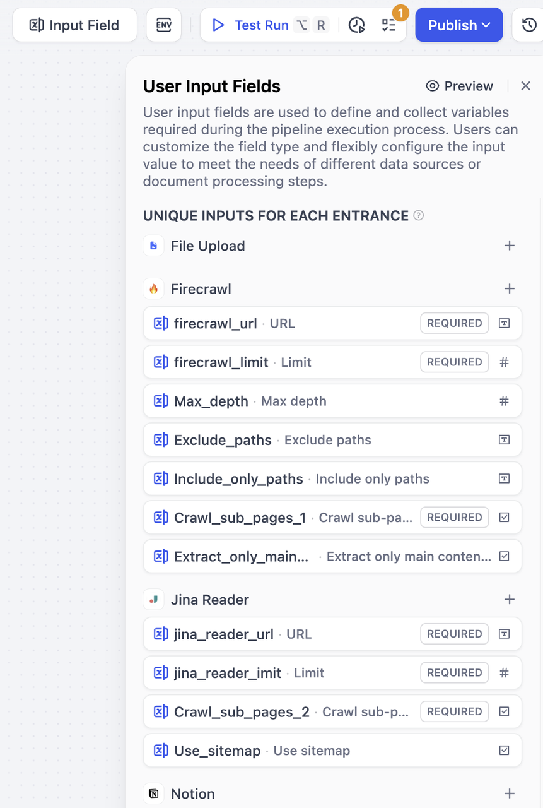

这类输入适用于每个数据源及其下游节点，用户只需在选择对应数据源时填写这些字段，比如不同数据源的 URL。

**创建方式**：在数据源右侧点击"+"按钮，为该数据源添加字段。这个字段只能被该数据源及其后续连接的节点引用。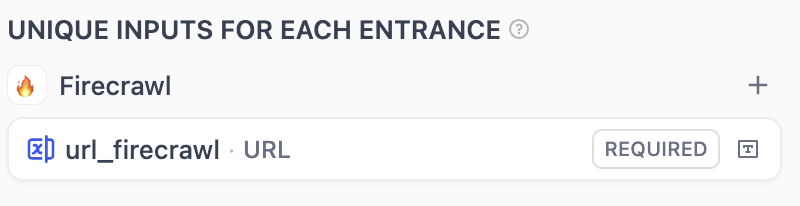

#### 全局共享输入 (Global Inputs for All Entrances)

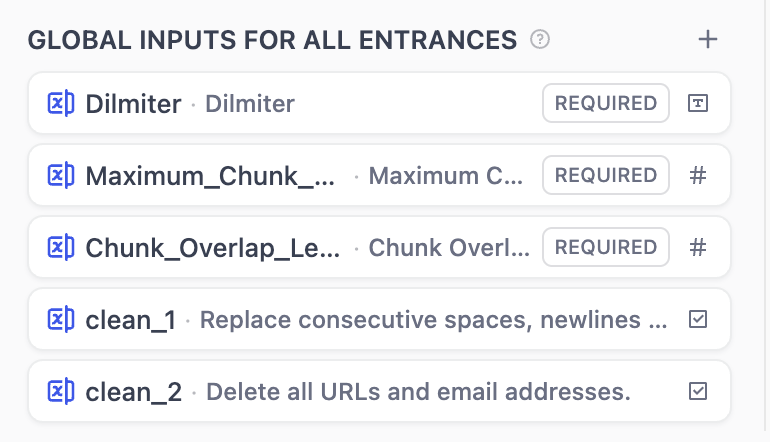

全局共享输入可以被所有节点引用。这类输入适用于通用处理参数，比如分隔符、最大分段长度、文档处理配置等。无论用户选择哪个数据源，都需要填写这些字段。

**创建方式**：在全局共享输入右侧点击"+"按钮，添加的字段将被任意节点引用。

### 支持字段类型和填写说明

知识流水线支持以下七种类型的输入变量。

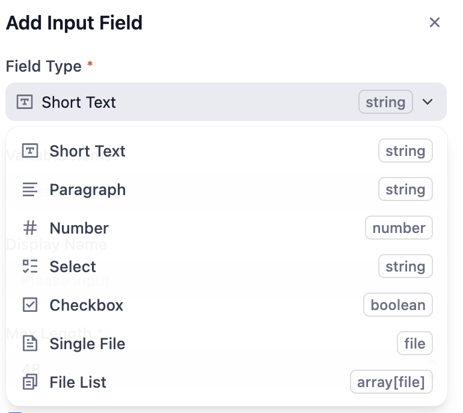

| 字段类型 | 说明 |
| - | - |
| 文本 | 短文本，由知识库使用者自行填写，最大长度为 256 字符 |
| 段落 | 长文本，知识库使用者可以输入较长字符 |
| 下拉选项 | 由编排者预设的固定选项供使用者选择，使用者无法自行填写内容 |
| 布尔值 | 只有真/假两个取值 |
| 数字 | 只能输入数字 |
| 单文件 | 上传单个文件，支持多种文件类型（文档、图片、音频和其他文件类型） |
| 文件列表 | 批量上传文件，支持多种文件类型（文档、图片、音频和其他文件类型） |

> [!TIP]
>
> 请阅读 [用户输入节点](../../../%E7%BC%96%E6%8E%92/Workflow%20%E4%B8%8E%20Chatflow/%E5%BC%80%E5%A7%8B/%E7%94%A8%E6%88%B7%E8%BE%93%E5%85%A5.md)，了解关于支持字段的更多说明。

### 字段配置选项

所有类型的输入项包含：必填项、非必填项和更多设置，可以通过勾选设置为是否为必填。

| 设置类型 | 名称 | 说明 | 示例 |
| - | - | - | - |
| 必填项 | 变量名称 | 系统内部标识名称，通常使用英文和下划线进行命名 | `user_email` |
| | 显示名称 | 界面展示的名称，通常是简洁易读的文字 | 用户邮箱 |
| 类型特定设置 | | 不同字段类型的特殊要求 | 文本的最大长度为 100 字符 |
| 更多设置 | 默认值 | 用户未输入时的默认值 | 数字字段默认为 0，文本字段默认为空 |
| | 占位符 | 输入框空白时的提示文字 | 请输入您的邮箱 |
| | 提示 | 解释或指引用户进行填写的文字，通常在用户鼠标悬停时显示 | 请输入有效的邮箱地址 |
| 特殊非必填信息 | | 根据不同字段类型的额外设置选项 | 邮箱格式验证 |

配置完成后，点击右上角的预览按钮，你可以在弹出的表单预览界面中浏览。你可以拖拽调整字段的分组，如果出现感叹号，则表明移动后引用失效。

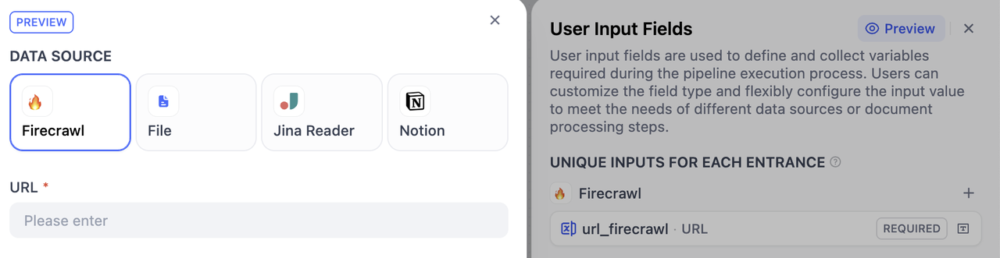

***

## 步骤五：为知识库命名

默认情况下，知识库名称为"Untitled + 序号"，权限设置为"只有我"，图标为橙色书本。如果你使用 DSL 文件导入，则将使用其保存的图标。

点击左侧面板中的 **设置** 并填写以下信息：

* **名称和图标**\
  为你的知识库命名。\
  你还可以选择一个 emoji、上传图片或粘贴图片 URL 作为知识库的图标。
* **描述**\
  简要描述你的知识库。这有助于 AI 更好地理解和检索你的数据。如果留空，Dify 将应用默认的检索策略。
* **可见权限**\
  从下拉菜单中选择适当的访问权限。

***

## 步骤六：测试

你马上就要完成了！这是知识流水线编排的最后一步。

在完成编排后，你需要先验证配置的完整性，然后测试流水线运行效果，确认各项设置正确无误，最后发布知识库。

### 检查配置完成度

在进行测试前，建议先检查配置的完整性，避免因遗漏配置而导致测试失败。

点击右上角的检查清单按钮，系统会显示遗漏部分。

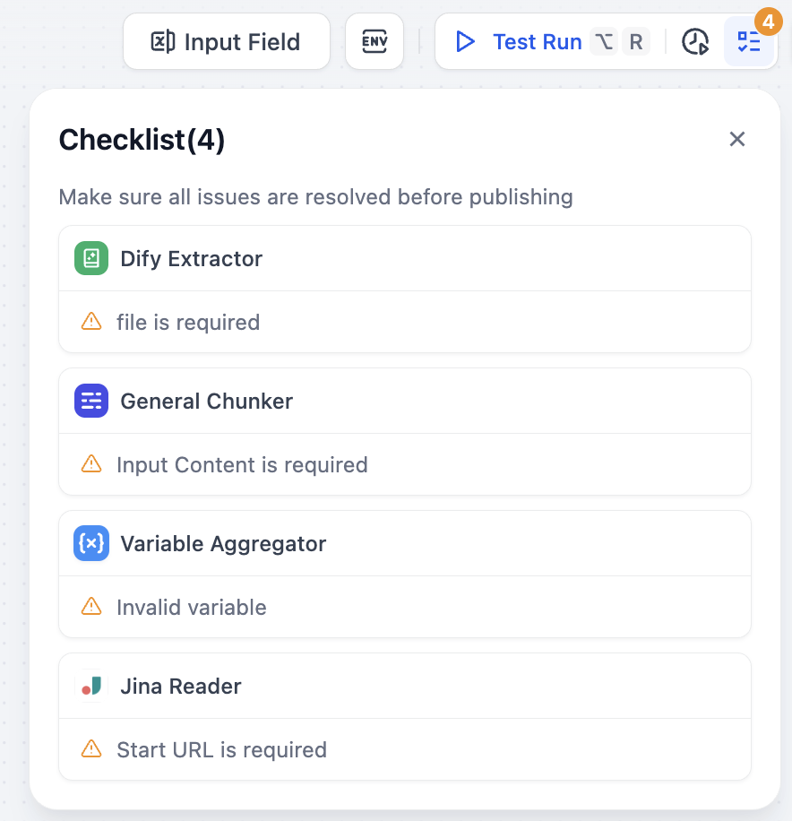

完成所有的配置后，可以通过测试运行来预览知识流水线的运行效果，确认各项设置准确无误，再进行发布。

### 测试运行 (Test Run)

1. **开始测试**：点击右上角的测试运行（Test Run）按钮
2. **导入测试文件**：在右侧弹出的数据源窗口中，导入文件

> [!WARNING]
>
> **重要提醒**：为了便于调试和观测，在测试运行状态下，每次仅允许上传一个文件。

3. **填写参数**：导入成功后，根据你之前配置的用户输入表单填写对应参数
4. **开始试运行**：点击下一步，开始测试整个流水线

在测试期间，你可以访问[运行历史](../../../%E7%9B%91%E6%8E%A7/%E6%97%A5%E5%BF%97.md)（记录所有运行记录，包括运行时间、执行状态和输入/输出参数概要）和[变量检查](../../../%E7%BC%96%E6%8E%92/Workflow%20%E4%B8%8E%20Chatflow/%E8%B0%83%E8%AF%95/%E5%8F%98%E9%87%8F%E6%A3%80%E6%9F%A5%E5%99%A8.md)（位于底部面板，它显示每个节点的输入/输出数据，帮助你识别问题和验证数据流），以实现高效的故障排除和错误修复。

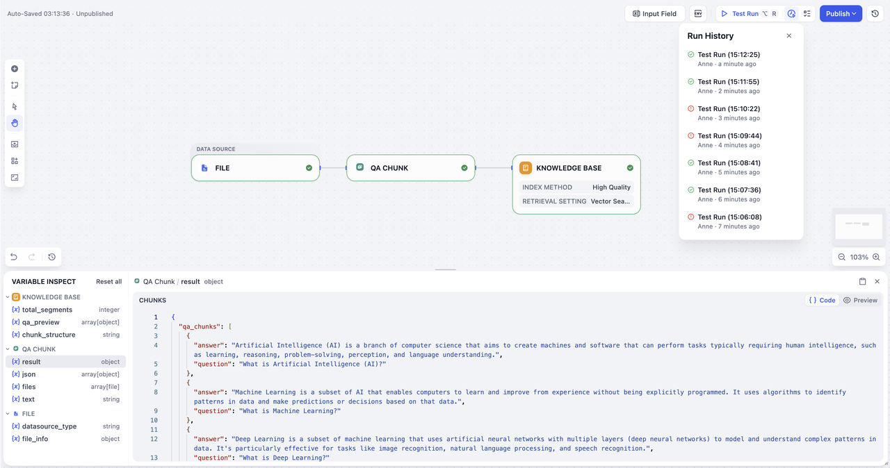
