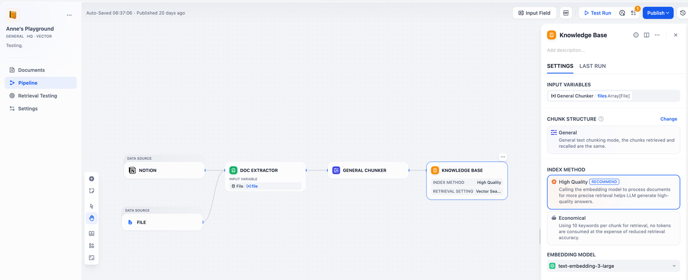

# 步骤五：管理和使用知识库

> 本文档由 AI 自动翻译。如有任何不准确之处，请参考 [英文原版](https://docs.dify.ai/en/cloud/use-dify/knowledge/knowledge-pipeline/manage-knowledge-base.md)。

创建知识库后，你可以继续对其进行管理和优化，以确保它能为你的应用提供准确的的上下文信息。通过以下方式，你可以对知识库文件的进行更新、进行召回测试、修改流水线和修改知识库的属性等：

### 流水线

浏览编排的流水线，并对节点和配置进行修改。

> [!TIP]
>
> 你可前往 [管理知识库文档](../%E7%AE%A1%E7%90%86/%E7%BB%B4%E6%8A%A4%E7%9F%A5%E8%AF%86%E5%BA%93%E5%86%85%E5%AE%B9.md)，了解更多内容。

