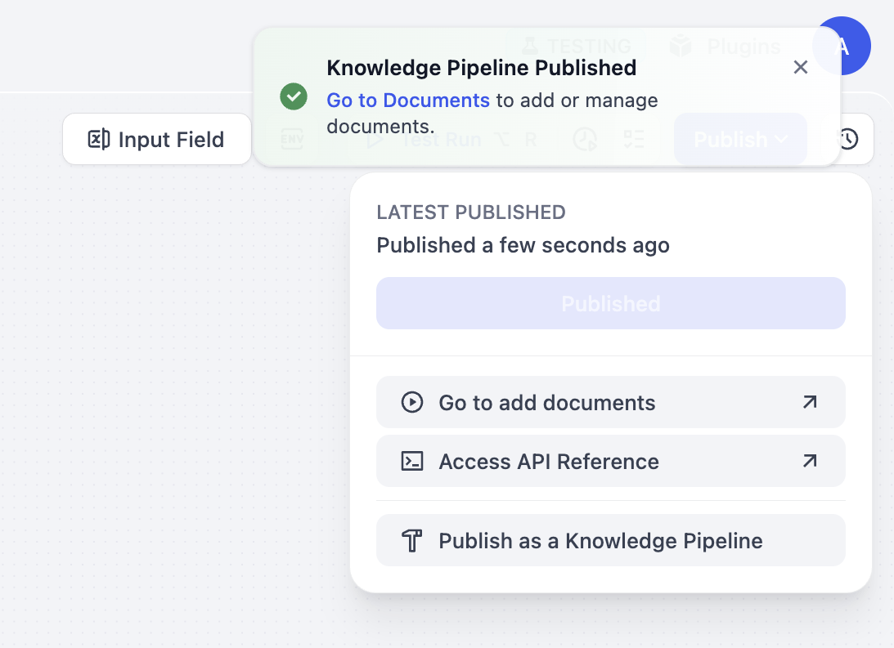
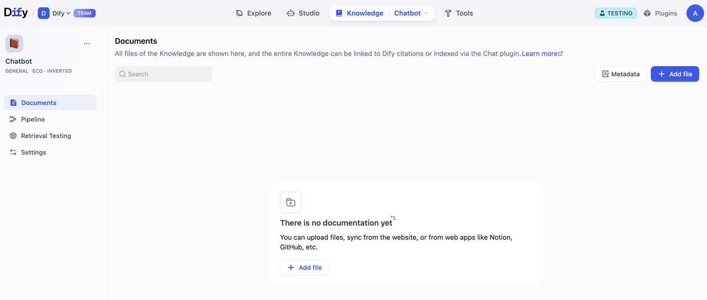
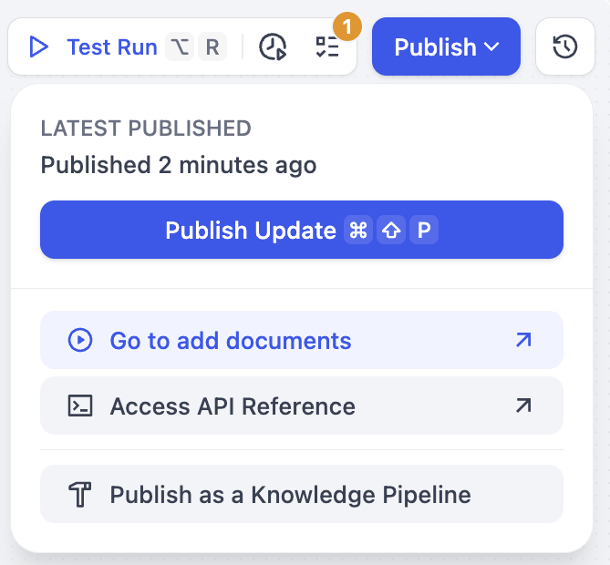
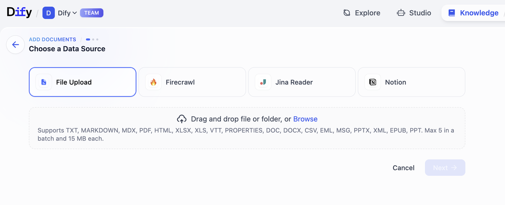
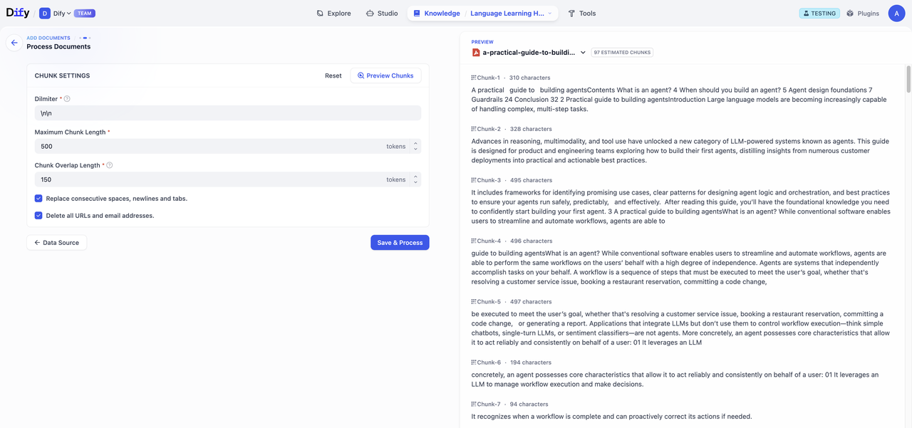
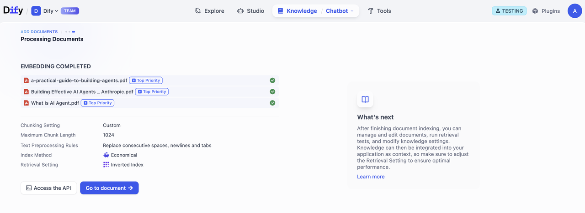
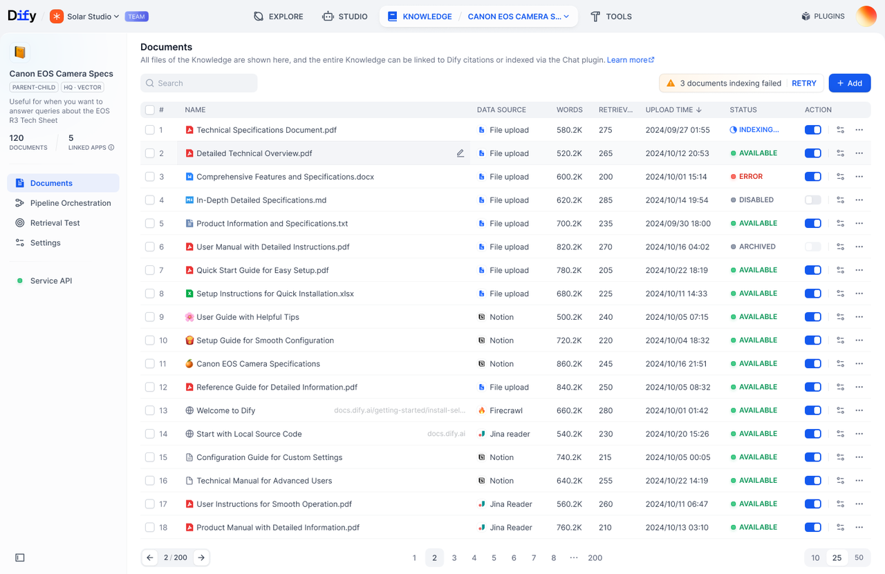

# 步骤四：上传文件

> 本文档由 AI 自动翻译。如有任何不准确之处，请参考 [英文原版](https://docs.dify.ai/en/cloud/use-dify/knowledge/knowledge-pipeline/upload-files.md)。

完成知识流水线的编排、调试并发布成功后，你能通过以下两种方式上传文件：

A. 在发布成功的弹窗哪点击前往文档。进入文档页面后，点击添加文件进行上传。

B. 在发布的下拉菜单中，点击去添加文档。进入选择数据源页面，选择对应数据源开始上传文件。

### 上传流程

1. **选择数据源**\
   从流水线配置的数据源类型中进行选择。目前，Dify 支持 4 种数据源
   **文件上传（pdf, docx 等）、在线网盘（Google Drive, OneDrive 等）、在线文档（Notion) 和 网页爬虫（Jina Reader 和 Firecrawl）。**
   请前往 [Dify Marketplace](https://marketplace.dify.ai/) 获取更多数据源支持。

2. **填写文件处理相关参数和变量**\
   如果你在知识流水线的编排过程中配置了用户输入字段，需要在这一步填写所需的参数和变量。完成填写后，点击 **预览分段** 可进行预览。\
   点击保存并处理完成知识库创建，进入数据处理阶段。

   > [!WARNING]
   >
   > 注意：分段结构与知识流水线内保持一致，不会因用户输入的文件处理参数和变量而改变。

   

3. **文档处理**\
   跟踪文档处理的进度。嵌入完成后，点击 **前往文档**。

   

4. **查看文件列表**\
   点击 **前往文档**，前往知识库文档界面。在这里，你可以浏览上传文件数量、处理进程和状态等。

   
