# 管理文档元数据

> 本文档由 AI 自动翻译。如有任何不准确之处，请参考 [英文原版](https://docs.dify.ai/en/cloud/use-dify/knowledge/metadata.md)。

## 什么是元数据？

### 定义

元数据是用于描述其他数据的信息。简单来说，它是"关于数据的数据"。它就像一本书的目录或标签，可以为你介绍数据的内容、来源和用途。
通过提供数据的上下文，元数据能帮助你在知识库内快速查找和管理数据。

### 知识库元数据定义

* **字段（Field）**：元数据字段是用于描述文档特定属性的标识项，每个字段代表文档的某个特征或信息。例如"author""language"等。

* **字段值（Value）**：字段值是该字段的具体信息或属性，例如"Jack""English"。

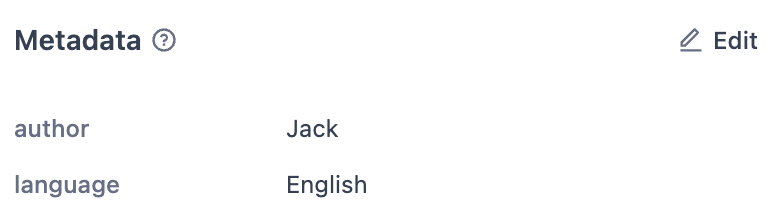

* **字段值计数（Value Count）**：字段值计数是指在某条元数据字段中标记的字段值数量，包括重复项。例如，此处的"3"是字段值计数，指该字段中有 3 个独特的字段值。

* **值类型（Value Type）**：值类型指字段值的类型。
* 目前，Dify 的元数据功能支持以下三种值类型：
  * **字符串**（String）：文本值。
  * **数字**（Number）：数值。
  * **时间**（Time）：日期和时间。

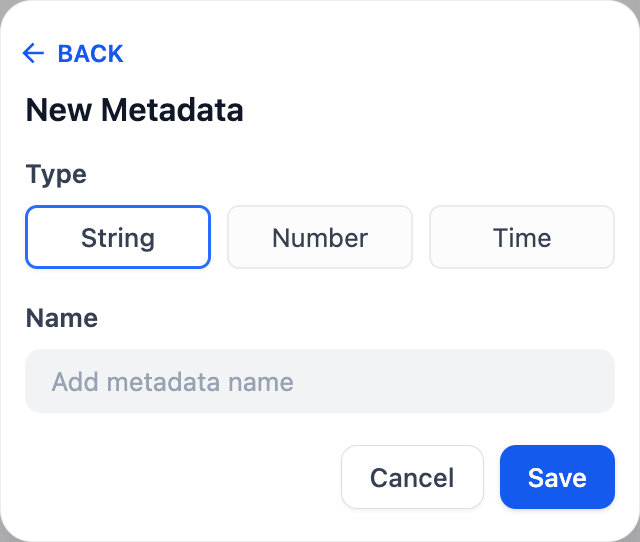

## 如何管理知识库元数据？

### 管理知识库元数据字段

在知识库管理界面，你可以创建、修改和删除元数据字段。

> 注意：所有在此界面进行的更新均为 **全局更新**，这意味着对元数据字段列表的任何更改都会影响整个知识库，包括所有文档中标记的元数据。

#### 元数据管理界面简介

**进入元数据管理界面**

在知识库管理界面，点击右上方的 **元数据** 按钮，进入元数据管理界面。

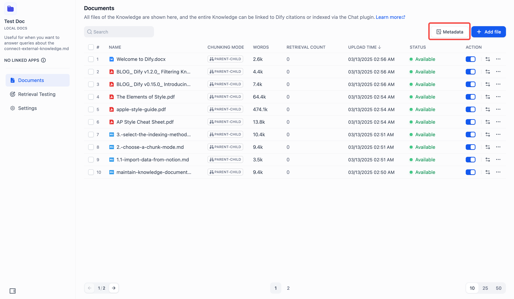

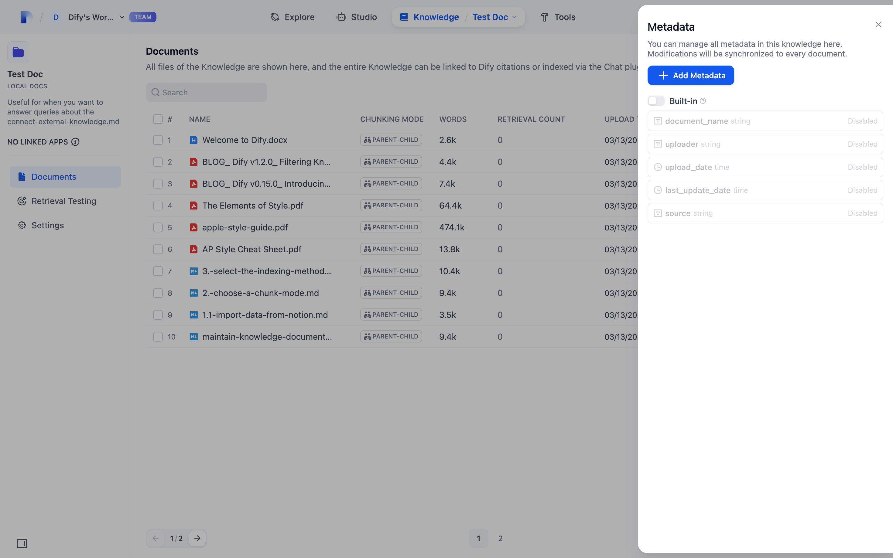

**知识库元数据字段的类型**

在知识库中，元数据字段分为两类：**内置元数据（Built-in）** 和 **自定义元数据**。

<table>
  <thead>
    <tr>
      <th />

      <th>内置元数据（Built-in）</th>
      <th>自定义元数据</th>
    </tr>
  </thead>

  <tbody>
    <tr>
      <td>显示位置</td>
      <td>知识库界面 元数据 栏的下半部分。</td>
      <td>知识库界面 元数据 栏的上半部分。</td>
    </tr>

    <tr>
      <td>启用方式</td>
      <td>默认禁用，需要手动开启才能生效。</td>
      <td>由用户根据需求自由添加。</td>
    </tr>

    <tr>
      <td>生成方式</td>
      <td>启用后，由系统自动提取相关信息并生成字段值。</td>
      <td>用户手动添加，完全由用户自定义。</td>
    </tr>

    <tr>
      <td>修改权限</td>
      <td>一旦生成，无法修改字段与字段值。</td>
      <td>可以删除或编辑字段名称，也可以修改字段值。</td>
    </tr>

    <tr>
      <td>应用范围</td>
      <td>启用后，适用于已上传和新上传的所有文档。</td>
      <td>添加元数据字段后，字段会储存在知识库的元数据列表中/需要手动设置，才能将该字段应用于具体文档。</td>
    </tr>

    <tr>
      <td>字段</td>

      <td>
        由系统预定义，包括：

        <ul>
          <li>document\_name (string)：文件名</li>
          <li>uploader (string)：上传者</li>
          <li>upload\_date (time)：上传日期</li>
          <li>last\_update\_date (time)：最后更新时间</li>
          <li>source (string)：文件来源</li>
        </ul>
      </td>

      <td>在初始状态下，知识库无自定义元数据字段，需要用户手动添加。</td>
    </tr>

    <tr>
      <td>字段值类型</td>

      <td>
        <ul>
          <li>字符串 (string)：文本值</li>
          <li>数字 (number)：数值</li>
          <li>时间 (time)：日期和时间</li>
        </ul>
      </td>

      <td>
        <ul>
          <li>字符串 (string)：文本值</li>
          <li>数字 (number)：数值</li>
          <li>时间 (time)：日期和时间</li>
        </ul>
      </td>
    </tr>
  </tbody>
</table>

#### 新建元数据字段

1. 点击 **+添加元数据** 按钮，弹出 **新建元数据** 弹窗。

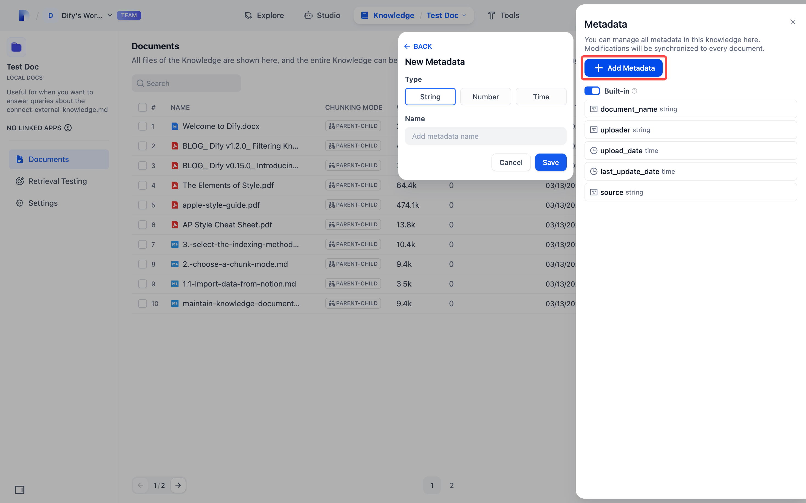

2. 在 **字段值类型** 中选择元数据字段的值类型。

3. 在 **名称** 框中填写字段的名称。

> 字段名仅支持小写字母、数字和下划线（\_）字符，不支持空格和大写字母。

4. 点击 **保存** 按钮，保存字段。

#### 修改元数据字段

1. 点击单条元数据字段右侧的编辑按钮，弹出 **重命名** 弹窗。

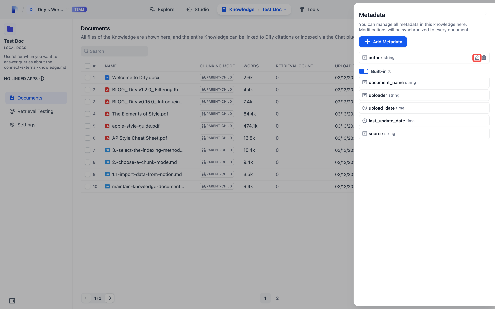

2. 在 **名称** 框中修改字段名称。

> 此弹窗仅支持修改字段名称，不支持修改字段值类型。

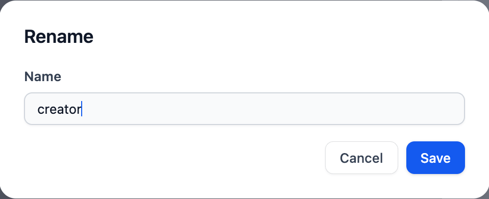

3. 点击 **保存** 按钮，保存修改后的字段。

> 修改并保存后，该字段将在知识库中的所有相关文档中同步更新。

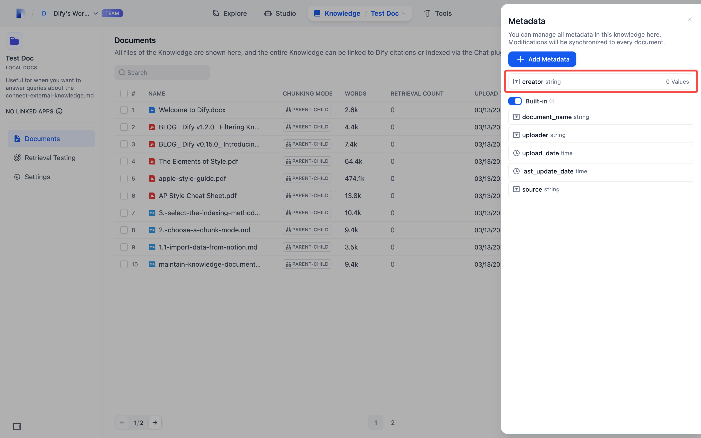

#### 删除元数据字段

点击单条元数据字段右侧的删除按钮，可以删除该字段。

> 如果删除单条字段，该字段及该字段下包含的字段值将从知识库的所有文档中删除。

### 编辑文档元数据信息

#### 批量编辑文档元数据信息

你可以在知识库管理界面批量编辑文档的元数据信息。

**打开编辑元数据弹窗**

1. 打开知识库管理界面，在文档列表左侧的白色方框中勾选你希望批量操作的文档。勾选后，页面下方会弹出操作选项。

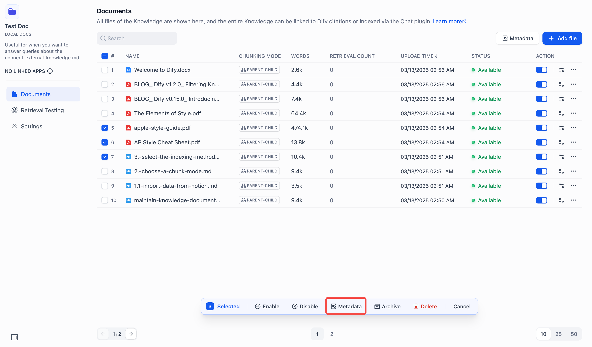

2. 点击操作选项中的 **元数据**，弹出 **编辑元数据** 弹窗。

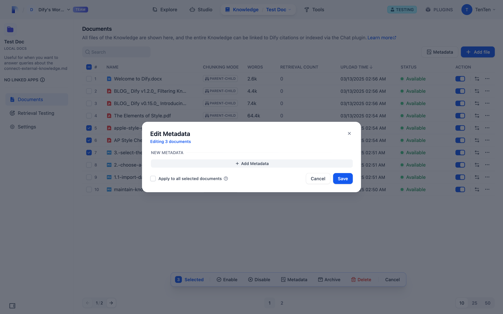

**批量新增元数据信息**

1. 在 **编辑元数据** 弹窗中点击底部的 **+添加元数据** 按钮，弹出操作弹窗。

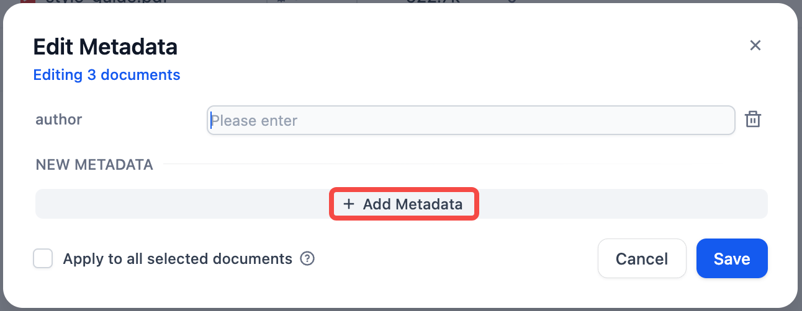

* 如需为选中文档添加已创建的字段：

  * 可以从下拉列表中选择已有的字段，添加到字段列表中。

  * 可以在 **搜索元数据** 搜索框中搜索你需要的字段，添加到该文档的字段列表中。

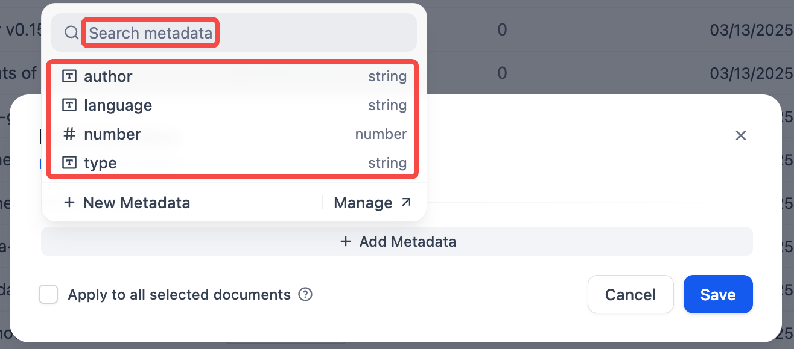

* 如需为选中文档新建字段，可以点击弹窗左下角的 **+新建元数据** 按钮，并参考前文的 **新建元数据字段** 章节新建字段。

  > 在 **+新建元数据** 弹窗中新建的元数据字段，将自动同步至知识库字段列表中。

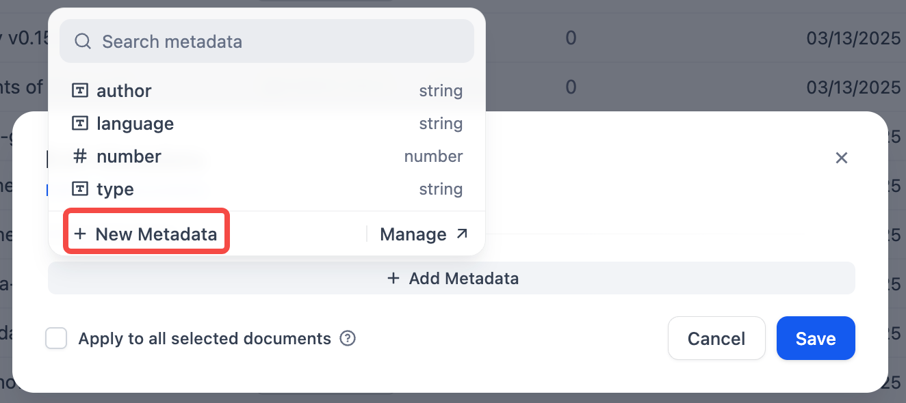

* 如需管理已创建的字段，可以点击该弹窗右下角的 **管理** 按钮，跳转到知识库的管理界面。

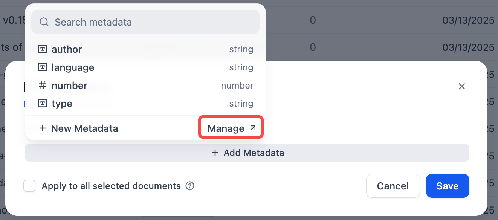

2. *（可选）* 新增字段后，在字段值框内填写该字段相应的字段值。

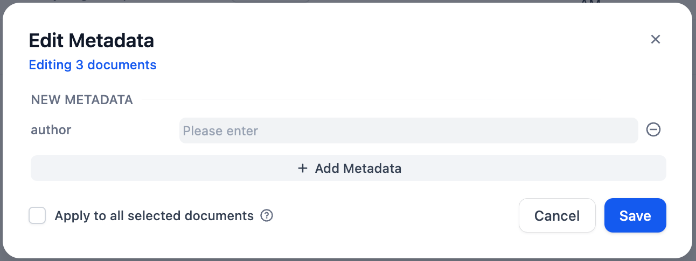

* 如果值类型为 **时间**，在填写字段值时会弹出时间选择器，供你选择具体时间。

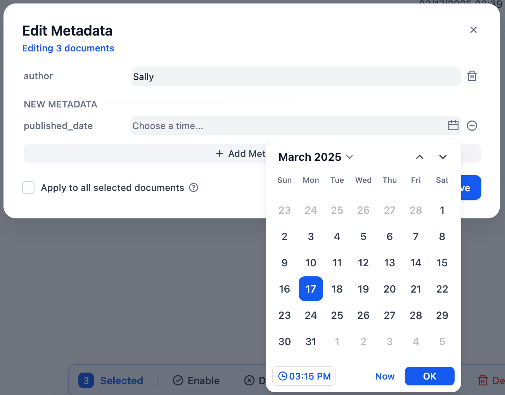

3. 点击 **保存** 按钮，保存操作。

**批量删改元数据信息**

1. 在 **编辑元数据** 弹窗中删改元数据信息：

* **添加字段值**：在需要添加元数据值的字段框内直接输入所需值。

* **重置字段值**：将光标悬停在字段名左侧的蓝色圆点上，蓝点将变为 **重置** 按钮。点击蓝点，将字段框内修改后的内容重置为原始元数据值。

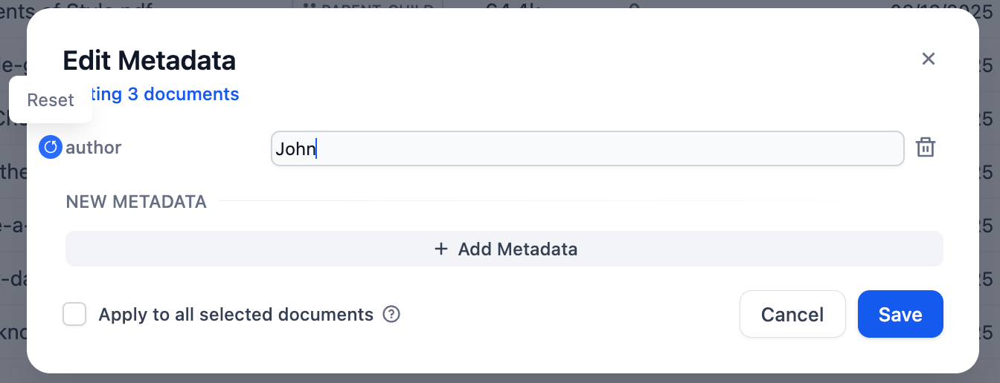

* **删除字段值**：

* 删除一个字段值：在需要删除字段值的字段框内直接删除该字段值。

* 删除多个字段值：点击 **多个值** 卡片的删除图标，清空所有选中文档的该元数据字段的值。

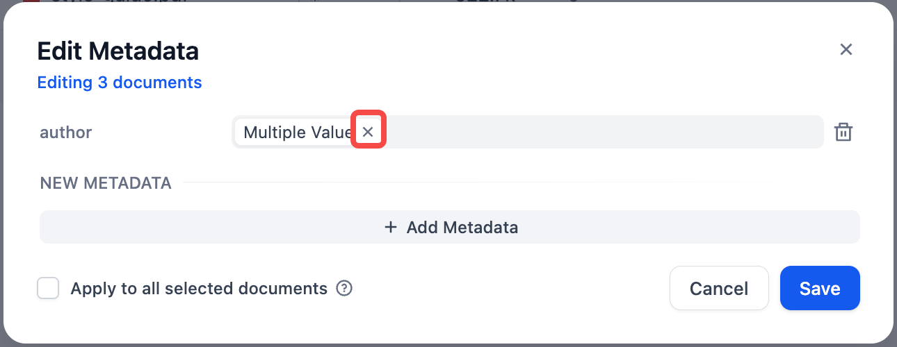

* **删除单条元数据字段**：点击字段最右侧的删除符号，删除该字段。删除后，该字段会被横线划掉且置灰。

> 此操作仅会删除已选文档的该字段与字段值，字段本身依然保留在知识库中。

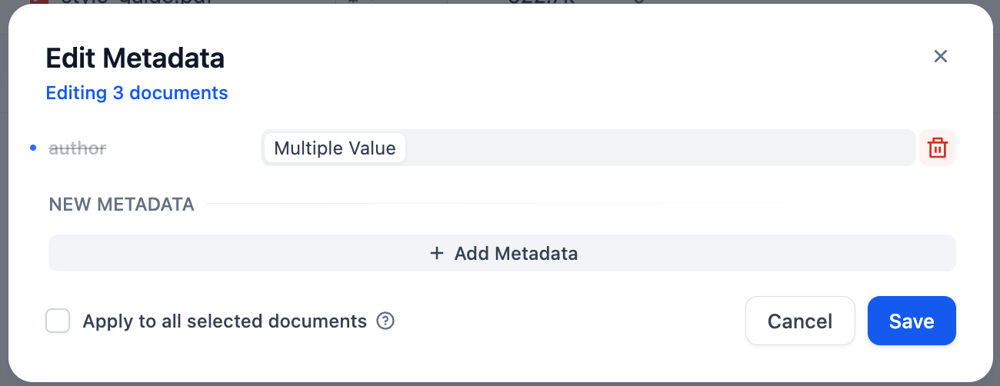

2. 点击 **保存** 按钮，保存操作。

**调整批量操作的应用范围**

* **调整批量操作的应用范围**：你可以使用 **编辑元数据** 弹窗左下角的 **应用于所有文档** 选框来调整编辑模式中改动的应用范围。

  * **否（默认）**：如果不选中该选项，编辑模式中的改动仅对原本已有该元数据字段的文档生效，其他文档不会受到影响。

  * **是**：如果选中该选项，编辑模式中的改动会对所有选中的文档生效。原本没有该字段的文档，会自动添加该字段。

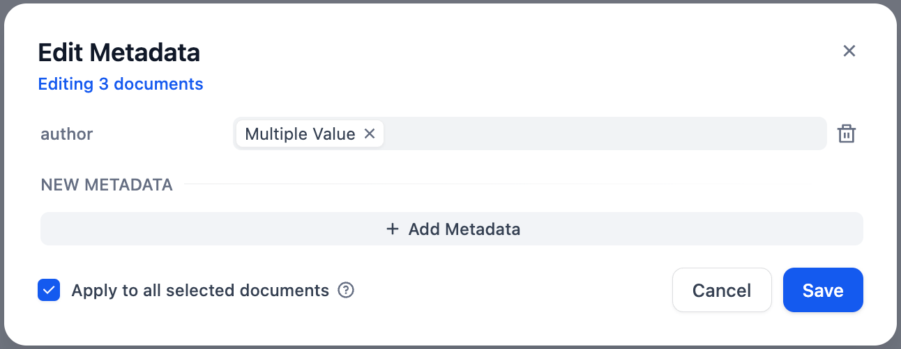

#### 编辑单篇文档元数据信息

你可以在文档详情界面中编辑单篇文档的元数据信息。

**进入文档元数据编辑模式**

1. 在文档详情界面，点击信息栏上方的 **开始标记** 按钮。

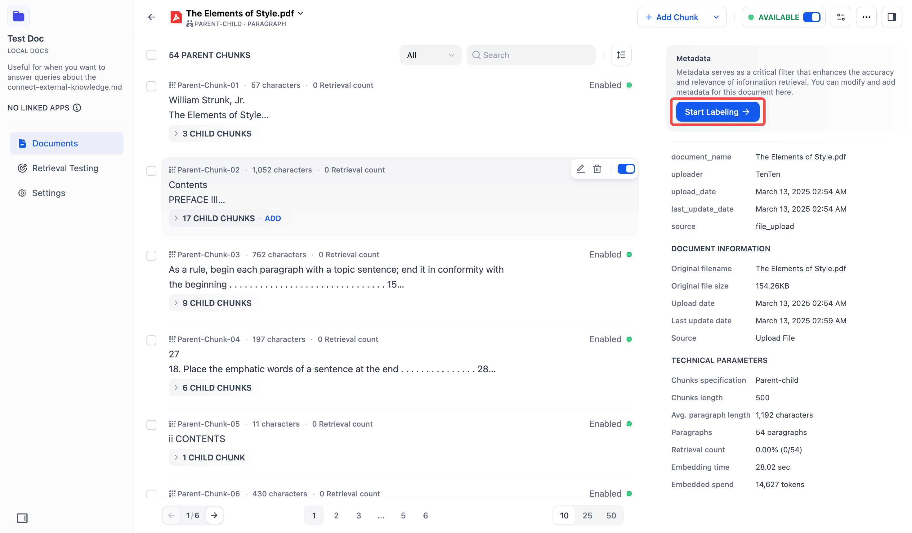

2. 进入文档元数据编辑模式。

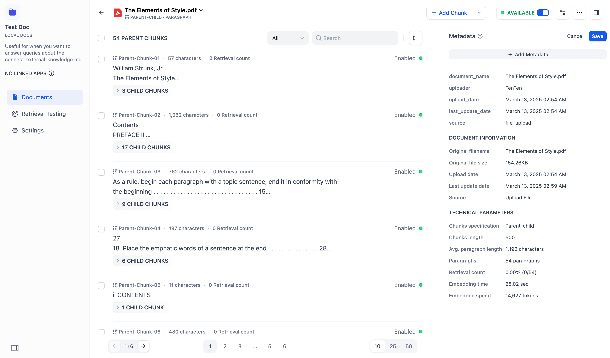

**新增文档元数据信息**

1. 在文档的元数据编辑模式中，点击 **+添加元数据** 按钮，弹出操作弹窗。

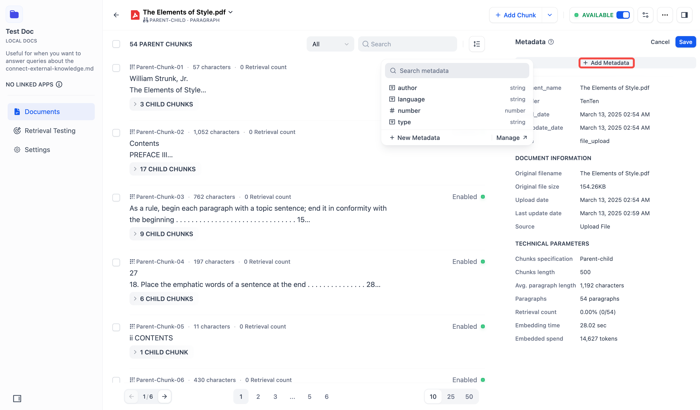

* 如需使用新建字段为该文档标记字段值，可以点击弹窗左下角的 **+ 新建元数据** 按钮，并参考前文的 **新建元数据字段** 章节新建字段。

  > 在文档页面新建的元数据字段，将自动同步至知识库字段列表中。

  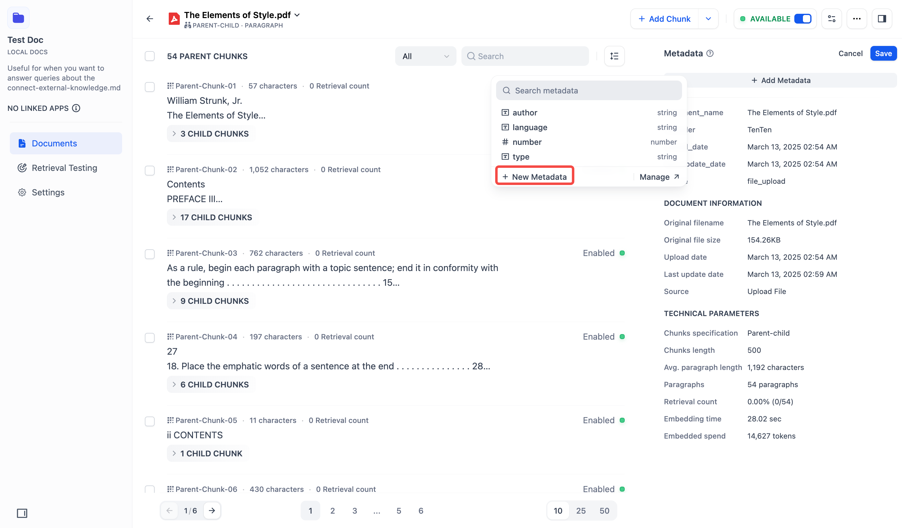

* 如需使用知识库已有的字段为该文档标记字段值，可以选择下列任意一种方式使用已有的字段：

  * 从下拉列表中选择知识库已有的字段，添加到该文档的字段列表中。

  * 在 **搜索元数据** 搜索框中搜索你需要的字段，添加到该文档的字段列表中。

  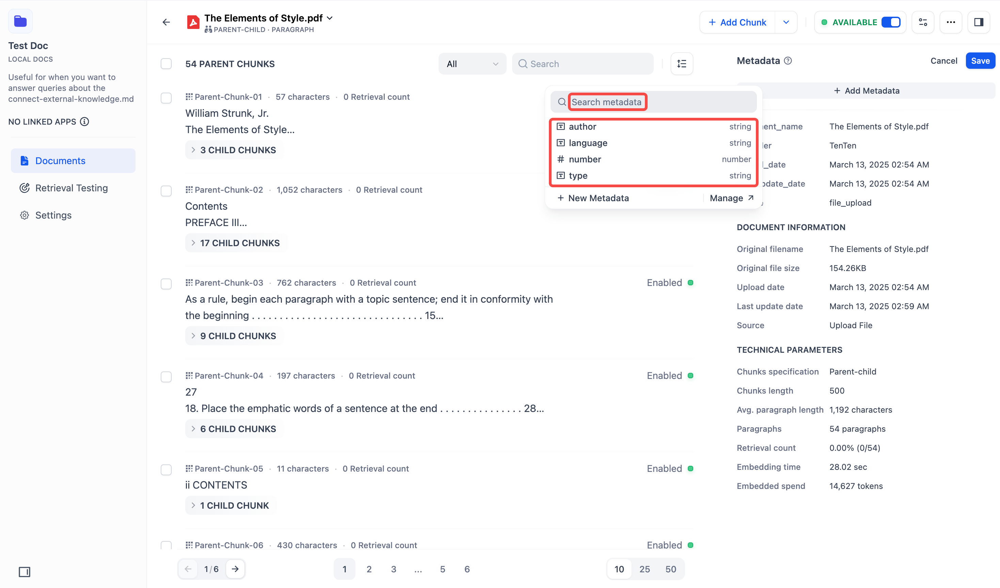

* 如需管理知识库已有的字段，可以点击弹窗右下角的 **管理** 按钮，跳转到知识库的管理界面。

  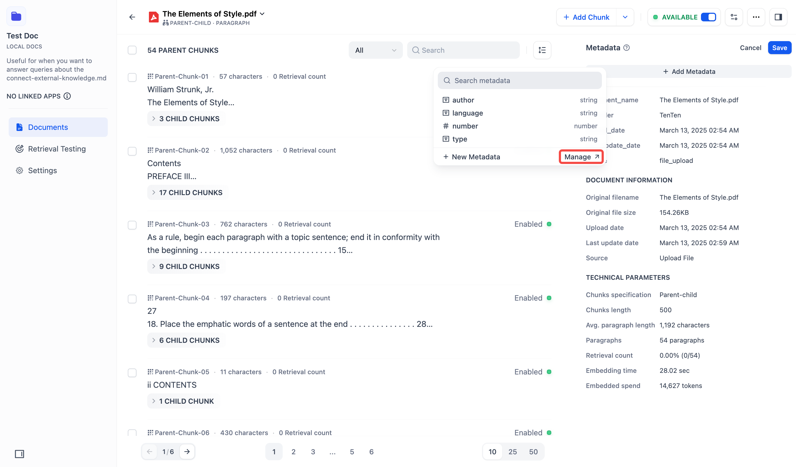

2. *（可选）* 添加字段后，在字段名右侧的元数据栏中填写字段值。

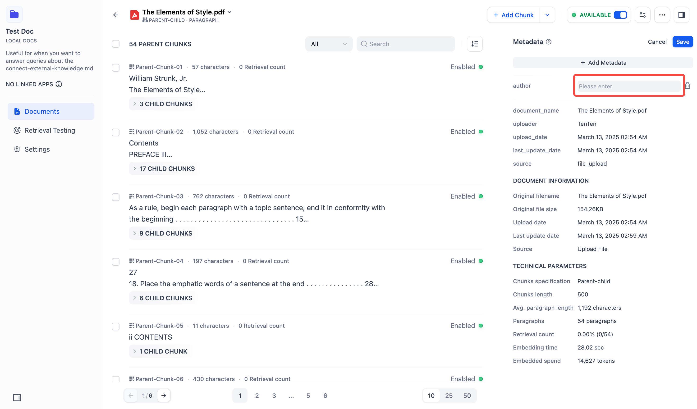

3. 点击右上角的 **保存** 按钮，保存字段值。

**删改文档元数据信息**

1. 在文档的元数据编辑模式中，点击右上角的 **编辑** 按钮，进入编辑模式。

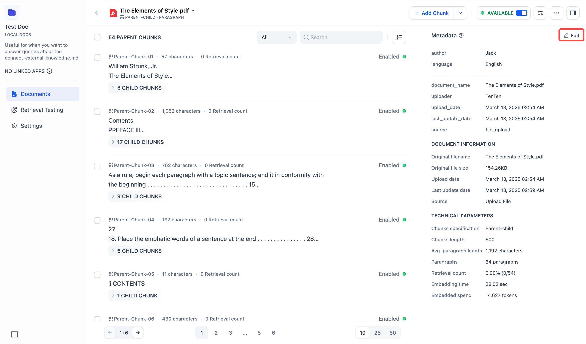

2. 删改文档元数据信息：

* **删改字段值**：在字段名右侧的字段值框内，删除或修改字段值。

> 此模式仅支持修改字段值，不支持修改字段名。

* **删除字段**：点击字段值框右侧的删除按钮，删除字段。

> 此操作仅会删除该文档的该字段与字段值，字段本身依然保留在知识库中。

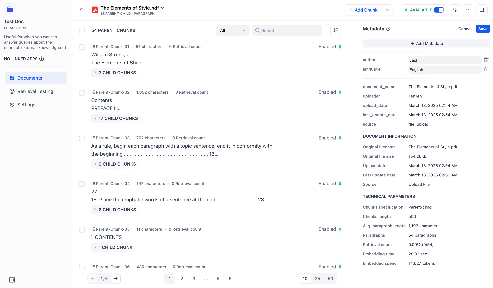

3. 点击右上角的 **保存** 按钮，保存修改后的字段信息。

## 如何使用元数据功能在知识库中筛选文档？

请参阅 [在应用内集成知识库](../%E5%9C%A8%E5%BA%94%E7%94%A8%E5%86%85%E9%9B%86%E6%88%90%E7%9F%A5%E8%AF%86%E5%BA%93.md) 中的 **使用元数据筛选知识** 章节。

## FAQ

* **元数据有什么作用？**

  * 提升搜索效率：用户可以根据元数据标签快速筛选和查找相关信息，节省时间并提高工作效率。

  * 增强数据安全性：通过元数据设置访问权限，确保只有授权用户能访问敏感信息，保障数据的安全性。

  * 优化数据管理能力：元数据帮助企业或组织有效分类和存储数据，提高数据的管理和检索能力，增强数据的可用性和一致性。

  * 支持自动化流程：元数据在文档管理、数据分析等场景中可以自动触发任务或操作，简化流程并提高整体效率。

* **知识库元数据管理列表中的元数据字段和某篇文档中的元数据值有什么区别？**

| | 定义 | 性质 | 举例 |
| - | - | - | - |
| 元数据管理列表中的元数据字段 | 预定义的字段，用于描述文档的某些属性。 | 全局性字段。所有文档都可以使用这些字段。 | 作者、文档类型、上传日期。 |
| 某篇文档中的元数据值 | 每个文档按需标记的针对特定文档的信息。 | 文档特定的值。每个文档根据其内容会标记不同的元数据值。 | 文档 A 的"作者"字段值为"张三"，文档 B 的"作者"字段值为"李四"。 |

* **"在知识库管理界面删除某条元数据字段""在编辑元数据弹窗中删除已选文档的某条元数据字段"和"在文档详情界面删除某条元数据字段"有什么区别？**

| 操作方式 | 操作方法 | 影响范围 | 结果 |
| - | - | - | - |
| 在知识库管理界面删除某条元数据字段 | 在知识库管理界面，点击某条元数据字段右侧的删除图标，删除该字段。 | 从知识库管理列表中完全删除该元数据字段及其所有字段值。 | 该字段从知识库中移除，所有文档中的该字段及包含的所有字段值也会消失。 |
| 在编辑元数据弹窗中删除已选文档的某条元数据字段 | 在编辑元数据弹窗中，点击某条元数据字段右侧的删除图标，删除该字段。 | 仅删除已选文档的该字段与字段值，字段本身依然保留在知识库管理列表中。 | 选中文档中的字段与字段值被移除，但字段仍保留在知识库内，字段值计数会发生数值上的变化。 |
| 在文档详情界面删除某条元数据字段 | 在文档详情界面中的元数据编辑模式里，点击某条元数据字段右侧的删除图标，删除该字段。 | 仅删除该文档的该字段与字段值，字段本身依然保留在知识库管理列表中。 | 该文档中的字段与字段值被移除，但字段仍保留在知识库内，字段值计数会发生数值上的变化。 |
