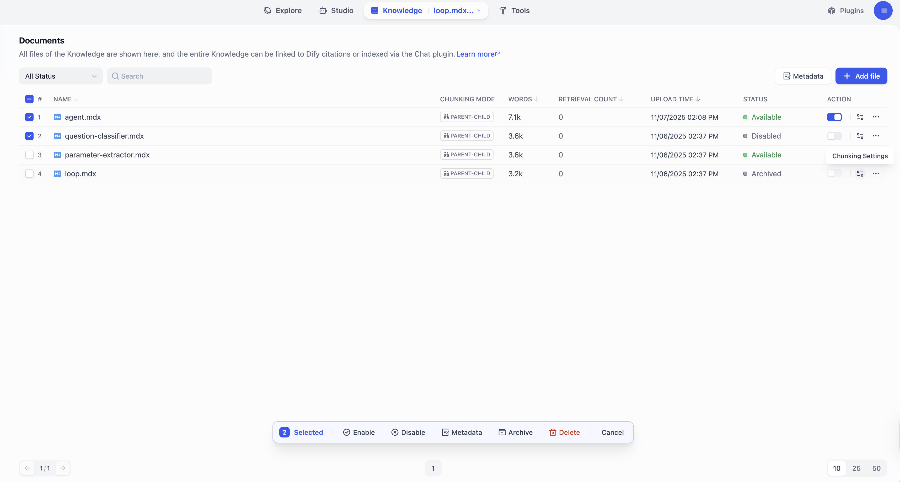
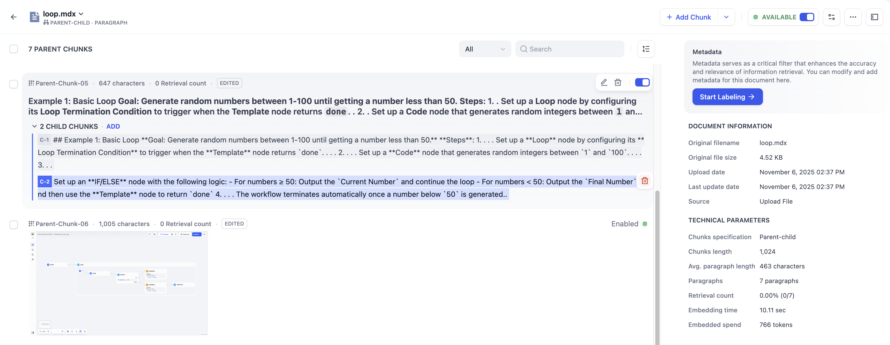

# 维护知识库内容

> 本文档由 AI 自动翻译。如有任何不准确之处，请参考 [英文原版](https://docs.dify.ai/en/cloud/use-dify/knowledge/manage-knowledge/maintain-knowledge-documents.md)。

## 管理文档

在知识库中，每个导入的项（无论是本地文件、Notion 页面还是网页）都会成为一个文档。

你可以在文档列表中查看和管理所有文档，确保知识库的内容始终准确、相关且最新。

> [!TIP]
>
> 点击顶部的知识库名称，可快速切换不同知识库。

| 操作 | 说明 |
| :- | :- |
| 添加 | 导入新文档。 |
| 修改分段设置 | 修改文档的分段设置（不包括分段结构）。\[!NOTE] 每个文档可拥有独立的分段设置，但分段结构在整个知识库中共享，且一旦设置无法更改。 |
| 删除 | 永久删除文档。**删除不可撤销**。 |
| 启用 / 禁用 | 临时将文档纳入或排除检索。\[!NOTE] 在 Dify Cloud 上，长时间未更新或未被检索的文档会自动禁用以优化性能。 不同订阅计划的未活跃时长如下：<ul><li>Sandbox：7 天</li><li>Professional & Team：30 天</li></ul>Professional 和 Team 用户可 **一键** 重新启用这些文档。 |
| 归档 / 取消归档 | 将不再需要检索但仍需保留的文档归档。归档文档为只读，可随时取消归档。 |
| 编辑 | 通过编辑分段内容修改文档。详见 [管理分段](%E7%BB%B4%E6%8A%A4%E7%9F%A5%E8%AF%86%E5%BA%93%E5%86%85%E5%AE%B9.md#管理分段)。 |
| 重命名 | 修改文档名称。 |

## 管理分段

根据其分段设置，每个文档被拆分为一个或多个分段，而分段是检索的基本单元。

你可以在文档的分段列表中查看和管理所有分段，以提升检索效率与准确性。

> [!TIP]
>
> 点击左上角的文档名称，可快速切换不同文档。

| 操作 | 说明 |
| :- | :- |
| 添加 | 新增或批量新增分段。 对于采用父子分段模式的文档，可同时新增父分段和子分段。\[!NOTE] 「添加分段」适用于 Professional 和 Team 套餐。[了解更多](https://dify.ai/zh/pricing)。 |
| 删除 | 永久删除分段。**删除不可撤销**。 |
| 启用 / 禁用 | 临时将分段纳入或排除检索。已禁用的分段不可编辑。 |
| 编辑 | 修改分段内容。已编辑的分段将标记为 **已编辑**。 对于采用父子分段模式的知识库：<ul><li>编辑父分段时，可选择重新生成其子分段或保持原有的子分段不变。</li><li>编辑子分段不会改变其父分段。</li></ul> |
| 添加 / 编辑 / 删除关键词 | 为分段添加或修改关键词（最多 10 个），以提升其可检索性。仅适用于使用经济索引方式的知识库。 |
| 添加 / 删除图片附件 | 在对应分段中，删除从文档中提取的图片或上传新图片。 提取的图片 URL 会保留在分段文本中，你可以安全地删除这些 URL 以保持文本简洁，这不会影响已提取的图片。\[!NOTE] 每个分段最多支持 10 张图片附件，在检索中将被一同返回；超过数量的图片不会被提取。\[!TIP] 若选择多模态嵌入模型（带有 **Vision** 图标），提取的图片也将被向量化并索引以供检索。 |
| 添加 / 编辑 / 删除摘要 | 为分段添加、修改或删除摘要。 摘要同样会被向量化并索引以供检索。当摘要与查询匹配时，其对应的分段也会被返回。\[!TIP] 为多个分段添加相同的摘要，可实现分组检索，使相关分段能够一同返回（受 Top K 限制）。 |

## 最佳实践

### 检查分段质量

文档完成分段后，仔细检查每个分段，确保其语义完整、长度适中，以保证检索准确性和回复相关性。

常见问题包括：

* 分段 **过短**：上下文不完整，易造成语义丢失和答案不准确。

* 分段 **过长**：包含无关信息，易引入语义噪音、降低检索精度。

* 分段 **语义不完整**：句子或段落被分段设置强制切断，易导致检索结果存在内容缺失或误导。

### 将子分段用作父分段的检索钩子

对于采用父子分段模式的文档，系统会在子分段中进行搜索，但返回的是父分段。由于编辑子分段不会改变其父分段，可将子分段作为父分段的语义标签或检索提示。

具体做法是将子分段改写为 **关键词**、**摘要** 或 **常见用户问题**。例如，若父分段的内容涉及技术性的"LED 状态指示灯"，可将子分段改写为：

* *闪烁灯、无法开机、红灯、连接错误、卡死*（关键词）

* *LED 颜色解读及硬件电源或配对问题排查指南*（摘要）

* *常亮红灯是什么意思？*（问题）

### 使用摘要弥合查询与内容之间的差距

虽然高质量的索引可以实现语义搜索，但当原始分段过于具体、包含噪音或结构复杂时，仍然难以与用户查询良好匹配。

摘要通过提供一个精简的语义层来弥合这一差距，使分段的核心意图更加明确。

在以下情况下使用摘要：

* **用户查询与文档语言不同**：对于正式书写的技术文档，按照用户实际提问的方式添加摘要。

* **概念隐含或埋没在细节中**：添加高层次的摘要，提炼核心概念和意图，使分段能够被匹配，而不依赖于分散在文本中的细枝末节。

* **原始文本是非文本内容**：当分段主要是代码、表格、日志、记录稿或其他难以进行语义匹配的内容时，添加描述性摘要，清楚标注分段包含的内容。

* **相关分段需要一起检索**：为一系列相关分段应用相同的摘要，以实现分组检索。这种语义粘合剂使一个主题的多个部分能够一起被检索，提供更丰富的上下文。

  > [!NOTE]
  >
  > 返回的相关分段数量受检索设置中定义的 Top K 限制。
