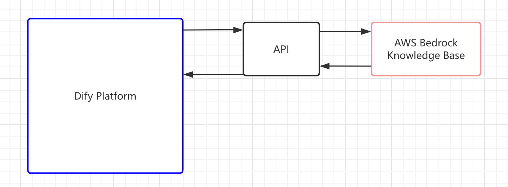
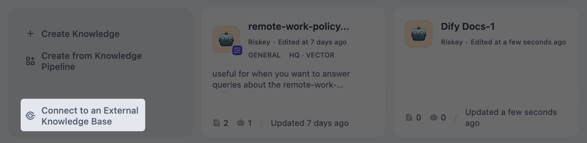

# 连接外部知识库

> 通过 API 连接将外部知识源集成到 Dify 应用中，以使用自定义 RAG 系统或第三方知识服务

> 本文档由 AI 自动翻译。如有任何不准确之处，请参考 [英文原版](https://docs.dify.ai/en/cloud/use-dify/knowledge/connect-external-knowledge-base.md)。

如果你的团队自建 RAG 系统，或将内容托管在第三方知识服务（如 [AWS Bedrock](https://aws.amazon.com/bedrock/)）中，你可将这些外部知识源连接到 Dify，无需将内容迁移至 Dify 内置的知识库。

这样，你的 AI 应用可直接从现有基础设施中检索信息，同时你可完全掌控检索逻辑和内容管理。

**连接外部知识库包含三个步骤**：

1. [构建一个供 Dify 查询的 API 服务](%E8%BF%9E%E6%8E%A5%E5%A4%96%E9%83%A8%E7%9F%A5%E8%AF%86%E5%BA%93.md#step-1-构建检索-api)。
2. [在 Dify 中注册 API 端点](%E8%BF%9E%E6%8E%A5%E5%A4%96%E9%83%A8%E7%9F%A5%E8%AF%86%E5%BA%93.md#step-2-注册外部知识库-api)。
3. [通过已注册的 API 连接特定知识源](%E8%BF%9E%E6%8E%A5%E5%A4%96%E9%83%A8%E7%9F%A5%E8%AF%86%E5%BA%93.md#step-3-创建外部知识库)。

应用运行时，Dify 向你的端点发送检索请求，并将返回的分段作为 LLM 响应的上下文。

> [!TIP]
>
> 如果你要连接 LlamaCloud，可直接安装 [LlamaCloud 插件](https://marketplace.dify.ai/plugin/langgenius/llamacloud) 而无需构建自定义 API。完整的设置演示详见 [视频教程](https://www.youtube.com/watch?v=FaOzKZRS-2E)。
>
> 如果你正在为其他知识服务构建插件，可参考 LlamaCloud 插件的 [源代码](https://github.com/langgenius/dify-official-plugins/tree/main/extensions/llamacloud)。

> [!NOTE]
>
> Dify 对外部知识库仅拥有检索权限，无法修改或管理你的外部内容。你需要独立维护外部知识库及其检索逻辑。

## Step 1: 构建检索 API

构建一个实现 [外部知识库 API 规范](%E5%A4%96%E9%83%A8%E7%9F%A5%E8%AF%86%E5%BA%93%20API.md) 的 API 服务。该服务需提供一个 `POST` 端点，接受搜索查询并返回匹配的文本分段及相似度分数。

## Step 2: 注册外部知识库 API

外部知识库 API 用于存储你的端点 URL 和认证凭据。多个知识库可共享同一个 API 连接。

1. 前往 **知识库**，点击右上角的 **外部知识库 API**，然后点击 **添加外部知识库 API**。

2. 填写以下字段：

   * **名称**：用于区分不同 API 连接的标签。
   * **API 接口地址**：外部知识服务的基础 URL。Dify 发送请求时自动追加 `/retrieval`。
   * **API Key**：认证凭据。Dify 将其作为 Bearer 令牌放在 `Authorization` 请求头中发送。

保存时，Dify 向你的端点发送测试请求以验证连接。

## Step 3: 创建外部知识库

注册 API 后，将外部知识源连接到 Dify。这会在 Dify 中创建一个与你的外部系统关联的知识库。

1. 前往 **知识库**，点击 **连接外部知识库**。

   

2. 填写以下字段：
   * **外部知识库名称** 和 **知识库描述**（可选）。

   * **外部知识库 API**：选择你已注册的 API 连接。

   * **外部知识库 ID**：外部系统中特定知识源的标识符，作为 `knowledge_id` 字段传递给你的 API。

     这个 ID 是你的外部服务用于区分不同知识库的标识符。例如，Bedrock 知识库的 ARN，或者你在自己系统中定义的 ID。

     > [!NOTE]
     >
     > **外部知识库 API** 和 **外部知识库 ID** 创建后不可更改。如需使用其他 API 或知识源，请创建新的外部知识库。

   * **检索设置**：
     * **Top K**：每次查询检索的最大分段数。数值越高，返回的结果越多，但可能包含相关性较低的内容。
     * **分数阈值**：返回分段的最低相似度分数。启用此选项可过滤掉低相关性的结果。数值越高，相关性要求越严格；数值越低，匹配范围越广。

       禁用时，无论分数如何，均返回 Top K 限制内的所有结果。

创建完成后，即可在你的应用中使用外部知识库，用法与内置知识库相同。详见 [在应用内集成知识库](../%E5%9C%A8%E5%BA%94%E7%94%A8%E5%86%85%E9%9B%86%E6%88%90%E7%9F%A5%E8%AF%86%E5%BA%93.md)。

## 常见问题

### API 响应格式问题

如果检索失败或返回意外结果，请根据 [外部知识库 API 规范](%E5%A4%96%E9%83%A8%E7%9F%A5%E8%AF%86%E5%BA%93%20API.md#响应) 验证你的 API 响应。

常见问题：

* 每条记录中的 `metadata` 字段必须是一个对象（`{}`），不能为 `null`。`null` 值会导致检索流程出错。
* 每条记录必须包含 `content` 和 `score` 字段。
