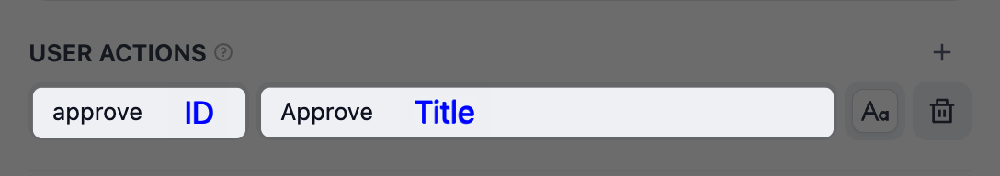
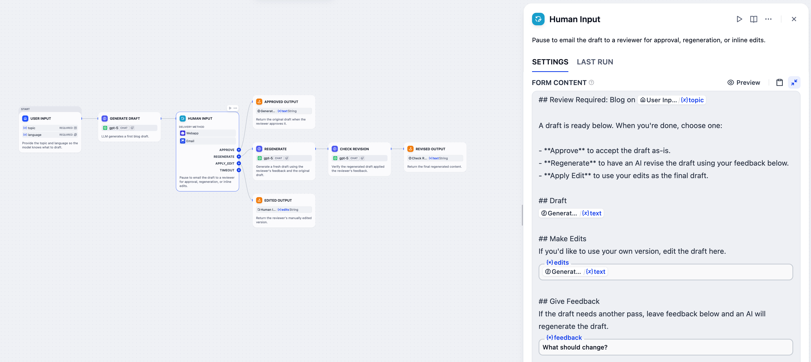
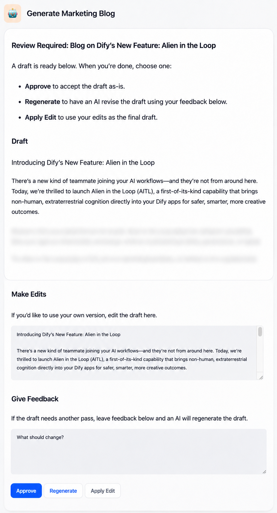

# 人工介入

> 暂停工作流以请求人工输入

> 本文档由 AI 自动翻译。如有任何不准确之处，请参考 [英文原版](https://docs.dify.ai/en/cloud/use-dify/nodes/human-input)。

人工介入节点在关键节点暂停工作流，发送可自定义的请求表单。接收人可使用表单审核信息、提供输入，并从预定义的决策中进行选择，这些决策决定工作流如何继续。

通过在关键环节嵌入人工判断，你可在 **自动化效率与人工监督之间取得平衡**。

> [!TIP]
>
> 工作流设计示例，参考 [示例：内容审核工作流](%E4%BA%BA%E5%B7%A5%E4%BB%8B%E5%85%A5.md#示例：内容审核工作流)。

## 配置

配置以下内容以定义该节点如何请求和处理人工输入：

* **提交方式**：请求表单如何送达接收人。

* **表单内容**：接收人将看到什么信息以及他们可以与之交互的内容。

* **用户动作**：接收人可以做出哪些决策，以及工作流将如何相应地进行。

* **超时策略**：等待多久以及如果无人响应会发生什么。

### 提交方式

选择发送请求的渠道。当前可用的方式：

* **Web app**：向 Web 应用终端用户显示请求表单。在由触发器启动的工作流中不可用。

  > [!NOTE]
  >
  > 外部客户端可通过 Service API 驱动 Web 应用表单的生命周期。详见 [API 集成流程](../../../../%E5%BC%80%E5%8F%91%E8%80%85%E8%B5%84%E6%BA%90/API/%E6%8C%87%E5%8D%97/%E4%BA%BA%E5%B7%A5%E4%BB%8B%E5%85%A5%20API%20%E9%9B%86%E6%88%90%E6%B5%81%E7%A8%8B.md)。

* **邮件**：将请求链接发送至特定工作区成员、外部邮箱地址或工作区全体成员。任何持有链接的人都可响应，无需 Dify 账户。

> [!NOTE]
>
> 无论采用何种提交方式，请求都将在收到第一个响应后关闭。

### 表单内容

自定义接收人将看到并可与之交互的表单：

* **使用 Markdown 格式化结构**

  使用标题、列表、粗体、链接和其他 Markdown 元素清晰地呈现信息。

* **使用变量显示动态数据**

  引用工作流变量以显示动态内容，例如供审核的 AI 生成文本，或他人在上游人工介入节点上传的待审核的文件。

  在 Web 应用提交方式下，表单本身会直接展示给终端用户。表单中引用的任何变量的值都将直接显示，因此 **无需在人工介入节点之前再添加直接回复或输出节点**。

  > [!TIP]
  >
  > 推理模型会在最终答案之外输出思维过程。引用 `text` 输出变量时，默认同时显示两者。
  >
  > 如需仅显示答案，为对应的 LLM 节点开启 **启用推理标签分离**。

* **使用表单字段收集输入**

  在请求表单中添加字段，以获取来自接收人的不同类型的输入。每个字段都会成为下游可用的变量。

  例如，在博客审核工作流中，你可以将接收人反馈传递给下游 LLM 节点用于内容修订。

  | 字段类型 | 描述 |
  | :- | :- |
  | 段落 | 文本输入。可为空，也可预填变量（例如，需优化的 LLM 输出）或静态文本（示例或默认值），供接收人进行编辑。 无最大长度限制，但过长的输入可能超出下游 LLM 的上下文窗口。 |
  | 下拉选项 | 从选项列表中进行单选。可手动定义选项，或引用上游的某个 `array[string]` 变量以将其中的值作为选项。 |
  | 单文件 / 文件列表 | 单个或多个文件上传。 单个文件上传上限：图片 10 MB、文档及其他文件 15 MB、音频 50 MB、视频 100 MB。文件列表字段最多支持 10 个文件。  |

  > [!NOTE]
  >
  > 仅段落为选填；下拉选项、单文件和文件列表均为必填。在所有必填字段填写完毕之前，表单的动作按钮将无法点击。

接收人响应后，填入所有值的表单内容可作为 `__rendered_content` 变量供下游使用。文件字段的值会以纯文本占位符呈现：单文件为 `[file]`，文件列表为 `[N files]`。

### 用户动作

定义接收人可点击的决策按钮，每个按钮将工作流路由到不同的执行路径。

例如，`Post` 分支可能会通向触发内容发布的节点，而 `Regenerate` 分支可能会循环回 LLM 节点以修改内容。

每个按钮包含显示标题和动作 ID。按钮被点击时，其 ID 可作为 `__action_id`、标题（按钮文本）可作为 `__action_value` 供下游使用。



> [!TIP]
>
> 使用预设按钮样式在视觉上区分动作。
>
> 例如，对 `Approve` 等关键动作使用醒目的样式，对次要选项使用较淡的样式。

### 超时策略

配置请求保持开启的时长，默认 3 天。

如果在超时前没有接收人响应，工作流将沿节点的超时分支继续。可将该分支连接到后备路径，例如发送通知或重试。

如果未连接超时分支，工作流将结束。

## 示例：内容审核工作流



工作流示例



通过邮件发送的请求表单

该工作流根据工作流发起者输入的 `topic` 和 `language` 起草一篇博客文章，将草稿通过邮件发送给审核人，并根据审核人的选择确定最终输出。

它围绕审核人在此节点上应能完成的三件事进行设计：

1. **查看 AI 生成的草稿**：在表单中引用上游 LLM 节点的 `text` 变量，让渲染后的表单直接显示草稿。

2. **按需编辑草稿**：在表单中添加一个段落输入字段 `edits`，并预填同一个 `text` 变量，让审核人以草稿为起点就地修改。

   由于博客文章通常较长，由表单以 Markdown 渲染呈现草稿（即第 1 点）比段落输入字段的阅读体验更好。若内容较短，单独使用预填的段落字段即可让接收人同时进行阅读与编辑。

3. **提供反馈以由 AI 修订**：

   1. 在表单中添加一个段落输入字段 `feedback`，用于收集审核人的反馈。
   2. 依次连接两个下游 LLM 节点：
      1. Regenerate 节点，用于根据原始草稿 `text` 和审核人反馈 `feedback` 生成修订后的草稿。
      2. Check Revision 节点，用于根据 `feedback` 和 Regenerate 节点生成的修订草稿检查修订内容是否与反馈一致。检查后的结果会作为最终输出流向下游。

审核人在收到的请求表单中，根据判断填写相应的段落字段（或留空），然后点击对应的动作按钮。每个动作连接到不同的输出：

* **Approve**：来自上游 LLM 的原始草稿
* **Apply Edit**：来自第一个段落字段 `edits`，即由审核人编辑过的内容
* **Regenerate**：来自经下游 LLM 节点处理过的修订草稿

> [accordion] LLM 节点提示词参考
>
> > [tab] Generate Draft
> >
> > **System**
> >
> > ```text wrap theme={null}
> > Write a marketing blog post around the given topic in the specified language.
> > ```
> >
> > **User**
> >
> > ```text theme={null}
> > Topic: {{#user_input.topic#}}
> > Language: {{#user_input.language#}}
> > ```
>
> > [tab] Regenerate
> >
> > **System**
> >
> > ```text wrap theme={null}
> > Regenerate the draft based on user feedback.
> > ```
> >
> > **User**
> >
> > ```text theme={null}
> > Draft: {{#generate_draft.text#}}
> > User Feedback: {{#human_input.feedback#}}
> > ```
>
> > [tab] Check Revision
> >
> > **System**
> >
> > ```text wrap theme={null}
> > Check whether the draft below addresses the user's feedback. Return the draft unchanged if it does; revise it to address the feedback if it doesn't.
> > ```
> >
> > **User**
> >
> > ```text theme={null}
> > User Feedback: {{#human_input.feedback#}}
> > Regenerated Draft: {{#regenerate.text#}}
> > ```
