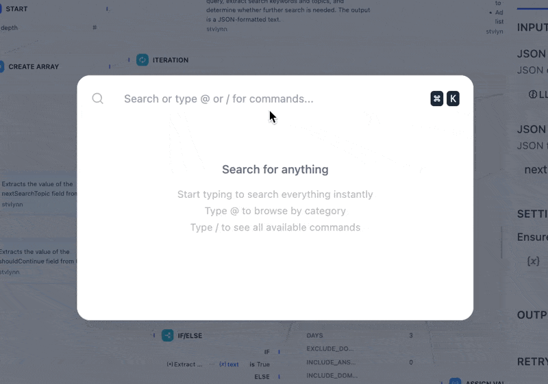

# 快捷键

> 使用键盘快捷键更快地构建 Dify 工作流

> 本文档由 AI 自动翻译。如有任何不准确之处，请参考 [英文原版](https://docs.dify.ai/en/cloud/use-dify/build/shortcut-key.md)。

使用键盘快捷键加速你的工作流构建。

> [!TIP]
>
> **[Go to Anything](../%E5%85%A8%E5%B1%80%E6%90%9C%E7%B4%A2.md)**：在 Dify 中的任意位置按下 `Cmd+K`（macOS）或 `Ctrl+K`（Windows），即可查找并跳转到几乎任何内容。
>
> * 输入 `@` 搜索应用、集成、知识库或工作流节点。
> * 输入 `/` 运行命令，例如 `/docs`、`/theme` 或 `/language`。
>
> 

## 选择与编辑

在画布上选中一个或多个节点时：

| Windows | macOS | 操作 |
| :- | :- | :- |
| `Ctrl` + `C` | `Cmd` + `C` | 复制 |
| `Ctrl` + `V` | `Cmd` + `V` | 粘贴 |
| `Ctrl` + `D` | `Cmd` + `D` | 创建副本 |
| `Delete` | `Delete` | 删除选中的节点或连线 |
| `Shift`（按住） | `Shift`（按住） | 高亮所选节点的变量关联 |

## 画布模式

| Windows | macOS | 操作 |
| :- | :- | :- |
| `V` | `V` | 指针模式（选择） |
| `H` | `H` | 抓手模式（平移） |
| `C` | `C` | 评论模式 |

## 缩放与布局

| Windows | macOS | 操作 |
| :- | :- | :- |
| `Ctrl` + `1` | `Cmd` + `1` | 适应视图 |
| `Ctrl` + `=` | `Cmd` + `=` | 放大 |
| `Ctrl` + `-` | `Cmd` + `-` | 缩小 |
| `Shift` + `1` | `Shift` + `1` | 缩放至 100% |
| `Shift` + `5` | `Shift` + `5` | 缩放至 50% |
| `Ctrl` + `O` | `Cmd` + `O` | 自动排列节点 |

## 历史记录

| Windows | macOS | 操作 |
| :- | :- | :- |
| `Ctrl` + `Z` | `Cmd` + `Z` | 撤销 |
| `Ctrl` + `Y` | `Cmd` + `Y` | 重做 |
| `Ctrl` + `Shift` + `Z` | `Cmd` + `Shift` + `Z` | 重做 |

## 测试

| Windows | macOS | 操作 |
| :- | :- | :- |
| `Alt` + `R` | `Option` + `R` | 测试运行 |
