# 版本控制

> 本文档由 AI 自动翻译。如有任何不准确之处，请参考 [英文原版](https://docs.dify.ai/en/cloud/use-dify/build/version-control.md)。

在 Chatflow 和 Workflow 应用中跟踪变更和管理版本。

> [!NOTE]
>
> 目前仅适用于 Chatflow 和 Workflow 应用。

## 工作原理

**当前草稿**：你的工作版本。这是你进行更改的地方。对用户不可见。

**最新版本**：用户看到的实时版本。

**历史版本**：较旧的已发布版本。

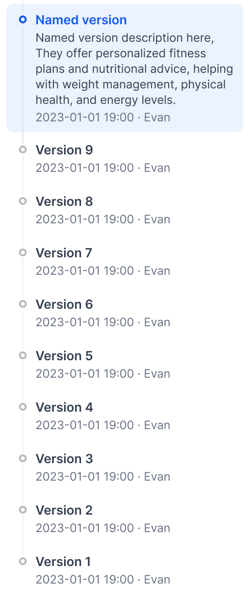

## 发布版本

点击 **发布** → **发布更新** 以使你的草稿上线。

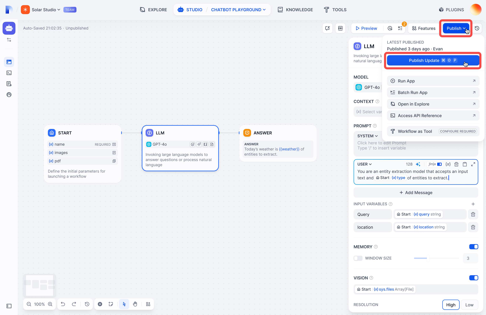

你的草稿将成为新的最新版本，你将获得一个新的草稿进行工作。

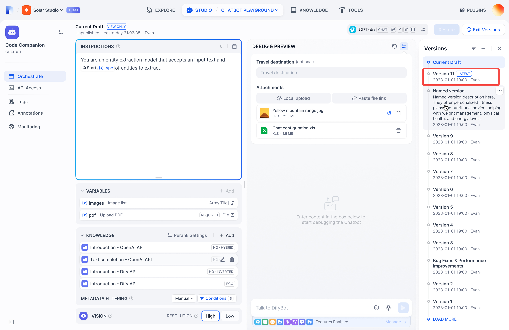

## 查看版本

点击历史图标查看所有版本：

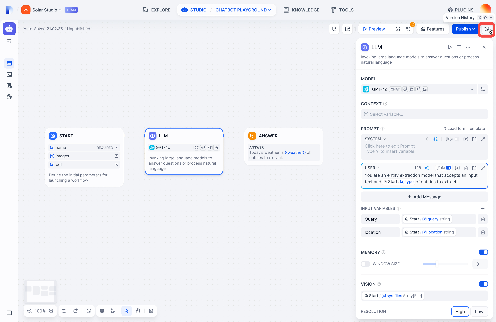

筛选方式：

* **所有版本** 或 **仅你的版本**
* **仅命名版本**（跳过自动生成的名称）

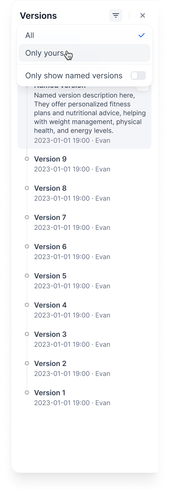

## 管理版本

**命名版本**：为版本提供一个合适的名称，而不是自动生成的名称

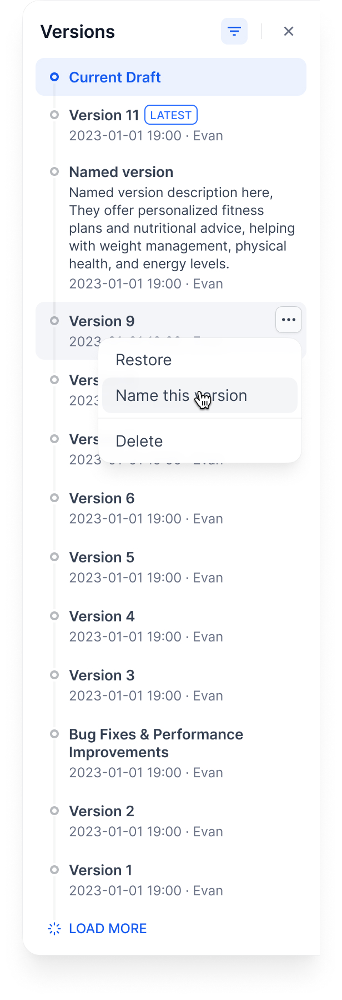

**编辑版本信息**：更改名称并添加发布说明

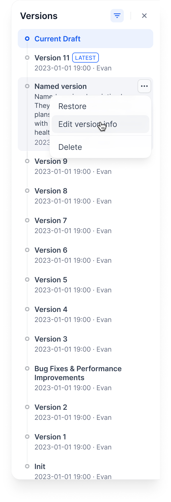

**删除旧版本**：清理你不需要的版本

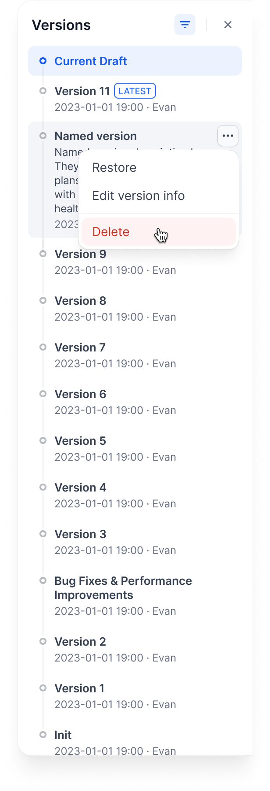

> [!WARNING]
>
> 你无法删除当前草稿或最新版本。

**恢复版本**：将旧版本重新加载到你的草稿中

> [!WARNING]
>
> 这将完全替换你当前的草稿。确保你没有未保存的工作。

**导出版本**：在已发布版本的菜单中选择 **导出应用**，即可将该版本下载为 [应用包](../../%E5%B7%A5%E4%BD%9C%E7%A9%BA%E9%97%B4/%E5%AF%BC%E5%87%BA%E5%92%8C%E5%AF%BC%E5%85%A5%E5%BA%94%E7%94%A8.md)。导出的版本始终不包含 Secret 类型环境变量的值。

> [!NOTE]
>
> 恢复版本、导出指定版本，以及通过 [Service API](../../../%E5%BC%80%E5%8F%91%E8%80%85%E8%B5%84%E6%BA%90/API/%E5%BA%94%E7%94%A8%20API/%E5%B7%A5%E4%BD%9C%E6%B5%81%E8%BF%90%E8%A1%8C/%E6%8C%89%20ID%20%E6%89%A7%E8%A1%8C%E5%B7%A5%E4%BD%9C%E6%B5%81.md) 运行指定的已发布版本，需要付费套餐。Sandbox 套餐始终运行最新发布的版本。

## 示例工作流

以下是版本在典型开发周期中的工作方式：

### 1. 从草稿开始

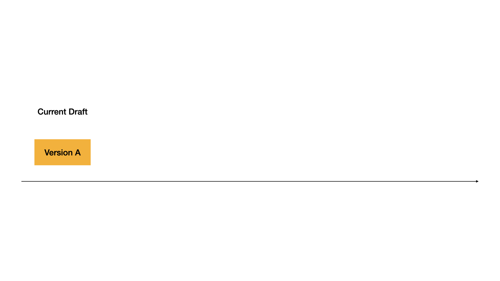

### 2. 发布第一个版本

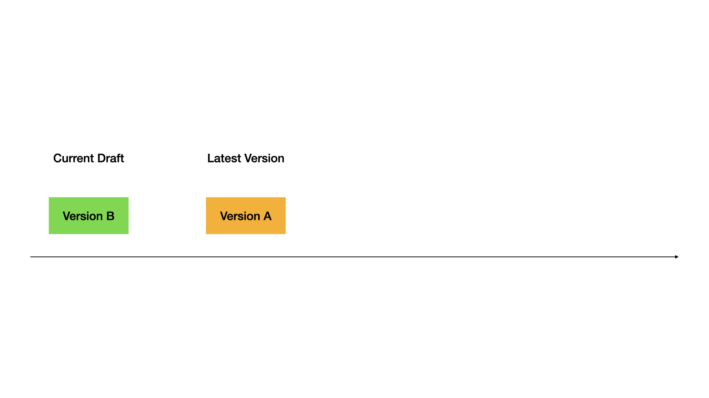

### 3. 发布第二个版本

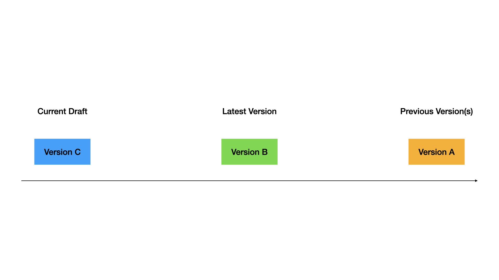

### 4. 将旧版本恢复到草稿

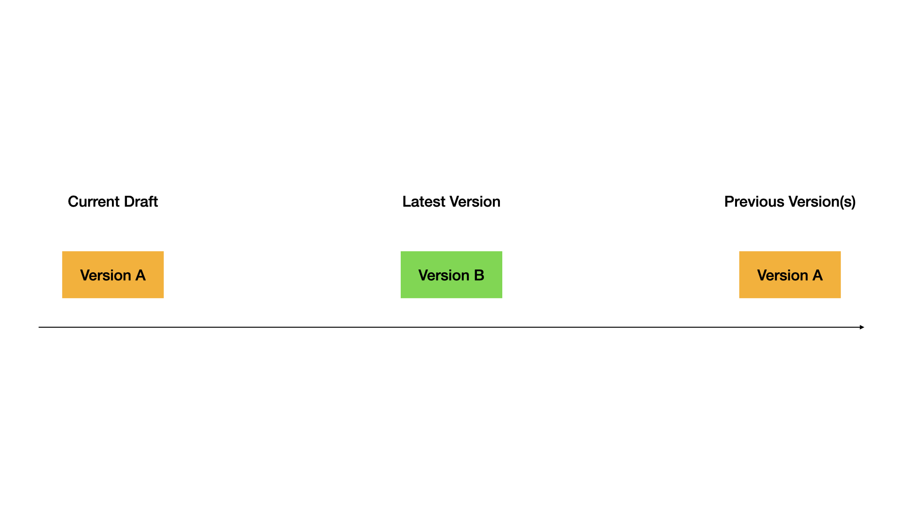

### 5. 发布恢复的版本

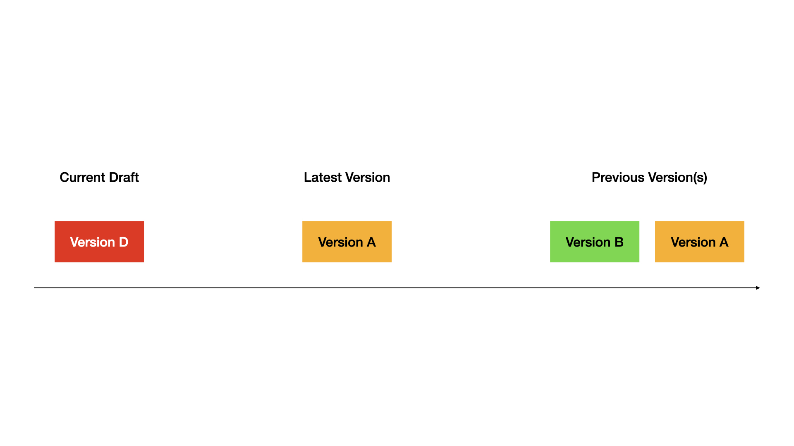

完整演示：

## 技巧

* 发布前始终在草稿中测试
* 为重要发布使用描述性版本名称
* 需要快速回滚时恢复版本
* 保留旧版本以供参考
