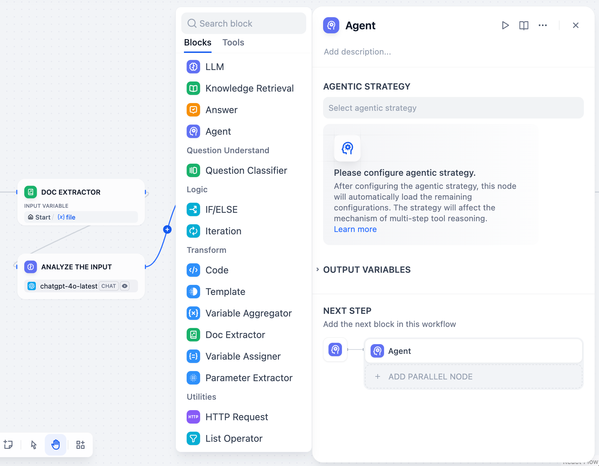
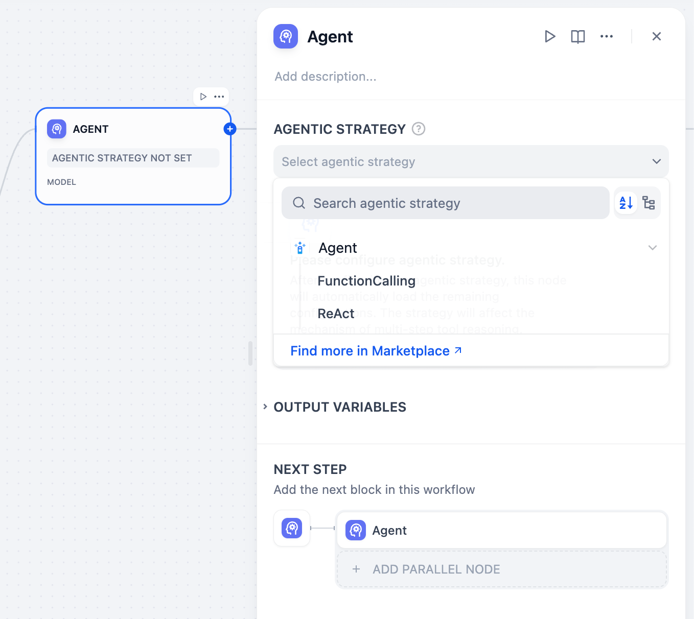
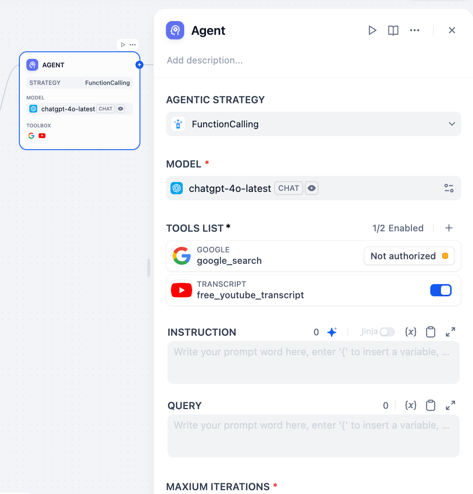
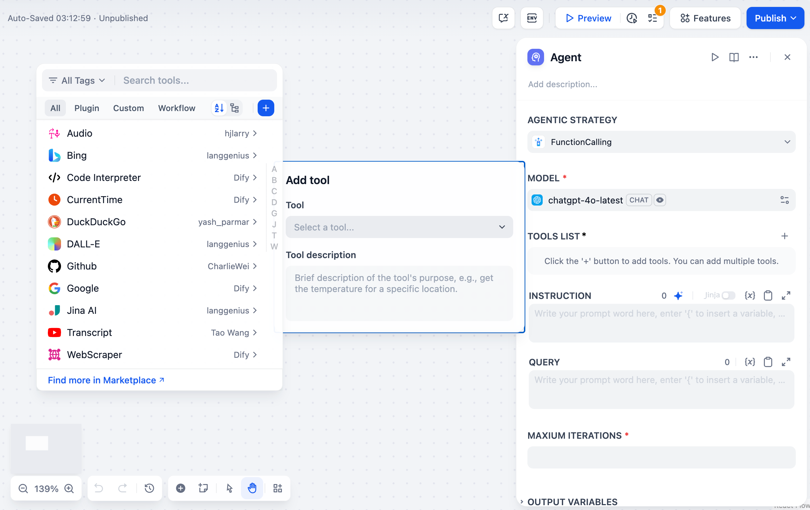
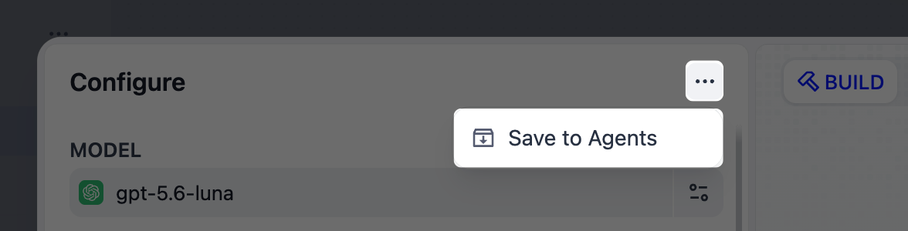

# Agent

> 将 Agent 作为工作流中的一步运行，通过推理和调用工具完成任务

> 本文档由 AI 自动翻译。如有任何不准确之处，请参考 [英文原版](https://docs.dify.ai/en/cloud/use-dify/nodes/agent.md)。

> [tab] 经典 Agent
>
> Agent 节点让你的大型语言模型自主控制工具，使其能够迭代决定使用哪些工具以及何时使用它们。Agent 不是预先规划每一步，而是动态地推理问题，根据需要调用工具来完成复杂任务。
>
> 
>
> Agent 节点配置界面
>
> ## Agent 策略
>
> Agent 策略定义了你的 Agent 如何思考和行动。选择最适合你的模型能力和任务需求的方法。
>
> 
>
> 可用的 Agent 策略选项
>
> > [tab] 函数调用
> >
> > 使用大型语言模型的原生函数调用能力，通过工具参数直接传递工具定义。大型语言模型使用其内置机制决定何时以及如何调用工具。
> >
> > 最适合像 GPT-4、Claude 3.5 和其他具有强大函数调用支持的模型。
>
> > [tab] 推理与行动 (ReAct)
> >
> > 使用结构化提示词来引导大型语言模型通过明确的推理步骤。遵循 **思维 → 行动 → 观察** 循环进行透明的决策制定。
> >
> > 适用于可能没有原生函数调用能力的模型，或者当你需要明确推理轨迹时。
>
> > [!NOTE]
> >
> > 从 **Marketplace → Agent 策略** 安装其他策略，或向 [社区仓库](https://github.com/langgenius/dify-plugins) 贡献自定义策略。
>
> 
>
> 函数调用策略配置
>
> ## 配置
>
> ### 模型选择
>
> 选择支持你所选 Agent 策略的大型语言模型。更强大的模型能更好地处理复杂推理，但每次迭代成本更高。如果使用函数调用策略，请确保你的模型支持函数调用。
>
> ### 工具配置
>
> 配置你的 Agent 可以访问的工具。每个工具需要：
>
> **授权** - 在工作空间中配置的外部服务的 API 密钥和凭据
>
> **描述** - 清楚说明工具的作用以及何时使用它（这指导 Agent 的决策制定）
>
> **参数** - 工具接受的必需和可选输入，带有适当的验证
>
> ### 指令和上下文
>
> 使用自然语言指令定义 Agent 的角色、目标和上下文。使用 Jinja2 语法引用上游工作流节点的变量。
>
> **查询** 指定 Agent 应该处理的用户输入或任务。这可以是来自先前工作流节点的动态内容。
>
> 
>
> Agent 配置参数
>
> ### 执行控制
>
> **最大迭代次数** 设置安全限制以防止无限循环。根据任务复杂性进行配置 - 简单任务需要 3-5 次迭代，而复杂研究可能需要 10-15 次。
>
> **记忆** 通过 TokenBufferMemory 控制 Agent 记住多少条历史消息。更大的记忆窗口提供更多上下文，但会增加 token 成本。这使得对话可以连续，用户能够引用之前的操作。
>
> ### 工具参数自动生成
>
> 工具可以将参数配置为 **自动生成** 或 **手动输入**。自动生成的参数（`auto: false`）由 Agent 自动填充，而手动输入参数需要明确的值，这些值成为工具永久配置的一部分。
>
> <video controls src="../../../../../assets/images/a8bd0e7afd9f3e1382498191.mp4" width="100%" />
>
> ## 输出变量
>
> Agent 节点提供全面的输出，包括：
>
> **最终答案** - Agent 对查询的最终响应
>
> **工具输出** - 执行期间每次工具调用的结果
>
> **推理轨迹** - 逐步决策过程（推理与行动策略特别详细）在 JSON 输出中可用
>
> **迭代计数** - 使用的推理循环次数
>
> **成功状态** - Agent 是否成功完成任务
>
> **Agent 日志** - 带有元数据的结构化日志事件，用于调试和监控工具调用
>
> ## 用例
>
> **研究与分析** - Agent 可以自主搜索多个来源，综合信息，并提供全面的答案。
>
> **故障排除** - 诊断任务，Agent 需要收集信息、测试假设，并根据发现调整其方法。
>
> **多步数据处理** - 复杂的工作流，其中下一个行动取决于中间结果。
>
> **动态 API 集成** - API 调用序列取决于无法预先确定的响应和条件的场景。
>
> ## 最佳实践
>
> **清晰的工具描述** 帮助 Agent 了解何时以及如何有效使用每个工具。
>
> **适当的迭代限制** 防止失控成本，同时为复杂任务提供足够的灵活性。
>
> **详细的指令** 提供关于 Agent 角色、目标以及任何约束或偏好的上下文。
>
> **记忆管理** 根据你的用例要求平衡上下文保留与标记效率。

> [tab] 新 Agent
>
> > [!NOTE]
> >
> > 新 Agent 节点目前处于 Beta 阶段，仅在 Workflow 应用中可用。
>
> 新 Agent 节点将一个 [Agent](../../Agent/Agent.md) 作为工作流中的一步来运行。与经典节点「模型加工具」的组合不同，这里请来的是一名自带能力和沙箱的完整员工。
>
> 你选定 Agent 并告诉它要做什么；它自主完成任务，再把结果交还给流程的其余部分。
>
> ## 选择 Agent
>
> 添加节点时，先选定由谁来干活：
>
> > [tab] 邀请已有 Agent
> >
> > 你可邀请任何已发布的 Agent：它会带着已保存的能力就位，你在这里只需设置它的任务。
> >
> > 受邀的 Agent 就像全职员工：它的能力统一在 **Agents** 页面管理。你在该页面发布更新后，所有用到该 Agent 的工作流都会同步更新。
> >
> > * 要编辑它的能力，点击 **在 Agents 中编辑**。
> >
> > * 若只想在这一步做改动，点击 **创建副本**：节点会切换为一次性副本，不再跟随原 Agent 更新。
> >
> > > [!NOTE]
> > >
> > > 两个节点即使邀请同一个 Agent，工作时也彼此独立：每个节点都从该 Agent 已保存的配置出发，在各自的沙箱中工作，一个节点运行中产生的内容（写下的文件、安装的工具）不会带入另一个节点。
> > >
> > > 要在节点间传递结果，请将它们声明为输出，供下游节点引用。
> >
> > 导入工作流时，其中邀请的每个 Agent 都会变成一次性副本。
>
> > [tab] 从空白开始
> >
> > 创建一个只属于此节点的一次性 Agent，直接在这里配置，方法与在 **Agents** 页面 [构建](../../Agent/%E6%9E%84%E5%BB%BA%20Agent.md) 相同。
> >
> > 它就像为一件事请来的临时工。如果确实好用，可将它转入 **Agents** 页面，在其他地方复用。
> >
> > 
>
> ## 给它派任务
>
> 在 **Agent 任务** 中描述这一步需要什么，就像向同事交代一件事那样。这与 Agent 自身的提示词及能力相互独立。输入 `/` 可引用之前节点的输出。
>
> 假设你邀请的是一个客服 Agent：它已熟悉你的产品文档、掌握你们的客服语气，工作流会把客户来信交给它。任务只需说明这一步要做什么：
>
> ```text wrap theme={null}
> 阅读 {{customer_email}} 中的客户邮件，起草一封回复，逐一回应邮件中的问题，不超过 150 字。
> ```
>
> > [!NOTE]
> >
> > 你引用的变量会以文本形式传给 Agent，超过 2000 字符会被截断。要完整传递更长的内容，请改用文件：Agent 会收到整个文件，并在沙箱中读取。
>
> ## 声明输出
>
> Agent 节点默认只返回一个输出 `text`，即 Agent 对任务的回复文本。当后续步骤需要更具体的内容，比如一个具体的值或某份文件，可将它声明为独立输出。
>
> 在 **Agent 任务** 中输入 `/`，选择 **新建输出**，然后就地命名并选择类型。每个声明的输出，下游节点都可单独引用。
>
> 声明的输出就写在任务文本里，因此你可明确告诉 Agent 该往里面放什么。下面的任务中，`{{vendor_name}}` 和 `{{quote_file}}` 就是声明的输出：
>
> ```text wrap theme={null}
> 对比 {{vendor_quotes}} 中的三份供应商报价并给出推荐。把胜出供应商的名称放入 {{vendor_name}}，其报价 PDF 放入 {{quote_file}}。
> ```
>
> Agent 返回的文件，单个不超过 50 MB。
>
> ## 让它选择路由
>
> 如果下一步取决于 Agent 的结论，比如是发出回复还是转人工，可开启 **输出路由**。Agent 会自行决定走哪条路由，工作流只沿这一条继续。
>
> > [!TIP]
> >
> > Agent 选路由和执行任务在同一次运行中完成，因此 Agent 节点之后不必再接问题分类器或条件分支节点。
> >
> > 如果分支取决于能精确判断的值，比如分数是否超过阈值，条件分支节点仍更合适：保持路由关闭，把这个值 [声明为输出](Agent.md#声明输出)，再交给条件分支节点判断。
>
> 为每条路由写好清晰的标题和描述，让 Agent 知道什么情况下该选它。Agent 收到任务时会一并收到路由列表，因此无需在 **Agent 任务** 中提及这些路由。
>
> 以上文的客服 Agent 为例，可设置两条路由：
>
> * **发送回复**：草稿已回应邮件中的所有问题。
> * **转人工**：草稿中至少还有一个问题没有回应。
>
> 描述中也可引用之前节点的字符串和数字变量，让路由条件随每次运行而变。本节点自己的输出无法选用，也无需选用：Agent 选路由时，已经能看到自己的 `text` 和声明的输出。
>
> Agent 每次都会选且只选一条路由，哪怕没有一条特别合适。写描述时，要保证总有一条适用，比如专门加一条路由处理其余情况。
>
> 如果模型的回答里缺少路由，或给出的路由并不存在，节点就会失败。要让工作流继续运行，可将 **异常处理** 设为 **异常分支**，再把这条分支连到兜底步骤。
