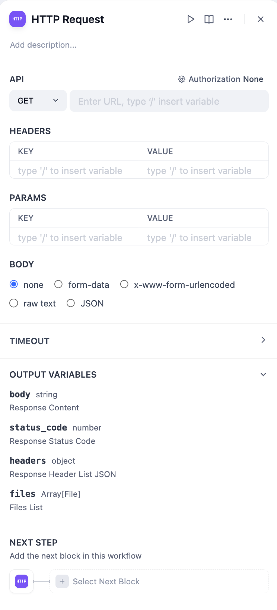
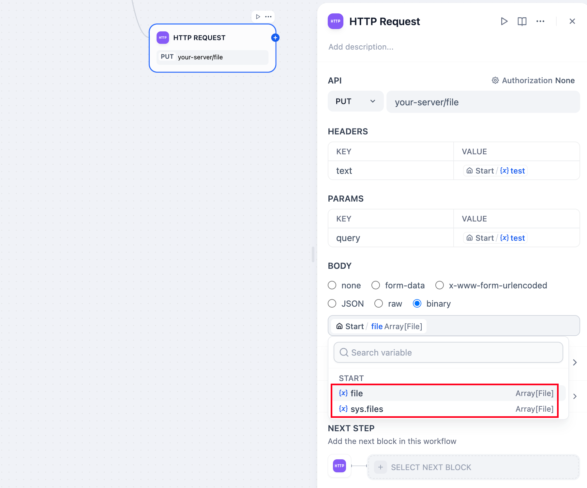
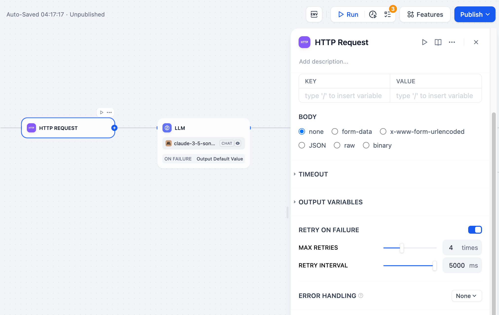
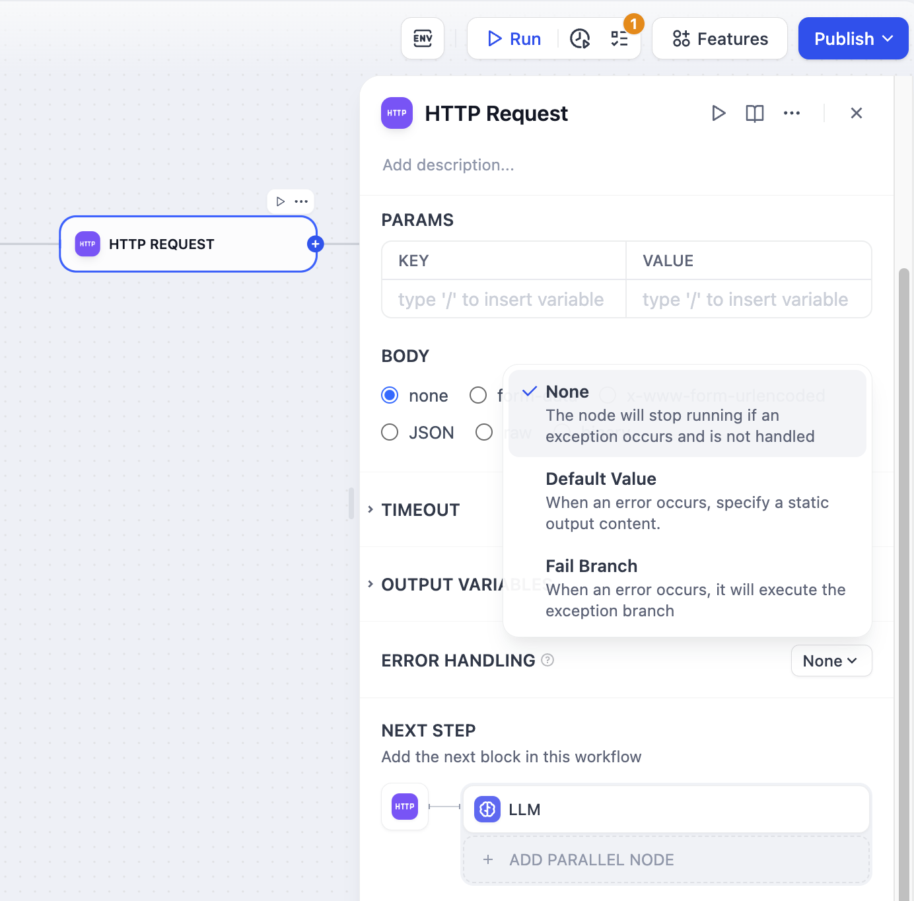
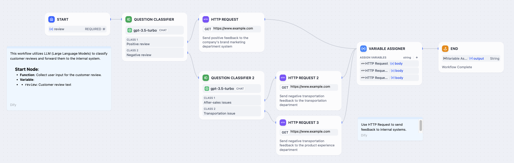

# HTTP 请求

> 本文档由 AI 自动翻译。如有任何不准确之处，请参考 [英文原版](https://docs.dify.ai/en/cloud/use-dify/nodes/http-request.md)。

HTTP 请求节点将你的工作流连接到外部 API 和 Web 服务。使用它来获取数据、发送 webhooks、上传文件，或与任何接受 HTTP 请求的服务集成。

HTTP 请求节点配置

## HTTP 方法

该节点支持所有标准 HTTP 方法，用于不同类型的操作：

> [tab] 数据检索
>
> **GET** 从服务器检索数据而不修改任何内容。用于获取用户资料、搜索数据库或获取当前状态。
>
> **HEAD** 获取响应头而不包含完整的响应正文。用于检查资源是否存在或获取元数据。

> [tab] 数据提交
>
> **POST** 向服务器发送数据，通常用于创建新资源。用于表单提交、文件上传或发送 JSON 负载。
>
> **PUT** 创建或完全替换资源。当你想要设置资源的整个状态时使用。
>
> **PATCH** 对现有资源进行部分更新。当你只需要修改特定字段时使用。

> [tab] 资源管理
>
> **DELETE** 从服务器移除资源。用于删除文件、用户账户或任何应该被移除的资源。

## 配置

配置 HTTP 请求的各个方面，包括 URL、头部、查询参数、请求正文和身份验证。来自先前工作流节点的变量可以动态插入到请求配置的任何位置。

### 变量替换

使用双花括号引用工作流变量：`{{variable_name}}`。Dify 支持深度对象访问，因此你可以从先前的 HTTP 响应中提取嵌套值，如 `{{api_response.data.items[0].id}}`。

Secret 类型环境变量的值在工作流运行日志和该节点的请求日志中会显示为掩码。

### 超时配置

HTTP 请求具有可配置的超时设置以防止挂起：

* **连接超时**：建立连接的最大时间
* **读取超时**：读取响应数据的最大时间
* **写入超时**：发送请求数据的最大时间

强制执行超时以维持工作流性能并防止资源耗尽。

### 身份验证

该节点支持多种身份验证类型：

**无认证** (`type: "no-auth"`) - 不添加身份验证头部

**API 密钥** (`type: "api-key"`) 具有三种子类型：

* **基础** (`type: "basic"`) - 添加带有 base64 编码的基础认证头部
* **Bearer** (`type: "bearer"`) - 添加 `Authorization: Bearer <token>` 头部
* **自定义** (`type: "custom"`) - 添加具有指定名称和值的自定义头部

### 请求正文

根据你的 API 要求选择适当的正文类型：

* **JSON** 用于结构化数据
* **表单数据** 用于传统 Web 表单
* **二进制** 用于文件上传
* **原始文本** 用于自定义内容类型

## 文件检测

HTTP 请求节点使用复杂的逻辑自动检测文件响应：

1. **Content-Disposition 分析** - 检查 `attachment` 配置或文件名参数
2. **MIME 类型评估** - 分析内容类型以区分文本和二进制
3. **内容采样** - 对于模糊类型，采样前 1024 字节以检测文本模式

基于文本的响应（JSON、XML、HTML 等）被视为常规数据，而二进制内容则成为文件变量。

## 文件操作

HTTP 请求节点无缝处理文件上传和下载：

文件上传配置示例

**文件上传** 使用二进制请求正文选项。从先前节点选择文件变量，将文件发送到外部服务进行文档存储、媒体处理或备份。

**文件下载** 在响应包含文件内容时自动处理。下载的文件可作为文件变量在处理和重试

为依赖外部服务的生产工作流配置健壮的错误处理：

HTTP 重试配置

**重试设置** 自动重试失败的请求，最多 10 次，具有可配置的间隔（最大 5000ms）。这处理临时网络问题或服务不可用性。

HTTP 错误处理选项

**错误处理** 定义 HTTP 请求失败时的替代工作流路径，确保即使在外部 API 不可用时你的工作流也能继续执行。

## 响应处理

HTTP 响应在后续节点中成为结构化变量，可分别访问：

* **响应正文** - API 返回的主要内容
* **状态码** - 用于条件逻辑的 HTTP 状态
* **头部** - 作为键值对的响应元数据
* **文件** - API 返回的任何文件内容
* **大小信息** - 内容大小（以字节为单位），具有可读格式（KB/MB）

### SSL 验证

每个节点的 SSL 证书验证是可配置的（`ssl_verify` 参数）。这允许连接到具有自签名证书的内部服务，同时为外部 API 维持安全性。

动态 API 集成示例工作流

## 常见集成模式

**API 数据获取** - 检索用户资料、产品信息或外部数据以丰富你的工作流处理。

**Webhook 交付** - 向外部系统和服务发送通知、状态更新或处理结果。

**文件处理** - 上传文档进行分析、下载资源进行进一步处理，或与云存储服务集成。

**多步骤 API 工作流** - 将多个 API 调用链接在一起，使用一个请求的响应来配置后续请求。
