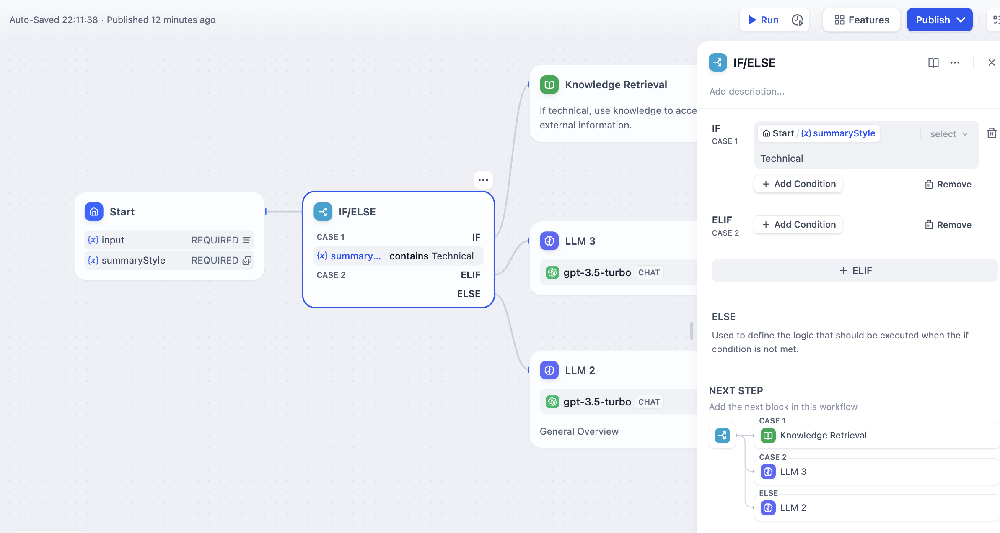
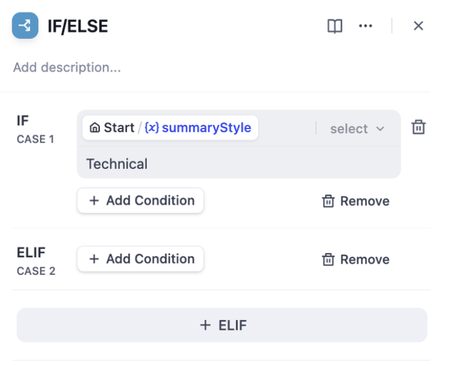

# If-Else

> 为工作流添加条件逻辑和分支

> 本文档由 AI 自动翻译。如有任何不准确之处，请参考 [英文原版](https://docs.dify.ai/en/cloud/use-dify/nodes/ifelse.md)。

If-Else 节点通过根据你定义的条件将执行路由到不同路径，为你的工作流添加决策逻辑。它评估变量并确定你的工作流应该遵循哪个分支。

If-Else 条件分支示例

## 分支逻辑

该节点支持多个分支路径来处理复杂的决策树：

**IF 路径** 在主要条件评估为真时执行。

**ELIF 路径** 在 IF 条件为假时提供按顺序检查的附加条件。你可以添加多个 ELIF 分支来处理复杂逻辑。

**ELSE 路径** 作为没有条件匹配时的后备选项，确保你的工作流始终有路径可循。

## 条件类型

配置条件以使用各种比较运算符测试变量：

> [tab] 文本操作
>
> **包含** / **不包含** - 检查值是否包含特定词语或短语
>
> **开头为** / **结尾为** - 测试文本开头或结尾的模式匹配
>
> **是** / **不是** - 精确值匹配

> [tab] 值检查
>
> **为空** / **不为空** - 检查空白、空值或缺失值
>
> **大于** / **小于** - 数字和日期的数值比较
>
> **等于** / **不等于** - 任何数据类型的精确匹配

## 复杂条件

使用逻辑运算符组合多个条件以实现复杂的决策制定：

带有 AND/OR 逻辑的复杂条件配置

**AND 逻辑** 要求所有条件都为真。当你需要同时满足多个条件时使用此选项。

**OR 逻辑** 要求任何条件为真。当你希望为不同场景触发相同动作时使用此选项。

## 变量引用

在你的条件中引用来自先前工作流节点的任何变量。变量可以来自用户输入、大型语言模型响应、API 调用或任何其他工作流节点输出。

使用变量选择器从可用变量中选择，或使用 `{{variable_name}}` 语法直接键入变量名称。
