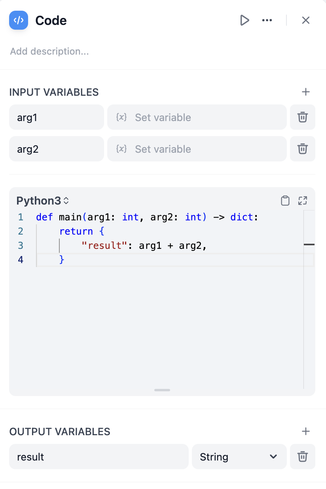
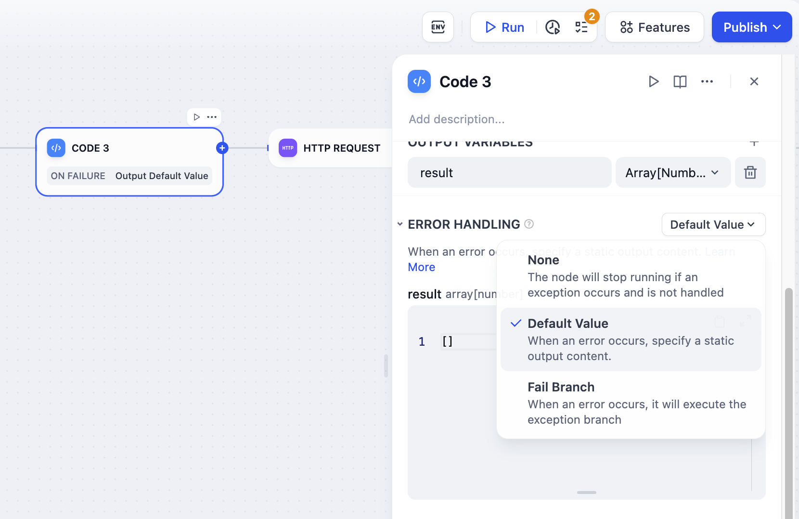
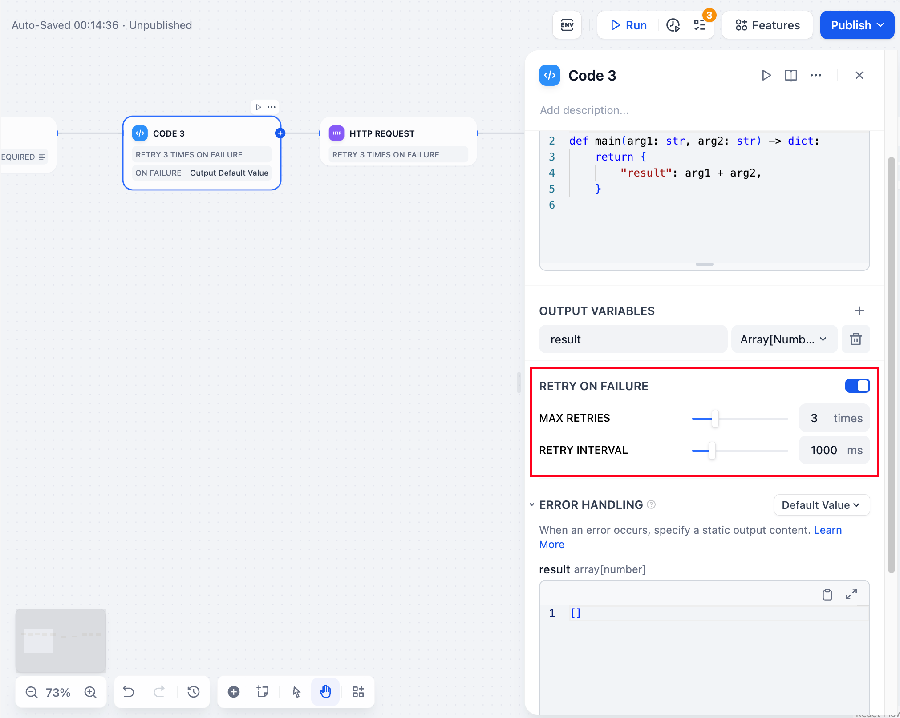

# 代码

> 本文档由 AI 自动翻译。如有任何不准确之处，请参考 [英文原版](https://docs.dify.ai/en/cloud/use-dify/nodes/code.md)。

代码节点执行自定义 Python 或 JavaScript 来处理工作流中复杂的数据转换、计算和逻辑。当预设节点无法满足你的特定处理需求时可以使用它。



代码节点配置界面

## 配置

定义 **输入变量** 以访问工作流中其他节点的数据，然后在代码中引用这些变量。你的函数必须返回一个包含你已声明的 **输出变量** 的字典。

```python theme={null}
def main(input_variable: str) -> dict:
    # Process the input
    result = input_variable.upper()
    return {
        'output_variable': result
    }
```

## 语言支持

根据你的需求和熟悉程度在 **Python** 和 **JavaScript** 之间进行选择。两种语言都在安全沙箱中运行，并可访问用于数据处理的常用库。

> [tab] Python
>
> Python 包含标准库，如 `json`、`math`、`datetime` 和 `re`。非常适合数据分析、数学运算和文本处理。
>
> ```python theme={null}
> def main(data: list) -> dict:
>     import json
>     import math
>
>     average = sum(data) / len(data)
>     return {'result': math.ceil(average)}
> ```

> [tab] JavaScript
>
> JavaScript 提供标准内置对象和方法。适合 JSON 操作和字符串操作。
>
> ```javascript theme={null}
> function main(data) {
>     const processed = data.map(item => item.toUpperCase());
>     return { result: processed };
> }
> ```

## 错误处理和重试

为失败的代码执行配置自动重试行为，并定义代码遇到错误时的回退策略。



错误处理配置选项

**重试设置** 允许最多 10 次自动重试，并可配置间隔（最大 5000ms）。启用此功能来处理临时处理问题。

**错误处理** 让你在代码执行失败时定义回退路径，使你的工作流即使在代码遇到问题时也能继续运行。



重试配置界面

## 输出限制

在输出传递到下一个节点之前，Dify 会检查其大小是否过大：

* **字符串**：最多 400,000 个字符。
* **数字**：整数最多 19 位，小数最多 20 位。
* **对象和数组**：嵌套最多 5 层。

超出限制的输出将无法通过检查，因此在返回前裁剪或拆分过大的结果。

## 安全考虑

代码在隔离的沙箱中运行，阻止文件系统访问、出站网络请求和系统命令。沙箱将代码执行与底层基础设施隔离开来，同时保留编写自定义代码的灵活性。

由于这种隔离，任何试图访问沙箱外部的操作都会被自动阻止。避免读取系统文件、建立网络连接或运行 shell 命令，请改用沙箱内可用的输入变量和库来重构你的逻辑。

## 依赖支持

代码节点支持 Python 和 JavaScript 的外部依赖：

```python theme={null}
# Python: Import numpy, pandas, requests, etc.
import numpy as np
import pandas as pd

def main(data: list) -> dict:
    df = pd.DataFrame(data)
    return {'mean': float(np.mean(df['values']))}
```

```javascript theme={null}
// JavaScript: Import lodash, moment, etc.
const _ = require('lodash');

function main(data) {
    return { unique: _.uniq(data) };
}
```

沙箱环境中预装了一组标准包。导入这组之外的包会在执行时失败。
