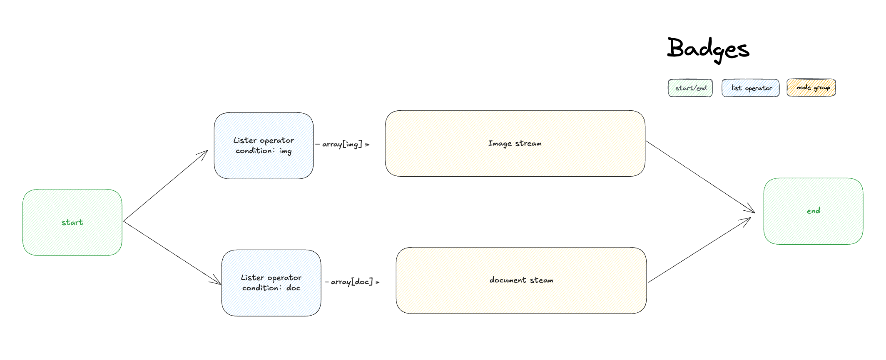
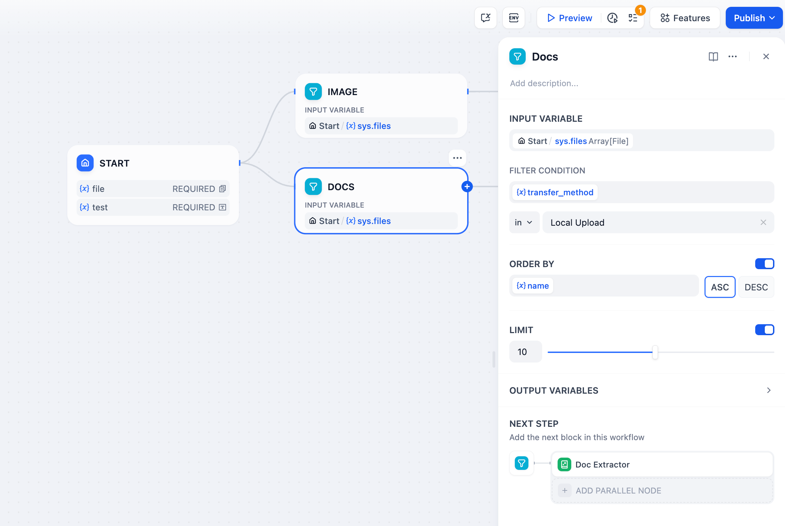
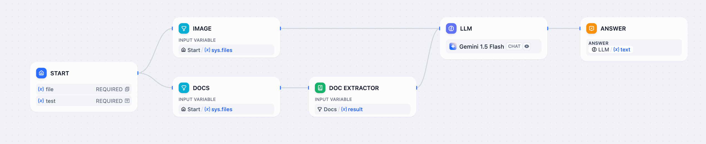

# 列表操作符

> 筛选、排序和选择数组中的元素

> 本文档由 AI 自动翻译。如有任何不准确之处，请参考 [英文原版](https://docs.dify.ai/en/cloud/use-dify/nodes/list-operator.md)。

列表操作符节点通过筛选、排序和选择特定元素来处理数组。当你需要处理混合文件上传、大型数据集或任何需要在下游处理之前进行分离或组织的数组数据时，请使用它。

支持的输入数据类型包括 `array[string]`、`array[number]`、`array[file]` 和 `array[boolean]`。

列表操作符节点界面

## 数组处理问题

大多数工作流节点期望单个值，而不是数组。当你在一个变量中有像 `[image.png, document.pdf, audio.mp3]` 这样的混合内容时，你需要将其分离成下游节点可以有效处理的专注流。

列表操作符充当智能路由器，使用过滤器分离混合数组并为专门处理做好准备。

数组处理工作流示例

## 操作

### 筛选

根据属性提取特定项目。对于文件数组，可以按以下条件筛选：

> [tab] 内容属性
>
> **类型** - 按内容类别筛选：图像、文档、音频、视频
>
> **MIME 类型** - 精确的内容类型识别（image/jpeg、application/pdf 等）
>
> **扩展名** - 文件扩展名（.pdf、.jpg、.mp3、.docx 等）

> [tab] 文件属性
>
> **大小** - 处理限制的文件大小约束
>
> **名称** - 文件名模式或特定名称
>
> **传输方法** - 区分本地上传和基于 URL 的文件

### 排序

按任何属性组织筛选结果：

**升序（ASC）** - 从最小到最大值，A-Z 字母顺序

**降序（DESC）** - 从最大到最小值，Z-A 逆序

### 选择

从处理后的数组中选择特定元素：

**取前 N 个** - 在筛选和排序后选择前 1-20 个项目

**第一条记录** - 仅返回第一个匹配元素作为单个值

**最后一条记录** - 仅返回最后一个匹配元素作为单个值

## 输出变量

**result** - 完整的筛选和排序数组，用于批量处理

**first\_record** - 来自开头的单个元素，非常适合"主要"或"最新"项目选择

**last\_record** - 来自末尾的单个元素，用于"最近"或"最终"选择

## 混合文件处理示例

处理用户同时上传文档和图像的工作流：

混合文件处理工作流

**实施步骤**：

1. **配置混合上传** - 启用文件上传功能以接受多种文件类型
2. **按类型分离** - 使用带有不同过滤器的独立列表操作符节点：
   * 筛选 `type = "image"` → 路由到具有视觉能力的大型语言模型
   * 筛选 `type = "document"` → 路由到文档提取器
3. **适当处理** - 图像被直接分析，文档进行文本提取
4. **合并结果** - 将处理后的输出合并为统一响应

这种模式自动将不同文件类型路由到适当的处理器，创建无缝的多模态用户体验。
