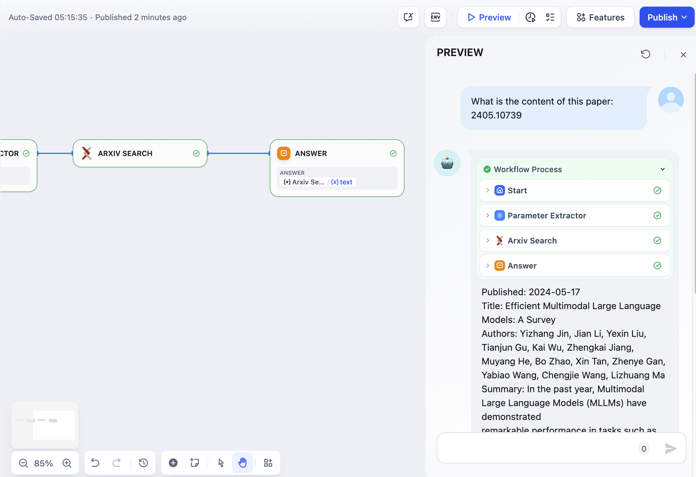
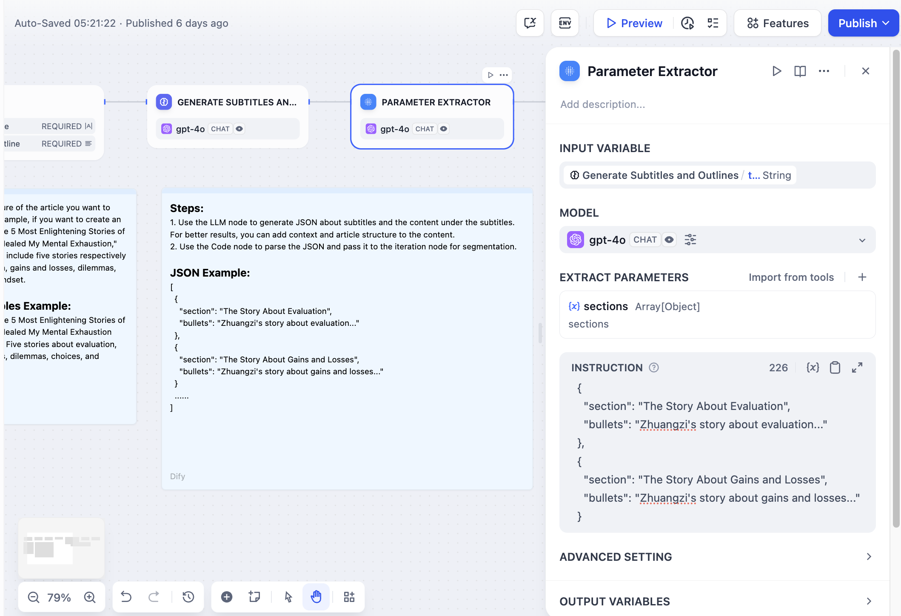

# 参数提取器

> 本文档由 AI 自动翻译。如有任何不准确之处，请参考 [英文原版](https://docs.dify.ai/en/cloud/use-dify/nodes/parameter-extractor.md)。

参数提取器节点使用大型语言模型智能将非结构化文本转换为结构化数据。它弥合了自然语言输入与工具、API 和其他工作流节点所需的结构化参数之间的差距。

## 配置

### 输入和模型选择

选择包含要提取参数的文本的 **输入变量**。这通常来自用户输入、大型语言模型响应或其他工作流节点。

选择具有强大结构化输出能力的 **模型**。参数提取器依赖于大型语言模型理解上下文并生成结构化 JSON 响应的能力。

### 参数定义

通过指定以下内容来定义要提取的参数：

* **参数名称** - 将出现在输出 JSON 中的键
* **数据类型** - 字符串、数字、布尔值、数组或对象
* **描述** - 帮助大型语言模型了解要提取的内容
* **必需状态** - 参数是否必须存在

你可以手动定义参数或 **从现有工具快速导入** 以匹配下游节点的参数要求。

### 提取指令

编写清晰的指令，描述要提取什么信息以及如何格式化。在指令中提供示例可以提高复杂参数的提取准确性和一致性。

Arxiv论文检索的参数提取

## 高级配置

### 推理模式

根据你的模型能力选择两种提取方法之一：

**函数调用/工具调用** 使用模型的结构化输出功能进行可靠的参数提取，具有强类型合规性。

**基于提示词的方法** 依赖纯提示词技术，适用于可能不支持函数调用的模型或基于提示词的提取表现更好的情况。

### 记忆

启用记忆功能以在提取参数时包含对话历史。这有助于大型语言模型在交互式对话中理解上下文，并提高对话工作流的提取准确性。

## 输出变量

该节点提供提取的参数和内置状态变量：

**提取的参数** 作为与你的参数定义匹配的单个变量出现，可供下游节点使用。

**内置变量** 包括状态信息：

* `__is_success` - 提取成功状态（成功为 1，失败为 0）
* `__reason` - 提取失败时的错误描述

数据格式转换示例

## 常见用例

**工具参数准备** 从自然语言中提取特定参数，用于需要结构化输入的工作流工具。

**数据格式转换** 将文本转换为其他节点所需的格式，例如将列表转换为数为外部服务的 HTTP 请求构建数据，处理从用户意图到 API 兼容参数的转换。

**表单数据处理** 从自由格式的用户输入中提取结构化信息，用于数据库存储或进一步处理。

## 最佳实践

**清晰的参数描述** 有助于大型语言模型准确理解要提取的信息及其格式。

**在指令中提供示例** 以提高提取准确性，特别是对于复杂或特定领域的参数。

**使用适当的数据类型** 以确保提取的参数符合下游节点的要求。

**处理提取失败** 通过检查`__is_success`变量并在提取失败时提供后备逻辑。
