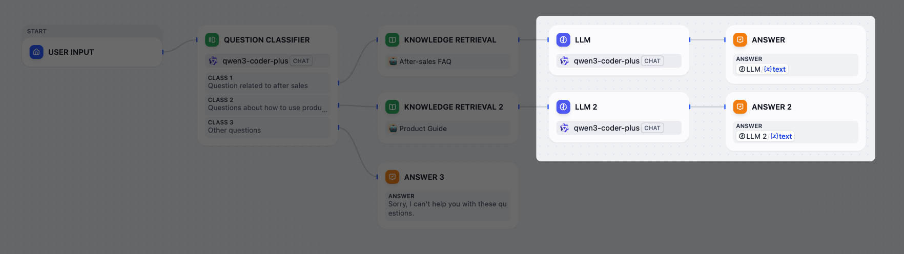
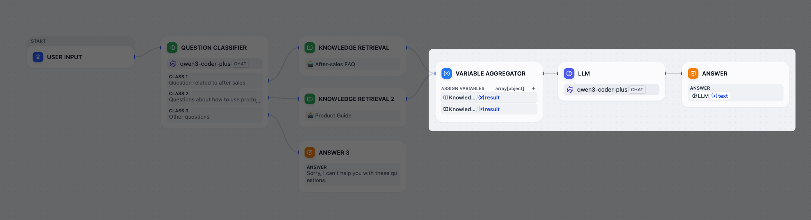

# 变量聚合器

> 将互斥工作流分支汇聚为单一输出

> 本文档由 AI 自动翻译。如有任何不准确之处，请参考 [英文原版](https://docs.dify.ai/en/cloud/use-dify/nodes/variable-aggregator.md)。

使用变量聚合器节点将 **互斥** 的工作流分支汇聚为单一输出，这样只需定义一次下游处理逻辑。

条件分支和问题分类器等节点会创建互斥分支，每次运行只有一条路径会执行。当这些分支产生相同类型的输出时，通常需要在每条分支上重复配置下游节点。

变量聚合器消除了这种重复，提供一个统一的输出变量供下游节点引用，无论实际执行的是哪条分支。

未使用变量聚合器

使用变量聚合器

> [!NOTE]
>
> 变量聚合器仅适用于 **每次只有一条路径会执行** 的互斥分支。它不会合并同时执行的多条并行分支的输出。
>
> 如需合并并行分支的结果，请使用 [代码执行](%E4%BB%A3%E7%A0%81.md) 或 [模板转换](%E6%A8%A1%E6%9D%BF%E8%BD%AC%E6%8D%A2.md) 节点。

## 选择要汇聚的变量

从每条分支中添加需要相同下游处理的变量。所有变量必须具有相同的数据类型。

支持的类型：`string`、`number`、`object`、`boolean`、`array`、`file`。

节点在运行时输出有值的变量。由于只有一条分支会执行，因此只有一个变量会有值，该值即为节点的输出。

## 汇聚多组变量

当有多组变量需要分别汇聚时，启用 **聚合分组** 在单个变量聚合器中创建分组。

每个分组独立汇聚各自的变量，并产生单独的输出。
