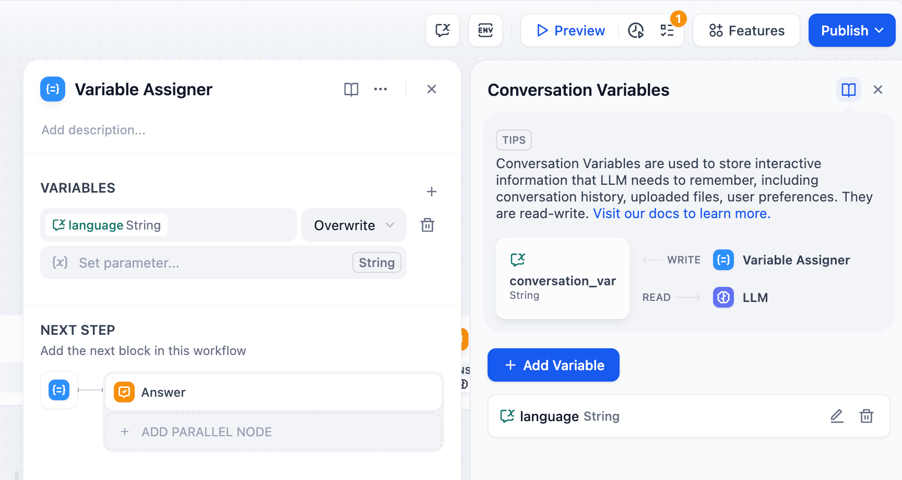
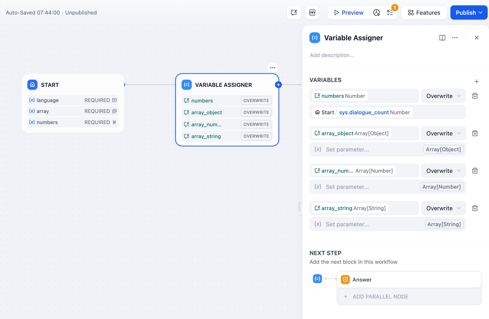
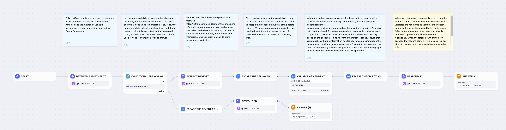
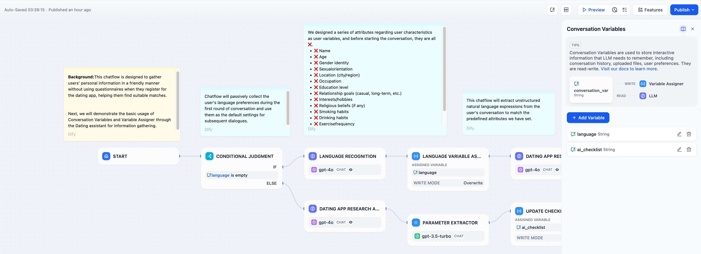
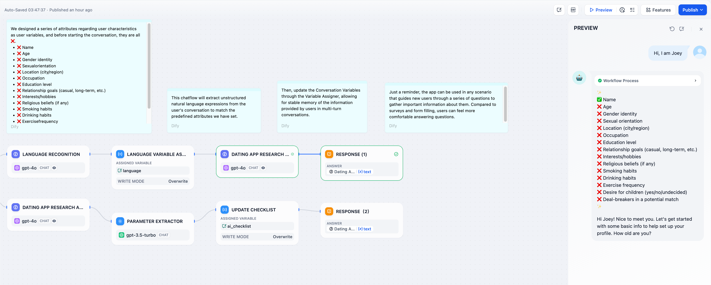

# 变量赋值器

> 在 Chatflow 应用中管理持久化会话变量

> 本文档由 AI 自动翻译。如有任何不准确之处，请参考 [英文原版](https://docs.dify.ai/en/cloud/use-dify/nodes/variable-assigner.md)。

变量赋值器节点通过写入会话变量（在[这里](../../../../%E5%AD%A6%E4%B9%A0/%E6%A0%B8%E5%BF%83%E6%A6%82%E5%BF%B5.md#变量)了解不同类型的变量）来管理 Chatflow 应用中的持久化数据。与每次执行都会重置的常规工作流变量不同，会话变量在整个聊天会话期间持续存在。

变量赋值器节点配置

## 会话变量 vs 工作流变量

**工作流变量** 仅在单次工作流执行期间存在，并在工作流完成时重置。

**会话变量** 在同一聊天会话中的多个对话轮次之间持续存在，支持有状态交互和上下文记忆。

这种持久性支持上下文对话、用户个性化、有状态工作流，以及跨多个用户交互的进度跟踪。

## 配置

配置要更新的会话变量并指定其源数据。你可以在单个节点中分配多个变量。

变量分配配置界面

**变量** - 选择要写入的会话变量

**设置变量** - 从上游工作流节点中选择源数据

**操作模式** - 确定如何更新变量（覆写、追加、清除等）

## 操作模式

不同变量类型根据其数据结构支持不同的操作：

> [tab] 字符串
>
> * **覆写** - 用另一个字符串变量替换
>
> * **清除** - 移除当前值
>
> * **设置** - 手动分配一个固定值

> [tab] 数字
>
> * **覆写** - 用另一个数字变量替换
>
> * **清除** - 移除当前值
>
> * **设置** - 手动分配一个固定值
>
> * **算术运算** - 对当前值进行加、减、乘、除操作

> [tab] 布尔值
>
> * **覆写** - 用另一个布尔变量替换
>
> * **清除** - 移除当前值
>
> * **设置** - 手动分配一个固定值

> [tab] 对象
>
> * **覆写** - 用另一个对象变量替换
>
> * **清除** - 移除当前值
>
> * **设置** - 手动定义对象结构和值

> [tab] 数组
>
> * **覆写** - 用同类型的另一个数组变量替换
>
> * **清除** - 移除数组中的所有元素
>
> * **追加** - 在数组末尾添加单个元素
>
> * **扩展** - 添加同类型另一个数组中的所有元素
>
> * **移除第一个/最后一个** - 移除数组中的第一个或最后一个元素
>
> > [!TIP]
> >
> > 数组操作在构建记忆系统、清单和随时间增长的对话历史记录方面特别强大。

## 常见实现模式

### 智能记忆系统

构建能够自动检测和存储对话中重要信息的聊天机器人：

智能记忆系统工作流

系统分析用户输入中的可记忆事实，提取结构化信息，并将其追加到持久化记忆数组中，以便在未来的对话中参考。

### 用户偏好存储

存储用户偏好，如语言设置、通知偏好或显示选项：

用户偏好管理

使用 **覆写** 模式从用户输入中捕获初始偏好，然后在所有后续大型语言模型响应中引用它们，实现个性化交互。

### 渐进式清单

构建跨多个对话轮次跟踪完成状态的引导式工作流：

渐进式清单实现

使用数组会话变量跟踪已完成的项目。变量赋值器在每轮更新清单，而大型语言模型引用它来指导用户完成剩余任务。
