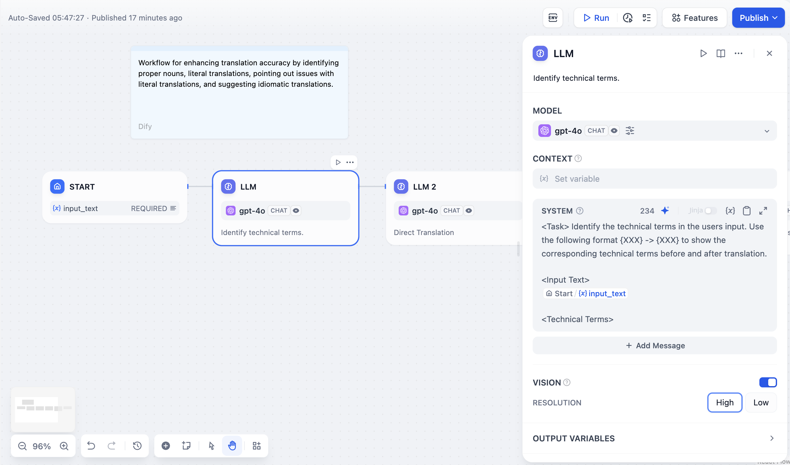
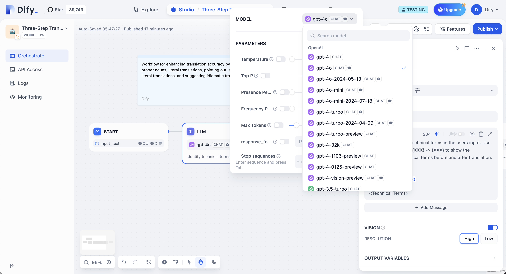
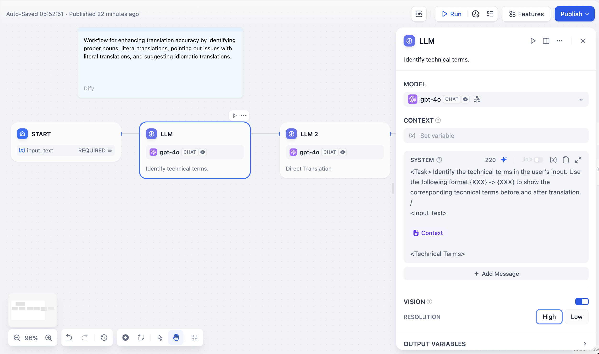
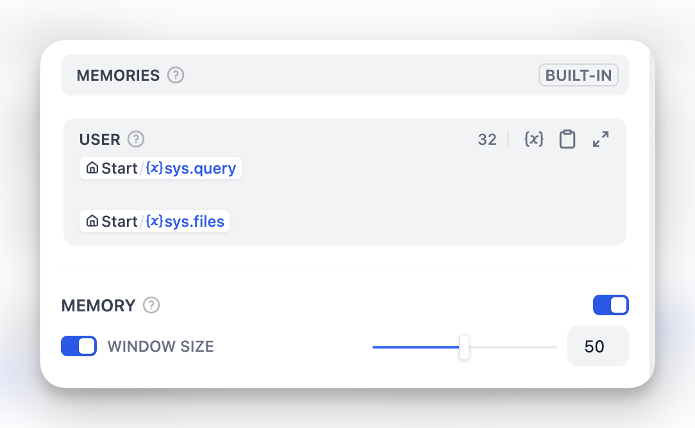
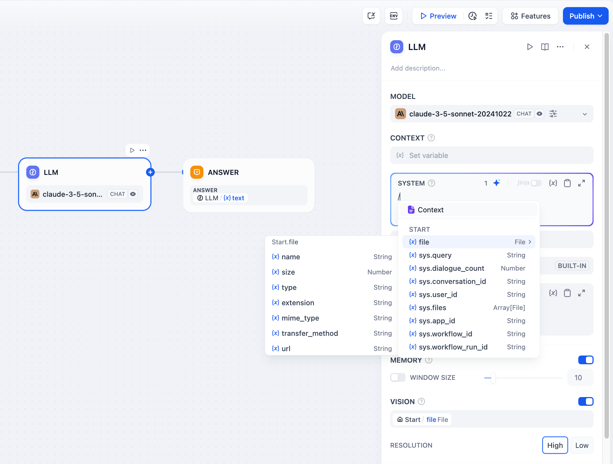

# 大语言模型

> 调用语言模型进行文本生成和分析

> 本文档由 AI 自动翻译。如有任何不准确之处，请参考 [英文原版](https://docs.dify.ai/en/cloud/use-dify/nodes/llm.md)。

大型语言模型节点调用语言模型来处理文本、图像和文档。它向你配置的模型发送提示词并捕获其响应，支持结构化输出、上下文管理和多模态输入。



大型语言模型节点配置界面

> [!NOTE]
>
> 在使用大型语言模型节点之前，先在 **集成** > **模型供应商** 中配置至少一个模型供应商。

## 模型选择和参数

从你已配置的任何模型供应商中进行选择。不同模型擅长不同任务 - GPT-4 和 Claude 3.5 在复杂推理方面表现良好但成本较高，而 GPT-3.5 Turbo 在能力和经济性之间取得平衡。



模型选择和参数配置

模型参数控制响应生成。**温度** 范围从 0（确定性）到 1（创造性）。**核采样** 通过概率限制词汇选择。**频率惩罚** 减少重复。**存在惩罚** 鼓励新话题。你也可以使用预设：**精确**、**平衡** 或 **创意**。

### 跨节点共享模型配置

多个 LLM 节点需要使用同一个模型时，可将模型选择存入环境变量，而不必逐个节点配置。编辑变量（例如改为指向另一个模型）后，所有绑定该变量的节点会一并更新。

打开 **环境变量** 面板，添加一个 **LLM** 类型的变量，选择模型及其参数。

然后在每个 LLM 节点中，将 **模型** 字段切换为变量模式，选择该变量。变量承载模型供应商、模型和模型参数；提示词等其他设置仍保留在各节点中。

## 提示词配置

你的界面根据模型类型自适应。聊天模型使用消息角色（**系统** 用于行为，**用户** 用于输入，**助手** 用于示例），而完成模型使用简单的文本续写。

在提示词中使用双花括号引用工作流变量：`{{variable_name}}`。变量在到达模型之前会被实际值替换。

```text theme={null}
System: You are a technical documentation expert.
User: {{user_input}}
```

## 上下文变量

上下文变量在保持来源归属的同时注入外部知识。这使得大型语言模型可以使用你的特定文档回答问题的检索增强生成应用成为可能。



在检索增强生成应用中使用上下文变量

将 [知识检索](%E7%BB%8F%E5%85%B8%E7%9F%A5%E8%AF%86%E6%A3%80%E7%B4%A2.md) 或 [Agent 知识检索](Agent%20%E7%9F%A5%E8%AF%86%E6%A3%80%E7%B4%A2.md) 节点的输出连接到 LLM 节点的上下文输入，然后引用它：

```text theme={null}
Answer using only this context:
{{knowledge_retrieval.result}}

Question: {{user_question}}
```

当使用来自知识检索的上下文变量时，Dify 会自动跟踪引用，以便用户看到信息来源。

## 结构化输出

强制模型返回特定数据格式（如 JSON）以便程序化使用。通过三种方法配置：

> [tab] 可视化编辑器
>
> 用户友好的界面适用于简单结构。添加具有名称和类型的字段，标记必需字段，设置描述。编辑器自动生成 JSON Schema。

> [tab] JSON Schema
>
> 直接编写 Schema，适用于具有嵌套对象、数组和验证规则的复杂结构。
>
> ```json theme={null}
> {
>   "type": "object",
>   "properties": {
>     "sentiment": {
>       "type": "string",
>       "enum": ["positive", "negative", "neutral"]
>     }
>   },
>   "required": ["sentiment"]
> }
> ```

> [tab] AI 生成
>
> 用自然语言描述需求，让 AI 生成 Schema。

> [!NOTE]
>
> 如果 **结构化输出** 旁出现 **模型不支持**，说明该模型不原生支持结构化输出。这时 Dify 会改为在提示词中加入 JSON Schema，但模型的回复仍可能不符合 Schema，导致节点运行失败。如需稳定的结构化输出，可选择没有该提示的模型。

## 记忆和文件处理



启用记忆以在 Chatflow 对话中的多个大型语言模型调用之间维护上下文。启用后，之前的交互将作为格式化的用户 - 助手输出包含在后续提示词中。你可以通过编辑 `USER` 模板来自定义用户提示词的内容。记忆是节点特定的，不会在不同对话之间持续存在。

对于 **文件处理**，将文件变量添加到多模态模型的提示词中。GPT-4V 处理图像，Claude 直接处理 PDF，而其他模型可能需要预处理。

### 视觉能力配置

处理图像时，你可以控制细节级别：

* **高细节** - 对复杂图像具有更好的准确性但使用更多令牌
* **低细节** - 对简单图像进行更快处理，使用较少令牌

视觉能力的默认变量选择器是 `userinput.files`，它会自动从用户输入节点获取文件。



多模态模型的文件处理

## Jinja2 模板支持

大型语言模型提示词支持 Jinja2 模板以进行高级变量处理。当你使用 Jinja2 模式（`edition_type: "jinja2"`）时，你可以：

```jinja theme={null}

{{ loop.index }}. {{ item.title }}: {{ item.content }}

```

Jinja2 变量与常规变量替换分别处理，允许在提示词中进行循环、条件和复杂数据转换。

## 流式结果返回

大型语言模型节点默认支持流式结果返回。每个文本块都作为 `RunStreamChunkEvent` 产生，实现实时响应显示。文件输出（图像、文档）在流式传输期间自动处理和保存。

## 从回答中分离推理内容

部分推理模型会用 `<think>...</think>` 标签包裹思考过程。默认情况下，这些标签保留在 `text` 输出中，推理内容随回答一起传递到下游节点。

打开 **启用推理标签分离** 开关即可将两者分开：`text` 输出仅保留回答，思考过程则移至独立的 `reasoning_content` 输出变量。开关关闭时，`reasoning_content` 为空。

在 API 调用中，该开关对应 `reasoning_format` 参数。开关打开时，`reasoning_format` 为 `separated`，流式 API 客户端会通过独立的 `reasoning_chunk` 事件接收推理内容，与回答流分开。事件详情参见 [发送对话消息](../../../../%E5%BC%80%E5%8F%91%E8%80%85%E8%B5%84%E6%BA%90/API/%E5%BA%94%E7%94%A8%20API/%E5%AF%B9%E8%AF%9D%E6%B6%88%E6%81%AF/%E5%8F%91%E9%80%81%E5%AF%B9%E8%AF%9D%E6%B6%88%E6%81%AF.md) 和 [执行工作流](../../../../%E5%BC%80%E5%8F%91%E8%80%85%E8%B5%84%E6%BA%90/API/%E5%BA%94%E7%94%A8%20API/%E5%B7%A5%E4%BD%9C%E6%B5%81%E8%BF%90%E8%A1%8C/%E6%89%A7%E8%A1%8C%E5%B7%A5%E4%BD%9C%E6%B5%81.md)。

> [!NOTE]
>
> 此设置仅对用 `<think>` 标签包裹推理内容的模型生效。

## 错误处理

为失败的大型语言模型调用配置重试行为。设置最大重试次数、重试间隔和退避乘数。当重试不足时，定义回退策略，如默认值、错误路由或替代模型。
