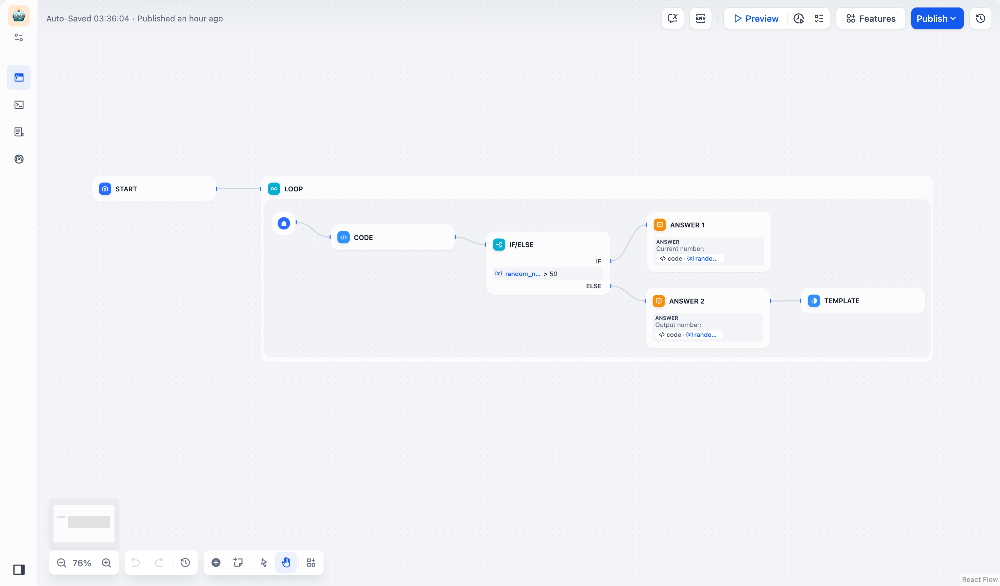
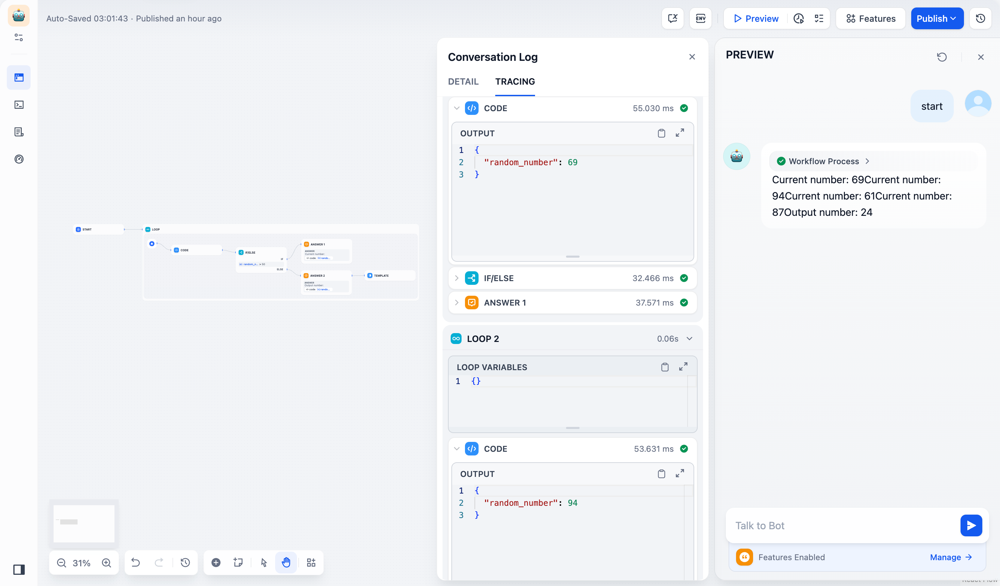

# 循环

> 本文档由 AI 自动翻译。如有任何不准确之处，请参考 [英文原版](https://docs.dify.ai/en/cloud/use-dify/nodes/loop.md)。

循环节点执行重复性工作流，每个循环都基于前一个循环的结果进行构建。与迭代处理数组元素独立不同，循环创建的是随着每次重复而演进的渐进式工作流。

## 循环 vs 迭代

了解何时使用每种重复模式：

> [tab] 循环
>
> **顺序处理** - 每个循环依赖于先前的结果
>
> **渐进式改进** - 输出在迭代过程中得到改善或演化
>
> **状态管理** - 变量在循环中持续存在并累积
>
> **使用场景** - 内容优化、问题解决、质量保证

> [tab] 迭代
>
> **独立处理** - 每个项目单独处理
>
> **并行执行** - 项目可以同时处理
>
> **批量操作** - 对多个数据点应用相同操作
>
> **使用场景** - 数据转换、批量处理、并行分析

## 配置

### 循环变量

定义在循环迭代中持续存在并在循环完成后仍可访问的变量。这些变量维护状态并实现渐进式工作流。

### 终止条件

配置循环何时停止执行：

**循环终止条件** - 确定何时退出的表达式（例如，`quality_score > 0.9`）

**最大循环次数** - 防止无限循环的安全限制

**退出循环节点** - 达到此节点时立即终止

> [!NOTE]
>
> 当满足终止条件、达到最大次数或执行退出循环节点时，循环终止。如果未指定条件，循环将继续直到达到最大次数。

## 基础循环示例

生成随机数，直到找到小于 50 的数：



用于随机数生成的基础循环工作流

**工作流步骤**：

1. **代码节点** 生成 1-100 之间的随机整数
2. **条件分支节点** 检查数字是否小于 50
3. **模板节点** 为小于 50 的数字返回 "done" 以触发循环终止
4. 循环继续直到满足终止条件



循环执行步骤和结果

## 高级循环示例

通过迭代改进创建诗歌，每个版本都基于前一个版本构建：

<video controls src="../../../../../assets/images/b11141905489f3cb540d10ec.mp4" width="100%" />

**循环变量**：

* `num` - 计数器，从 0 开始，每次迭代递增
* `verse` - 文本变量，保存当前诗歌版本

**工作流逻辑**：

1. **条件分支节点** 检查 `num > 3` 以确定何时退出
2. **大型语言模型节点** 基于前一版本生成改进的诗歌
3. **变量赋值器** 更新计数器和诗歌内容
4. **退出循环节点** 在 4 个改进循环后终止

大型语言模型提示词引用当前诗句和迭代上下文：

```text theme={null}
You are a European literary figure creating poetic verses.

Current verse: {{verse}}

Refine and improve this poem based on your previous work.
```

## 常见使用场景

**内容优化** - 通过多次大型语言模型审查逐步改进文本、代码或设计，直到达到质量标准。

**问题解决** - 将复杂问题分解为迭代步骤，其中每个循环基于先前的进展处理下一个逻辑部分。

**研究工作流** - 基于每个搜索循环的发现，迭代搜索、分析和优化研究查询。

**质量保证** - 重进直到满足所有标准。

## 最佳实践

**定义明确的退出条件** - 确保循环具有特定的、可测量的终止条件，以防止无限执行。

**设置合理限制** - 根据预期复杂性和处理需求使用适当的最大迭代次数。

**有效管理状态** - 使用循环变量在迭代中维护必要信息，同时避免不必要的数据累积。

**监控进度** - 包含日志记录或进度指示器来跟踪循环执行，特别是对于长时间运行的过程。
