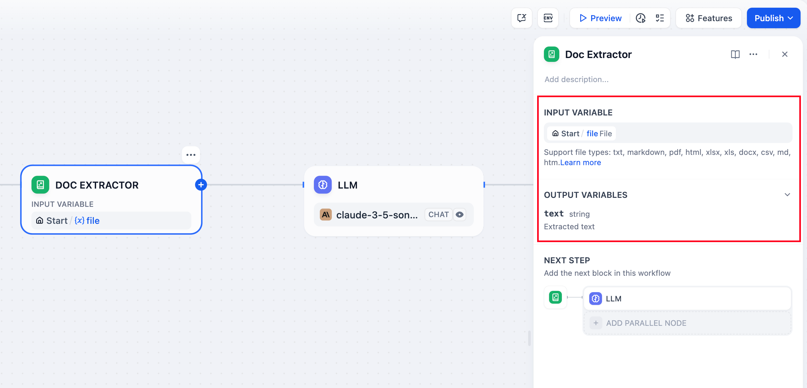
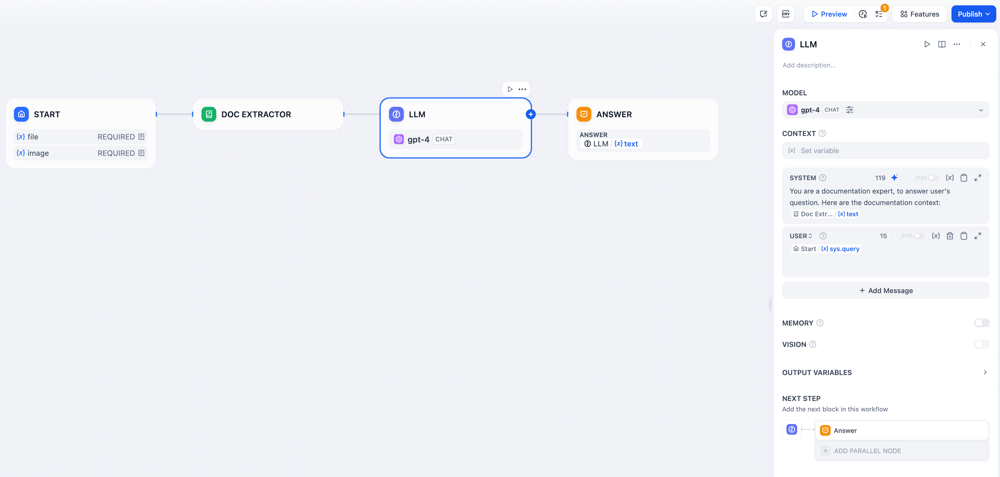
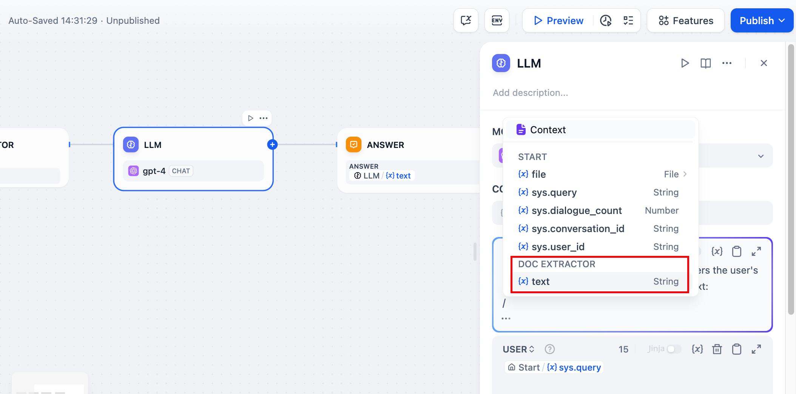
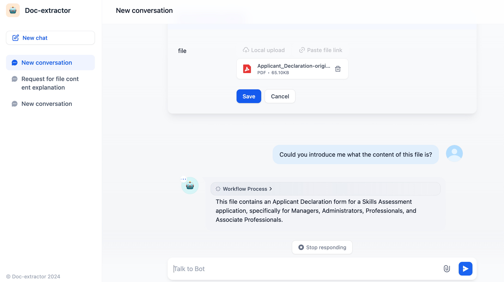

# 文档提取器

> 本文档由 AI 自动翻译。如有任何不准确之处，请参考 [英文原版](https://docs.dify.ai/en/cloud/use-dify/nodes/doc-extractor.md)。

文档提取器节点将上传的文件转换为大型语言模型可以处理的文本。由于语言模型无法直接读取 PDF 或 DOCX 等文档格式，此节点作为文件上传和 AI 分析之间的重要桥梁。

文档提取器节点配置

## 支持的文件类型

该节点处理大多数基于文本的文档格式：

**文本文档** - TXT、Markdown、HTML 文件，包含直接文本内容

**办公文档** - Microsoft Word 和兼容应用的 DOCX 文件

**PDF 文档** - 基于文本的 PDF

**办公文件** - DOCX 文件可直接解析，表格会转换为 Markdown。也支持 DOC 和 ODT 文件。

**电子表格** - Excel（.xls/.xlsx）和 CSV 文件转换为 Markdown 表格

**演示文稿** - PowerPoint（.ppt/.pptx）文件

**邮件格式** - EML 和 MSG 文件用于邮件内容提取

**专业格式** - EPUB 电子书、VTT 字幕、JSON/YAML 数据和 Properties 文件

主要包含二进制内容（如图像、音频或视频）的文件需要专门的处理工具或外部服务。

## 输入和输出

### 输入配置

配置节点以接受：

来自文件变量的 **单个文件** 输入（通常来自开始节点）

用于批量文档处理的 **多个文件** 数组

### 输出结构

节点输出提取的文本内容：

* 单个文件输入产生包含提取文本的`string`
* 多个文件输入产生包含每个文件内容的`array[string]`

输出变量命名为`text`，包含准备用于下游处理的原始文本内容。

## 实现示例

以下是使用文档提取器的完整文档问答工作流：

ChatPDF风格的工作流实现

### 工作流设置

**文件上传配置** - 在开始节点中启用文件输入，接受用户上传的文档。

**文本提取** - 连接文档提取器处理上传的文件并提取其文本内容。

**AI 处理** - 在大型语言模型提示词中使用提取的文本进行分析、摘要或问答。

文档处理实际操作

带文档上传的聊天界面

## 常见用例

**文档问答应用** - 构建 ChatPDF 风格的应用，用户上传文档并询问其内容相关问题。

**内容分析** - 处理合同、报告或研究论文以提取关键信息和见解。

**批量文档处理** - 同时从多个文档提取文本用于分析、索引或迁移。

**文档转换** - 将各种文档格式转换为纯文本以进行进一步处理或存储。

## 处理注意事项

文档提取器使用针对不同文件格式优化的专用解析库。它尽可能保留文本结构和格式，使提取的内容对大型语言模型处理更加有用。

### 文件格式处理

**编码检测** - 使用 chardet 库自动检测文件编码，基于文本的文件使用 UTF-8 作为后备

**表格转换** - Excel 和 CSV 数据转换为 Markdown 表格，以便大型语言模型更好地理解

**文档结构** - DOCX 文件保持段落和表换

**多行内容** - VTT 字幕文件合并同一发言者的连续话语

对于非常大的文档，请考虑大型语言模型的上下文限制，如果需要，可以实施分段策略。提取的文本保持原始文档的逻辑结构，以保留含义和上下文。
