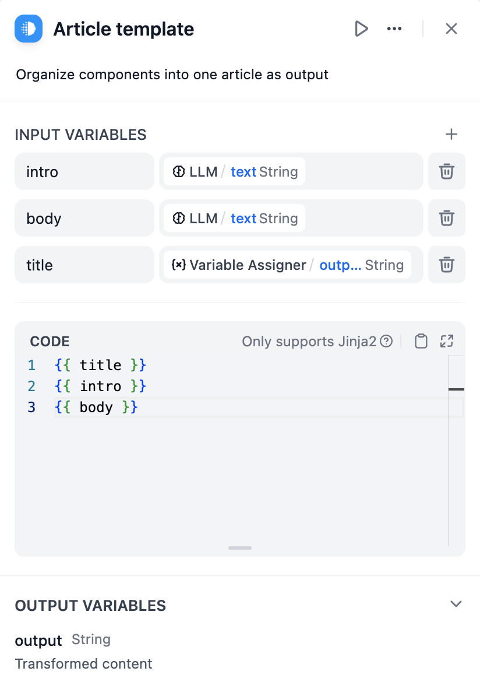
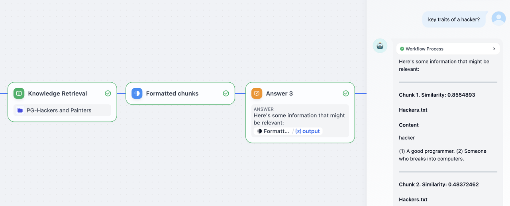
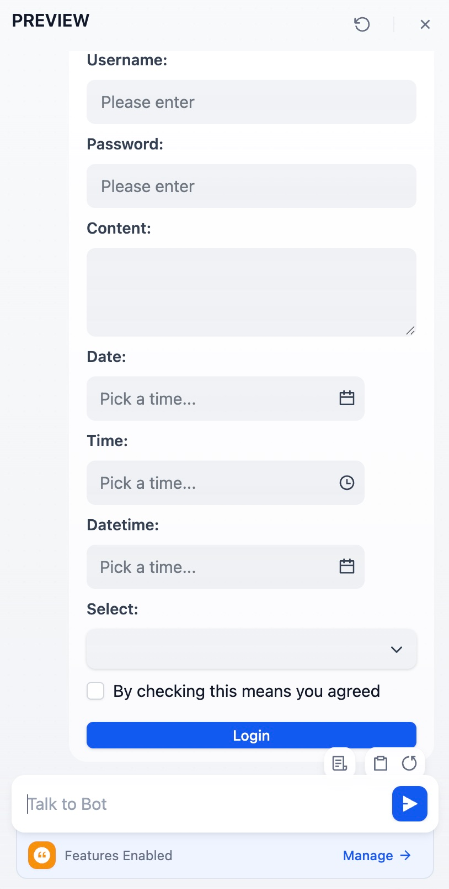

# 模板转换

> 使用 Jinja2 模板转换和格式化数据

> 本文档由 AI 自动翻译。如有任何不准确之处，请参考 [英文原版](https://docs.dify.ai/en/cloud/use-dify/nodes/template.md)。

模板转换节点使用 Jinja2 模板语法将来自多个来源的数据转换和格式化为结构化文本。可使用它来组合变量、格式化输出，并为下游节点或终端用户准备数据。



模板转换节点配置界面

## Jinja2 模板

模板转换节点使用 Jinja2 模板语法，根据工作流数据动态生成内容。该语法提供类似编程的能力，包括循环、条件判断和过滤器，适用于复杂的文本生成。

### 变量替换

使用双花括号引用工作流变量：`{{ variable_name }}`。可使用点号和括号语法访问嵌套对象属性和数组元素。

```jinja theme={null}
{{ user.name }}
{{ items[0].title }}
{{ data.metrics.score }}
```

### 条件逻辑

使用 if-else 语句根据数据值显示不同内容：

```jinja theme={null}

Welcome back, Premium Member! You have access to all features.

Consider upgrading to Premium for additional capabilities.

```

### 循环和迭代

使用 for 循环处理数组和对象以生成重复内容：

```jinja theme={null}

### Result {{ loop.index }}
**Score**: {{ item.score | round(2) }}
{{ item.content }}
---

```



模板处理知识检索结果

## 数据格式化

### 过滤器

Jinja2 过滤器在模板渲染时转换数据：

```jinja theme={null}
{{ name | upper }}
{{ price | round(2) }}
{{ content | replace('\n', '<br>') }}
{{ tags | join(', ') }}
{{ score | default('No score available') }}
```

### 错误处理

使用默认值和条件检查优雅处理缺失或无效数据：

```jinja theme={null}
{{ user.email | default('No email provided') }}
{{ metrics.accuracy | round(2) if metrics.accuracy else 'Not calculated' }}
```

## 交互式表单

模板转换节点可在 Chatflow 中生成交互式 HTML 表单，用于收集结构化数据。

提交后，表单值会作为终端用户的下一条聊天消息发送。具体格式取决于 `<form>` 的 `data-format` 属性：

* **`data-format="json"`**：值会序列化为 JSON 对象。下游的代码执行节点或参数提取器可调用 `JSON.parse`（或用模式匹配）提取各字段。
* **未设置（或为其他值）**：值以纯文本发送，每行一个 `name: value`。便于 LLM 阅读。

例如：

```html theme={null}
<form data-format="json">
  <label for="username">Username:</label>
  <input type="text" name="username" placeholder="Please enter" />
  <label for="password">Password:</label>
  <input type="password" name="password" placeholder="Please enter" />
  <label for="content">Content:</label>
  <textarea name="content"></textarea>
  <label for="date">Date:</label>
  <input type="date" name="date" />
  <label for="time">Time:</label>
  <input type="time" name="time" />
  <label for="datetime">Datetime:</label>
  <input type="datetime" name="datetime" />
  <label for="select">Select:</label>
  <input type="select" name="select" data-options='["Option A","Option B","Option C"]' />
  <input type="checkbox" name="agreed" data-tip="By checking this means you agreed" />
  <button data-variant="primary">Login</button>
</form>
```



### 支持的标签

| 标签 | 属性 | 说明 |
| :- | :- | :- |
| `<form>` | `data-format` | 表单字段的容器。 设置 `data-format="json"` 以 JSON 形式接收提交内容；其他值（或未设置）则以纯文本发送。 |
| `<label>` | `for` | 将内部文本渲染为字段标签。 将 `for` 设置为字段的 `name` 以关联两者。将 `<label>` 放在字段之前，使其显示在字段上方。 |
| `<input>` | `type`、`name`、`value`、`placeholder`、`checked`、`data-tip`、`data-options` | 参见下方输入类型。字段必须设置 `name` 才会出现在提交内容中，且其值需匹配 `[A-Za-z][A-Za-z0-9_-]*`。 |
| `<textarea>` | `name`、`placeholder`、`value` | 多行文本输入。 |
| `<button>` | `data-variant`、`data-size` | 提交表单。<ul><li>变体：`primary`、`warning`、`secondary`、`secondary-accent`、`ghost`、`ghost-accent`、`tertiary`。</li><li>尺寸：`small`、`medium`、`large`。</li></ul>不在以上列表中的值会被忽略，按钮回退为默认样式。 忽略 `data-message` 和 `data-link`，这些属性仅适用于 [快速回复按钮](%E6%A8%A1%E6%9D%BF%E8%BD%AC%E6%8D%A2.md#快速回复按钮)。 |

> [!NOTE]
>
> 不要在 `<form>` 内部的标签之间留空行。空行会在 markdown 解析时结束 HTML 块，断行之后的标签将无法渲染为表单字段。

### 支持的输入类型

| `type` 值 | 渲染为 | 提交为 |
| :- | :- | :- |
| `text`、`password`、`email`、`number` | 与 HTML 语义匹配的单行输入框 | 字符串 |
| `date` | 日期选择器 | ISO 日期字符串（如 `2026-01-10`） |
| `datetime` | 日期选择器（含时间选择） | ISO 日期时间字符串（如 `2026-01-10T14:30:00.000+08:00`） |
| `time` | 时间选择器 | 字符串（包含完整日期前缀，并非仅时间） |
| `checkbox` | 复选框，后跟 `data-tip` 文本作为标签 | 布尔值（`true` 或 `false`） |
| `select` | 下拉框，选项来自 `data-options` 中的 JSON 字符串数组 | 选中的选项字符串 |
| `hidden` | 渲染为 `<input type="hidden">` 元素；不在 UI 中显示 | 字符串 |

* 其他 `type` 值会在字段处显示为「Unsupported tag」提示信息。

* HTML5 验证属性 `required`、`min`、`max` 和 `pattern` 不会强制生效。

* 浏览器可能会用当前站点保存的凭据自动填充 `<input type="password">` 和 `<input type="email">`；如不希望预填充，可改用 `<input type="text">`。

### 快速回复按钮

位于 `<form>` 之外的独立 `<button>` 会在聊天中渲染为可点击按钮，可用于在消息中提供预设回复或外部链接。例如：

```html wrap theme={null}
Would you like to see more options?
<button data-variant="primary" data-message="Yes, show me more">Yes</button> <button data-variant="secondary" data-message="No, that is enough">No</button> <button data-variant="secondary-accent" data-link="https://docs.dify.ai">Read the docs</button>
```


| 属性 | 点击行为 |
| :- | :- |
| `data-message` | 将文本作为终端用户的下一条聊天消息发送。 |
| `data-link` | 在新标签页中打开 URL。必须是有效的 URL。 |

如果两者都设置，`data-link` 优先。若两者都未设置，按钮仍会渲染，但点击不会触发任何动作。

可使用 `data-variant` 和 `data-size` 设置样式，取值与上方 [表单按钮](%E6%A8%A1%E6%9D%BF%E8%BD%AC%E6%8D%A2.md#支持的标签) 相同。

> [!NOTE]
>
> 与表单按钮不同，独立按钮会将 `data-variant` 和 `data-size` 原样传给底层组件，不做校验。无法识别的值可能让按钮失去样式，只显示为纯文本。
>
> 仅使用上述列表中的值。

## 输出限制

模板转换节点的输出限制为 **400,000 个字符**。此限制可避免内存问题，并让大型模板输出在合理时间内完成处理。
