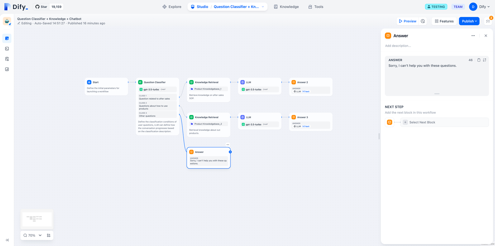
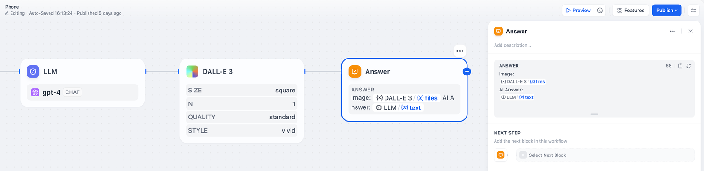
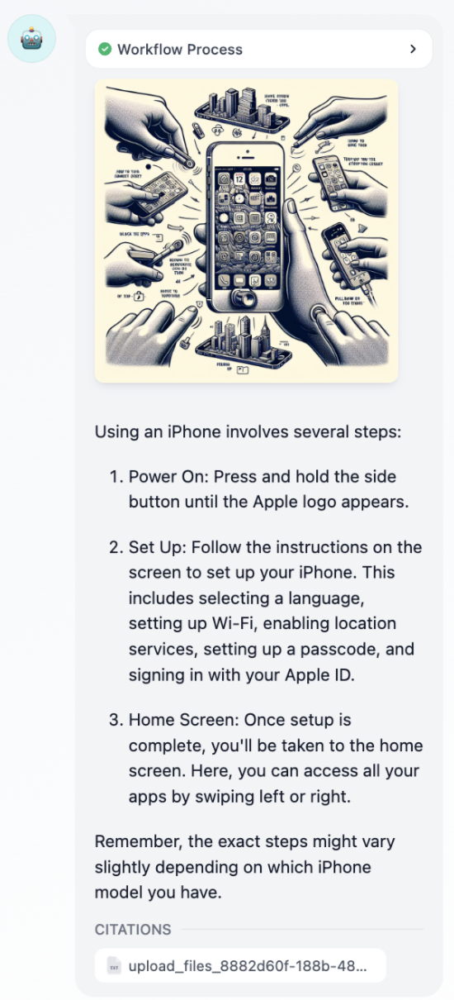

# 直接回复

> 本文档由 AI 自动翻译。如有任何不准确之处，请参考 [英文原版](https://docs.dify.ai/en/cloud/use-dify/nodes/answer.md)。

直接回复节点定义了在 Chatflow 应用中向用户传递的内容。使用它来格式化响应、将文本与变量结合，以及流式传输包括文本、图像和文件在内的多模态内容。

> [!NOTE]
>
> 直接回复节点仅适用于 Chatflow 应用。Workflow 应用使用结束节点。

## 内容配置

直接回复节点提供了一个灵活的文本编辑器，你可以使用固定文本、来自先前节点的变量或两者的组合来制作响应。

使用 `{{variable_name}}` 语法引用任何先前工作流节点的变量。编辑器支持丰富的内容格式化和变量插入，以创建动态的、上下文相关的响应。

纯文本配置

## 多模态响应

直接回复节点支持丰富的内容传递，包括在单个响应流中传递文本、图像和文件。

包含图像和文本内容的多模态配置

**文本内容** 可以包括变量替换、markdown 格式化以及基于工作流处理结果的动态内容。

**图像内容** 显示由工具生成、用户上传或由工作流节点处理的图像。图像与文本一起流式传输，提供丰富的用户体验。

**文件内容** 传递在工作流执行期间生成或处理的文档、电子表格或其他文件。

聊天中的直接回复节点用户界面

## 多个直接回复节点

你可以在 Chatflow 中的不同位置放置多个直接回复节点，以在处理的不同阶段传递内容。这实现了：

**渐进式响应** - 在后台处理继续的同时提供即时确认

**条件响应** - 基于工作流分支逻辑发送不同的内容

**流式更新** - 在长时间运行的过程中，一旦部分结果可用就立即传递

每个直接回复节点独立地为对话做出贡献，允许复杂的响应模式和用户体验设计。

## 变量集成

直接回复节点与所有工作流节点类型的输出无缝集成。常见的变量源包括：

**大型语言模型响应** - 显示生成的文本、分析结果或来自语言模型的结构化输出

**知识检索** - 显示在知识库中找到的相关信息，并自动进行引用跟踪

**工具结果** - 展示来自外部 API、计算或服务集成的数据

**文件处理** - 显示提取的文本、分析结果或处理过的文档内容

变量系统维护类型安全，并自动处理不同的内容类型，以便在聊天界面中实现最佳显示。
