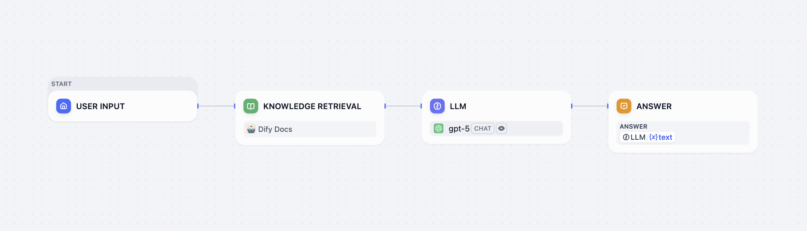

# 经典知识检索

> 从经典知识库中检索相关内容，作为下游节点的上下文

> 本文档由 AI 自动翻译。如有任何不准确之处，请参考 [英文原版](https://docs.dify.ai/en/cloud/use-dify/nodes/knowledge-retrieval.md)。

> [!NOTE]
>
> 此节点检索 [经典知识库](../../../%E7%9F%A5%E8%AF%86%E5%BA%93/%E7%BB%8F%E5%85%B8%E7%9F%A5%E8%AF%86%E5%BA%93/%E7%BB%8F%E5%85%B8%E7%9F%A5%E8%AF%86%E5%BA%93.md)。如需检索 Agent 知识库，改用 [Agent 知识检索节点](Agent%20%E7%9F%A5%E8%AF%86%E6%A3%80%E7%B4%A2.md)。

你可以通过知识检索节点将已有知识库集成到 Chatflow 或 Workflow 应用中。该节点在指定知识库中检索与查询相关的信息，并将检索结果作为上下文内容传递给下游节点（如 LLM）使用。

知识检索节点在 Chatflow 中的典型用例如下：

1. **用户输入** 节点收集用户问题。

2. **知识检索** 节点在指定知识库中检索与用户问题相关的内容，并输出检索结果。

3. **LLM** 节点基于用户问题和检索结果生成回复。

4. **直接回答** 节点将 LLM 的回复输出给用户。

使用知识检索节点前，确保至少有一个可用的知识库。了解如何创建知识库，阅读 [知识库](../../../%E7%9F%A5%E8%AF%86%E5%BA%93/%E7%BB%8F%E5%85%B8%E7%9F%A5%E8%AF%86%E5%BA%93/%E7%BB%8F%E5%85%B8%E7%9F%A5%E8%AF%86%E5%BA%93.md#set-up)。

> [!NOTE]
>
> 知识检索操作受每分钟频率限制，具体数值因订阅计划而异。各计划的限额详见 [知识库请求频率限制](../../../%E7%9F%A5%E8%AF%86%E5%BA%93/%E7%9F%A5%E8%AF%86%E5%BA%93%E8%AF%B7%E6%B1%82%E9%A2%91%E7%8E%87%E9%99%90%E5%88%B6.md)。

## 配置知识检索节点

要使知识检索节点正常工作，你需要指定：

* **检索什么**（查询内容）

* **在哪里检索**（知识库）

* **如何处理检索结果**（节点级检索设置）

你还可以利用文档元数据实现基于筛选的检索，进一步提升检索精度。

### 指定查询内容

设置节点需要在指定知识库中检索的查询内容。

* **查询文本**：选择一个文本变量。例如，在 Chatflow 中可用 `userinput.query` 引用用户输入，而在 Workflow 中则可选择文本类型的用户输入变量。

* **查询图片**：选择一个图片变量（如用户通过用户输入节点上传的图片），通过图片进行检索。每张图片不得超过 2 MB。

  > [!NOTE]
  >
  > 当添加了至少一个多模态知识库时，才会出现 **查询图片** 选项。
  >
  > 此类知识库会带有 **Vision** 图标，表示其使用的是多模态嵌入模型。

### 选择检索的知识库

为节点添加一个或多个知识库，用于检索与查询内容相关的信息。

添加了多个知识库时，会同时检索所有知识库，合并结果并根据 [节点级检索设置](%E7%BB%8F%E5%85%B8%E7%9F%A5%E8%AF%86%E6%A3%80%E7%B4%A2.md#调整节点级检索设置) 进行处理。

> [!NOTE]
>
> 带有 **Vision** 图标的知识库支持跨模态检索：基于语义相关性同时检索文本和图片。

点击已添加知识库旁的 **编辑** 图标，可修改该知识库的 [设置](../../../%E7%9F%A5%E8%AF%86%E5%BA%93/%E7%BB%8F%E5%85%B8%E7%9F%A5%E8%AF%86%E5%BA%93/%E7%AE%A1%E7%90%86/%E8%B0%83%E6%95%B4%E7%9F%A5%E8%AF%86%E5%BA%93%E8%AE%BE%E7%BD%AE.md)。

### 调整节点级检索设置

设置节点在获取知识库检索结果后的处理方式。

> [!NOTE]
>
> 检索设置分为知识库级和节点级两层。
>
> 可将其理解为先后两道筛选：知识库设置决定初步的检索结果池，而节点设置对结果进行重排序（Rerank）或进一步筛选。

* **Rerank 设置**

  * **权重设置**

    语义相似度与关键词匹配的权重。语义权重高则更注重语义相关性，关键词权重高则更偏向精确匹配。

    仅当所有已添加的知识库使用的索引方式均为高质量时，才会出现 **权重设置** 的选项。

  * **Rerank 模型**

    根据与查询内容的相关性，对所有结果的相似度分数进行重新评定和排序。

    > [!NOTE]
    >
    > 若添加了多模态知识库，需同时选择多模态 Rerank 模型（带有 **Vision** 图标）。否则，检索到的图片将在重排序和最终输出中被排除。

* **Top K**

  重排序后返回的最大结果数。

  选择 Rerank 模型时，该值将根据模型的最大输入容量自动调整。

* **Score 阈值**

  返回结果的最低相似度分数。低于该阈值的结果会被过滤。阈值高表示对结果的相关性更严格，阈值低则更宽松。

### 启用元数据过滤

可利用已有的文档元数据，将检索范围限定在知识库的特定文档内，以进一步提升检索精度。

启用元数据过滤后，知识检索节点仅会检索符合指定元数据过滤条件的文档，而非整个知识库。尤其适用于内容多样的大型知识库。

关于创建和管理文档元数据，详见 [元数据](../../../%E7%9F%A5%E8%AF%86%E5%BA%93/%E7%BB%8F%E5%85%B8%E7%9F%A5%E8%AF%86%E5%BA%93/%E7%AE%A1%E7%90%86/%E7%AE%A1%E7%90%86%E6%96%87%E6%A1%A3%E5%85%83%E6%95%B0%E6%8D%AE.md)。

## 输出变量

知识检索节点将检索结果输出为 `result` 变量，即一个包含分段内容、元数据、标题等属性的文档分段数组。

若检索结果中包含图片附件，`result` 变量中将增加包含图片元数据的 `files` 字段。

## 搭配 LLM 节点使用知识检索节点

如需在 LLM 节点中基于检索结果回答用户问题：

1. 在 **上下文** 字段中，选择知识检索节点的 `result` 变量。

2. 在提示词字段中，同时引用 `上下文` 变量和用户输入变量（如 Chatflow 中的 `userinput.query`）。

3. （可选）若 LLM 支持视觉能力（带有 **Vision** 图标），可启用 **Vision**，以便其理解检索到的图片。

   > [!NOTE]
   >
   > 启用 **Vision** 后，LLM 会自动处理检索到的图片。无需在 **Vision** 输入字段中再次手动引用 `上下文` 变量。
