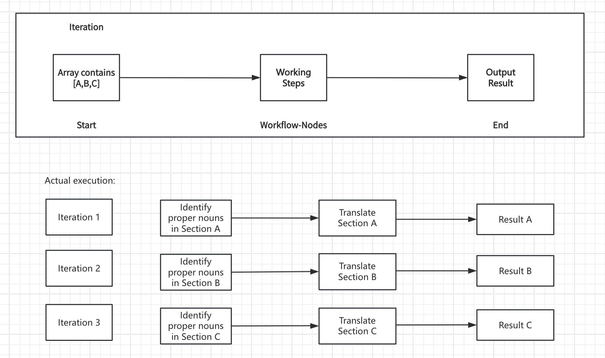
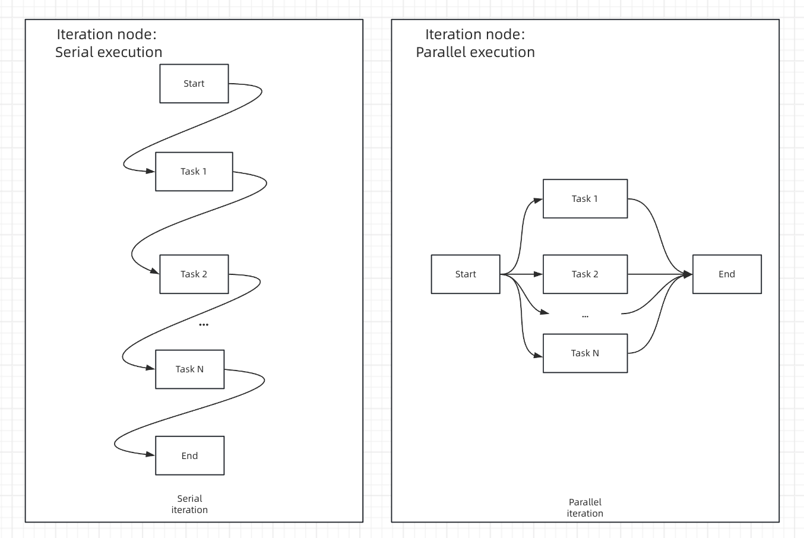
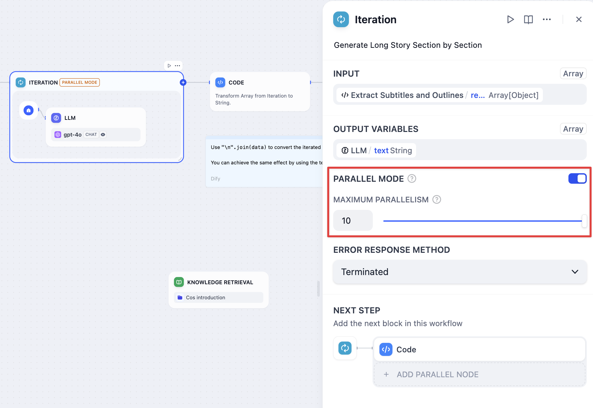
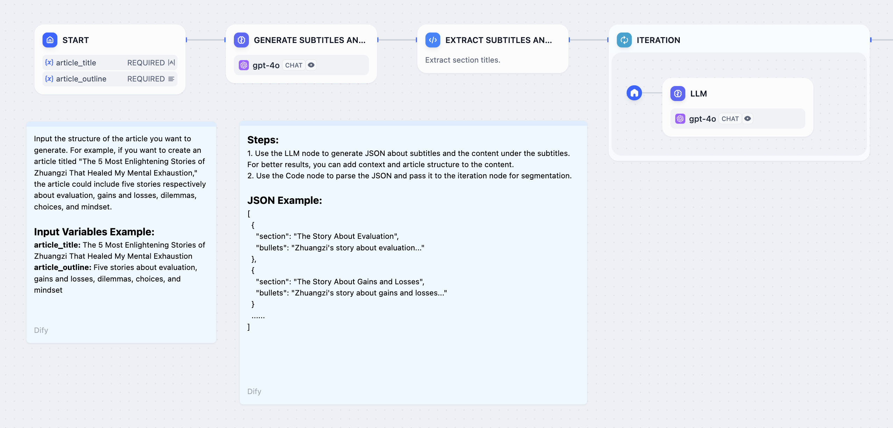
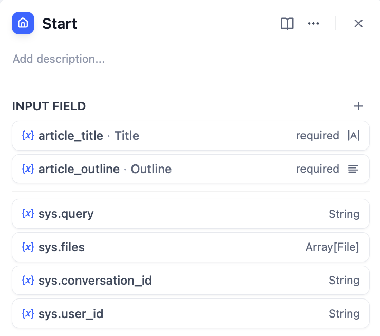
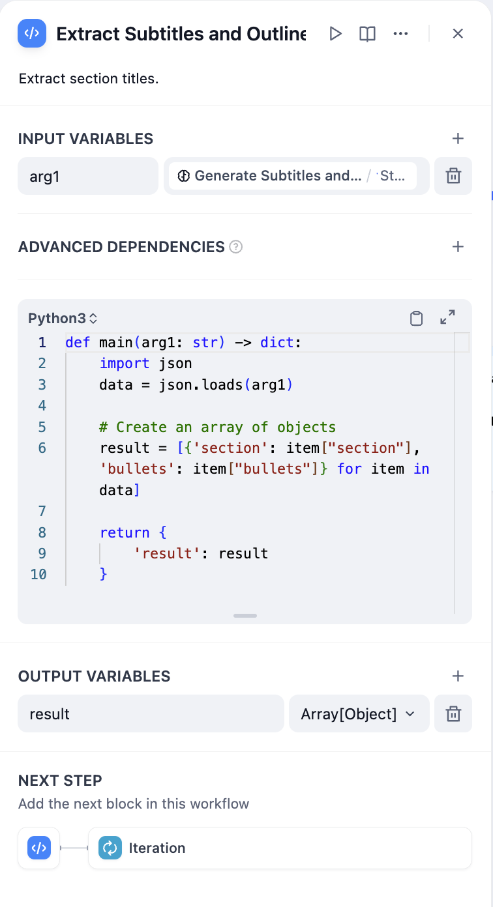
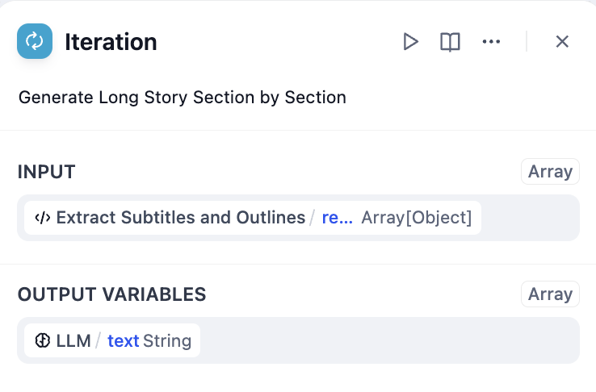
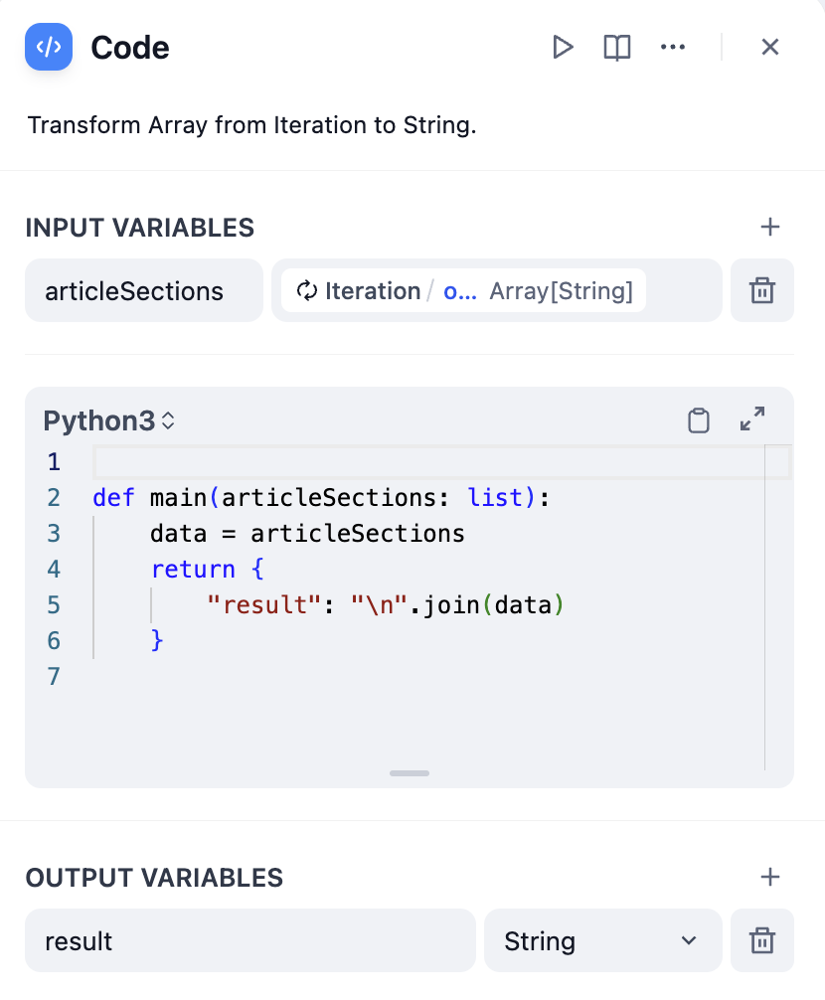
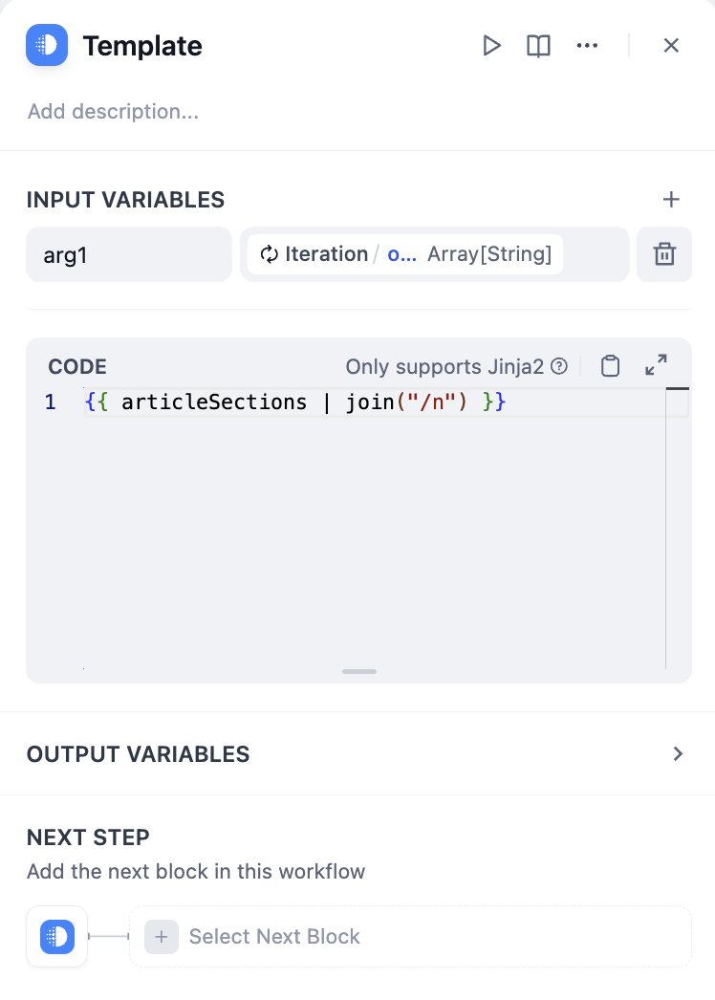

# 迭代

> 本文档由 AI 自动翻译。如有任何不准确之处，请参考 [英文原版](https://docs.dify.ai/en/cloud/use-dify/nodes/iteration.md)。

迭代节点通过对每个元素按顺序或并行运行相同的工作流步骤来处理数组。用于批处理任务，这些任务若作为单一操作会遇到限制或效率低下的问题。



迭代节点处理工作流

## 迭代的工作原理

该节点接收数组输入并创建一个子工作流，对每个数组元素运行一次。在每次迭代期间，当前项目及其索引可作为内部节点可以引用的变量。

**核心组件**：

* **输入变量** - 来自上游节点的数组数据
* **内部工作流** - 对每个元素执行的处理步骤
* **输出变量** - 从所有迭代收集的结果（也是一个数组）

## 配置

### 数组输入

连接来自上游节点的数组变量，如参数提取器、代码节点、知识检索或 HTTP 请求响应。

### 内置变量

每次迭代提供访问：

* `items[object]` - 正在处理的当前数组元素
* `index[number]` - 当前迭代索引（从 0 开始）

### 处理模式

> [tab] 顺序模式
>
> **顺序处理** - 项目按顺序逐一处理
>
> **流式结果返回支持** - 可以使用回答节点逐步输出结果
>
> **资源管理** - 较低的内存使用量，可预测的执行顺序
>
> **最适用于** - 当顺序重要或使用流式输出时

> [tab] 并行模式
>
> **并发处理** - 最多同时处理 10 个项目
>
> **性能提升** - 独立操作的更快执行
>
> **批处理** - 高效处理大型数组
>
> **最适用于** - 顺序无关紧要的独立操作



顺序与并行处理比较



在迭代设置中启用并行模式

## 错误处理

配置如何处理单个数组元素的处理失败：

**终止** - 出现任何错误时停止处理并返回错误消息

**错误时继续** - 跳过失败的项目并继续处理，为失败的元素输出 null

**移除失败结果** - 跳过失败的项目并仅返回成功的结果

输入输出对应示例：

* 输入：`[1, 2, 3]`
* 错误时继续的输出：`[result-1, null, result-3]`
* 移除失败的输出：`[result-1, result-3]`

## 长文章生成示例

通过单独处理章节大纲生成冗长内容：



长文章生成工作流

**工作流步骤**：

1. **开始节点** - 用户提供故事标题和大纲
2. **大型语言模型节点** - 生成详细的章节分解
3. **参数提取器** - 将章节列表转换为结构化数组
4. **迭代节点** - 通过内部大型语言模型处理每个章节
5. **回答节点** - 生成章节内容时进行流式传输




故事输入的开始节点配置



通过大型语言模型处理的迭代配置

> [!NOTE]
>
> 参数提取的有效性取决于模型能力和指令质量。使用更强的模型并在指令中提供示例以提高结果。

## 输出处理

迭代节点输出数组，通常需要转换以供最终使用：

### 将数组转换为文本

> [tab] 使用代码节点
>
> ```python theme={null}
> def main(articleSections: list):
>     return {
>         "result": "\n".join(articleSections)
>     }
> ```
>
> 
>
> 代码节点数组转换

> [tab] 使用模板节点
>
> ```
> {{ articleSections | join("\n") }}
> ```
>
> 
>
> 模板节点数组转换

## 常见用例

**标记数限制管理** - 当内容超过大型语言模型上下文窗口时，将大文本分解为块进行翻译、摘要或分析。

**批处理** - 高效地对多个项目应用相同操作，例如处理多个文档或 API 调用。

**质量控制** - 单独处理项目以保持质量并优雅地处理错误，而不是冒整个批次失败的风险。

**渐进式输出** - 在结果完成时流式传输，而不是等待所有处理完成。

## 最佳实践

**选择适当的模式** - 对于有序处理或流式传输使用顺序模式，对于需要速度的独立操作使用并行模式。

**优雅地处理错误** - 根据部分失败是否应停止处理或跳过来配置错误处理。

**优化内部工作流** - 保持迭代子工作流的效率，因为它们运行多次。

**监控资源使用** - 具有复杂处理的大型数组可能会消耗大量资源，特别是在并行模式下。
