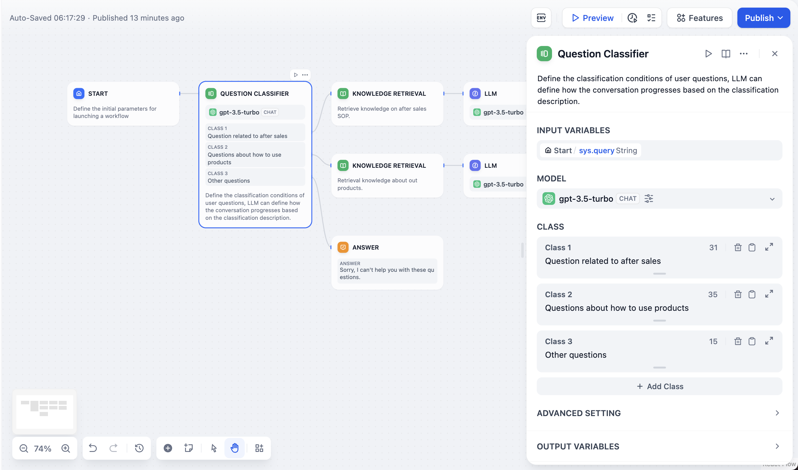
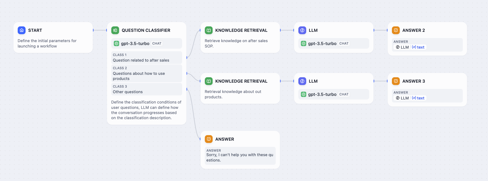

# 问题分类器

> 本文档由 AI 自动翻译。如有任何不准确之处，请参考 [英文原版](https://docs.dify.ai/en/cloud/use-dify/nodes/question-classifier.md)。

问题分类器节点对用户输入进行智能分类，将对话路由到不同的工作流路径。无需构建复杂的条件逻辑，只需定义分类，让大语言模型基于语义理解判断最契合的一项。

## 配置

### 输入和模型设置

**输入变量** - 选择要分类的内容，通常使用用户问题的 `sys.query`，也可以是来自上游工作流节点的任意文本变量。

**模型选择** - 选择用于分类的大语言模型。简单分类用速度较快的模型即可处理；分类边界细微时，更强的模型表现更好。

### 分类定义

每个分类包含两段相互独立的文本：

* **分类描述**（编辑器正文）是模型选择分支时读取的内容。

  写出能准确区分该分类内容的描述。分类边界相近时，使用「与……相关」「不包括……」等边界表述有助于模型做出判断。下游通过 `class_name` 输出。

* **分类标题**（编辑器上方的小标题）是画布上展示的标签。

  双击默认的 **分类 N** 标题可重命名。下游通过 `class_label` 输出。

标题和描述可独立编辑，以便你在画布上保留简洁易读的标签，同时为模型提供更完整、更具体的描述。

每个分类对应一条潜在的输出路径，可连接到不同的下游节点，例如专门的知识库、响应模板或处理流程。

## 分类示例

以下是问题分类器在客户服务场景中的使用方式：

客户服务分类工作流

**已定义的分类**：

* **售后服务** - 保修申请、退货、维修以及购后支持
* **产品使用** - 安装说明、故障排查、功能解释
* **其他问题** - 不属于以上分类的一般问询

**分类结果**：

* 「如何在 iPhone 14 上设置联系人？」 → **产品使用**
* 「我购买的产品保修期是多长？」 → **售后服务**
* 「今天天气如何？」 → **其他问题**

每个分类结果路由到不同的知识库和响应策略，确保用户获得相关、专业的帮助。

## 高级配置

### 指令和指南

在 **指令** 字段中添加详细的分类指南，用于处理边界场景、模棱两可的情况或特定业务规则。这有助于大语言模型理解分类之间的细微差别。
