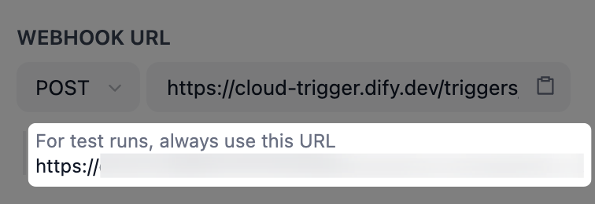

# Webhook 触发器

> 本文档由 AI 自动翻译。如有任何不准确之处，请参考 [英文原版](https://docs.dify.ai/en/cloud/use-dify/nodes/trigger/webhook-trigger.md)。

> [!NOTE]
>
> 触发器仅适用于 Workflow 应用。

Webhook 允许一个系统自动向另一个系统发送实时数据。当某个特定事件发生时，源系统将事件详情打包进一个 HTTP 请求，并发送至目标系统的指定 URL。

遵循相同的机制，Webhook 触发器能够让 Workflow 在外部事件发生时自动运行：

1. 在 Workflow 中添加 Webhook 触发器后，系统将自动生成一个 webhook URL 作为监听外部 HTTP 请求的专用端点。该 URL 托管于 Dify Cloud 域名下，外部系统可公开访问。

2. 你使用此 URL 在外部系统中创建一个 webhook，订阅期望关注的事件。然后，在 Dify 中配置 Webhook 触发器，定义其如何处理接收到的请求并提取请求中的事件数据。

   > [!NOTE]
   >
   > 在测试场景中，请始终使用测试专用的 webhook URL，以分离测试与生产数据。
   >
   > 

3. 当订阅的事件发生时，外部系统会将包含事件数据的 HTTP 请求发送到先前提供的 webhook URL。一旦请求被成功接收和处理，你的 Workflow 会被触发，而提取到的事件数据也将成为下游节点可引用的变量。

> [!TIP]
>
> 若目标外部系统有可用的触发器集成，推荐使用 [集成触发器](%E9%9B%86%E6%88%90%E8%A7%A6%E5%8F%91%E5%99%A8.md)。

## 添加 Webhook 触发器

在 Workflow 画布上，单击右键并选择 **添加节点** > **开始** > **Webhook 触发器**。

> [!TIP]
>
> 一个工作流可以包含多个 Webhook 触发器。如果这些触发器分支共享相同的下游节点，可以添加 [变量聚合器](../%E8%8A%82%E7%82%B9/%E5%8F%98%E9%87%8F%E8%81%9A%E5%90%88%E5%99%A8.md) 将它们汇聚，避免在每条分支上重复配置相同的节点。

## 配置 Webhook 触发器

你可以定义 Webhook 触发器如何处理接收到的 HTTP 请求，包括：

* Webhook URL 接受的 HTTP 方法

* 请求的内容类型

* 需要从请求中提取的事件数据

* 当 Workflow 成功触发时，返回至外部系统的响应

> [!NOTE]
>
> 如需测试未发布的 Webhook 触发器，必须先点击 **运行此步骤** 或测试运行整个 Workflow，使触发器进入监听状态。否则，将无法接收到外部请求。

### HTTP 方法

为了确保传入的请求被成功接收，需指定 webhook URL 接受的 HTTP 方法。

在此处选择的方法，必须与外部系统发送请求时使用的方法一致。否则，请求将被拒绝。

> [!TIP]
>
> 通常，你可以在外部系统的 webhook 文档或设置界面中找到该信息。

### 内容类型

为了确保请求体被正确解析且特定数据被成功提取，需指定外部请求的预期内容类型。

在此处选择的内容类型，必须与外部系统发送的请求的内容类型一致。否则，请求将被拒绝。

### 查询参数、请求头参数和请求体参数

你可以从传入请求的查询参数、请求头和请求体中提取特定参数。**每个提取出的参数都将成为一个输出变量，可供下游节点引用。**

许多外部系统支持查看已发出请求的日志，可在其中浏览请求包含的所有数据，并确定需要提取的参数。

或者，你也可以让外部系统向 Webhook 触发器发送测试请求，然后在触发器的 **上次运行** 日志中查看接收到的请求数据：

1. 使用 Dify 提供的测试专用 webhook URL 在外部系统中创建一个 webhook。

2. 在触发器中设置正确的 HTTP 方法和内容类型。

3. 点击触发器的 **运行此步骤** 图标，使其开始监听外部请求。

4. 在外部系统中手动触发已订阅的事件，使其向 Dify 的 webhook URL 发送 HTTP 请求。

5. 点开触发器的 **上次运行** 日志，在 **输入** 中查看接收到的请求数据。

> [!NOTE]
>
> 在触发器内定义的变量名，必须与请求中对应参数的键名一致。

> [tab] 查询参数
>
> * 外部系统在发送请求时添加到 webhook URL（`?` 之后）的键值对参数，每对参数之间用 `&` 分隔。
>
> * 通常是关于事件的简单、非敏感的标识符或过滤数据。
>
> * 示例：从 URL `{webhook url}?userID=u-456&source=email` 中，可提取 `userID`（`u-456`）或 `source`（`email`）。

> [tab] 请求头参数
>
> * 包含在请求头中的请求元数据。
>
> * 处理请求所需的技术信息，例如身份验证令牌或请求体的内容类型。
>
> * 示例：从类似 `Authorization: Bearer sk-abc...` 和 `Content-Type: application/json` 的请求头中，可提取授权信息（`Bearer sk-abc...`）或内容类型（`application/json`）。

> [tab] 请求体参数
>
> * 发送核心事件数据的主要有效负载，例如客户资料、订单详情或 Slack 消息的具体内容。
>
> * 示例：从以下请求体中，可提取 `customerName`（`Alex`）、`items` 列表或 `isPriority` 状态（`true`）。
>
> ```json theme={null}
> "customerName": "Alex",
> "items":
> [
>         { "sku": "A42", "quantity": 2 },
>         { "sku": "B12", "quantity": 1 }
> ],
> "isPriority": true
> ```
>
> > [!NOTE]
> >
> > 可从请求体中提取的参数数据类型，取决于请求的内容类型。
> >
> > | 内容类型 | `String` | `Number` | `Boolean` | `Object` | `File` | `Array[String]` | `Array[Number]` | `Array[Boolean]` | `Array[Object]` | `Array[File]` |
> > | :- | :-: | :-: | :-: | :-: | :-: | :-: | :-: | :-: | :-: | :-: |
> > | application/json | ✅ | ✅ | ✅ | ✅ | ❌ | ✅ | ✅ | ✅ | ✅ | ❌ |
> > | application/x-www-form-urlencoded | ✅ | ✅ | ✅ | ❌ | ❌ | ✅ | ✅ | ✅ | ❌ | ❌ |
> > | multipart/form-data | ✅ | ✅ | ✅ | ❌ | ✅ | ✅ | ✅ | ✅ | ❌ | ✅ |
> > | text/plain | ✅ | ✅ | ✅ | ❌ | ❌ | ❌ | ❌ | ❌ | ❌ | ❌ |

**参数设置**

对于要提取的每个参数，可进行以下设置：

* **变量名**：请求中对应参数的键名（例如，`userID=u-456` 中的 `userID`）。

  > [!NOTE]
  >
  > 对于请求头参数，变量名中的任何连字符（`-`）将在输出变量中自动转换为下划线（`_`）。

* **类型**：预期的数据格式。仅适用于查询参数和请求体参数，因为请求头参数的格式始终被视为字符串。

* **必填**：该参数是否对你的 Workflow 是必需的。若传入请求中缺少任何必填参数，Workflow 将不会被触发。

### 响应

当 Workflow 被外部请求成功触发时，Dify 会向外部系统返回一个默认的 `200 OK` 响应。

若外部系统对成功响应的格式有特定要求，你可以自定义其状态码和响应体。默认响应将被覆盖。

* **状态码**：支持 \[200, 399] 范围内的任何状态码。

* **响应体**：支持 JSON 或纯文本。

> [!NOTE]
>
> 在返回的响应体中，非 JSON 内容将自动转换为 JSON 格式。
>
> 例如，`OK` 将被转换为 `"message": "OK"`。

> [!NOTE]
>
> 以下错误响应由系统定义，无法自定义：
>
> * 400 Bad Request
> * 404 Not Found
> * 413 Payload Too Large
> * 500 Internal Server Error

## 测试 Webhook 触发器

如需测试未发布的 Webhook 触发器，必须先点击 **运行此步骤** 或测试运行整个 Workflow，使触发器进入监听状态。否则，将无法接收到外部请求。
