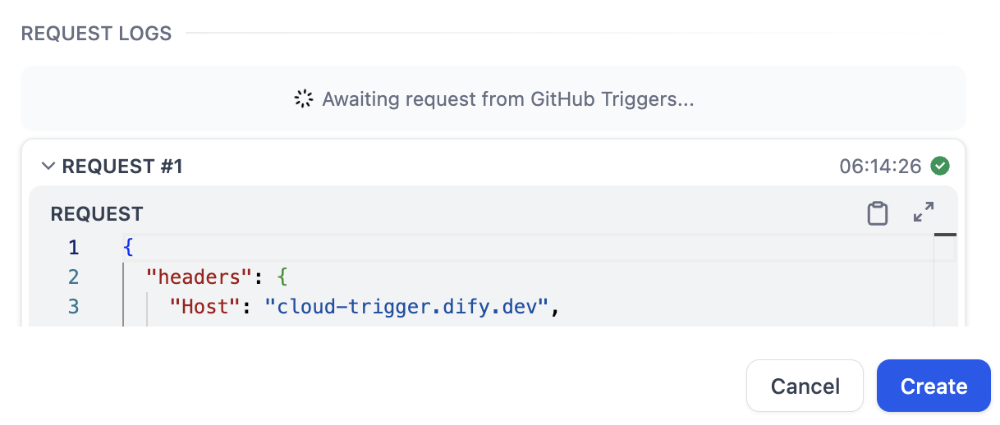

# 集成触发器

> 本文档由 AI 自动翻译。如有任何不准确之处，请参考 [英文原版](https://docs.dify.ai/en/cloud/use-dify/nodes/trigger/plugin-trigger.md)。

> [!NOTE]
>
> 触发器仅适用于 Workflow 应用。

集成触发器可在外部系统发生特定事件时自动运行工作流。你通过触发器集成订阅这些事件，再将对应的触发器添加到工作流中即可。

例如，安装 GitHub 触发器集成后，你可以订阅 `Pull Request`、`Push`、`Issue` 等事件。订阅 `Pull Request` 并添加对应的触发器后，每当有人在指定仓库中创建 pull request，工作流就会自动运行。

## 添加和配置集成触发器

1. 在工作流画布上，单击右键并选择 **添加节点** > **开始**，然后选择要启动工作流的集成触发器事件。如需更多集成，可在 [Marketplace](https://marketplace.dify.ai/?language=zh-Hans\&category=trigger) 中搜索。

   > [!TIP]
   >
   > * 若目标系统没有可用的触发器集成，可 [向社区请求](https://github.com/langgenius/dify-plugins/issues/new?template=plugin_request.yaml)、[自行开发](../../../../%E5%BC%80%E5%8F%91%E8%80%85%E8%B5%84%E6%BA%90/%E6%8F%92%E4%BB%B6%E5%BC%80%E5%8F%91/%E5%BC%80%E5%8F%91%E6%8C%87%E5%8D%97%E4%B8%8E%E7%A4%BA%E4%BE%8B/%E6%8C%89%E6%8F%92%E4%BB%B6%E7%B1%BB%E5%9E%8B/%E8%A7%A6%E5%8F%91%E5%99%A8%E6%8F%92%E4%BB%B6.md)，或改用 [Webhook 触发器](Webhook%20%E8%A7%A6%E5%8F%91%E5%99%A8.md)。
   > * 一个工作流可包含多个集成触发器。如果这些触发器分支共享下游节点，可添加 [变量聚合器](../%E8%8A%82%E7%82%B9/%E5%8F%98%E9%87%8F%E8%81%9A%E5%90%88%E5%99%A8.md) 将它们汇聚。

2. 选择一个现有订阅或 [创建新订阅](%E9%9B%86%E6%88%90%E8%A7%A6%E5%8F%91%E5%99%A8.md#创建订阅)。触发器需要订阅才能接收事件。

3. 配置其他必需设置。

> [!NOTE]
>
> 集成触发器的输出变量由触发器集成定义，无法修改。

## 创建订阅

订阅是一个用于监听外部系统事件的 webhook。每个触发器集成在每个工作空间中最多支持 10 个订阅。

> [accordion] 什么是 webhook？
>
> Webhook 允许一个系统自动向另一个系统发送实时数据。当某个事件发生时，源系统将事件详情打包为 HTTP 请求，发送至目标系统提供的 URL。

Dify 支持两种创建订阅的方式，具体取决于触发器集成支持的选项。

* **自动**：你选择要订阅的事件，Dify 在外部系统中自动创建 webhook。这需要先通过 OAuth 或 API key 授权，以便 Dify 代表你完成配置。
* **手动**：你使用 Dify 提供的回调 URL 自行在外部系统中创建 webhook，无需授权。

> [tab] OAuth（自动）
>
> 在 Dify Cloud 上，许多主流触发器集成都预配置了默认 OAuth 客户端，你无需注册自己的 OAuth 应用即可一键授权。如需改用自己的 OAuth 应用，则选择 **自定义**。
>
> **默认**
>
> 1. 选择 **通过 OAuth 创建** > **默认**，然后点击 **保存并授权**。
> 2. 在弹出的授权页面上，授予 Dify 访问权限。
> 3. 填写订阅名称，选择要订阅的事件，并配置其他必需设置。
>    > [!TIP]
>    >
>    > 建议订阅所有可用事件。触发器只会响应订阅中涵盖的事件，因此一个涵盖广泛的订阅可被后续添加的触发器复用，无需再创建新订阅。
> 4. 点击 **创建**。
>
> **自定义**
>
> 1. 选择 **通过 OAuth 创建** > **自定义**。
> 2. 在外部系统中，使用 Dify 提供的回调 URL 创建一个 OAuth 应用。
> 3. 返回 Dify，输入应用的客户端 ID 和客户端密钥，然后点击 **保存并授权**。
>    \[!NOTE] 保存后，同一凭据可在后续订阅中复用。
> 4. 填写订阅名称，选择要订阅的事件，并配置其他必需设置。
>    > [!TIP]
>    >
>    > 建议订阅所有可用事件。触发器只会响应订阅中涵盖的事件，因此一个涵盖广泛的订阅可被后续添加的触发器复用，无需再创建新订阅。
> 5. 点击 **创建**。

> [tab] API Key（自动）
>
> 1. 选择 **通过 API Key 创建**。
> 2. 输入所需的验证信息，然后点击 **验证**。
> 3. 填写订阅名称，选择要订阅的事件，并配置其他必需设置。
>    > [!TIP]
>    >
>    > 建议订阅所有可用事件。触发器只会响应订阅中涵盖的事件，因此一个涵盖广泛的订阅可被后续添加的触发器复用，无需再创建新订阅。
> 4. 点击 **创建**。

> [tab] 粘贴 URL 创建新订阅（手动）
>
> 1. 选择 **粘贴 URL 以创建新订阅**。
> 2. 填写订阅名称，并使用 Dify 提供的回调 URL 在外部系统中创建 webhook。
> 3. （可选）测试：触发一个已订阅的事件，然后在 **手动设置** 页面底部的 **请求日志** 中查看接收到的请求和 Dify 的响应。
>
>    
> 4. 点击 **创建**。

## 管理订阅

在 **集成** > **触发器** 中管理触发器集成的订阅。打开某个触发器集成后，可查看其所有订阅（包括每个订阅被多少个工作流使用），并进行编辑或删除。

## 测试集成触发器

如需测试未发布的触发器，先点击 **运行此步骤** 或测试运行整个工作流，使触发器进入监听状态。否则，即使订阅的事件发生，也不会被捕获。
