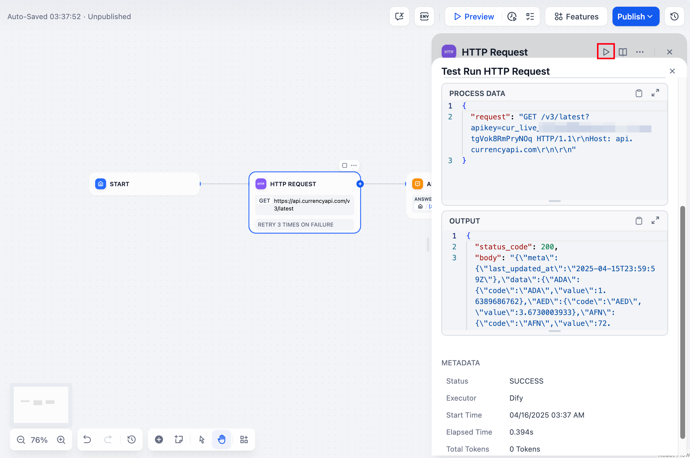
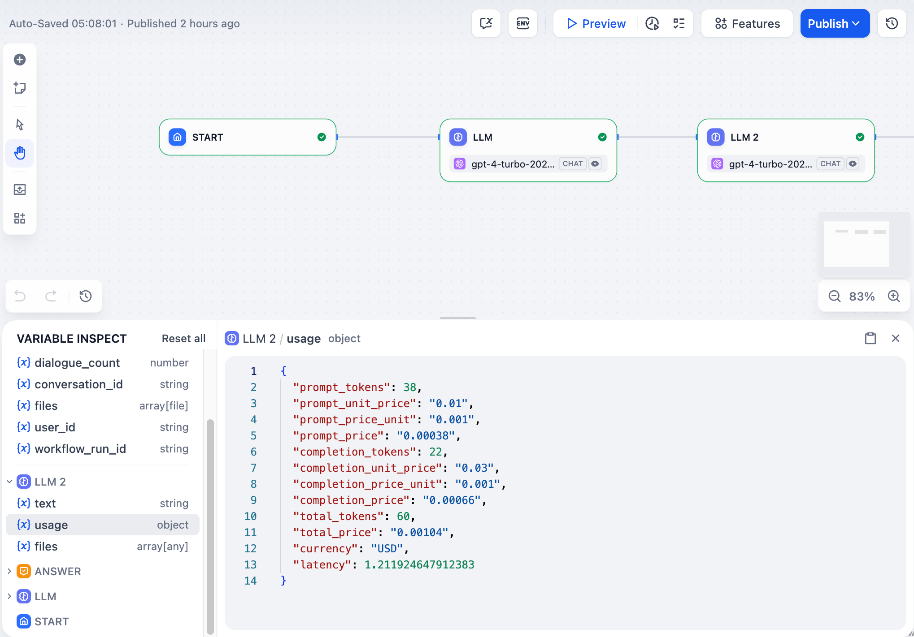
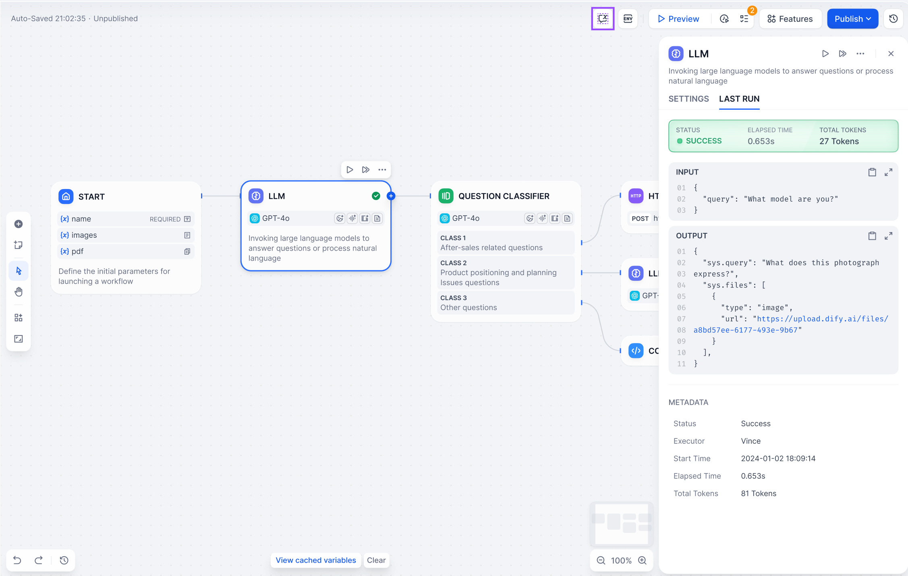

# 单节点

> 本文档由 AI 自动翻译。如有任何不准确之处，请参考 [英文原版](https://docs.dify.ai/en/cloud/use-dify/debug/step-run.md)。

测试单个节点或逐步运行你的工作流以在发布前发现问题。

## 单节点测试

你可以单独测试任何节点而无需运行整个工作流。选择节点，在其设置面板中提供测试输入，然后点击运行以查看输出。

测试后，点击"上次运行"查看执行详情，包括输入、输出、时间和任何错误消息。

> [!WARNING]
>
> 答案节点和结束节点不支持单节点测试。

## 逐步执行

当你一次运行一个节点时，它们的输出会缓存在变量检查器中。你可以编辑这些缓存的变量来测试不同场景，而无需重新运行上游节点。

当你想要测试节点如何响应不同数据而无需修改和重新运行它之前的所有节点时，这非常有用。只需在检查器中更改变量值并再次运行节点即可。

## 查看执行历史

每次节点执行都会创建一条记录。点击任何节点上的"上次运行"可查看其最近的执行详情，包括输入数据、输出内容以及执行时间。

