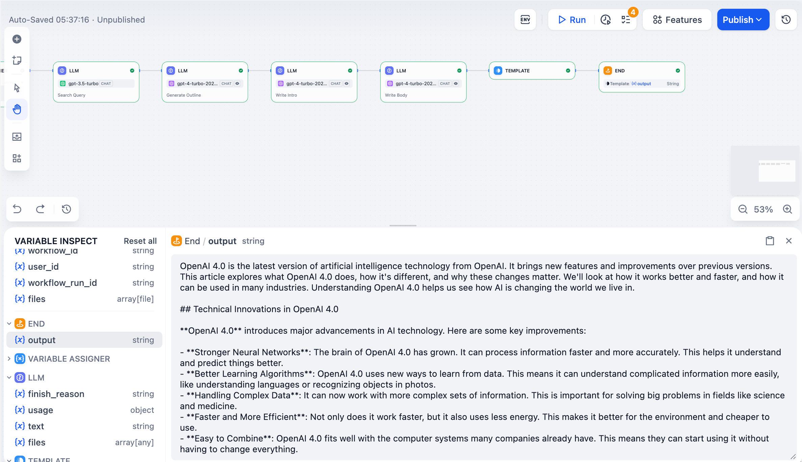
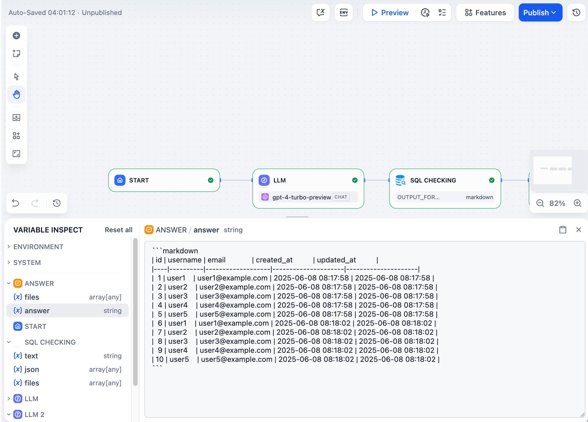
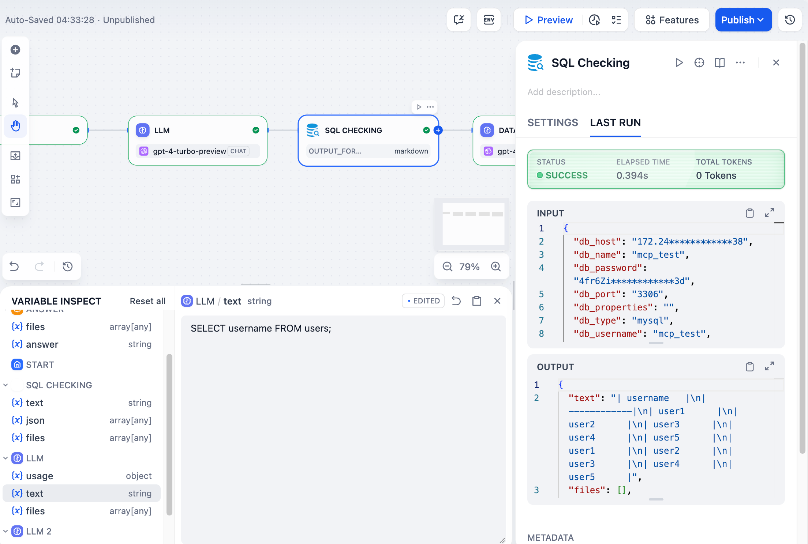
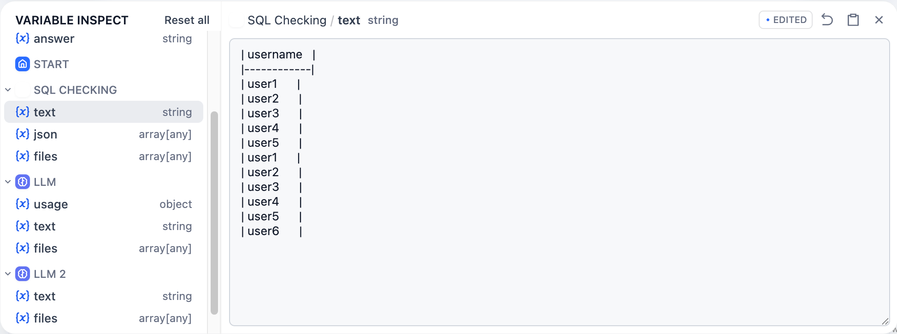

# 变量检查器

> 本文档由 AI 自动翻译。如有任何不准确之处，请参考 [英文原版](https://docs.dify.ai/en/cloud/use-dify/debug/variable-inspect.md)。

变量检查器显示所有流经你工作流的数据。它会在每个节点运行后捕获输入和输出，因此你可以查看正在发生的情况并测试不同的场景。

## 查看变量

任何节点运行后，其输出变量会出现在屏幕底部的检查器面板中。点击任何变量可查看其完整内容。

## 编辑变量

你可以通过点击大多数变量值来编辑它们。当你运行下游节点时，它们将使用你编辑的值而不是原始值。这让你可以测试不同场景，而无需重新运行整个工作流。

> [!NOTE]
>
> 在此处编辑变量不会更改最初创建它们的节点的"最后运行"记录。

例如，如果大型语言模型节点生成了像 `SELECT * FROM users` 这样的 SQL，你可以在检查器中将其编辑为 `SELECT username FROM users`，然后只重新运行数据库节点以查看不同的结果。

## 重置变量

点击任何变量旁边的还原图标以恢复其原始值，或点击"全部重置"以一次性清除所有缓存变量。

