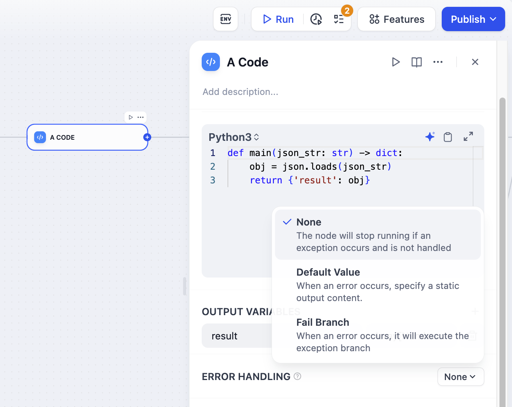
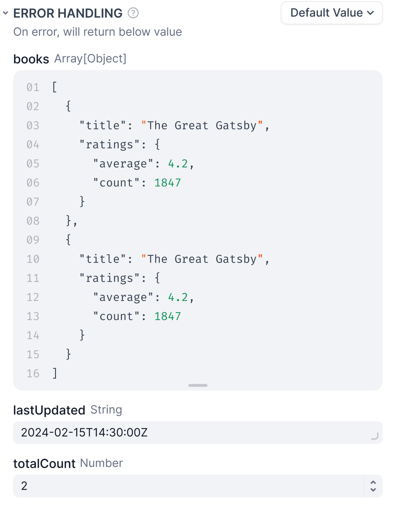
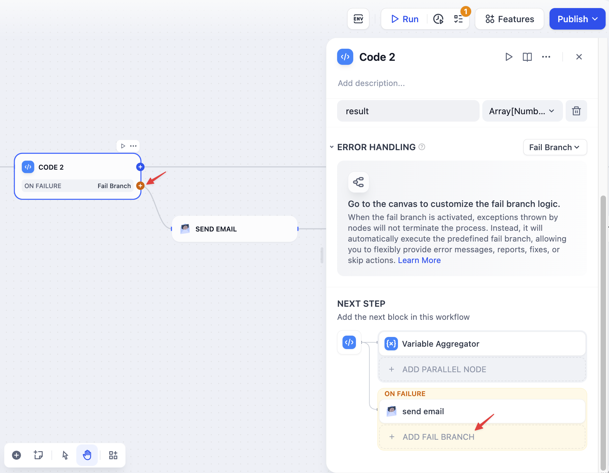

# 处理错误

> 本文档由 AI 自动翻译。如有任何不准确之处，请参考 [英文原版](https://docs.dify.ai/en/cloud/use-dify/build/predefined-error-handling-logic.md)。



[大型语言模型](../%E8%8A%82%E7%82%B9/%E5%A4%A7%E8%AF%AD%E8%A8%80%E6%A8%A1%E5%9E%8B.md)、[HTTP](../%E8%8A%82%E7%82%B9/HTTP%20%E8%AF%B7%E6%B1%82.md)、[代码](../%E8%8A%82%E7%82%B9/%E4%BB%A3%E7%A0%81.md) 和 [工具](../%E8%8A%82%E7%82%B9/%E5%B7%A5%E5%85%B7%E8%8A%82%E7%82%B9.md)
节点支持开箱即用的错误处理。当节点失败时，可以采用以下三种行为之一：

> [accordion] 无
>
> 默认行为。当节点失败时，整个工作流停止。你会收到原始错误消息。
>
> 适用于以下情况：
>
> * 正在测试并希望查看哪里出了问题
> * 工作流无法在没有此步骤的情况下继续

> [accordion] 默认值
>
> 当节点失败时，使用备用值代替。工作流继续运行。
>
> 
>
> **要求**
>
> * 默认值必须与节点的输出类型匹配，如果输出字符串，你的默认值也必须是字符串。
>
> **示例**
>
> 你的大型语言模型节点通常返回分析结果，但有时由于速率限制而失败。设置一个默认值，如：
>
> ```
> "抱歉，我暂时不可用。请几分钟后再试。"
> ```
>
> 现在用户会收到有用的消息，而不是损坏的工作流。

> [accordion] 失败分支
>
> 当节点失败时，触发一个单独的流程来处理错误。
>
> 
>
> 失败分支用橙色高亮显示。你可以：
>
> * 发送错误通知
> * 尝试不同的方法
> * 记录错误以进行调试
> * 使用备用服务
>
> **示例**
>
> 你的主 API 失败，因此失败分支调用备用 API。用户永远不会知道出现了问题。

## 循环/迭代节点中的错误

当子节点在循环和迭代中失败时，这些控制流节点有自己的错误行为。

**循环节点** 总是在任何子节点失败时立即停止。整个循环终止并返回错误，阻止任何进一步的迭代运行。

**迭代节点** 让你通过错误处理模式设置选择如何处理子节点失败：

* `terminated` - 当任何项目失败时立即停止处理（默认）
* `continue-on-error` - 跳过失败的项目并继续下一个
* `remove-abnormal-output` - 继续处理但从最终输出中过滤掉失败的项目

当你将迭代设置为 `continue-on-error` 时，失败的项目在输出数组中返回 `null`。当你使用 `remove-abnormal-output` 时，输出数组仅包含成功的结果，使其比输入数组更短。

## 错误变量

使用默认值或失败分支时，你会得到两个特殊变量：

* `error_type` - 发生了什么类型的错误（参见 [错误类型](%E9%94%99%E8%AF%AF%E7%B1%BB%E5%9E%8B.md)）
* `error_message` - 实际的错误详细信息

使用这些来：

* 向用户显示有用的消息
* 向你的团队发送警报
* 选择不同的恢复策略
* 记录错误以进行调试

**示例**

```text theme={null}

请求过多。请稍等片刻再试。

出了点问题。我们的团队已收到通知。

```
